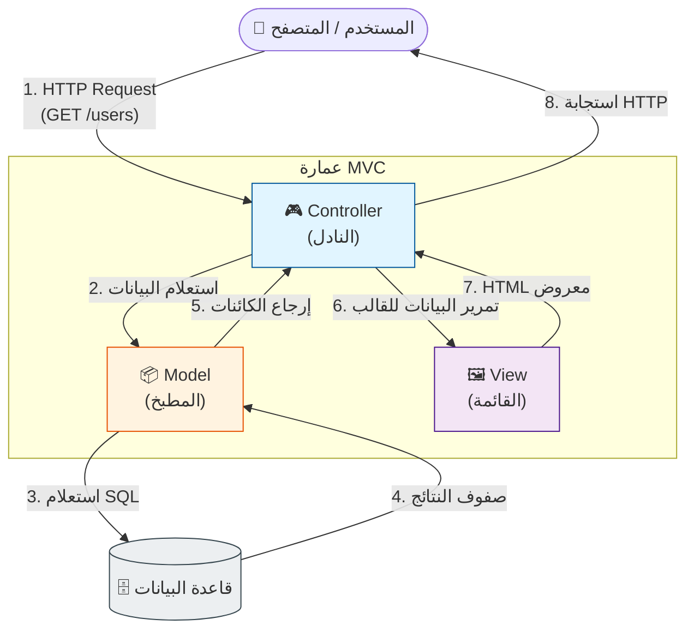
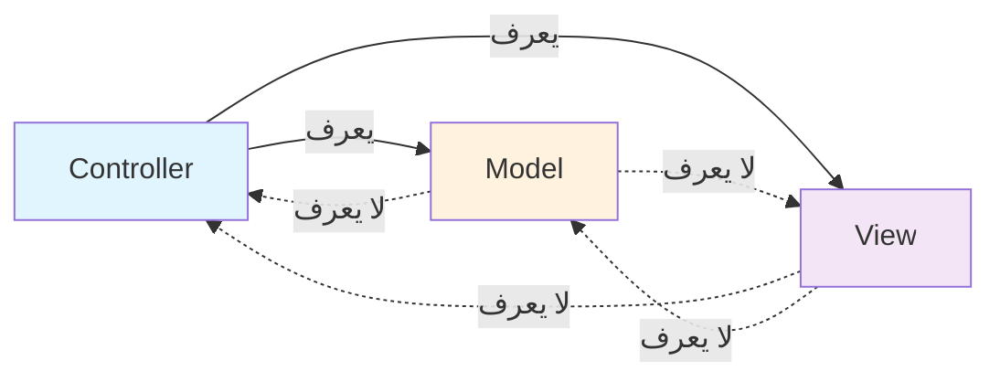
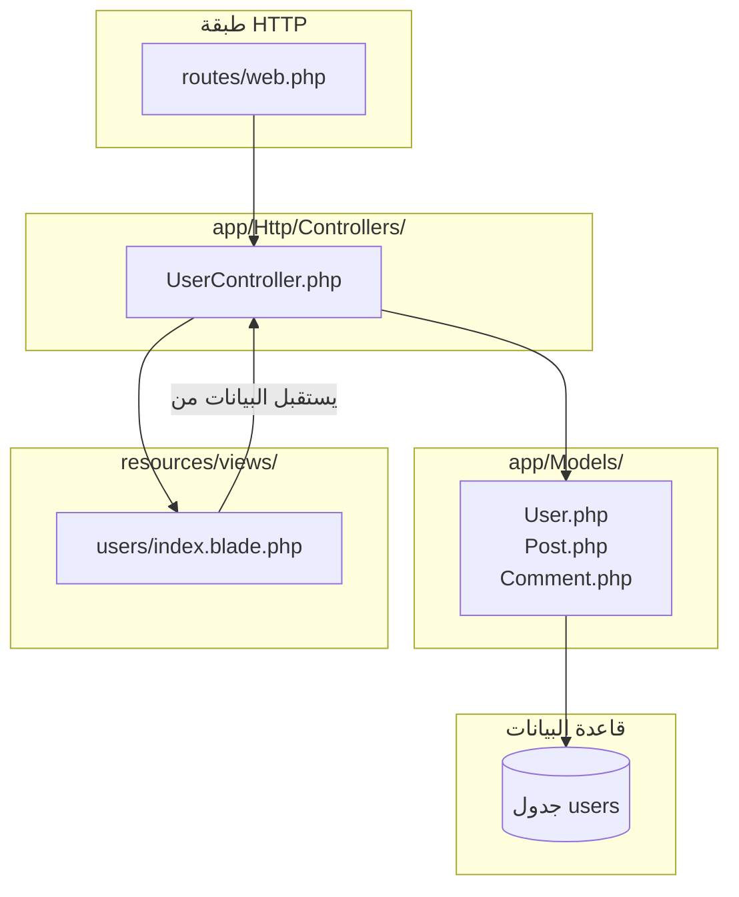

<div dir="rtl">

# الفصل 1: MVC — Model View Controller
## العمارة التي بدأت كل شيء

---

## 1. المشكلة قبل هذه العمارة

قبل MVC، كان تطوير الويب فوضى. دعني أعود بك إلى عام 1996، عندما كانت PHP/FI و Perl CGI scripts المبكرة تحكم العالم. كان "Hello World" يبدو هكذا:

```php
<?php
// index.php — التطبيق بالكامل
$name = $_GET['name'];
$db = mysql_connect("localhost", "root", "");
mysql_select_db("myapp");
$result = mysql_query("SELECT * FROM users WHERE name = '$name'");
$row = mysql_fetch_assoc($result);
echo "<html><body><h1>Hello " . $row['name'] . "</h1></body></html>";
mysql_close($db);
?>
```

هذا الملف الواحد كان لديه **كل مشكلة** يمكنك تخيلها:

### 😱 المشاكل

**1. الاهتمامات المتشابكة (Tangled Concerns)**
- HTML markup مختلط مع استعلامات قاعدة البيانات
- SQL مضمّن في منطق العرض
- قواعد الأعمال ("if user is admin") متناثرة في كل مكان
- ملف واحد يقوم بالإدخال والمعالجة والإخراج والتخزين

**2. الصيانة المستحيلة**
- تريد تغيير عمود قاعدة البيانات؟ ابحث في 200 ملف.
- تريد إعادة تصميم الصفحة؟ اعثر على كل استعلام SQL مدفون في HTML.
- تريد إضافة validation؟ أين؟ في HTML؟ في SQL؟

**3. لا قابلية لإعادة الاستخدام**
- تريد عرض قائمة المستخدمين في صفحة مختلفة؟ انسخ والصق الـ SQL و HTML.
- تريد استدعاء هذا من CLI؟ أعد كتابة كل شيء.

**4. كوابيس الأمان**
- لاحظ ثغرة SQL injection: `'$name'`. لم يكن هناك فصل بين مدخلات المستخدم والاستعلام، لذلك كانت هجمات الحقن منتشرة.
- لا مكان واضح لإضافة validation مركزي، أو sanitization، أو authentication.

**5. الاختبار المستحيل**
- لاختبار منطق "Hello"، كنت تحتاج قاعدة بيانات، و web server، و HTTP client.
- اختبارات Unit كما نعرفها لم تكن موجودة للويب.

**6. صراعات الفريق**
- المصممون لم يستطيعوا لمس HTML دون كسر SQL.
- DBAs لم يستطيعوا تحسين الاستعلامات دون لمس كود UI.
- الجميع يعدّل نفس الملفات، مما يسبب جحيم الدمج (merge hell).

**7. صفر تجريد**
- التغيير من MySQL إلى PostgreSQL يعني إعادة كتابة كل ملف.
- التبديل من HTML إلى إخراج PDF يعني إعادة كتابة كل ملف.
- التطبيق لم يكن لديه مفهوم "هذا مستخدم" — فقط "هذا صف في جدول".

**8. فخ "الذكي" (The "Smart" Trap)**
- مع نمو التطبيقات، كان المطورون ينشئون دوال مساعدة يتم تضمينها في كل مكان.
- الحالة العامة (`$_SESSION`, `$_GLOBALS`) تتسرب عبر التطبيق.
- لا شيء يمنعك من الوصول إلى قاعدة البيانات *أثناء* عرض HTML.

### ألم الصناعة

بحلول منتصف التسعينيات، كانت تطبيقات الويب تنمو من نصوص بسيطة إلى برامج أعمال جادة. كان الألم عالمياً:

> *"لا يمكنني إضافة ميزات دون كسر الموجودة. لا يمكنني اختبار أي شيء. لا يمكنني إعادة استخدام الكود. لا يمكنني وضع المصممين والمبرمجين في نفس قاعدة الكود."*

هذا الألم طالب بـ **فصل الاهتمامات (Separation of Concerns)**. كانت هناك ثلاث مسؤوليات متميزة متشابكة معاً:
- **البيانات (Data)** — كيف تُخزّن المعلومات وتُسترجع
- **العرض (Presentation)** — كيف تُعرض المعلومات
- **التنسيق (Coordination)** — كيف ترتبط البيانات والعرض بناءً على مدخلات المستخدم

هذه الاهتمامات الثلاثة كانت لها أسباب مختلفة للتغيير. البيانات تتغير عندما يتغير الـ schema. العرض يتغير عندما يتغير التصميم. التنسيق يتغير عندما تتغير سير عمل المستخدم. خلطها كان مصدر كل الألم.

---

## 2. لماذا اخترعت هذه العمارة

### السياق التاريخي

في عام 1979، **Trygve Reenskaug**، عالم كمبيوتر نرويجي كان يعمل في Xerox PARC على مشروع Smalltalk، صك مصطلح "Model-View-Controller". كتب ورقة بعنوان *"Models-Views-Controllers"*. دوافعه كانت محددة:

> *"الغرض الأساسي لـ MVC هو سد الفجوة بين النموذج الذهني للمستخدم البشري والنموذج الرقمي الموجود في الكمبيوتر. الحل المثالي لـ MVC يدعم المستخدم في رؤية والتلاعب بنموذجهم الذهني بوضوح."*

Smalltalk-80 (1980) كانت أول لغة تعمم MVC. كانت واجهة المستخدم الرسومية لسطح المكتب هي الحدود الجديدة. كانت التطبيقات تنتقل من معالجة الدفعات إلى نوافذ تفاعلية. ثلاث قوى طالبت بالبنية:

1. **طرق عرض متعددة لنفس البيانات** — رسم بياني، جدول، ونموذج كلها تعرض نفس البيانات. بدون فصل، ستكرر المنطق لكل واحد.

2. **التغذية الراجعة التفاعلية** — انقر صفاً في جدول، النموذج يملأ. غيّر النموذج، الجدول يتحدث. هذا تطلب نموذجاً ذهنياً *مدفوعاً بالأحداث* حيث يبقى الـ View والـ Model متزامنين.

3. **مكونات واجهة قابلة لإعادة الاستخدام** — زر، قائمة، حوار يجب أن تعمل بنفس الطريقة في كل مكان. المكونات احتاجت مسؤوليات معزولة.

### الفكرة الجوهرية

رؤية Reenskaug: **افصل "ماذا" (Model) عن "كيف يُعرض" (View) عن "إجراءات المستخدم" (Controller)**. الـ Model لا يعرف أنه يُعرض. الـ View لا يعرف من أين تأتي البيانات. الـ Controller ينسق الرقصة.

### لماذا غزت MVC الويب

في الألفينيات، أُطّر (frameworks) مثل Ruby on Rails (2004) و Laravel (2011، متأثراً بـ Symfony المتأثر بـ Rails) نقلت MVC إلى الويب. نموذج الويب عديم الحالة (stateless) لـ request/response كيفها:

- **Request** → **Controller** (يتعامل مع المدخلات)
- **Controller** → **Model** (يقرأ/يكتب البيانات)
- **Controller** → **View** (يعرض المخرجات)
- **View** → **المتصفح** (استجابة HTML)

لأول مرة، كان لدى مطوري الويب **نموذج ذهني** لتنظيم تطبيقاتهم. نفس فصل الاهتمامات الذي أنقذ Smalltalk أنقذ تطوير PHP و Ruby و Python و Java على الويب.

### عبقرية MVC

نجحت MVC لأنها حلت **المشكلة الأكثر شيوعاً** بـ **بنية دنيا**:
- ثلاثة مجلدات. ثلاث مسؤوليات. ثلاثة أسباب للتغيير.
- كل مطور يمكنه تعلمها في يوم.
- كل framework يمكنه تنفيذها بنفس الطريقة.

هذا هو سبب اعتماد Laravel و Symfony و Rails و Django و ASP.NET و Spring و Express جميعها لـ MVC. إنها **اللغة المشتركة** لـ web frameworks.

---

## 3. تشبيه من الحياة الواقعية

### 🍽️ المطعم

تخيل مطعم مزدحم:

- **القائمة (Menu)** = **View**
  - ما يراه العميل.
  - تصف ما هو متاح، مع الأوصاف والأسعار.
  - **لا تعرف** كيف يُطهى الطعام أو من أين تأتي المكونات.
  - يمكن إعادة تصميم القائمة (صور جديدة، تخطيط جديد) دون تغيير المطبخ.

- **المطبخ (Kitchen)** = **Model**
  - يخزّن المكونات (البيانات) ويحضّر الأطباق.
  - لا يعرف من يأكل أو كيف تبدو القائمة.
  - يمكن للشيف تغيير الموردين أو الوصفات أو التقنيات دون تغيير القائمة.
  - عندما ينفد مكون من المطبخ، يخبر النادل.

- **النادل (Waiter)** = **Controller**
  - يأخذ النادل طلب العميل (request).
  - يخبر النادل المطبخ بما يجب تحضيره.
  - يعيد النادل الطعام المحضر إلى العميل.
  - النادل هو الوحيد الذي يتفاعل مع كل من العميل والمطبخ.

### كيف يتدفق طلب العميل

1. يقرأ العميل **القائمة** (View) ويقرر ما يطلبه.
2. يخبر العميل **النادل** (Controller) بطلبه.
3. يذهب النادل إلى **المطبخ** (Model) ويقول "حضّر هذا".
4. يحضّر المطبخ الطعام (البحث/التلاعب بالبيانات).
5. يعيد النادل الطعام إلى العميل (response).
6. يرى العميل النتيجة في طبقه (View معروض).

### لماذا هذا التشبيه مثالي

- **القائمة لا تطبخ.** الـ View لا يستعلم قاعدة البيانات.
- **المطبخ لا يخدم.** الـ Model لا يعرض HTML.
- **فقط النادل يتحدث مع الاثنين.** فقط الـ Controller ينسق.

إذا أعدت تصميم القائمة، لا يلاحظ المطبخ. إذا غيرت الشيف، لا تتغير القائمة. إذا وظفت نادلاً جديداً، لا تُمَس القائمة والمطبخ. **يمكن لكل دور التطور باستقلال لأن المسؤوليات مفصولة.**

### 🔄 الرؤية التفاعلية (Push-and-Pull)

في **MVC الأصلي لـ Smalltalk**، كان الـ View *يراقب بنشاط* الـ Model ويعيد العرض عندما تتغير البيانات. هذا هو **Observer Pattern** في قلب MVC.

في **نسخة الويب**، لا يوجد اتصال مستمر. المستخدم يقدم طلباً، يحصل على استجابة، وتنتهي الدورة. لذلك يسحب الـ Controller البيانات يدوياً من الـ Model ويدفعها إلى الـ View. يُسمى هذا أحياناً **"Model 2 MVC"** أو **Web MVC**.

Laravel يستخدم Web MVC. الـ View هو *قالب* يستقبل البيانات، وليس *مراقباً* يتفاعل مع التغييرات.

---

## 4. الشرح البصري

### مثلث MVC



### اتجاه الاعتمادية



**القاعدة**: الـ Controller يعرف الـ Model والـ View. الـ Model لا يعرف شيئاً. الـ View لا يعرف شيئاً. الـ Controller هو المنسّق.

### ما يعيش أين (في Laravel)



---

## 5. دورة حياة الطلب (Request Lifecycle)

دعنا نتتبع طلباً حقيقياً: **"أرني قائمة المستخدمين في /users"**

### التدفق خطوة بخطوة

```
🌐 المتصفح: GET https://myapp.com/users
   ↓
📍 1. نقطة الدخول (public/index.php)
   - جميع الطلبات تدخل من خلال ملف واحد
   - يُشغّل تطبيق Laravel
   - ينشئ HTTP kernel
   ↓
🛣️ 2. التوجيه (routes/web.php)
   - يبحث Laravel عن route مطابق
   - Route::get('/users', [UserController::class, 'index'])
   - يربط الـ route بـ controller method
   ↓
🛡️ 3. الـ Middleware (اختياري)
   - يتحقق من CSRF token
   - يفحص الـ authentication
   - يسجّل الطلب
   - يطبق rate limiting
   ↓
🎮 4. الـ Controller (app/Http/Controllers/UserController.php)
   - يُنشئ Laravel UserController عبر DI
   - يستدعي method الـ index()
   - توقيع الـ method: public function index()
   ↓
📦 5. الـ Model (app/Models/User.php)
   - يستدعي الـ Controller User::all() أو User::paginate(10)
   - يترجم Eloquent الاستدعاء إلى SQL
   - SQL: SELECT * FROM users LIMIT 10
   ↓
🗄️ 6. قاعدة البيانات
   - تنفذ قاعدة البيانات الاستعلام
   - تُرجع الصفوف: [(1, 'Alice'), (2, 'Bob'), ...]
   ↓
📦 7. ترطيب Eloquent (Hydration)
   - تصبح الصفوف الخام كائنات User
   - أعمدة كل صف تصبح خصائص النموذج
   - تُحلّل تواريخ Carbon، تُطبق casts
   ↓
🎮 8. الـ Controller يُرجع View
   - return view('users.index', ['users' => $users])
   - يمرر الـ Controller البيانات لقالب الـ view
   ↓
🖼️ 9. عرض الـ View (resources/views/users/index.blade.php)
   - يُترجم محرك Blade القالب إلى PHP
   - تُستخرج المتغيرات: $users متاحة
   - يُولّد HTML مع حلقات @foreach
   ↓
🌐 10. استجابة HTTP
   - يلتف Laravel الـ HTML في كائن Response
   - يضيف headers (Content-Type, cookies, إلخ)
   - يُرسل من خلال الـ kernel
   ↓
🌐 المتصفح: يستقبل HTML، يعرض الصفحة
```

### ماذا يحدث مع إرسال نموذج (Form)

```
🌐 المتصفح: POST https://myapp.com/users
   Form data: { name: "Alice", email: "alice@example.com" }
   ↓
📍 1. نقطة الدخول + التوجيه
   - Route::post('/users', [UserController::class, 'store'])
   ↓
🛡️ 2. الـ Middleware
   - تم التحقق من CSRF token
   - يجب أن يكون المستخدم مصادقاً
   ↓
🎮 3. الـ Controller: store(Request $request)
   - يحقن Laravel كائن Request
   - $request->validated() يُرجع البيانات المنظفة
   ↓
📦 4. إنشاء الـ Model
   - $user = User::create([...])
   - يبني Eloquent: INSERT INTO users ...
   ↓
🗄️ 5. قاعدة البيانات
   - يُدرج الصف، يُرجع auto-increment ID
   ↓
📦 6. Eloquent
   - يُعيّن ID على النموذج
   - تُعيّن created_at/updated_at تلقائياً
   ↓
🎮 7. استجابة الـ Controller
   - return redirect()->route('users.show', $user)
   - أو: return response()->json($user, 201)
   ↓
🌐 المتصفح: يُعاد توجيهه إلى /users/123، يرى ملف Alice
```

---

## 6. هيكل المجلدات

### تخطيط Laravel MVC الكلاسيكي

```
app/
├── Http/
│   └── Controllers/
│       ├── Controller.php           ← الـ Controller الأساسي (Laravel 11+)
│       ├── UserController.php       ← 🎮 طلبات متعلقة بالمستخدمين
│       ├── PostController.php       ← 🎮 طلبات متعلقة بالمقالات
│       └── ProductController.php    ← 🎮 طلبات متعلقة بالمنتجات
│
├── Models/
│   ├── User.php                     ← 📦 نموذج Eloquent للمستخدمين
│   ├── Post.php                     ← 📦 نموذج Eloquent للمقالات
│   └── Product.php                  ← 📦 نموذج Eloquent للمنتجات
│
├── Providers/
│   └── AppServiceProvider.php       ← ربط service container
│
└── ...

bootstrap/
├── app.php                          ← إقلاع التطبيق (Laravel 11+)
└── ...

config/
├── app.php                          ← إعدادات التطبيق
├── database.php                     ← إعدادات قاعدة البيانات
└── ...

database/
├── migrations/
│   ├── 2024_01_01_000000_create_users_table.php
│   └── 2024_01_02_000000_create_posts_table.php
│
├── seeders/
│   └── DatabaseSeeder.php
│
└── factories/
    └── UserFactory.php

public/
├── index.php                        ← نقطة الدخول الواحدة
└── assets/                          ← CSS, JS, images

resources/
├── views/
│   ├── layouts/
│   │   └── app.blade.php            ← القالب الرئيسي
│   ├── users/
│   │   ├── index.blade.php          ← قائمة المستخدمين
│   │   ├── show.blade.php           ← مستخدم واحد
│   │   └── create.blade.php         ← نموذج
│   └── posts/
│       └── ...
│
└── css/, js/

routes/
├── web.php                          ← routes الويب (جلسة)
├── api.php                          ← routes الـ API (بلا حالة)
└── console.php                      ← أوامر Artisan

storage/
├── app/                             ← مرفوعات المستخدم
├── framework/                       ← الكاش، الجلسات
└── logs/                            ← سجلات الأخطاء

tests/
├── Feature/                         ← اختبارات HTTP كاملة
└── Unit/                            ← اختبارات unit معزولة
```

### لماذا يوجد كل مجلد

| المجلد | الغرض | لماذا يوجد |
|--------|-------|------------|
| `app/Http/Controllers/` | جميع Controller classes | مجمّعة حسب معالجة الطلب، منفصلة عن منطق الأعمال |
| `app/Models/` | جميع Eloquent models | مجلد واحد لـ "M" في MVC؛ يمكن لـ Eloquent اكتشافه عبر namespace |
| `app/Providers/` | ربط service container | مركزية كيفية حل Laravel للاعتمادات |
| `bootstrap/` | إقلاع التطبيق | التمديد الذي يبدأ Laravel |
| `config/` | ملفات الإعداد | كل إعدادات التطبيق في مكان واحد، مدركة للبيئة |
| `database/migrations/` | تعريفات Schema | تحكم إصدار لقاعدة البيانات |
| `database/seeders/` | بيانات عينة | للتطوير/الاختبار |
| `database/factories/` | مولدات بيانات اختبار | Faker-powered model factories |
| `public/` | جذر الويب | المجلد الوحيد المكشوف للويب؛ يحتوي نقطة الدخول |
| `resources/views/` | قوالب Blade | "V" في MVC؛ تُترجم عند التخزين المؤقت |
| `routes/` | تعريفات URL | تعيين URLs إلى controllers/closures |
| `storage/` | الملفات المولّدة | السجلات، الكاش، الجلسات، المرفوعات |
| `tests/` | اختبارات آلية | تعكس بنية التطبيق لسهولة التنقل |

### تعيين MVC

```
URL            → routes/web.php
Controller     → app/Http/Controllers/
Model          → app/Models/
View           → resources/views/
Database       → database/
```

---

## 7. مثال Laravel كامل

### 🏥 السيناريو: نظام إدارة مستشفى

سنبني نظاماً بسيطاً لإدارة المرضى: قائمة، عرض، إنشاء مرضى.

### الخطوة 1: الـ Model (app/Models/Patient.php)

```php
<?php

namespace App\Models;

use Illuminate\Database\Eloquent\Factories\HasFactory;
use Illuminate\Database\Eloquent\Model;
use Illuminate\Database\Eloquent\Relations\HasMany;

class Patient extends Model
{
    use HasFactory;

    /**
     * الجدول المرتبط بالنموذج.
     * (اختياري — Laravel سيستنتج 'patients' من اسم الكلاس)
     */
    protected $table = 'patients';

    /**
     * الخصائص القابلة للتعبئة الجماعية.
     * هذه الأعمدة التي يمكنك ملؤها عبر Patient::create([...]).
     */
    protected $fillable = [
        'name',
        'email',
        'date_of_birth',
        'medical_record_number',
    ];

    /**
     * تحويل الخصائص (Attribute Casting).
     * date_of_birth يصبح instance من Carbon، وليس string.
     */
    protected $casts = [
        'date_of_birth' => 'date',
    ];

    /**
     * العلاقة: المريض لديه مواعيد كثيرة.
     */
    public function appointments(): HasMany
    {
        return $this->hasMany(Appointment::class);
    }
}
```

**ماذا يحدث:**
- الـ Model يمثل مريضاً واحداً في قاعدة البيانات.
- `$fillable` هي ميزة أمان: فقط الأعمدة المدرجة يمكن تعيينها جماعياً.
- `$casts` يحوّل تلقائياً قيم قاعدة البيانات الخام إلى أنواع PHP.
- `appointments()` هي علاقة Eloquent — الـ Model يعرف بياناته المرتبطة.

### الخطوة 2: الـ Migration (database/migrations/..._create_patients_table.php)

```php
<?php

use Illuminate\Database\Migrations\Migration;
use Illuminate\Database\Schema\Blueprint;
use Illuminate\Support\Facades\Schema;

return new class extends Migration
{
    public function up(): void
    {
        Schema::create('patients', function (Blueprint $table) {
            $table->id();
            $table->string('name');
            $table->string('email')->unique();
            $table->date('date_of_birth');
            $table->string('medical_record_number')->unique();
            $table->timestamps();
        });
    }

    public function down(): void
    {
        Schema::dropIfExists('patients');
    }
};
```

### الخطوة 3: الـ Controller (app/Http/Controllers/PatientController.php)

```php
<?php

namespace App\Http\Controllers;

use App\Models\Patient;
use Illuminate\Http\Request;
use Illuminate\View\View;
use Illuminate\Http\RedirectResponse;

class PatientController extends Controller
{
    /**
     * عرض قائمة بجميع المرضى.
     * GET /patients
     */
    public function index(): View
    {
        $patients = Patient::latest()->paginate(15);

        return view('patients.index', [
            'patients' => $patients,
        ]);
    }

    /**
     * عرض نموذج إنشاء مريض جديد.
     * GET /patients/create
     */
    public function create(): View
    {
        return view('patients.create');
    }

    /**
     * تخزين مريض تم إنشاؤه حديثاً في التخزين.
     * POST /patients
     */
    public function store(Request $request): RedirectResponse
    {
        $validated = $request->validate([
            'name'                  => ['required', 'string', 'max:255'],
            'email'                 => ['required', 'email', 'unique:patients,email'],
            'date_of_birth'         => ['required', 'date', 'before:today'],
            'medical_record_number' => ['required', 'string', 'unique:patients'],
        ]);

        Patient::create($validated);

        return redirect()
            ->route('patients.index')
            ->with('success', 'تم تسجيل المريض بنجاح.');
    }

    /**
     * عرض مريض محدد.
     * GET /patients/{patient}
     */
    public function show(Patient $patient): View
    {
        return view('patients.show', [
            'patient' => $patient,
        ]);
    }
}
```

**ماذا يحدث:**
- كل method يقابل route (index, create, store, show).
- `Patient::latest()->paginate(15)` يستعلم قاعدة البيانات من خلال Eloquent.
- `$request->validate(...)` يتحقق ويُرجع البيانات المنظفة.
- `Patient $patient` هو **route model binding** — يجد Laravel المريض بالـ ID تلقائياً.
- يُرجع الـ Controller View لطلبات GET و redirect لـ POST.

### الخطوة 4: الـ View (resources/views/patients/index.blade.php)

```blade
@extends('layouts.app')

@section('title', 'المرضى')

@section('content')
<div class="container">
    <h1>المرضى</h1>

    @if (session('success'))
        <div class="alert alert-success">
            {{ session('success') }}
        </div>
    @endif

    <a href="{{ route('patients.create') }}" class="btn btn-primary">
        تسجيل مريض جديد
    </a>

    <table class="table">
        <thead>
            <tr>
                <th>الاسم</th>
                <th>البريد الإلكتروني</th>
                <th>تاريخ الميلاد</th>
                <th>الرقم الطبي</th>
                <th>الإجراءات</th>
            </tr>
        </thead>
        <tbody>
            @forelse ($patients as $patient)
                <tr>
                    <td>{{ $patient->name }}</td>
                    <td>{{ $patient->email }}</td>
                    <td>{{ $patient->date_of_birth->format('Y-m-d') }}</td>
                    <td>{{ $patient->medical_record_number }}</td>
                    <td>
                        <a href="{{ route('patients.show', $patient) }}">
                            عرض
                        </a>
                    </td>
                </tr>
            @empty
                <tr>
                    <td colspan="5">لا يوجد مرضى.</td>
                </tr>
            @endforelse
        </tbody>
    </table>

    {{ $patients->links() }}
</div>
@endsection
```

**ماذا يحدث:**
- `@extends('layouts.app')` يستخدم قالب رئيسي.
- `{{ $patient->name }}` يطبع HTML مهرب (آمن من XSS).
- `@forelse` يتكرر ويتعامل مع الحالة الفارغة.
- `$patients->links()` يعرض روابط التصفح.

### الخطوة 5: الـ Route (routes/web.php)

```php
<?php

use App\Http\Controllers\PatientController;
use Illuminate\Support\Facades\Route;

Route::get('/', fn () => view('welcome'));

Route::resource('patients', PatientController::class);
```

**ماذا يحدث:**
- `Route::resource()` ينشئ 7 routes دفعة واحدة:
  - `GET /patients` → `index`
  - `GET /patients/create` → `create`
  - `POST /patients` → `store`
  - `GET /patients/{patient}` → `show`
  - `GET /patients/{patient}/edit` → `edit`
  - `PUT /patients/{patient}` → `update`
  - `DELETE /patients/{patient}` → `destroy`

### الخطوة 6: القالب الرئيسي (resources/views/layouts/app.blade.php)

```blade
<!DOCTYPE html>
<html lang="ar" dir="rtl">
<head>
    <meta charset="UTF-8">
    <meta name="viewport" content="width=device-width, initial-scale=1.0">
    <title>@yield('title') — نظام المستشفى</title>
    <style>
        body { font-family: system-ui, sans-serif; margin: 0; }
        nav { background: #1976d2; color: white; padding: 1rem; }
        nav a { color: white; margin-right: 1rem; text-decoration: none; }
        .container { max-width: 1100px; margin: 2rem auto; padding: 0 1rem; }
    </style>
</head>
<body>
    <nav>
        <a href="/">الرئيسية</a>
        <a href="{{ route('patients.index') }}">المرضى</a>
    </nav>

    <main class="container">
        @yield('content')
    </main>
</body>
</html>
```

### الخطوة 7: الـ Factory (database/factories/PatientFactory.php)

```php
<?php

namespace Database\Factories;

use App\Models\Patient;
use Illuminate\Database\Eloquent\Factories\Factory;

class PatientFactory extends Factory
{
    protected $model = Patient::class;

    public function definition(): array
    {
        return [
            'name'                  => $this->faker->name(),
            'email'                 => $this->faker->unique()->safeEmail(),
            'date_of_birth'         => $this->faker->dateTimeBetween('-80 years', '-1 year'),
            'medical_record_number' => 'MRN-' . $this->faker->unique()->numberBetween(10000, 99999),
        ];
    }
}
```

---

## 8. شرح عميق

### كيف تتدفق البيانات عبر MVC

دعنا نتتبع **تخزين** مريض جديد مرة أخرى، بوضوح كامل:

```
┌──────────────────────────────────────────────────────────────┐
│ 1. المتصفح (HTML form)                                       │
│    المستخدم يملأ: <input name="name" value="Alice">           │
│    <input name="email" value="alice@example.com">            │
│    يُرسل: POST /patients                                     │
└──────────────────────────────────────────────────────────────┘
                          ↓
┌──────────────────────────────────────────────────────────────┐
│ 2. Laravel Kernel (public/index.php)                         │
│    - يُشغّل الـ framework                                     │
│    - ينشئ كائن Request من $_POST, $_GET, headers             │
│    - يحمّل الإعدادات، providers، facades                     │
└──────────────────────────────────────────────────────────────┘
                          ↓
┌──────────────────────────────────────────────────────────────┐
│ 3. الموجه (Router) (routes/web.php)                           │
│    - يطابق POST /patients مع PatientController@store          │
│    - يطبق middleware: مجموعة web (الجلسة، CSRF)              │
└──────────────────────────────────────────────────────────────┘
                          ↓
┌──────────────────────────────────────────────────────────────┐
│ 4. خط أنابيب الـ Middleware                                   │
│    - VerifyCsrfToken: ✓ token صالح                           │
│    - StartSession: تم تحميل الجلسة                          │
│    - ShareErrorsFromSession: متاح للـ views                  │
│    → Controller::store($request) يُستدعى                     │
└──────────────────────────────────────────────────────────────┘
                          ↓
┌──────────────────────────────────────────────────────────────┐
│ 5. الـ Controller (PatientController@store)                  │
│    - $validated = $request->validate([...])                  │
│      → يرمي ValidationException إذا فشلت القواعد            │
│      → يُرجع مصفوفة منظفة إذا نجحت كلها                    │
│    - Patient::create($validated)                             │
│      → استدعاء Eloquent static → INSERT INTO patients        │
└──────────────────────────────────────────────────────────────┘
                          ↓
┌──────────────────────────────────────────────────────────────┐
│ 6. Eloquent (app/Models/Patient.php)                         │
│    - new static(); يعيّن $attributes = $validated            │
│    - save() → SQL: INSERT INTO patients (name, email, ...)   │
│    - يُرجع: INSERT id 123، يملأ $patient->id                │
│    - يُطلق أحداث: حدث 'created'                             │
└──────────────────────────────────────────────────────────────┘
                          ↓
┌──────────────────────────────────────────────────────────────┐
│ 7. قاعدة البيانات                                            │
│    - تستقبل عبارة INSERT                                     │
│    - تكتب الصف، تُرجع 1 (الصفوف المتأثرة) وآخر ID           │
└──────────────────────────────────────────────────────────────┘
                          ↓
┌──────────────────────────────────────────────────────────────┐
│ 8. Eloquent يُرجع Patient                                    │
│    - $patient الآن هو كائن Patient بـ id=123                  │
│    - تم تحويل جميع الخصائص المُـcast (التواريخ → Carbon)     │
└──────────────────────────────────────────────────────────────┘
                          ↓
┌──────────────────────────────────────────────────────────────┐
│ 9. استجابة الـ Controller                                    │
│    - return redirect()->route('patients.show', $patient)     │
│    - يبني هذا RedirectResponse بـ header Location            │
│    - يضيف 'success' للجلسة                                   │
└──────────────────────────────────────────────────────────────┘
                          ↓
┌──────────────────────────────────────────────────────────────┐
│ 10. الـ Kernel يُرسل الاستجابة                               │
│    - HTTP/1.1 302 Found                                      │
│    - Location: https://myapp.com/patients/123                │
│    - Set-Cookie: laravel_session=...                         │
└──────────────────────────────────────────────────────────────┘
                          ↓
┌──────────────────────────────────────────────────────────────┐
│ 11. المتصفح يتبع إعادة التوجيه                              │
│    - GET /patients/123                                       │
│    - تتكرر الدورة لصفحة show                                │
└──────────────────────────────────────────────────────────────┘
```

### لماذا تشير الاعتمادات حيث تشير

في MVC الصارم، القواعد هي:

| الطبقة | تعرف عن | لا تعرف عن |
|--------|---------|------------|
| **Model** | قاعدة البيانات، نفسها | Controller، View، HTTP |
| **View** | نفسها، البيانات الممررة إليها | Model، Controller، قاعدة البيانات |
| **Controller** | Model، View، Request، Response | تفاصيل تنفيذ الطبقات الداخلية |

**لماذا؟**

- **الـ Model لا يعرف عن الـ Controller** لأن البيانات يجب أن توجد باستقلال عن أي UI. يمكن إرجاع نفس Patient كـ JSON (API)، HTML (ويب)، أو PDF (تقرير).
- **الـ View لا يعرف عن الـ Model** لأن الـ View يستقبل البيانات كمعلمات، وليس باستعلام قاعدة البيانات. هذا يسمح بإعادة استخدام نفس الـ View مع بيانات وهمية في الاختبارات.
- **الـ Controller يعرف الاثنين** لأنه المنسّق. يستقبل المدخلات، يطلب البيانات من الـ Model، ويمرر النتيجة إلى View.

### ماذا يحدث إذا كسرنا القواعد

**❌ سيء: Model يعرف عن Request**

```php
class Patient extends Model
{
    public function saveFromRequest(Request $request)
    {
        $this->name = $request->input('name');
        $this->save();
    }
}
```

الآن نموذجك يعتمد على HTTP. لا يمكنك إعادة استخدام هذا النموذج من:
- أمر CLI (`php artisan patient:create Alice`)
- job في الطابور
- اختبار لا يمر عبر HTTP
- endpoint API يستخدم validation مختلف للمدخلات

**❌ سيء: View يستعلم قاعدة البيانات مباشرة**

```blade
@foreach (\App\Models\Patient::all() as $patient)
    <li>{{ $patient->name }}</li>
@endforeach
```

الآن View مقترن بـ:
- اتصال قاعدة البيانات
- كلاس Patient
- Eloquent

لا يمكنك عرض نفس القالب ببيانات وهمية. لا يمكنك تغيير مصدر البيانات دون تعديل القالب.

**❌ سيء: Controller يفعل منطق الأعمال**

```php
public function store(Request $request)
{
    $patient = new Patient();
    $patient->name = $request->name;

    // ❌ قاعدة أعمال مدفونة في الـ controller
    if ($patient->date_of_birth->age < 18) {
        return back()->withErrors(['msg' => 'يجب أن يكون 18+']);
    }

    $patient->save();
}
```

الآن قاعدة "يجب أن يكون 18" في الـ Controller. إذا أضفت أمر CLI لإنشاء مرضى، يجب أن تتذكر تكرار هذا الفحص. إذا أضفت قاعدة "الحد الأقصى للعمر 120"، يجب أن تجد كل مكان ينشئ مرضى. **قواعد الأعمال تنتمي في مكان واحد.**

### الـ "M" في MVC غالباً ما يساء فهمها

في **MVC الأصلي لـ Smalltalk**، كان الـ Model كائن مجال يُنبّه الـ Views للتغييرات. في **MVC الويب**، أصبح "Model" تعني شيئين:
- **Domain Model**: كيان الأعمال (Patient, Order, Invoice)
- **Data Model**: التمثيل في قاعدة البيانات

Eloquent في Laravel يطمس هذين بإعطائك كلاساً واحداً يفعل الاثنين. هذا ملائم لكنه يمكن أن يؤدي إلى:
- نماذج ضخمة (Fat Models) (الفصل 2 سيستكشف هذا)
- خلط منطق الأعمال بالاستمرارية
- اقتران وثيق بين الـ schema والسلوك

هذا بالضبط لماذا اخترعت **Service Layers** و **Domain Layers** (الفصول التالية).

---

## 9. المزايا

### ✅ 1. البساطة
ثلاثة مجلدات. ثلاثة أدوار. أي مطور يمكنه الانضمام خلال ساعات. هناك سبب يجعل كل framework يتبنى MVC: إنه يعمل.

### ✅ 2. نموذج ذهني واضح
دائماً تعرف أين تضع الكود:
- منطق طلب HTTP → Controller
- بنية البيانات / الاستعلامات → Model
- العرض → View

### ✅ 3.Convention Over Configuration
`Route::resource()` في Laravel ينشئ 7 routes. `Patient::paginate(15)` يصفح بإعدادات افتراضية معقولة. تكتب كوداً أقل.

### ✅ 4. النمذجة السريعة (Fast Prototyping)
يمكنك بناء تطبيق CRUD في دقائق. `::create()`، `::find()`، `::update()`، `::delete()` في Eloquent هي 4 أسطر لميزة كاملة.

### ✅ 5. أدوات ممتازة
أدوات Laravel من الدرجة الأولى (Tinker, Eloquent, Blade, migrations) مصممة لـ MVC. تعمل معاً بسلاسة.

### ✅ 6. قابلية الاختبار المحسنة
يمكنك اختبار Controller بـ feature tests، Model بـ unit tests، و View بـ snapshot tests.

### ✅ 7. تعيين URL → ملف
الـ Routes تقابل مباشرة methods الـ Controller. يمكنك التنقل من URL إلى الكود فوراً.

### ✅ 8. المجتمع والموارد
 almost كل درس Laravel، package، وإجابة Stack Overflow تفترض MVC. لديك محيط من المساعدة.

### ✅ 9. العرض من جانب الخادم (SSR)
قوالب Blade تنتج HTML على الخادم. SEO، لا حاجة لـ JS، رسم أول سريع.

### ✅ 10. لا تعتمد على قاعدة بيانات
غيّر `DB_CONNECTION` من `mysql` إلى `pgsql` في `.env`، وEloquent يتعامل مع الباقي. الـ Model لا يهتم.

---

## 10. العيوب

### ❌ 1. Controllers ضخمة (Fat Controllers)
مع نمو الميزات، تتراكم في الـ Controllers:
- Validation
- منطق الأعمال
- استعلامات قاعدة البيانات
- إرسال البريد
- إطلاق الأحداث
- التسجيل
- استدعاءات API

method `store()` بطول 50 سطر يصبح 500 سطر. هذا هو **السبب الأول** الذي يجعل الفرق تتخطى MVC.

### ❌ 2. Models ضخمة (Fat Models)
كلاس `Patient` في Eloquent يصبح مكباً للنفايات:
- العلاقات
- accessors/mutators
- scopes
- methods الأعمال (`isEligibleForSurgery()`)
- methods الاستعلام
- منطق boot

Model بطول 200 سطر يصبح 2000 سطر. Active Record (الذي هو Eloquent) لا يفصل بشكل طبيعي *ما هي البيانات* عن *ماذا تفعل البيانات*.

### ❌ 3. اقتران وثيق بـ Eloquent
MVC في Laravel = Controller مقترن بشدة بـ Eloquent. محاكاة Eloquent لاختبارات unit مؤلمة. لا يمكنك بسهولة التبديل إلى MongoDB، تخزين ملفات، أو API خارجي دون إعادة كتابة Controller.

### ❌ 4. منطق الأعمال بلا منزل
أين تذهب قاعدة "المريض تحت 18 يحتاج ولي أمر"؟
- Controller؟ Controller ضخم.
- Model؟ Model ضخم.
- View؟ طبقة خاطئة.
- Helper function؟ لا مكان مركزي.
- لا مكان؟ تكرار الكود.

### ❌ 5. الاختبار يتطلب قاعدة بيانات
تريد اختبار أن Controller يعمل؟ تحتاج قاعدة بيانات. `RefreshDatabase` يعمل، لكنه بطيء والاختبارات تفشل عند تغيير الـ schema. اختبارات unit الحقيقية (بلا DB) صعبة.

### ❌ 6. لا دعم للمجالات المعقدة
في البنوك، عملية "تحويل الأموال" تتضمن:
- التحقق من الحسابات
- فحص الرصيد
- إنشاء transaction
- تحديث كلا الحسابين
- التدقيق
- الإشعارات

في MVC، هذا 50 سطر في Controller. مع تراكم العمليات، يصبح Controller كائن إله.

### ❌ 7. قابلية إعادة الاستخدام محدودة
تريد "إنشاء مريض" من:
- نموذج ويب
- أمر CLI
- job في الطابور (استيراد CSV)
- endpoint API
- مهمة مجدولة

MVC يقول: اكتب Controller لكل واحدة. منطق الأعمال الفعلي مكرر في كل Controller.

### ❌ 8. الاهتمامات الشاملة (Cross-Cutting Concerns) محرجة
- تسجيل كل save
- إرسال رسائل بريد عند أحداث محددة
- تخزين نتائج الاستعلام مؤقتاً
- rate limiting

في MVC، هذه متناثرة كـ middleware، model events، observers، أو inline في Controllers. لا توجد آلية مركزية "قبل كل save، افعل X".

### ❌ 9. لا حدود للمعاملات
أين تلتف بـ `DB::beginTransaction()`؟ في Controller؟ ثم يجب على أمر CLI أن يتذكر القيام بذلك أيضاً. في Model؟ ثم يعرف Model عن المعاملات، مما يتسرب.

### ❌ 10. لا يتوسع مع حجم الفريق
10 مطورين يعدلون `PatientController.php` = تعارضات دمج. لا توجد طريقة لتقسيم "ميزات المريض" عبر ملفات متعددة بوضوح.

### ❌ 11. تسرب منطق View
يسمح Blade بـ `{{ auth()->user()->can('edit', $patient) ? 'Edit' : '' }}` — لكن هذا منطق أعمال في View. الآن View لديه قواعد تفويض.

### ❌ 12. لا لغة مجال
في البنوك، لديك "تحويلات"، "دفاتر الأستاذ"، "مطابقات". في MVC، لديك `TransferController`، `LedgerController`، `ReconciliationController`. مفاهيم المجال ليست مواطنين من الدرجة الأولى.

---

## 11. الأخطاء الشائعة

### ❌ الخطأ 1: منطق الأعمال في Controllers

**الفخ:**
```php
public function store(Request $request)
{
    $patient = Patient::create($request->all());

    // ❌ قاعدة أعمال في الـ controller
    if ($patient->age < 18) {
        $patient->requires_guardian = true;
        $patient->save();
    }

    // ❌ تأثير جانبي في الـ controller
    Mail::to($patient->email)->send(new WelcomeMail($patient));

    return redirect()->route('patients.show', $patient);
}
```

**لماذا يحدث:** إنه المكان الأسهل لكتابة الكود عندما تنمذج.

**التكلفة:** يجب تذكر قاعدة "المريض تحت 18 يحتاج ولي أمر" في كل مكان يُنشأ فيه مريض. يجب إرسال البريد في كل مكان. **التكرار هو جذر الأخطاء.**

### ❌ الخطأ 2: منطق الاستعلام في Controllers

**الفخ:**
```php
public function index(Request $request)
{
    // ❌ استعلام معقد في الـ controller
    $patients = Patient::where('active', true)
        ->where('created_at', '>=', now()->subDays(30))
        ->whereHas('appointments', function ($q) {
            $q->where('scheduled_at', '>=', now());
        })
        ->with('doctor')
        ->orderBy('name')
        ->paginate(20);

    return view('patients.index', compact('patients'));
}
```

**لماذا يحدث:** Eloquent يجعل من السهل ربط methods inline.

**التكلفة:** استعلام "المرضى النشطون الذين لديهم مواعيد مستقبلية، مرتبون بالاسم" الآن في الـ Controller. تقرير CLI و endpoint API يجب أن يكرروه. **منطق الاستعلام ينتمي في query scope أو repository.**

### ❌ الخطأ 3: Validation في أماكن متعددة

**الفخ:**
```php
// في Controller
$request->validate(['email' => 'required|email']);

// في Controller آخر
$rules = ['email' => 'required|email'];
$this->validate($request, $rules);

// في Form Request
public function rules() { return ['email' => 'required|email']; }
```

**لماذا يحدث:** مطورون مختلفون يضيفون validation حيث يحتاجونه.

**التكلفة:** غيّر قاعدة البريد من "email" إلى "email:rfc,dns" ويجب أن تجد كل Controller. **Form Request classes تركز هذا.**

### ❌ الخطأ 4: إرجاع Eloquent Models من API

**الفخ:**
```php
public function show(Patient $patient): JsonResponse
{
    return response()->json($patient); // ❌ يكشف جميع الخصائص
}
```

**لماذا يحدث:** نماذج Eloquent قابلة للتسلسل JSON افتراضياً.

**التكلفة:** أعمدة `password`، `remember_token`، `internal_notes` تتسرب للعميل. لا يمكنك تغيير أعمدة Model دون كسر API. **استخدم API Resources أو DTOs.**

### ❌ الخطأ 5: وضع التفويض في Controllers

**الفخ:**
```php
public function update(Request $request, Patient $patient)
{
    // ❌ تفويض في الـ controller
    if ($patient->user_id !== auth()->id()) {
        abort(403);
    }

    $patient->update($request->validated());
}
```

**لماذا يحدث:** سريع وواضح.

**التكلفة:** كل مكان يحدث فيه مريض يجب أن يفحص الملكية. **استخدم Policies.**

### ❌ الخطأ 6: استخدام Models كـ Request Payloads

**الفخ:**
```php
$patient->fill($request->all()); // ❌ خطر mass-assignment
```

**لماذا يحدث:** الراحة.

**التكلفة:** المستخدم يقدم حقل `is_admin=1` ويرفع صلاحياته. **استخدم `$fillable` و `$request->validated()`.**

### ❌ الخطأ 7: لا كشف لمشكلة N+1

**الفخ:**
```blade
@foreach ($patients as $patient)
    <p>الطبيب: {{ $patient->doctor->name }}</p>  <!-- ❌ 1 استعلام لكل مريض -->
@endforeach
```

**لماذا يحدث:** Eloquent سهل لدرجة أن lazy loading غير مرئي.

**التكلفة:** 100 مريض = 101 استعلام. الصفحة تأخذ 5 ثوانٍ. **استخدم eager loading: `Patient::with('doctor')->get()`.**

### ❌ الخطأ 8: منطق Blade في القوالب

**الفخ:**
```blade
@if (auth()->user()->isDoctor() && $patient->isAdmitted() && $patient->room->isAvailable())
    <button>إخراج</button>
@endif
```

**لماذا يحدث:** "مجرد view"، لذا المنطق مقبول.

**التكلفة:** قواعد الأعمال في View غير قابلة للاختبار دون عرض. انقلها إلى method على class (Policy، Service، أو Model method).

### ❌ الخطأ 9: تجاهل الـ Container

**الفخ:**
```php
class PatientController
{
    public function store(Request $request)
    {
        $mailer = new Mailer(); // ❌ إنشاء يدوي
    }
}
```

**لماذا يحدث:** عدم الإلمام بـ container Laravel.

**التكلفة:** لا يمكن تبديل Mailer في الاختبارات، لا يمكن إعادة استخدام Controller في سياقات مختلفة. **Type-hint dependencies؛ دع Laravel يحقنها.**

### ❌ الخطأ 10: اعتبار Migration "ضبط ونسيان"

**الفخ:** أضف عموداً، عدّل Models، لكن لا تفكر أبداً في كيف يؤثر التغيير على البيانات الموجودة.

**التكلفة:** قاعدة بيانات الإنتاج بها مليون صف؛ العمود الجديد NOT NULL بدون قيمة افتراضية. الـ Migration تفشل. **دائماً ضع في اعتبارك البيانات الموجودة.**

---

## 12. تأثير الأداء

### نقاط قوة أداء MVC

1. **العرض من جانب الخادم سريع**: لا حاجة لـ JavaScript للرسم الأول. يُولّد HTML على الخادم، يُخزّن مؤقتاً، ويُشحن.
2. **Eloquent سريع للاستعلامات البسيطة**: `User::find($id)` واحد هو استعلام مفهرس واحد.
3. **OPcache يساعد**: تُترجم قوالب Blade إلى PHP وتُخزّن مؤقتاً.
4. **فهرسة قاعدة البيانات**: الـ Migrations تسمح لك بإضافة indexes تحسن سرعة القراءة بشكل كبير.

### اختناقات الأداء في MVC

#### 🐌 مشكلة استعلام N+1
```php
// استعلام واحد للمرضى
$patients = Patient::all();

foreach ($patients as $patient) {
    // N استعلام، واحد لكل مريض
    echo $patient->doctor->name;
}
```
**الحل:**
```php
// استعلام واحد للمرضى + 1 استعلام لجميع الأطباء
$patients = Patient::with('doctor')->get();
```

#### 🐌 لا تخزين مؤقت للاستعلام
كل تحميل صفحة يستعلم قاعدة البيانات. حتى لو لم يتغير شيء، تعيد قراءة البيانات.

**الحل:** استخدم كاش Laravel:
```php
$patients = Cache::remember('patients', 3600, fn () => Patient::all());
```

#### 🐌 تحميل بيانات كثيرة جداً
```php
$patients = Patient::all(); // ❌ يحدد جميع الأعمدة
```

**الحل:**
```php
$patients = Patient::select(['id', 'name', 'email'])->get();
```

#### 🐌 لا تصفح
```php
return view('patients.index', ['patients' => Patient::all()]);
```

**الحل:**
```php
return view('patients.index', ['patients' => Patient::paginate(50)]);
```

#### 🐌 Views تقوم بعمل ثقيل
```blade
@foreach ($patients as $patient)
    @php
        // ❌ محسوب في الـ view، غير مخزن مؤقتاً
        $age = $patient->date_of_birth->age;
    @endphp
@endforeach
```

**الحل:** احسب مسبقاً في Controller أو استخدم accessors.

#### 🐌 Validation مكررة
إذا كانت قواعد validation معقدة (regex، فحوصات unique)، فإنها تعمل عند كل طلب.

**الحل:** خزّن القواعد المترجمة مؤقتاً أو استخدم قواعد بسيطة حيث أمكن.

### حكم الأداء

MVC نفسه ليس لديه **عقوبة أداء متأصلة** — إنه مجرد هيكل مجلدات. مشكلات الأداء تأتي من:
- **سوء استخدام ORM** (N+1، indexes مفقودة، تحميل كثير جداً)
- **لا تخزين مؤقت** (إعادة استعلام ما لم يتغير)
- **لا تصفح** (تحميل ملايين الصفوف)
- **تأثيرات جانبية متزامنة** (بريد، استدعاءات API) تمنع الطلب

لمعظم تطبيقات CRUD، MVC أكثر من كافٍ بسرعة. الاختناق هو دائماً تقريباً قاعدة البيانات أو الخدمات الخارجية، وليس الـ framework.

---

## 13. الاختبار

MVC في Laravel لديه قابلية اختبار جيدة بفضل Eloquent و Factories و TestCase base class.

### ثلاث مستويات من الاختبار

#### 1. اختبارات Unit (tests/Unit/)

اختبر الـ Model بمعزل:

```php
<?php

namespace Tests\Unit;

use App\Models\Patient;
use Tests\TestCase;

class PatientTest extends TestCase
{
    public function test_patient_age_is_calculated_correctly(): void
    {
        $patient = new Patient([
            'name' => 'Alice',
            'date_of_birth' => '2000-01-01',
        ]);

        $this->assertEquals(25, $patient->age);
    }
}
```

**ما يختبره:** سلوك Patient Model، لا حاجة لقاعدة بيانات.

#### 2. اختبارات Feature (tests/Feature/)

اختبر دورة HTTP request/response الكاملة:

```php
<?php

namespace Tests\Feature;

use App\Models\Patient;
use Illuminate\Foundation\Testing\RefreshDatabase;
use Tests\TestCase;

class PatientRegistrationTest extends TestCase
{
    use RefreshDatabase; // ← الـ Migrations تعمل قبل كل اختبار

    public function test_user_can_register_a_patient(): void
    {
        $response = $this->post('/patients', [
            'name'                  => 'Alice',
            'email'                 => 'alice@example.com',
            'date_of_birth'         => '1990-05-15',
            'medical_record_number' => 'MRN-12345',
        ]);

        $response->assertRedirect(route('patients.show', 1));
        $this->assertDatabaseHas('patients', [
            'email' => 'alice@example.com',
        ]);
    }

    public function test_email_must_be_unique(): void
    {
        Patient::factory()->create(['email' => 'taken@example.com']);

        $response = $this->post('/patients', [
            'name'                  => 'Bob',
            'email'                 => 'taken@example.com',
            'date_of_birth'         => '1990-01-01',
            'medical_record_number' => 'MRN-99999',
        ]);

        $response->assertSessionHasErrors('email');
    }

    public function test_under_18_patients_require_guardian(): void
    {
        $response = $this->post('/patients', [
            'name'                  => 'Child',
            'email'                 => 'child@example.com',
            'date_of_birth'         => now()->subYears(10)->format('Y-m-d'),
            'medical_record_number' => 'MRN-11111',
        ]);

        $response->assertSessionHasErrors('guardian_required');
    }
}
```

**ما يختبره:** دورة MVC الكاملة — routes، middleware، controller، model، validation، response.

#### 3. اختبارات المتصفح (Laravel Dusk)

اختبر في متصفح حقيقي:

```php
public function test_user_can_navigate_to_patients(): void
{
    $this->browse(function (Browser $browser) {
        $browser->visit('/patients')
                ->assertSee('المرضى')
                ->clickLink('تسجيل مريض جديد')
                ->assertPathIs('/patients/create');
    });
}
```

### المحاكاة (Mocking) في MVC

لاختبار Controller بدون قاعدة البيانات، ستحتاج عادةً لمحاكاة الـ Model أو استخدام قاعدة بيانات SQLite في الذاكرة.

```php
public function test_controller_calls_create(): void
{
    $mock = $this->mock(Patient::class, function ($mock) {
        $mock->shouldReceive('create')->once()->andReturn(new Patient());
    });

    $response = $this->post('/patients', [...]);
    $response->assertOk();
}
```

**المشكلة:** محاكاة Eloquent محرجة. يستخدم Eloquent methods staticة، late static binding، و facades — كلها صعبة المحاكاة. هذا أحد الأسباب التي تجعل الفرق تطبق **Repository Pattern** (الفصل 3).

### مقايضة قابلية الاختبار

اقتران MVC الوثيق بـ Eloquent يجعل **اختبار unit صعباً** و **اختبار feature سهلاً**:
- ✅ اختبارات Feature سريعة الكتابة، تغطي كل شيء
- ❌ اختبارات Unit تتطلب قاعدة بيانات أو محاكاة ثقيلة
- ❌ منطق الأعمال في Controllers صعب الاختبار دون HTTP

---

## 14. الاستخدام المؤسسي

### متى يكون MVC كافياً

MVC هي العمارة الصحيحة لـ:
- ✅ **تطبيقات CRUD** — لوحات تحكم، أدوات داخلية، إدارة محتوى
- ✅ **APIs صغيرة إلى متوسطة** — endpoints تقرأ/تكتب بعض الموارد
- ✅ **النماذج الأولية و MVPs** — سرعة الوصول للسوق أهم شيء
- ✅ **فرق صغيرة أو فردية** — تكلفة التنسيق منخفضة
- ✅ **تطبيقات بمنطق أعمال بسيط** — "احفظ هذا النموذج، أرسل هذا البريد"

### متى تخرج المؤسسات من MVC

بمجرد وصولك لأي من هذه، تبدأ بالشعور بالألم:

1. **50+ Controllers** بمنطق أعمال متداخل
2. **فرق متعددة** تعمل على نفس قاعدة الكود
3. **قواعد مجال معقدة** يجب فرضها في أماكن كثيرة
4. **حاجة لاختبارات unit شاملة** دون إعداد قاعدة بيانات
5. **واجهات أمامية متعددة** (ويب، موبايل، CLI) تشترك في المنطق
6. **متطلبات امتثال** (PCI, HIPAA) تطالب منطق أعمال قابل للتدقيق
7. **تطبيق طويل العمر** (5+ سنوات) بمساهمين كثيرين

### MVC المؤسسي الحقيقي في Laravel

حتى على نطاق المؤسسات، تظل العديد من تطبيقات Laravel "MVC plus services". شركات مثل:
- **9GAG** — MVC + service layer على نطاق واسع
- **Toyota, BMW** — أدوات داخلية مؤسسية في Laravel MVC
- **Disney, Warner Bros** — أنظمة محتوى على Laravel

العمارة ليست MVC خالصة إلى الأبد. إنها:
- **MVC** لطبقة الـ framework
- **Service Layer** لمنطق الأعمال
- **Repositories** للوصول إلى البيانات
- **Modules** لحدود الفريق
- **CQRS** للأنظمة القراءة-الثقيلة
- **Events** للاهتمامات الشاملة

### النمط المؤسسي

```php
// Controller — نحيف، فقط يستقبل الطلبات
class PatientController
{
    public function __construct(
        private PatientService $service  // ← Service محقون
    ) {}

    public function store(StorePatientRequest $request)
    {
        $patient = $this->service->register($request->validated());
        return redirect()->route('patients.show', $patient);
    }
}

// Service — يحتوي على منطق الأعمال
class PatientService
{
    public function __construct(
        private PatientRepository $repository,  // ← Repository محقون
        private NotificationService $notifier
    ) {}

    public function register(array $data): Patient
    {
        if ($this->isMinor($data['date_of_birth'])) {
            $data['requires_guardian'] = true;
        }

        $patient = $this->repository->create($data);
        $this->notifier->sendWelcome($patient);
        return $patient;
    }
}

// Repository — يلخص الوصول إلى البيانات
class PatientRepository
{
    public function create(array $data): Patient
    {
        return Patient::create($data);
    }
}
```

هذا هو **Service + Repository**، التطور التالي الذي سنغطيه. MVC الخالصة لا تملك Service أو Repository، لكن كود المؤسسات يكاد دائماً يضيفها.

### الحكم

**MVC هي الأساس، وليست السقف.** كل تطبيق Laravel يبدأ هنا. كثير يبقى هنا لسنوات. بعض ينمو إلى Service Layer و Repository وما بعدها. يجب أن تتبع العمارة الألم، وليس الاتجاه.

---

## 15. قسم المقارنة

### MVC مقابل PHP الخام (ما قبل العمارة)

| الجانب | PHP الخام | MVC |
|--------|----------|-----|
| تنظيم الملفات | كل شيء في ملف واحد | ثلاثة مجلدات حسب الدور |
| الوصول لقاعدة البيانات | مختلط مع HTML | مغلف في Model |
| قابلية إعادة الاستخدام | نسخ ولصق | الوراثة، DI |
| قابلية الاختبار | مستحيلة | Unit + Feature |
| الأمان | يدوي في كل مكان | اتفاقيات الـ framework |
| توسع الفريق | جحيم الدمج | مجلدات حسب الدور |

### MVC مقابل Service Layer (الفصل التالي)

| الجانب | MVC | Service Layer |
|--------|-----|---------------|
| منطق الأعمال | في Controller | في Service |
| قابلية إعادة الاستخدام | لكل Controller | على مستوى التطبيق |
| قابلية الاختبار | اختبارات feature | اختبارات unit حقيقية |
| التعقيد | منخفض | متوسط |
| الأفضل لـ | تطبيقات CRUD | تطبيقات بمنطق |

### MVC مقابل Repository Pattern

| الجانب | MVC | Repository |
|--------|-----|------------|
| الوصول للبيانات | Eloquent static | instance Repository |
| المحاكاة | صعبة | سهلة |
| تغيير قاعدة البيانات | لمس كل Controllers | لمس Repository واحد |
| ضبط الأداء | بحث في Controllers | مركز |

### MVC مقابل Action Pattern

| الجانب | MVC | Action Pattern |
|--------|-----|----------------|
| الدقة | Controller بـ N methods | كلاس واحد لكل method |
| عدد الملفات | ملفات كبيرة قليلة | ملفات صغيرة كثيرة |
| الاكتشاف | URL → Controller | URL → Action |
| توسع الفريق | تعارضات على ملفات كبيرة | ملكية موزعة |

### MVC مقابل DDD

| الجانب | MVC | DDD |
|--------|-----|-----|
| Bounded contexts | مجلدات حسب الدور التقني | مجلدات حسب المجال |
| نمذجة المجال | Eloquent models | Aggregates، entities، value objects |
| اللغة الموحدة (Ubiquitous Language) | تسمية متغيرة | مصطلحات مركزية |
| منحنى التعلم | منخفض | حاد |

### MVC مقابل Microservices

| الجانب | MVC | Microservices |
|--------|-----|---------------|
| النشر | وحدة واحدة | وحدات كثيرة |
| الفريق | قاعدة كود واحدة | واحدة لكل خدمة |
| قاعدة البيانات | مشتركة | لكل خدمة |
| التواصل | استدعاءات دوال | HTTP/gRPC/رسائل |

### المقارنة الرئيسية

| العمارة | التعقيد | الأفضل لـ | حجم الفريق | العمر |
|---------|---------|----------|------------|-------|
| **MVC** | منخفض | تطبيقات CRUD | 1-5 | سنوات |
| **Service Layer** | متوسط | تطبيقات بمنطق | 5-15 | سنوات |
| **Repository** | متوسط | متعدد DB / اختبارات | 5-15 | سنوات |
| **Service + Repo** | متوسط | تطبيقات قياسية | 5-20 | سنوات |
| **Action** | متوسط | APIs عالية الحركة | 5-20 | سنوات |
| **DTO** | منخفض | طبقة API | أي | سنوات |
| **SOLID** | مفاهيمي | كل الكود | أي | للأبد |
| **Clean** | عالي | مجالات معقدة | 10+ | سنوات |
| **DDD** | عالي جداً | تصميم استراتيجي | 10+ | عقود |
| **Hexagonal** | عالي | حاجات الفصل | 5+ | سنوات |
| **Onion** | عالي | المؤسسات | 5+ | سنوات |
| **CQRS** | متوسط | قراءة-ثقيلة | 5+ | سنوات |
| **Event-Driven** | متوسط | أنظمة مفصولة | 5+ | سنوات |
| **Modular Monolith** | عالي | فرق متوسعة | 10+ | سنوات |
| **Microservices** | عالي جداً | نطاق ضخم | 20+ | عقد+ |
| **Feature-Based** | متوسط | ميزات شاملة | 5+ | سنوات |
| **Package-Based** | عالي | قواعد كود قابلة لإعادة الاستخدام | 5+ | سنوات |
| **Event Sourcing** | عالي جداً | حاجات تدقيق | 10+ | عقد+ |
| **Command Bus** | متوسط | استدعاءات مفصولة | 5+ | سنوات |
| **Pipeline** | منخفض | سلوك قابل للتركيب | أي | سنوات |
| **Strategy** | منخفض | خوارزميات قابلة للتبديل | أي | سنوات |
| **Factory** | منخفض | إنشاء الكائنات | أي | سنوات |
| **Specification** | متوسط | قواعد قابلة للتركيب | 5+ | سنوات |
| **State** | متوسط | كائنات ذات حالة | 5+ | سنوات |
| **Observer** | منخفض | إشعارات الأحداث | أي | سنوات |
| **Dependency Injection** | مفاهيمي | كل Laravel | أي | للأبد |

---

## 16. مسار التطور

### كيف تنمو المشاريع خارج MVC

```
📊 المرحلة 1: MVC خالص (الأشهر 1-6)
================================
   1 Controller لكل مورد
   1 Model لكل جدول
   1 View لكل صفحة
   كل شيء يعمل، بسيط ونظيف.
   الألم: لا شيء بعد.

   ↓ نقطة الألم: "method الـ store() عندي 80 سطر"

📊 المرحلة 2: Service Layer (الأشهر 6-12)
================================
   Controllers تصبح نحيفة
   منطق الأعمال ينتقل إلى Services
   Models لا تزال Eloquent
   الألم: "يجب أن أحاكي Eloquent في الاختبارات."

   ↓ نقطة الألم: "أريد التبديل إلى MongoDB."

📊 المرحلة 3: Repository Pattern (الأشهر 12-18)
================================
   Services تعتمد على interfaces
   Repositories تنفذ الـ interfaces
   Eloquent مخفي خلف الـ interface
   الألم: "لدي 3 services، كل منها بنفس method الـ create()."

   ↓ نقطة الألم: "أحتاج لـ create() واحد قابل لإعادة الاستخدام."

📊 المرحلة 4: Action Pattern (الأشهر 18-24)
================================
   كلاس واحد لكل عملية: CreatePatient، DischargePatient
   Services و Controllers يصبحون منسقين
   Actions هي وحدة منطق الأعمال
   الألم: "لدي 50 action، كلها في app/Actions. أين تذهب؟"

   ↓ نقطة الألم: "فرق مختلفة تحتاج bounded contexts مختلفة."

📊 المرحلة 5: Modular Monolith (السنة 2-3)
================================
   app/Modules/Patient/، app/Modules/Billing/
   كل module لديه Controllers و Services و Models خاصة به
   التواصل بين الوحدات عبر interfaces أو events
   الألم: "بعض الوحدات تحتاج للتوسع باستقلال."

   ↓ نقطة الألم: "نشر 100 مرة في اليوم، لكن الاختبارات تأخذ 30 دقيقة."

📊 المرحلة 6: Microservices (السنة 3+)
================================
   الوحدات تصبح تطبيقات منفصلة
   لكل منها قاعدة بيانات خاصة
   التواصل عبر HTTP/gRPC/events
   الألم: "المعاملات الموزعة صعبة. اتساق البيانات صعب."

   ↓ نقطة الألم: "نحتاج سجل تدقيق كامل لكل تغيير."

📊 المرحلة 7: Event Sourcing + CQRS (السنة 5+)
================================
   كل تغيير هو حدث يُخزّن للأبد
   نماذج القراءة هي إسقاطات غير مطبعة
   نماذج الكتابة هي aggregates تم التحقق منها
   الألم: تظهر آلام جديدة حول تطور مخطط الأحداث.
```

### لماذا تنتقل الفرق (بكلماتها)

**MVC → Service Layer**
> *"سير عمل الانضمام لدينا 12 خطوة. الـ Controller بطول 600 سطر. نحتاج لإعادة استخدام 'انضمام المريض' في 4 أماكن. أين يذهب المنطق؟"*

**Service Layer → Repository**
> *"اختباراتنا تأخذ 4 دقائق للعمل لأنها كلها تضرب MySQL. نريد اختبارات unit، وليس اختبارات قاعدة بيانات."*

**Repository → Action**
> *"لدي CreatePatient، UpdatePatient، DeletePatient في PatientService. الـ service بطول 1000 سطر. كل عملية يجب أن تكون كلاسها الخاص."*

**Action → Modular Monolith**
> *"ثلاث فرق تعمل على تطبيق واحد. يستمرون في التداخل. نحتاج حدوداً واضحة."*

**Modular Monolith → Microservices**
> *"وحدة 'التصوير' لدينا أكثر نشاطاً بـ 10 مرات من الباقي. نريد توسيعها باستقلال. فريق مختلف. إيقاع مختلف."*

**Microservices → Event Sourcing**
> *"لدينا 30 خدمة. إجراء 'تحويل الأموال' يلامس 5 منها. نحتاج لتتبع الأخطاء. نحتاج لمعرفة ما حدث بالضبط وبأي ترتيب."*

### مضاد التطور: متى تبقى في MVC

أحياناً الإجابة هي "لا تتطور."

| السيناريو | ابق في MVC؟ |
|----------|--------------|
| مشروع جانبي | ✅ نعم |
| أداة إدارية داخلية | ✅ نعم |
| MVP لشركة ناشئة | ✅ نعم |
| موقع تسويقي | ✅ نعم |
| تطبيق إنتاج مستقر، 5 controllers | ✅ نعم |
| تطبيق إنتاج مستقر، 50 controllers، 5 مطورين | ❌ ربما تحتاج services |
| API عالي الحركة، قواعد معقدة | ❌ ربما تحتاج DDD أو Clean |
| إيقاعات نشر متعددة | ❌ ربما تحتاج microservices |

**قاعدة عامة:** إذا كانت تكلفة العمارة الجديدة أعلى من ألم العمارة القديمة، لا تهاجر.

---

## 17. أسئلة المقابلة

### مبتدئ

1. **ماذا تعني MVC؟ ماذا يفعل كل مكون؟**
   <details>
   <summary>الإجابة</summary>

   Model: طبقة البيانات، كيانات الأعمال، الاستمرارية (Eloquent)
   View: طبقة العرض، القوالب (Blade)
   Controller: التنسيق، معالجة الطلبات، الغراء بين Model و View.
   </details>

2. **في Laravel، ما دور `routes/web.php`؟**
   <details>
   <summary>الإجابة</summary>

   يربط HTTP URLs والأفعال بـ Controller methods (أو closures). حيث يتم إعلان ربط URL → Controller.
   </details>

3. **ما الفرق بين `find($id)` و `where('id', $id)->first()`؟**
   <details>
   <summary>الإجابة</summary>

   `find($id)` هو اختصار يُرجع null إذا لم يُعثر. `where(...)->first()` يُرجع أول سجل مطابق أو null. كلاهما يستعلم بنفس الطريقة لـ ID واحد.
   </details>

4. **ما هو Eloquent؟**
   <details>
   <summary>الإجابة</summary>

   Eloquent هو ORM الخاص بـ Laravel (Object-Relational Mapper). يمثل جداول قاعدة البيانات كلـ PHP classes (Models) والصفوف كـ instances. يدعم العلاقات و scopes و accessors و mutators و events.
   </details>

5. **ما هو `Route::resource()`؟**
   <details>
   <summary>الإجابة</summary>

   ينشئ 7 routes RESTful (index, create, store, show, edit, update, destroy) تشير إلى Controller. إنه اختصار لأكثر endpoints CRUD شيوعاً.
   </details>

### متوسط

6. **ما هو route model binding؟ كيف يعمل؟**
   <details>
   <summary>الإجابة</summary>

   route model binding يحقن تلقائياً instance من Model بناءً على معامل URL. على سبيل المثال، `Route::get('/patients/{patient}', ...)` يحقن `Patient $patient` في method الـ controller، ويستعلم تلقائياً `Patient::find($id)`. الربط الضمني يستخدم اسم المعامل؛ الربط الصريح يستخدم `Model::resolveRouteBinding()`.
   </details>

7. **ما هي مشكلة استعلام N+1؟ كيف تحلها؟**
   <details>
   <summary>الإجابة</summary>

   N+1 تحدث عندما تحمّل N سجلات، ثم تصدر 1 استعلام لكل سجل لتحميل علاقة. المجموع: N+1 استعلام. الحل: eager loading مع `with()`: `Patient::with('doctor')->get()`. هذا يصدر 2 استعلام: واحد للمرضى، واحد لجميع أطبائهم.
   </details>

8. **ما الفرق بين `$request->all()` و `$request->validated()`؟**
   <details>
   <summary>الإجابة</summary>

   `$request->all()` يُرجع كل المدخلات، بما في ذلك الحقول غير الموجودة في نموذجك (مثلاً `is_admin` الخبيث). `$request->validated()` يُرجع فقط الحقول التي اجتازت قواعد validation. استخدم دائماً `validated()` للتعيين الجماعي.
   </details>

9. **ما هو middleware؟ أعط 3 أمثلة على middleware مدمج.**
   <details>
   <summary>الإجابة</summary>

   middleware هو كود يعمل قبل/بعد أن يصل الطلب إلى Controller. أمثلة: `auth` (يتطلب المصادقة)، `verified` (يتطلب التحقق من البريد)، `throttle:60,1` (يحد المعدل إلى 60 طلب في الدقيقة). يمكنك أيضاً إنشاء middleware مخصص.
   </details>

10. **ما الفرق بين `Route::get` في `web.php` و `api.php`؟**
    <details>
    <summary>الإجابة</summary>

    routes في `web.php` لديها middleware للجلسة و CSRF و cookies. هي لتطبيقات المتصفح. routes في `api.php` بلا حالة (لا جلسة) ومسبوقة بـ `/api`. هي لـ SPAs وتطبيقات الموبايل وتكاملات الطرف الثالث.
    </details>

### متقدم

11. **لماذا "fat controller" نمط مضاد؟ أعط 3 أعراض محددة.**
    <details>
    <summary>الإجابة</summary>

    fat controller هو الذي لديه منطق كثير. الأعراض:
    (1) methods أكثر من 50 سطر
    (2) قواعد أعمال inline (مثلاً "if user is admin")
    (3) تأثيرات جانبية في الـ controller (إرسال بريد، تسجيل)
    (4) استعلامات قاعدة بيانات مختلطة مع منطق شرطي
    (5) validation مكررة عبر methods

    نمط مضاد لأنه: صعب الاختبار (يتطلب HTTP)، صعب إعادة الاستخدام (يجب تكرار المنطق لـ CLI/API)، صعب الصيانة (ملفات طويلة)، ويعزز التكرار.
    </details>

12. **كيف تمنع ثغرات mass-assignment في Eloquent؟**
    <details>
    <summary>الإجابة</summary>

    استخدم `$fillable` لإدراج الخصائص المسموح بها أو `$guarded` لمنع المحمية. بدون هذه، استدعاء `Model::create($request->all())` يسمح بتعيين أي عمود، بما في ذلك `is_admin`. أفضل ممارسة: حدد `$fillable` صراحة واستخدم `$request->validated()`.
    </details>

13. **اشرح الفرق بين eager loading و lazy loading. متى تستخدم كلاً منهما؟**
    <details>
    <summary>الإجابة</summary>

    lazy loading: يتم استعلام العلاقات فقط عند الوصول إليها (`$patient->doctor`). eager loading: يتم جلب العلاقات مسبقاً في نفس الاستعلام (`Patient::with('doctor')`).

    استخدم eager loading عندما تعرف أنك ستصل إلى العلاقة (يوفر N+1). استخدم lazy loading عندما تكون العلاقة اختيارية أو نادراً ما تُوصل (يوفر الذاكرة).
    </details>

14. **كيف تصمم ميزة "soft delete"؟**
    <details>
    <summary>الإجابة</summary>

    استخدم SoftDeletes trait في Laravel:
    - Migration: `$table->softDeletes();` يضيف عمود `deleted_at`.
    - Model: `use SoftDeletes;`
    - السلوك: `Model::delete()` يعيّن `deleted_at` بدلاً من إزالة الصف. الاستعلامات تستبعد تلقائياً السجلات المحذوفة ناعماً.
    - للتضمين: `Model::withTrashed()`، `Model::onlyTrashed()`.
    </details>

15. **ما الفرق بين `belongsTo`، `hasOne`، و `hasMany`؟ كيف تقرر؟**
    <details>
    <summary>الإجابة</summary>

    `belongsTo`: هذا النموذج لديه المفتاح الخارجي (Patient belongsTo Doctor). استخدم عندما يحتفظ الطفل بـ FK.
    `hasOne` / `hasMany`: هذا النموذج هو الأب (Doctor hasMany Patients). استخدم عندما لا يحتفظ الأب بـ FK.
    القرار يعتمد على أي جدول يحتفظ بعمود المفتاح الخارجي.
    </details>

### خبير

16. **لديك Controller ينشئ Patient، ويرسل بريد ترحيب، وينشئ سجلاً طبياً، ويُطلق حدث "PatientCreated". أين يجب أن يعيش كل خطوة، ولماذا؟**
    <details>
    <summary>الإجابة</summary>

    Controller: يستقبل الطلب، يتحقق، يُرجع الاستجابة. لا شيء آخر.
    Service: ينسق سير عمل "تسجيل المريض". يستدعي Repository للحفظ، يُطلق الحدث.
    Repository: يحفظ Patient و MedicalRecord.
    Event: حدث PatientCreated.
    Listener: يتعامل مع إرسال البريد الترحيبي (أو يتم في الطابور).

    هذا الفصل يضمن: يُرسل البريد حتى لو تم إنشاء المريض من CLI؛ سير العمل قابل للاختبار بـ unit؛ البريد قابل لإعادة المحاولة باستقلال.
    </details>

17. **Controllers الفريق بطول 2000 سطر. اختبارات الفريق تأخذ 10 دقائق. اقترح إعادة هيكلة.**
    <details>
    <summary>الإجابة</summary>

    الخطوة 1: حدد منطق الأعمال المختلط في Controllers. استخرجه إلى Service classes.
    الخطوة 2: حدد منطق الاستعلام. استخرجه إلى Repositories.
    الخطوة 3: حدد الـ validation. استخرجه إلى Form Request classes.
    الخطوة 4: حدد التأثيرات الجانبية. انقلها إلى Jobs/Listeners.
    الخطوة 5: الآن Controllers <50 سطر، Services قابلة للاختبار دون HTTP، Repositories قابلة للمحاكاة.

    بعد إعادة الهيكلة، اكتب اختبارات unit للخدمات (بلا DB) واختبارات feature للـ Controllers (لا تزال تستخدم DB لكن سيناريوهات أقل).
    </details>

18. **قارن MVC، Service Layer، و DDD. متى يكون كل منها مناسباً؟**
    <details>
    <summary>الإجابة</summary>

    MVC: تطبيقات CRUD بسيطة، لا منطق أعمال معقد.
    Service Layer: تطبيقات بمنطق أعمال يحتاج للمشاركة عبر نقاط دخول متعددة (ويب، API، CLI).
    DDD: مجالات معقدة بسلوك غني، bounded contexts متعددة، حاجات تصميم استراتيجي.

    DDD يتطلب استثماراً أولياً كبيراً. Service Layer هي الحل الوسط. MVC هي الافتراضية.
    </details>

---

## 18. التمارين

### التمرين 1: بناء نظام مكتبة

أنشئ نظام إدارة مكتبة بالميزات التالية:
- الكتب (title, ISBN, author, available_copies)
- الأعضاء (name, email, membership_date)
- الإعارات (book_id, member_id, borrowed_at, returned_at)

نفّذ:
- CRUD للثلاثة
- إجراء "استعارة كتاب" يقلل `available_copies` وينشئ Loan
- إجراء "إرجاع كتاب" يزيد `available_copies` ويحدّث Loan
- Validation (صيغة ISBN، تفرد البريد، إلخ)

**المخرجات:**
- Migrations
- Models مع العلاقات
- Controllers
- Blade views
- Routes
- اختبار يتحقق أن الاستعارة تقلل النسخ المتاحة

### التمرين 2: إعادة هيكلة Fat Controller

خذ هذا Controller وأعد هيكلته:

```php
public function store(Request $request)
{
    $request->validate([
        'email' => 'required|email|unique:users',
        'password' => 'required|min:8',
    ]);

    $user = User::create([
        'email' => $request->email,
        'password' => Hash::make($request->password),
    ]);

    $profile = Profile::create([
        'user_id' => $user->id,
        'name' => $request->name,
    ]);

    Mail::to($user)->send(new WelcomeEmail($user));

    event(new UserRegistered($user));

    return redirect('/dashboard');
}
```

حدد واستخرج:
- Validation → FormRequest
- منطق الأعمال → Service
- الوصول للبيانات → Repository (إن أمكن)
- التأثيرات الجانبية → Listeners

### التمرين 3: تدقيق الأداء

لديك صفحة مرضى تُحمَّل في 8 ثوانٍ. شخّص وأصلح:

```php
// Controller
$patients = Patient::all();
return view('patients.index', compact('patients'));
```

```blade
@foreach ($patients as $patient)
    <tr>
        <td>{{ $patient->name }}</td>
        <td>{{ $patient->doctor->name }}</td>
        <td>{{ $patient->hospital->name }}</td>
        <td>{{ $patient->appointments->count() }} مواعيد</td>
    </tr>
@endforeach
```

**تلميح:** عد الاستعلامات مع `DB::enableQueryLog()` و `DB::getQueryLog()`. اعثر على N+1. أضف eager loading. أضف تصفحاً. خزّن العدد مؤقتاً.

### التمرين 4: تغطية الاختبارات

اكتب اختبارات لميزة "استعارة كتاب":
- يمكن للعضو استعارة كتاب متاح
- لا يمكن للعضو استعارة كتاب غير متاح
- الاستعارة تقلل available_copies
- لا يمكن للعضو استعارة أكثر من 5 كتب
- يتم إنشاء سجل إعارة بـ `borrowed_at = now()`

استخدم اختبارات Unit و Feature.

### التمرين 5: إضافة مورد جديد

أضف مورد `Author` لنظام المكتبة. الكتب belongsTo المؤلفون. صفحة المؤلف تعرض جميع كتبه. صفحة الكتاب تعرض مؤلفه.

**المخرجات:**
- Migration
- Model مع العلاقة
- Controller (CRUD)
- Views (index, show, create, edit)
- Routes
- على الأقل 3 اختبارات feature

### التمرين 6: Soft Deletes

نفّذ soft deletes للكتب. عندما يُحذف كتاب "soft":
- مخفي من القائمة الرئيسية
- لا يزال مرئياً للمسؤولين عبر route منفصل
- الإعارات التي تشير إلى الكتاب لا تزال تعمل (يمكنك رؤية السجل)
- يمكنك "استعادة" كتاب محذوف ناعماً

### التمرين 7: التفويض

أضف Policies:
- فقط أمين المكتبة يمكنه إنشاء كتب
- الأعضاء يمكنهم فقط رؤية إعاراتهم الخاصة
- فقط مؤلف الكتاب (أو المسؤول) يمكنه تعديل كتاب
- المرضى يمكنهم فقط رؤية سجلاتهم الطبية الخاصة

### التمرين 8: إصدارات API

حوّل Patients CRUD إلى API مُصدَّر: `/api/v1/patients`.
- استخدم API Resources للمخرجات
- لا تكشف حقل `internal_notes`
- استخدم Form Requests للـ validation
- أرجع 201 عند الإنشاء، 204 عند الحذف
- اكتب اختبارات feature باستخدام `$this->postJson()`، `$this->getJson()`، إلخ.

---

## 🎯 ملخص

MVC هي **أساس كل عمارة Laravel**. تفصل المدخلات (Controller) عن البيانات (Model) عن المخرجات (View). تعمل لأغلب تطبيقات CRUD. تفشل عندما:
- Controllers تصبح طويلة جداً
- منطق الأعمال بلا منزل
- الاختبار يتطلب قاعدة بيانات
- الفريق يحتاج للتوسع خارج تكلفة التنسيق

عندما يبدأ MVC بالألم، **الخطوة التالية هي Service Layer** (الفصل 2). اقرأه بعد ذلك.

> *"MVC هي الإجابة على 'كيف أنظم أول تطبيق Laravel؟' ليست الإجابة على 'كيف أنظم تطبيق Laravel في عامي العاشر؟' لذلك تحتاج المزيد."*

</div>
