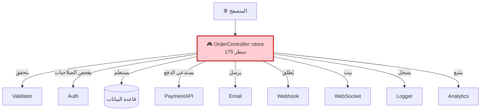
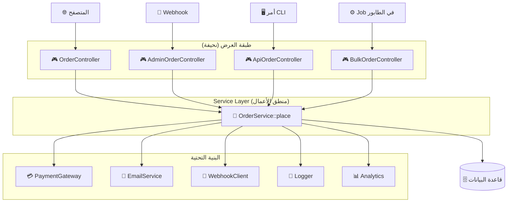
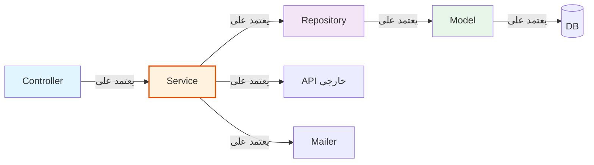
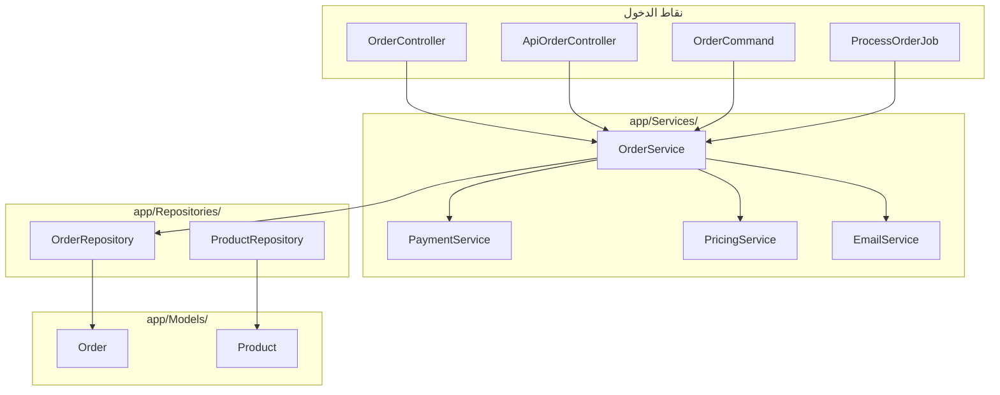
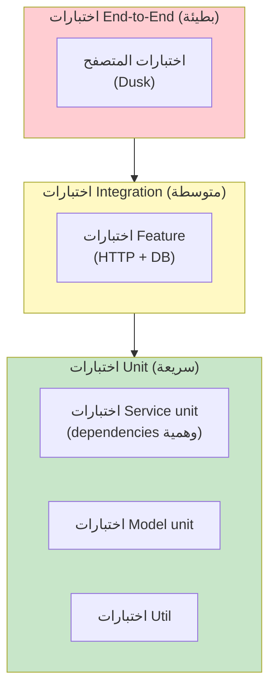

<div dir="rtl">

# الفصل 2: Service Layer
## عندما يصبح الـ Controller ضخماً جداً

---

## 1. المشكلة قبل هذه العمارة

"Fat Controller" هو أكثر code smell شيوعاً في Laravel. دعني أعرض لك ما يبدو عليه في الواقع، ولماذا يقتل تطبيقك.

### 😱 الأعراض

إليك مثال من العالم الحقيقي. هذا method `OrderController` واحد سحبتـه من قاعدة كود إنتاجية:

```php
public function store(Request $request)
{
    // 1. Validation
    $validator = Validator::make($request->all(), [
        'items' => 'required|array|min:1',
        'items.*.product_id' => 'required|exists:products,id',
        'items.*.quantity' => 'required|integer|min:1',
        'shipping_address' => 'required|string',
        'payment_method' => 'required|in:credit_card,paypal,stripe',
        'coupon_code' => 'nullable|string|exists:coupons,code',
    ]);

    if ($validator->fails()) {
        return back()->withErrors($validator)->withInput();
    }

    // 2. التفويض
    if (!auth()->user()->canPlaceOrder()) {
        abort(403, 'الحساب غير موثق');
    }

    // 3. بدء المعاملة
    DB::beginTransaction();
    try {
        // 4. فحص المخزون
        foreach ($request->items as $item) {
            $product = Product::findOrFail($item['product_id']);
            if ($product->stock < $item['quantity']) {
                throw new \Exception("مخزون غير كافٍ لـ {$product->name}");
            }
        }

        // 5. حساب الأسعار
        $subtotal = 0;
        $items = [];
        foreach ($request->items as $item) {
            $product = Product::findOrFail($item['product_id']);
            $price = $product->price * $item['quantity'];
            $subtotal += $price;
            $items[] = [
                'product_id' => $product->id,
                'quantity'   => $item['quantity'],
                'price'      => $product->price,
            ];
        }

        // 6. تطبيق الخصم
        $discount = 0;
        if ($request->coupon_code) {
            $coupon = Coupon::where('code', $request->coupon_code)->first();
            if ($coupon->isValid()) {
                if ($coupon->type === 'percentage') {
                    $discount = $subtotal * ($coupon->value / 100);
                } elseif ($coupon->type === 'fixed') {
                    $discount = $coupon->value;
                }
            }
        }

        // 7. حساب الشحن
        $shipping = $this->calculateShipping($request->shipping_address, $subtotal);

        // 8. حساب الضريبة
        $tax = ($subtotal - $discount) * 0.08;

        // 9. الإجمالي
        $total = $subtotal - $discount + $shipping + $tax;

        // 10. إنشاء الطلب
        $order = Order::create([
            'user_id' => auth()->id(),
            'subtotal' => $subtotal,
            'discount' => $discount,
            'shipping' => $shipping,
            'tax' => $tax,
            'total' => $total,
            'shipping_address' => $request->shipping_address,
            'status' => 'pending',
        ]);

        // 11. إنشاء عناصر الطلب
        foreach ($items as $item) {
            OrderItem::create([
                'order_id' => $order->id,
                'product_id' => $item['product_id'],
                'quantity' => $item['quantity'],
                'price' => $item['price'],
            ]);
        }

        // 12. تقليل المخزون
        foreach ($items as $item) {
            Product::where('id', $item['product_id'])
                ->decrement('stock', $item['quantity']);
        }

        // 13. معالجة الدفع
        $payment = $this->processPayment($request->payment_method, $total, $order);

        // 14. تحديث الطلب بمعلومات الدفع
        $order->update([
            'payment_id' => $payment->id,
            'status' => 'paid',
        ]);

        // 15. تطبيق استخدام الكوبون
        if ($request->coupon_code) {
            Coupon::where('code', $request->coupon_code)
                ->increment('times_used');
        }

        // 16. إرسال بريد التأكيد
        Mail::to($order->user)->send(new OrderConfirmation($order));

        // 17. إرسال إشعار المسؤول
        Mail::to(config('shop.admin_email'))
            ->send(new NewOrderAlert($order));

        // 18. مسح السلة
        Cart::where('user_id', auth()->id())->delete();

        // 19. نقاط الولاء
        $this->addLoyaltyPoints($order->user, $total);

        // 20. تتبع التحليلات
        Analytics::track('order_placed', [
            'order_id' => $order->id,
            'total' => $total,
        ]);

        // 21. إطلاق webhook
        Http::post(config('webhooks.orders'), [
            'event' => 'order.created',
            'order' => $order->toArray(),
        ]);

        // 22. إشعار WebSocket
        broadcast(new OrderPlaced($order));

        DB::commit();

        // 23. التسجيل
        Log::info('تم إنشاء الطلب', ['order_id' => $order->id]);

        return redirect()->route('orders.show', $order)
            ->with('success', 'تم تقديم الطلب!');

    } catch (\Exception $e) {
        DB::rollBack();
        Log::error('فشل الطلب', ['error' => $e->getMessage()]);
        return back()->with('error', 'فشل الطلب: ' . $e->getMessage());
    }
}
```

**هذا 175 سطر.** ويفعل:
- Validation
- التفويض
- معاملات قاعدة البيانات
- منطق الأعمال (التسعير، الخصومات، الضريبة)
- معالجة الدفع
- إرسال البريد
- إطلاق Webhook
- تتبع التحليلات
- بث WebSocket
- التسجيل
- نقاط الولاء
- إدارة السلة

هذا **المشكلة رقم 1** مع MVC الخالص.

### الأعراض السبعة القاتلة لـ Fat Controllers

**1. 🐘 مستحيل القراءة**
لا يمكنك رؤية "ماذا يفعل هذا الـ method؟" في 5 ثوانٍ. تمر عبر 175 سطر تخلط 23 اهتماماً مختلفاً.

**2. 🧪 مستحيل اختبار الـ Unit**
لاختبار هذا الـ method، تحتاج:
- قاعدة بيانات (مع المنتجات، الكوبونات، المستخدمين)
- بوابة دفع
- مشغّل بريد
- URL Webhook
- بنية WebSocket
- تتبع التحليلات

اختبار واحد = نظام كامل.

**3. 🔁 مستحيل إعادة الاستخدام**
الآن تحتاج لـ:
- السماح للمسؤولين بإنشاء طلبات نيابة عن العملاء
- استيراد طلبات بالجملة من CSV
- إعادة إنشاء طلب من سلة محفوظة
- إعادة معالجة دفعة فاشلة

كل نقطة دخول يجب أن تكرر الـ method بطول 175 سطر.

**4. 🐛 الأخطاء تختبئ في العراء**
أين الخطأ؟ "أحياناً يتم إنشاء الطلبات ولكن لا تُمسح السلة." يجب قراءة الـ 175 سطر بالكامل للعثور على المشكلة.

**5. 🔄 صعب إعادة الهيكلة**
تحتاج لتغيير حساب الخصم؟ اعثر على كل مكان. قاعدة التسعير؟ حظاً سعيداً.

**6. 👥 تعارضات الدمج**
5 مطورين، controller واحد. كل ميزة تلمس نفس الملف. Git يصبح غير قابل للاستخدام.

**7. 🎯 ينتهك المسؤولية الواحدة**
الـ method لديه 23 سبباً للتغيير:
- تغيير قانون الضريبة
- موفر الدفع يحدّث API
- التسويق يريد نوع خصم جديد
- قالب البريد يتغير
- صيغة Webhook تتغير
- قواعد برنامج الولاء تتغير
- ... 17 سبباً آخر

**كلاس يجب أن يكون لديه سبب واحد للتغيير.** هذا الـ method لديه 23.

### المشكلة المخفية: أين يعيش المنطق؟

مع نمو الميزات، يسأل الفريق: "أين يذهب هذا؟"

- "احسب الشحن" — Controller؟ Model؟ Helper؟
- "طبق الخصم" — Controller؟ Service؟ trait على Order؟
- "تحقق من المخزون" — Controller؟ method `isInStock()` على Model؟ Repository؟
- "أرسل التأكيد" — Controller؟ Listener؟ Job؟

**لا اتفاقية. كل مطور يقرر بشكل مختلف.** الكود يصبح غير متسق. بعض الأماكن تحسب الضريبة في Controller، أخرى في Model، أخرى في لا مكان.

### فخ "دالة المساعد" (Helper Function)

لتجنب هذا، الفرق غالباً تنشئ `app/Helpers/`:

```php
// app/Helpers/OrderHelper.php
function calculateOrderTotal($items, $coupon, $address) { ... }
function applyDiscount($subtotal, $coupon) { ... }
function processPayment($method, $amount) { ... }
```

**لماذا هذا يفشل:**
- الدوال العامة تلوث الـ namespace
- لا type hinting، لا IDE autocompletion
- صعب الاختبار (لا يمكن محاكاة دالة عامة)
- صعب إعادة الهيكلة (المستدعون في كل مكان)
- لا مكان مركزي لإيجاد "كل منطق الطلب"

### فخ "Controller الأساسي" (Base Controller)

نمط فريق آخر: وضع المنطق في `app/Http/Controllers/Controller.php`:

```php
class Controller
{
    protected function calculateOrderTotal($items, $coupon) { ... }
    protected function processPayment($method, $amount) { ... }
}
```

**لماذا هذا يفشل:**
- جميع Controllers ترث هذا — لا تستطيع الانسحاب
- يصبح كلاس إله
- لا يمكن محاكاة methods على base controller بسهولة
- يقترن Controllers غير ذات الصلة بإحكام

### الألم الحقيقي

الألم ليس فقط "الملف طويل". الألم هو:
- **المنطق مكرر** عبر نقاط الدخول
- **المنطق صعب الاختبار** دون تشغيل كل شيء
- **المنطق صعب الإيجاد** — هل هو في Controller؟ Model؟ Helper؟
- **المنطق صعب التغيير** — تغيير قاعدة واحدة يتطلب تعديل ملفات كثيرة
- **المنطق صعب التفكير فيه** — الـ method يفعل 23 شيئاً

نحتاج **منزل مخصص لمنطق الأعمال**. هذا المنزل يجب أن يكون:
- قابل لإعادة الاستخدام عبر Controllers، أوامر CLI، jobs، و APIs
- قابل للاختبار دون HTTP، قاعدة بيانات، أو خدمات خارجية
- قابل للاكتشاف (مكان واحد للبحث)
- قابل للاستبدال (تبديل التنفيذ بسهولة)
- مستقل عن الـ frameworks (لا Request، لا Response)

هذا المنزل هو **Service Layer**.

---

## 2. لماذا اخترعت هذه العمارة

### السياق التاريخي

Service Layer نمط نشأ من **Domain-Driven Design** (Eric Evans, 2003) و **Fowler's "Patterns of Enterprise Application Architecture"** (2002).

**1. صعود تطبيقات "Three-Tier"**
بحلول أوائل الألفينيات، كانت العمارة القياسية:
- **Presentation tier**: صفحات HTML، JSP، ASP
- **Business logic tier**: كلاسات Java/C#
- **Data tier**: قاعدة البيانات

كل tier كان **حد منطقي وفيزيائي**. منطق الأعمال عاش في process الخاص به، JAR الخاص به، وحدة النشر الخاصة به.

**2. الحوسبة الموزعة طالبت بها**
قبل أن تكون تطبيقات الويب هي القاعدة، كان البرنامج غالباً client-server. العميل (VB، Delphi) كان "View". الخادم كان لديه منطق أعمال. منطق الأعمال كان **خدمة** مكشوفة للعملاء.

**3. فشل نمط "Smart UI" المضاد**
وثّق Fowler نمط "Smart UI" المضاد: منطق أعمال مضمّن في كود UI. أظهر أن:
- المنطق مكرر عبر الشاشات
- المنطق مستحيل المشاركة عبر UIs
- المنطق صعب الاختبار
- التطبيق يصبح غير قابل للصيانة

Service Layer كان الترياق الصريح.

### الفكرة الجوهرية

Service هو **كلاس ينسق عملية أعمال**. هو:
- يستقبل مدخلات بسيطة (primitives، arrays، DTOs)
- ينفذ منطق الأعمال (validation، حساب، تنسيق)
- ينسق repositories متعددة، نماذج، وخدمات خارجية
- يُرجع نتيجة (Model، DTO، أو قيمة بسيطة)

**يُستدعى** Service من قبل Controllers. Service **لا يعلم** بـ HTTP، requests، responses، أو views.

### لماذا غزت Laravel

Service Container و Facades في Laravel جعلا حقن الاعتمادية تافهاً:

```php
class OrderService
{
    public function __construct(
        private PaymentGateway $payments,
        private EmailService $mailer,
        private OrderRepository $orders,
    ) {}
}
```

صُمم الـ framework لـ Service Layers. الأنماط توافقت.

---

## 3. تشبيه من الحياة الواقعية

### 🏥 نظام أقسام المستشفى

تخيل مستشفى به 3 نقاط دخول حيث يمكن تسجيل المرضى:
1. مكتب الاستقبال (نموذج ويب)
2. غرفة الطوارئ (نموذج مختلف، سير عمل مختلف)
3. النظام الهاتفي (مركز الاتصال، واجهة مختلفة)
4. استيراد بالجملة (أداة مسؤول، يعالج 1000 مريض من CSV)

**بدون service layer:**

كل نقطة دخول لديها منطق التسجيل الخاص بها. مكتب الاستقبال لديه قواعد للتأمين والحساسية وتعيين الغرفة. الطوارئ لديه قواعد مختلفة (رعاية حادة، سرير فوري). النظام الهاتقي لديه سير عمل آخر.

عندما يغير المستشفى قاعدة التسجيل (مثلاً "يجب التحقق من تأمين جميع المرضى قبل تعيين الغرفة")، **يجب تحديث جميع الأماكن الـ 4**. تفوت واحداً وتظهر أخطاء.

**مع service layer:**

يوجد `PatientRegistrationService` واحد بـ `register()` method واحد. جميع نقاط الدخول الـ 4 تستدعيه. عندما تتغير القاعدة، تغيرها في **مكان واحد**.

```
مكتب الاستقبال ─┐
الطوارئ         ├──→  PatientRegistrationService ──→  PatientRepository
النظام الهاتفي   ├──→      (مصدر حقيقة واحد)   ──→  InsuranceService
أداة المسؤول    ┘                                  ──→  RoomService
                                                      ──→  EmailService
```

### 🎯 الرؤية الأساسية

> **Service هو "ماذا يجب أن يحدث" في عملك.**
> **Controller هو "ماذا طلب المستخدم" في تطبيقك.**

هذان مختلفان. المستخدم يطلب: "أريد شراء هذه العناصر الـ 3." الأعمال تقول: "تحقق من المخزون، اشحن الدفع، قلل المخزون، أرسل بريداً، أطلق webhook."

الـ Controller يترجم طلب المستخدم إلى طلب عمل. الـ Service ينفذ طلب العمل.

### 🍽️ تشبيه المطعم (مُحسَّن)

تذكر تشبيه المطعم؟ **النادل (Controller)** يأخذ طلبك. **المطبخ (Model)** يطبخ.

لكن ماذا لو:
- العميل يتصل مسبقاً لتقديم طلب استلام
- خدمة التموين تضع 50 طلباً دفعة واحدة
- النادل يحتاج لمعرفة إذا كان خاص اليوم لا يزال متاحاً

**بدون services:**
كل نقاط الدخول هذه لديها منطق الطلب الخاص بها. مختلف. مكرر. مليء بالأخطاء.

**مع services:**
يوجد `OrderService` واحد يعرف القواعد: "تحقق من التوفر، طبق الخصومات، اشحن الدفع، جدول التحضير." الهاتف، النادل شخصياً، ونظام التموين جميعهم يستدعونه.

---

## 4. الشرح البصري

### قبل: Fat Controller



### بعد: Service Layer



### اتجاه الاعتمادية



**القاعدة:** Controller يعرف Service. Service يعرف Repository. Service لا يعرف شيئاً عن HTTP. Controller لا يعرف شيئاً عن DB.

### ما يعيش أين



---

## 5. دورة حياة الطلب

### قبل: كل شيء في الـ Controller

```
🌐 المتصفح: POST /orders
   ↓
🎮 OrderController::store
   - يتحقق من الطلب           (10 سطور)
   - يفحص الصلاحيات            (5 سطور)
   - يلف المنتجات لفحص المخزون (15 سطر)
   - يحسب التسعير             (25 سطر)
   - يعالج الدفع              (15 سطر)
   - يحدث قاعدة البيانات       (20 سطر)
   - يرسل رسائل البريد         (10 سطور)
   - يُطلق webhooks           (10 سطور)
   - يسجل                     (5 سطور)
   - يُرجع redirect           (5 سطور)
   المجموع: 175 سطر
```

### بعد: مع Service Layer

```
🌐 المتصفح: POST /orders
   ↓
📍 1. نقطة الدخول (public/index.php)
   ↓
🛣️ 2. التوجيه
   - POST /orders → OrderController@store
   ↓
🛡️ 3. الـ Middleware
   - تم التحقق من auth و CSRF
   ↓
🎮 4. الـ Controller (10 سطور، ليس 175)
```php
public function store(StoreOrderRequest $request, OrderService $service)
{
    $order = $service->place($request->toDto());

    return redirect()
        ->route('orders.show', $order)
        ->with('success', 'تم تقديم الطلب!');
}
```
   ↓
💼 5. الخدمة: OrderService::place(OrderData $data)  (الـ 175 سطر، منظم)
```php
public function place(OrderData $data): Order
{
    return DB::transaction(function () use ($data) {
        $this->validateStock($data->items);
        $pricing = $this->pricing->calculate($data);
        $payment = $this->payments->charge($data->paymentMethod, $pricing->total);
        $order = $this->orders->create($data, $pricing, $payment);
        $this->mailer->sendConfirmation($order);
        event(new OrderPlaced($order));
        return $order;
    });
}
```
   ↓
💳 6. خدمة الدفع
   - Stripe/PayPal/أيا كان
   ↓
📦 7. الـ Repository
   - OrderRepository::create(...)
   - INSERT INTO orders ...
   ↓
🗄️ 8. قاعدة البيانات
   ↓
📦 9. Eloquent يُرجع
   ↓
💼 10. الخدمة تُرجع Order
   ↓
🎮 11. الـ Controller يعيد التوجيه
   ↓
🌐 المتصفح: يرى صفحة التأكيد
```

### ما الذي تغير؟

| قبل | بعد |
|-----|-----|
| 175 سطر في Controller | 10 سطور في Controller |
| 175 سطر مكررة 4 مرات | 175 سطر في مكان واحد، تُستدعى 4 مرات |
| الاختبار يتطلب HTTP + DB + Mail + Payment | اختبر الـ Service مع dependencies وهمية |
| التغيير يتطلب تعديل كل نقطة دخول | التغيير مرة واحدة، جميع نقاط الدخول تُحدّث |

---

## 6. هيكل المجلدات

### التخطيط الموصى به لـ Service Layer في Laravel

```
app/
├── Http/
│   └── Controllers/
│       ├── OrderController.php          ← نحيف، فقط يستقبل
│       ├── Api/                         ← API controllers
│       │   └── OrderController.php
│       └── Admin/
│           └── OrderController.php
│
├── Services/                            ← 💼 Service Layer
│   ├── OrderService.php                 ← ينسق عمليات الطلب
│   ├── PricingService.php               ← يحسب الأسعار
│   ├── PaymentService.php               ← يتعامل مع مقدمي الدفع
│   ├── ShippingService.php              ← يحسب الشحن
│   ├── EmailService.php                 ← يرسل قوالب البريد
│   └── Contracts/                       ← Interfaces
│       ├── PaymentGatewayInterface.php
│       └── ShippingProviderInterface.php
│
├── Repositories/                        ← اختياري، لكنه يتزاوج جيداً
│   ├── OrderRepository.php
│   └── ProductRepository.php
│
├── Models/
│   ├── Order.php
│   └── Product.php
│
├── DataTransferObjects/                 ← اختياري: مدخلات مكتوبة
│   └── OrderData.php
│
├── Jobs/                                ← عمل غير متزامن
│   ├── SendOrderConfirmation.php
│   └── SyncOrderToWarehouse.php
│
├── Events/
│   └── OrderPlaced.php
│
├── Listeners/
│   ├── SendOrderConfirmationEmail.php
│   ├── TrackOrderAnalytics.php
│   └── SyncToWarehouse.php
│
├── Exceptions/
│   ├── InsufficientStockException.php
│   └── PaymentFailedException.php
│
└── Providers/
    ├── AppServiceProvider.php           ← ربط interfaces
    └── DomainServiceProvider.php        ← تسجيل services
```

### لماذا يوجد كل مجلد

| المجلد | الغرض |
|--------|-------|
| `app/Services/` | Service Layer. منطق الأعمال يعيش هنا. Service واحد لكل منطقة مجال أعمال. |
| `app/Services/Contracts/` | Interfaces للخدمات القابلة للتبديل. مثلاً `PaymentGatewayInterface` يمكن تنفيذه بواسطة Stripe، PayPal، إلخ. |
| `app/Repositories/` | الوصول إلى البيانات. يتزاوج مع Services لإبقائها قابلة للاختبار. |
| `app/DataTransferObjects/` | كائنات مدخلات مكتوبة. Services يجب أن تقبل DTOs، وليس arrays أو Request objects. |
| `app/Jobs/` | عمل غير متزامن. استخدم jobs للبريد، webhooks، حسابات ثقيلة. |
| `app/Events/` | أشياء حدثت. Services تُطلق الأحداث؛ Listeners تتعامل مع التأثيرات الجانبية. |
| `app/Listeners/` | رد فعل على الأحداث. يفصل التأثيرات الجانبية عن منطق الأعمال الرئيسي. |
| `app/Exceptions/` | استثناءات خاصة بالمجال. Services ترمي هذه، Controllers تلتقط وتترجم إلى HTTP. |

### خاص بـ Laravel 11/12/13

في Laravel 11+، تم تبسيط بنية bootstrap. يمكنك تسجيل ربط الخدمات في:
- `app/Providers/AppServiceProvider.php` (الافتراضي)
- `app/Providers/DomainServiceProvider.php` جديد (للتنظيم)
- `bootstrap/providers.php` جديد (لتسجيل providers جدد)

```php
// app/Providers/DomainServiceProvider.php
class DomainServiceProvider extends ServiceProvider
{
    public function register(): void
    {
        $this->app->bind(
            \App\Services\Contracts\PaymentGatewayInterface::class,
            \App\Services\StripePaymentGateway::class
        );
    }
}
```

```php
// bootstrap/providers.php
return [
    App\Providers\AppServiceProvider::class,
    App\Providers\DomainServiceProvider::class,
];
```

---

## 7. مثال Laravel كامل

### 🏥 السيناريو: نظام مستشفى — قبول مريض

دعنا نعيد هيكلة نمط fat controller إلى Service Layer نظيف.

### الخطوة 1: الـ DTO (app/DataTransferObjects/AdmissionData.php)

```php
<?php

namespace App\DataTransferObjects;

use App\Http\Requests\StoreAdmissionRequest;

class AdmissionData
{
    public function __construct(
        public readonly int $patientId,
        public readonly int $doctorId,
        public readonly int $roomId,
        public readonly string $reason,
        public readonly \DateTimeInterface $admittedAt,
        public readonly ?string $notes = null,
    ) {}

    public static function fromRequest(StoreAdmissionRequest $request): self
    {
        return new self(
            patientId:  $request->integer('patient_id'),
            doctorId:   $request->integer('doctor_id'),
            roomId:     $request->integer('room_id'),
            reason:     $request->string('reason'),
            admittedAt: $request->date('admitted_at'),
            notes:      $request->string('notes'),
        );
    }
}
```

**لماذا DTO؟** Service يجب ألا يقبل كائن `Request` (مقترن بـ HTTP). يجب أن يقبل DTO بسيط بالبيانات التي يحتاجها. بهذه الطريقة، Service قابل لإعادة الاستخدام من CLI، API، طوابير.

### الخطوة 2: واجهة الـ Service (app/Services/Contracts/AdmissionServiceInterface.php)

```php
<?php

namespace App\Services\Contracts;

use App\DataTransferObjects\AdmissionData;
use App\Models\Admission;

interface AdmissionServiceInterface
{
    public function admit(AdmissionData $data): Admission;
    public function discharge(int $admissionId, ?string $notes = null): Admission;
    public function transfer(int $admissionId, int $newRoomId, string $reason): Admission;
}
```

**لماذا interface؟** حتى يمكن للاختبارات محاكاته. حتى يمكن تبديل التنفيذ. حتى يكون العقد صريحاً.

### الخطوة 3: تنفيذ الـ Service (app/Services/AdmissionService.php)

```php
<?php

namespace App\Services;

use App\DataTransferObjects\AdmissionData;
use App\Events\PatientAdmitted;
use App\Exceptions\RoomUnavailableException;
use App\Models\Admission;
use App\Models\Room;
use App\Services\Contracts\AdmissionServiceInterface;
use App\Services\Contracts\NotificationServiceInterface;
use Illuminate\Support\Facades\DB;
use Illuminate\Support\Facades\Log;

class AdmissionService implements AdmissionServiceInterface
{
    public function __construct(
        private NotificationServiceInterface $notifier,
        private RoomAllocationService $roomAllocation,
    ) {}

    public function admit(AdmissionData $data): Admission
    {
        return DB::transaction(function () use ($data) {
            // 1. تحقق من توفر الغرفة
            $room = $this->roomAllocation->allocate($data->roomId);
            if (!$room) {
                throw new RoomUnavailableException(
                    "الغرفة {$data->roomId} غير متاحة"
                );
            }

            // 2. أنشئ سجل القبول
            $admission = Admission::create([
                'patient_id'  => $data->patientId,
                'doctor_id'   => $data->doctorId,
                'room_id'     => $room->id,
                'reason'      => $data->reason,
                'admitted_at' => $data->admittedAt,
                'notes'       => $data->notes,
                'status'      => 'admitted',
            ]);

            // 3. ضع علامة على الغرفة كمشغولة
            $room->update(['status' => 'occupied']);

            // 4. أطلق الحدث (Listeners ستتعامل مع الإشعارات)
            event(new PatientAdmitted($admission));

            // 5. سجل للتدقيق
            Log::info('تم قبول المريض', [
                'admission_id' => $admission->id,
                'patient_id'   => $admission->patient_id,
            ]);

            return $admission;
        });
    }

    public function discharge(int $admissionId, ?string $notes = null): Admission
    {
        return DB::transaction(function () use ($admissionId, $notes) {
            $admission = Admission::findOrFail($admissionId);

            if ($admission->status !== 'admitted') {
                throw new \DomainException(
                    "لا يمكن الإخراج من الحالة: {$admission->status}"
                );
            }

            $admission->update([
                'status'         => 'discharged',
                'discharged_at'  => now(),
                'discharge_notes' => $notes,
            ]);

            $admission->room->update(['status' => 'cleaning']);

            return $admission;
        });
    }

    public function transfer(int $admissionId, int $newRoomId, string $reason): Admission
    {
        // نفس النمط: تحقق، حدّث، أطلق، أرجع
    }
}
```

**ماذا يحدث:**
- يستقبل الـ Service DTO، وليس Request.
- يستخدم `DB::transaction()` لضمان الذرية.
- يرمي استثناءات المجال (ليس استثناءات HTTP).
- يُطلق الأحداث للتأثيرات الجانبية.
- يُرجع نموذج Admission.
- الاعتمادات (NotificationService, RoomAllocationService) محقونة.

### الخطوة 4: الـ Controller النحيف (app/Http/Controllers/AdmissionController.php)

```php
<?php

namespace App\Http\Controllers;

use App\DataTransferObjects\AdmissionData;
use App\Http\Requests\StoreAdmissionRequest;
use App\Models\Admission;
use App\Services\Contracts\AdmissionServiceInterface;
use Illuminate\Http\RedirectResponse;
use Illuminate\View\View;

class AdmissionController extends Controller
{
    public function __construct(
        private AdmissionServiceInterface $admissions,
    ) {}

    public function store(StoreAdmissionRequest $request): RedirectResponse
    {
        $admission = $this->admissions->admit(
            AdmissionData::fromRequest($request)
        );

        return redirect()
            ->route('admissions.show', $admission)
            ->with('success', 'تم قبول المريض بنجاح.');
    }

    public function show(Admission $admission): View
    {
        return view('admissions.show', compact('admission'));
    }

    public function destroy(int $admissionId): RedirectResponse
    {
        $this->admissions->discharge($admissionId);

        return redirect()
            ->route('admissions.index')
            ->with('success', 'تم إخراج المريض.');
    }
}
```

**لاحظ:** 8 سطور من المنطق في `store()`. قارن مع fat controller بطول 175 سطر.

### الخطوة 5: Form Request (app/Http/Requests/StoreAdmissionRequest.php)

```php
<?php

namespace App\Http\Requests;

use Illuminate\Foundation\Http\FormRequest;

class StoreAdmissionRequest extends FormRequest
{
    public function authorize(): bool
    {
        return $this->user()->can('admit', \App\Models\Admission::class);
    }

    public function rules(): array
    {
        return [
            'patient_id'  => ['required', 'exists:patients,id'],
            'doctor_id'   => ['required', 'exists:doctors,id'],
            'room_id'     => ['required', 'exists:rooms,id'],
            'reason'      => ['required', 'string', 'max:500'],
            'admitted_at' => ['required', 'date'],
            'notes'       => ['nullable', 'string', 'max:2000'],
        ];
    }
}
```

### الخطوة 6: ربط Service Provider (app/Providers/DomainServiceProvider.php)

```php
<?php

namespace App\Providers;

use App\Services\AdmissionService;
use App\Services\Contracts\AdmissionServiceInterface;
use App\Services\Contracts\NotificationServiceInterface;
use App\Services\EmailNotificationService;
use Illuminate\Support\ServiceProvider;

class DomainServiceProvider extends ServiceProvider
{
    public function register(): void
    {
        $this->app->bind(
            AdmissionServiceInterface::class,
            AdmissionService::class
        );

        $this->app->bind(
            NotificationServiceInterface::class,
            EmailNotificationService::class
        );
    }
}
```

### الخطوة 7: الحدث (app/Events/PatientAdmitted.php)

```php
<?php

namespace App\Events;

use App\Models\Admission;
use Illuminate\Foundation\Events\Dispatchable;
use Illuminate\Queue\SerializesModels;

class PatientAdmitted
{
    use Dispatchable, SerializesModels;

    public function __construct(public readonly Admission $admission) {}
}
```

### الخطوة 8: الـ Listener (app/Listeners/NotifyNurseOnAdmission.php)

```php
<?php

namespace App\Listeners;

use App\Events\PatientAdmitted;
use App\Services\Contracts\NotificationServiceInterface;

class NotifyNurseOnAdmission
{
    public function __construct(
        private NotificationServiceInterface $notifier,
    ) {}

    public function handle(PatientAdmitted $event): void
    {
        $this->notifier->send(
            to: $event->admission->room->nurse->phone,
            message: "قبول جديد: المريض {$event->admission->patient->name} في الغرفة {$event->admission->room->number}"
        );
    }
}
```

### الخطوة 9: تسجيل الـ Listener (عبر attribute في Laravel 11+)

```php
<?php

namespace App\Listeners;

use App\Events\PatientAdmitted;
use Illuminate\Events\Attributes\AsEventListener;

#[AsEventListener(event: PatientAdmitted::class)]
class NotifyNurseOnAdmission
{
    public function handle(PatientAdmitted $event): void
    {
        // ...
    }
}
```

### الخطوة 10: أمر CLI (app/Console/Commands/AdmitPatientCommand.php)

```php
<?php

namespace App\Console\Commands;

use App\DataTransferObjects\AdmissionData;
use App\Services\Contracts\AdmissionServiceInterface;
use Illuminate\Console\Command;

class AdmitPatientCommand extends Command
{
    protected $signature = 'patient:admit
                            {patient : معرف المريض}
                            {doctor : معرف الطبيب}
                            {room : معرف الغرفة}
                            {reason : سبب القبول}';

    protected $description = 'قبول مريض (يستخدم من الطوارئ والمسؤول)';

    public function handle(AdmissionServiceInterface $admissions): int
    {
        $admission = $admissions->admit(new AdmissionData(
            patientId:  (int) $this->argument('patient'),
            doctorId:   (int) $this->argument('doctor'),
            roomId:     (int) $this->argument('room'),
            reason:     (string) $this->argument('reason'),
            admittedAt: now(),
        ));

        $this->info("تم القبول: #{$admission->id}");
        return self::SUCCESS;
    }
}
```

**لاحظ:** أمر CLI يستخدم نفس `AdmissionService`. **لا تكرار للكود.**

### الخطوة 11: Queue Job (app/Jobs/ProcessBulkAdmission.php)

```php
<?php

namespace App\Jobs;

use App\DataTransferObjects\AdmissionData;
use App\Services\Contracts\AdmissionServiceInterface;
use Illuminate\Bus\Queueable;
use Illuminate\Contracts\Queue\ShouldQueue;
use Illuminate\Foundation\Bus\Dispatchable;
use Illuminate\Queue\InteractsWithQueue;
use Illuminate\Queue\SerializesModels;

class ProcessBulkAdmission implements ShouldQueue
{
    use Dispatchable, InteractsWithQueue, Queueable, SerializesModels;

    public function __construct(public readonly array $admissions) {}

    public function handle(AdmissionServiceInterface $service): void
    {
        foreach ($this->admissions as $row) {
            $service->admit(new AdmissionData(...$row));
        }
    }
}
```

**نفس الـ Service. يُستدعى من web Controller، وأمر CLI، و queue job.** هذه هي قوة Service Layer.

---

## 8. شرح عميق

### كيف تتدفق البيانات عبر Service Layer

```
┌──────────────────────────────────────────────────────────────┐
│ 1. طلب HTTP                                                  │
│    POST /admissions                                          │
│    Body: { patient_id, doctor_id, room_id, reason, ... }     │
└──────────────────────────────────────────────────────────────┘
                          ↓
┌──────────────────────────────────────────────────────────────┐
│ 2. الـ Router + Middleware                                   │
└──────────────────────────────────────────────────────────────┘
                          ↓
┌──────────────────────────────────────────────────────────────┐
│ 3. الـ Controller (نحيف)                                     │
│    - يتم حقن $request                                        │
│    - AdmissionData::fromRequest($request)                    │
│    - $service->admit($dto)                                   │
│    - return redirect(...)                                    │
└──────────────────────────────────────────────────────────────┘
                          ↓
┌──────────────────────────────────────────────────────────────┐
│ 4. الـ Service (العمل)                                       │
│    - DB::transaction(function() { ... })                     │
│    - يتحقق من قواعد المجال                                   │
│    - يستدعي services فرعية (التسعير، الدفع، إلخ)            │
│    - يستخدم repositories للاستمرار                           │
│    - يُطلق الأحداث                                           │
│    - يرمي استثناءات المجال عند الفشل                        │
│    - يُرجع النتيجة                                           │
└──────────────────────────────────────────────────────────────┘
                          ↓
        ┌─────────────────┼─────────────────┐
        ↓                 ↓                 ↓
   ┌─────────┐      ┌──────────┐      ┌──────────┐
   │ Sub-Svc │      │ Sub-Svc  │      │ Sub-Svc  │
   │ (Pay)   │      │ (Email)  │      │ (Stock)  │
   └─────────┘      └──────────┘      └──────────┘
        ↓                 ↓                 ↓
        └─────────────────┼─────────────────┘
                          ↓
              ┌───────────┴───────────┐
              ↓                       ↓
        ┌──────────┐           ┌──────────┐
        │ REPO     │           │ EVENT    │
        │ (Save)   │           │ (Notify) │
        └──────────┘           └──────────┘
              ↓                       ↓
        ┌──────────┐           ┌──────────┐
        │ DATABASE │           │ LISTENER │
        └──────────┘           └──────────┘
```

### لماذا تشير الاعتمادات حيث تشير

| الاتجاه | مسموح؟ | لماذا؟ |
|---------|--------|-------|
| Controller → Service | ✅ | Controller ينسق؛ Service ينفذ العمل |
| Service → Repository | ✅ | Service ينسق؛ Repository يستمر |
| Service → Service | ✅ | Services يمكنها استدعاء services أخرى (تركيب) |
| Service → Controller | ❌ | Service يجب ألا يعرف عن HTTP |
| Repository → Service | ❌ | Repository يجب أن يكون وصول بيانات سلبي |
| Model → Service | ⚠️ | مسموح إذا احتاج Model لإطلاق منطق (مثل Observer) |

**المبدأ:** التجريدات عالية المستوى (Services) تنسق. التجريدات منخفضة المستوى (Repositories، Models) تنفذ. الأشياء منخفضة المستوى لا تعرف عن الأشياء عالية المستوى.

### لماذا يجب ألا يقبل Service كائن `Request`

```php
// ❌ سيء
public function admit(Request $request)
{
    $patientId = $request->input('patient_id');
    // ...
}
```

**لماذا سيء:**
- الآن يعتمد Service على كلاس `Illuminate\Http\Request`.
- لا يمكنك استدعاء هذا الـ Service من أمر CLI، job في الطابور، أو API.
- لا يمكنك اختبار unit دون إنشاء Request وهمي.
- تربط منطق الأعمال بنقل معين (HTTP).

**الإصلاح:** اقبل DTO، primitive arguments، أو Model.

```php
// ✅ جيد
public function admit(AdmissionData $data)
{
    // ...
}
```

الآن Service غير مرتبط بنقل.

### لماذا يجب ألا يُرجع Service استجابات HTTP

```php
// ❌ سيء
public function admit(AdmissionData $data): \Illuminate\Http\RedirectResponse
{
    // ...
    return redirect()->route('admissions.show', $admission);
}
```

**لماذا سيء:**
- Service الآن يُرجع استجابات HTTP.
- أوامر CLI ستحتاج "عرض" redirect، وهو هراء.
- Service مقترن بالويب، غير قابل لإعادة الاستخدام من API/CLI.

**الإصلاح:** أرجع كائن المجال. الـ Controller يتعامل مع استجابة HTTP.

```php
// ✅ جيد
public function admit(AdmissionData $data): Admission
{
    // ...
    return $admission;
}

// في الـ Controller:
public function store(StoreAdmissionRequest $request)
{
    $admission = $this->service->admit(AdmissionData::fromRequest($request));
    return redirect()->route('admissions.show', $admission);
}
```

### حدود المعاملة

أين يجب أن يعيش `DB::transaction()`؟

**الخيار أ: في الـ Controller (❌ سيء)**
```php
// Controller
DB::transaction(fn () => $this->service->admit($dto));
```
- المشكلة: كل نقطة دخول يجب أن تتذكر أن تلتف بـ transaction.
- إذا نسيت، تُكتب بيانات جزئية.

**الخيار ب: في الـ Service (✅ جيد)**
```php
// Service
public function admit(AdmissionData $data): Admission
{
    return DB::transaction(function () use ($data) {
        // كل العمل
    });
}
```
- الـ Service مسؤول عن الذرية.
- كل نقطة دخول (Controller، CLI، Job) تحصل على transaction تلقائياً.
- لا خطر النسيان.

**الخيار ج: في الـ Repository (⚠️ أحياناً)**
- إذا كان استدعاء repository واحد يحتاج transaction، جيد.
- للعمليات متعددة الخطوات، Service هو الحد الصحيح.

**القاعدة:** المعاملة تلتف بـ **وحدة عمل (unit of work)**. وحدة العمل عادة method خدمة. الـ Service يمتلكها.

### استراتيجية الاستثناء

يجب أن يرمي Service **استثناءات المجال**، وليس استثناءات HTTP.

```php
// ❌ سيء
public function admit(AdmissionData $data): Admission
{
    if (!$this->roomAllocation->isAvailable($data->roomId)) {
        return back()->withErrors(['room' => 'غير متاحة']); // ❌ خاص بـ HTTP
    }
}
```

```php
// ✅ جيد
public function admit(AdmissionData $data): Admission
{
    if (!$this->roomAllocation->isAvailable($data->roomId)) {
        throw new RoomUnavailableException("الغرفة {$data->roomId} غير متاحة");
    }
}
```

ثم يلتقط الـ Controller ويترجم:

```php
try {
    $admission = $this->service->admit($dto);
} catch (RoomUnavailableException $e) {
    return back()->withErrors(['room' => $e->getMessage()]);
}
```

أو استخدم معالج الاستثناءات في Laravel:

```php
// bootstrap/app.php (Laravel 11+)
->withExceptions(function (Exceptions $exceptions) {
    $exceptions->render(function (RoomUnavailableException $e, $request) {
        if ($request->expectsJson()) {
            return response()->json(['error' => $e->getMessage()], 409);
        }
        return back()->withErrors(['room' => $e->getMessage()]);
    });
})
```

الآن نفس الاستثناء يُعالج بشكل صحيح لـ HTTP، API، و CLI.

---

## 9. المزايا

### ✅ 1. قابلية إعادة الاستخدام
نفس Service يُستدعى من web Controllers، API Controllers، أوامر CLI، jobs في الطابور، واختبارات. **تنفيذ واحد، نقاط دخول كثيرة.**

### ✅ 2. قابلية الاختبار
يمكنك اختبار unit لـ Service مع **dependencies وهمية**، بلا HTTP، بلا قاعدة بيانات، بلا Mail facade.

```php
public function test_admit_creates_record_and_dispatches_event()
{
    Event::fake();
    $room = $this->mock(RoomAllocationService::class, fn ($m) =>
        $m->shouldReceive('allocate')->andReturn(new Room(['id' => 1]))
    );

    $service = new AdmissionService(...);
    $admission = $service->admit(new AdmissionData(...));

    $this->assertNotNull($admission);
    Event::assertDispatched(PatientAdmitted::class);
}
```

بلا HTTP. بلا قاعدة بيانات. اختبار منطق خالص. يعمل في ميلي ثانية.

### ✅ 3. منطق مركزي
"أين منطق تقديم الطلب؟" → `app/Services/OrderService.php`. **إجابة واحدة.** لا مزيد من الصيد.

### ✅ 4. Controllers نحيفة
Controllers تصبح 5-10 سطور. سهلة القراءة، سهلة المراجعة، سهلة الاختبار.

### ✅ 5. استثناءات المجال
ارمِ `RoomUnavailableException` بدلاً من `abort(409)`. يبقى Service غير مرتبط بنقل.

### ✅ 6. السلامة المعاملتية
الـ Service يمتلك المعاملة. كل نقطة دخول تحصل على ذرية تلقائياً.

### ✅ 7. Dependency Injection
يصرح الـ Service باعتماداته. يوفرها container Laravel. تبديل التنفيذات تافه.

### ✅ 8. واجهات أمامية متعددة
نفس Service يشغّل:
- نموذج ويب
- REST API
- تطبيق موبايل
- أداة CLI
- عامل طابور
- مهمة مجدولة

### ✅ 9. نمذجة مجال أفضل
Service مُسمى لعملية **أعمال** (`admitPatient`، `placeOrder`، `transferMoney`)، وليس فعل HTTP. الكود يقرأ كما تتحدث الأعمال.

### ✅ 10. إعادة هيكلة أسهل
غيّر سير عمل الطلب مرة واحدة، في الـ Service. جميع نقاط الدخول تستفيد.

### ✅ 11. التطور المستقل
يمكن استبدال Payment Gateway (Stripe → PayPal) بتغيير الربط، وليس كود الاستدعاء.

### ✅ 12. مراجعات كود أفضل
يمكن للمراجعين قراءة Controllers النحيفة بسرعة. يغوصون في الـ Service عند الحاجة. يثقون في Repositories.

---

## 10. العيوب

### ❌ 1. ملفات أكثر
كل عملية أعمال تعيش الآن في 3+ ملفات:
- Controller (10 سطور)
- Service (100 سطر)
- ربما DTO، FormRequest، Event، Listener

لـ CRUD بسيط، هذا مبالغة.

### ❌ 2. منحنى التعلم
يحتاج المطورون المبتدئون لفهم:
- أين يذهب هذا؟ Service أم Controller؟
- متى أنشئ DTO؟
- هل يجب أن يكون هذا interface؟

"الإجابة الصحيحة" ليست واضحة دائماً. الاتفاقيات تساعد، لكنها تستغرق وقتاً للتأسيس.

### ❌ 3. خطر الإفراط في الهندسة
الفرق أحياناً تنشئ `UserService`، `PostService`، `CommentService` — واحد لكل Model. الآن الـ Service مجرد ممر إلى Model، بلا قيمة.

**القاعدة:** أنشئ Service عندما يكون لديك **منطق أعمال لا ينتمي لـ Model أو Controller**. ليس لكل Model.

### ❌ 4. غير مباشر
للعثور على ما يفعله `POST /orders`، يجب:
1. قراءة الـ route
2. فتح الـ Controller (10 سطور)
3. إيجاد اسم الـ Service
4. فتح الـ Service (100 سطر)
5. قراءة المنطق الفعلي

بدون أدوات، هذا أبطأ من قراءة controller بطول 175 سطر. **"Go to definition" في IDE يساعد.**

### ❌ 5. انتفاخ الـ Service
بمجرد أن يتبنى الفريق Services، كل المنطق يذهب هناك. يصبح Service بطول 1000 سطر. الآن لديك "Service ضخم" بدلاً من "Controller ضخم".

**الحل:** قسّم إلى services أصغر. `OrderService` ينسق، `PricingService` يحسب، `PaymentService` يشحن. كل واحد صغير ومركّز.

### ❌ 6. أين الحد؟
ماذا يذهب في Service؟ ماذا يبقى في Controller؟ ماذا يذهب في Model؟ ماذا يذهب في helper؟

لا توجد إجابة مثالية. الاتفاقيات تبرز من خبرة الفريق.

### ❌ 7. قابلية إعادة استخدام زائفة
قد تنشئ Service لعملية لمرة واحدة، متوقعاً إعادة استخدام مستقبلية. YAGNI: لن تحتاجه. الـ Service overhead حتى يكون لديك مستدعيان.

**القاعدة:** أنشئ Service عندما يكون لديك المستدعي الثاني. أو توقعه بوضوح.

### ❌ 8. اقتران وثيق بـ Laravel
حتى مع interfaces، غالباً ما تستخدم Services `DB::transaction()`، `event()`، `Log::info()` — كلها facades في Laravel. لاستخراج "مجال خالص"، تحتاج Clean Architecture (الفصل 8).

### ❌ 9. نمط "Service Locator" المضاد
```php
// ❌ سيء
class OrderController
{
    public function store(Request $request)
    {
        $service = app(OrderService::class); // ❌ حل يدوي
        $service->place($request->all());
    }
}
```

هذا يعمل لكنه صعب الاختبار. احقن دائماً عبر الـ constructor:

```php
// ✅ جيد
class OrderController
{
    public function __construct(private OrderService $service) {}
}
```

### ❌ 10. صعوبة العمليات عديمة الحالة
بعض Controllers تقوم باستعلامات قراءة بسيطة:
```php
$users = User::active()->paginate(20);
```

إجبار هذا عبر Service overhead. query scope على Model هو الأداة الصحيحة.

**القاعدة:** Services لـ **التعديلات والاستعلامات المعقدة**، وليس القراءات البسيطة.

---

## 11. الأخطاء الشائعة

### ❌ الخطأ 1: كلاس "Service" يلتف فقط على Model

```php
// ❌ نمط مضاد
class UserService
{
    public function create(array $data): User
    {
        return User::create($data);
    }

    public function find(int $id): ?User
    {
        return User::find($id);
    }
}
```

**لماذا سيء:** هذا ممر. يضيف طبقة بلا قيمة. فقط اتصل بـ `User::create()` مباشرة.

**الإصلاح:** فقط أنشئ Services لمنطق التنسيق الفعلي.

### ❌ الخطأ 2: Methods خدمة فقيرة (Anemic)

```php
// ❌ نمط مضاد
class OrderService
{
    public function setItems($items) { $this->items = $items; return $this; }
    public function setCoupon($coupon) { $this->coupon = $coupon; return $this; }
    public function setAddress($address) { $this->address = $address; return $this; }
    public function place() { /* يستخدم $this->items، إلخ */ }
}
```

**لماذا سيء:** Services ذات حالة مع setters صعبة الاختبار وصعبة التفكير. يجب أن يكون Service عديم الحالة؛ تأخذ methods كل الـ arguments التي تحتاجها.

**الإصلاح:** اجعل `place()` يقبل كل البيانات عبر DTO أو method arguments.

### ❌ الخطأ 3: Service يستدعي Service يستدعي Service

```php
// ❌ نمط مضاد
class OrderService
{
    public function __construct(
        private PricingService $pricing,
        private PaymentService $payment,
        private InventoryService $inventory,
        private NotificationService $notification,
        private AnalyticsService $analytics,
        private LoyaltyService $loyalty,
        private ShippingService $shipping,
        private TaxService $tax,
        // ... 10 أكثر
    ) {}
}
```

**لماذا سيء:** Service بـ 15 اعتمادية هو service إله. صعب البناء، صعب الاختبار، وعلى الأرجح يفعل الكثير.

**الإصلاح:** جمّع services ذات الصلة في facade أو coordinator.

### ❌ الخطأ 4: Service يُرجع Eloquent Collections

```php
// ❌ نمط مضاد
public function listActiveUsers(): \Illuminate\Database\Eloquent\Collection
{
    return User::where('active', true)->get();
}
```

**لماذا سيء:** Service الآن يُرجع أنواعاً خاصة بـ Eloquent. المستدعون مقترنون بـ Eloquent.

**الإصلاح:** أرجع arrays من DTOs، أو paginators بأنواع صريحة.

### ❌ الخطأ 5: تأثيرات جانبية في Constructor الـ Service

```php
// ❌ نمط مضاد
class OrderService
{
    public function __construct()
    {
        // ❌ لا تعمل في الـ constructor
        Cache::forget('active_orders');
        Log::info('تم إنشاء OrderService');
    }
}
```

**لماذا سيء:** يجب أن تكون الـ Constructors للـ dependency فقط. التأثيرات الجانبية يجب أن تكون في methods.

### ❌ الخطأ 6: Services تلتقط الاستثناءات

```php
// ❌ نمط مضاد
public function admit(AdmissionData $data): Admission
{
    try {
        // ... منطق الأعمال
    } catch (SomeException $e) {
        return null; // ❌ استثناء مبلوع
    }
}
```

**لماذا سيء:** Service يفشل بصمت. المستدعون لا يعرفون أن شيئاً خاطئاً حدث.

**الإصلاح:** دع الاستثناءات تطفو. الـ Controller أو معالج الاستثناءات يقرر كيفية الاستجابة.

### ❌ الخطأ 7: Services تعرف عن Auth

```php
// ❌ نمط مضاد
class OrderService
{
    public function place(): Order
    {
        $user = auth()->user(); // ❌ Service يعتمد على facade المصادقة
        // ...
    }
}
```

**لماذا سيء:** Service مقترن بسياق مستخدم محدد. لا يمكن تشغيله من طابور أو CLI بدون مستخدم مصادق.

**الإصلاح:** مرر المستخدم كمعامل.

```php
public function place(User $user, OrderData $data): Order { ... }
```

### ❌ الخطأ 8: خلط methods القراءة والكتابة

```php
// ❌ نمط مضاد
class OrderService
{
    public function find(int $id): ?Order { ... }       // قراءة
    public function place(OrderData $data): Order { ... } // كتابة
    public function cancel(int $id): Order { ... }       // كتابة
    public function listActive(): Collection { ... }     // قراءة
}
```

**لماذا سيء:** القراءات والكتابة لها اهتمامات مختلفة. القراءات يمكن تخزينها مؤقتاً؛ الكتابة يجب أن تكون ذرية. خلطها يطمس التجريد.

**الإصلاح:** قسّم إلى `OrderQueryService` (قراءات) و `OrderCommandService` (كتابات). هذا هو بذرة CQRS (الفصل 13).

### ❌ الخطأ 9: Services هي Controllers مُعاد تسميتها فقط

```php
// ❌ نمط مضاد: "Service" هو controller فقط
class OrderController
{
    public function __construct(
        private OrderService $service,
        private PricingService $pricing,
        private PaymentService $payment,
    ) {}
}
```

إذا كان Service لا يفعل شيئاً لا يمكن للـ Controller فعله، لديك "Service بالاسم فقط."

### ❌ الخطأ 10: DTOs تعكس الـ Request

```php
// ❌ نمط مضاد
class OrderData
{
    public function __construct(
        public readonly string $name,
        public readonly string $email,
        public readonly string $phone,
        public readonly string $address,
        public readonly string $city,
        public readonly string $state,
        public readonly string $zip,
        public readonly string $country,
        // ... 20 حقل آخر يعكس النموذج
    ) {}
}
```

**لماذا سيء:** الـ DTO مجرد نسخة من Request. إذا تغير النموذج، يتغير DTO، ويجب على كل مستدعي التحديث. **DTOs يجب أن تعكس عملية الأعمال، وليس النموذج.**

---

## 12. تأثير الأداء

### Service Layer له Overhead ضئيل

Service Layer مجرد كلاس بـ methods. لا يضيف:
- استعلامات قاعدة بيانات (إلا إذا تطلب المنطق ذلك)
- استدعاءات شبكة (إلا إذا تطلب المنطق ذلك)
- overhead ذاكرة (إنشاء كائن واحد لكل طلب)

**تأثير الأداء أساسياً صفر**، باستثناء:

#### 🐌 Overhead استدعاء Method
استدعاء method خدمة يكلف نانو ثانية. لا يُذكر.

#### 🐌 حقن Constructor
يحل container Laravel الاعتمادات. لـ Controller بـ 5 اعتمادات، هذا ميكروثانية. لا يزال لا يُذكر.

#### 🐌 حل Facade
`DB::transaction()` يحل facade الـ DB. ميكروثانية. لا يُذكر.

### مخاوف الأداء الحقيقية في upstream

Service Layer لا يقدم مشكلات أداء. **يكشفها**:

- Service يفعل 50 استعلام سيكون بطيئاً.
- Service يستدعي API خارجي سيكون بطيئاً.
- Service يرسل 10 رسائل بريد بشكل متزامن سيكون بطيئاً.

هذه كانت بطيئة قبل Service Layer؛ كانت مخفية فقط في Controller.

### استراتيجيات التحسين

1. **كاش داخل الـ Service**
```php
public function getActiveUsers(): Collection
{
    return Cache::remember('active_users', 3600, function () {
        return User::where('active', true)->get();
    });
}
```

2. **استخدم الطوابير للتأثيرات الجانبية**
```php
public function place(OrderData $data): Order
{
    $order = $this->orders->create($data);
    
    // ❌ لا تحجب على البريد
    // Mail::to($order->user)->send(new Confirmation($order));
    
    // ✅ ضعه في الطابور
    SendOrderConfirmation::dispatch($order);
    
    return $order;
}
```

3. **استخدم Eager Loading في الـ Service**
```php
public function listOrdersForUser(int $userId): Collection
{
    return Order::where('user_id', $userId)
        ->with(['items', 'items.product'])
        ->get();
}
```

### الحكم

**Service Layer ليس لديه عقوبة أداء متأصلة.** إنه نمط تنظيم الكود، وليس نمط runtime. الأداء تحدده:
- استعلامات قاعدة البيانات (N+1، indexes مفقودة)
- استدعاءات API خارجية (latency)
- تأثيرات جانبية متزامنة (بريد، webhooks)

Service Layer يجعل هذه **مرئية** بحيث يمكن تحسينها.

---

## 13. الاختبار

### هرم الاختبار مع Service Layer



Service Layer هو حيث **تلمع اختبارات Unit**.

### اختبار Unit لـ Service (بلا قاعدة بيانات)

```php
<?php

namespace Tests\Unit\Services;

use App\DataTransferObjects\AdmissionData;
use App\Events\PatientAdmitted;
use App\Exceptions\RoomUnavailableException;
use App\Models\Admission;
use App\Services\AdmissionService;
use App\Services\Contracts\NotificationServiceInterface;
use App\Services\RoomAllocationService;
use Illuminate\Support\Facades\Event;
use Mockery;
use Tests\TestCase;

class AdmissionServiceTest extends TestCase
{
    public function test_admit_creates_admission_and_dispatches_event(): void
    {
        Event::fake();

        $room = new \App\Models\Room(['id' => 1, 'status' => 'available']);
        $room->id = 1;

        $roomAlloc = Mockery::mock(RoomAllocationService::class);
        $roomAlloc->shouldReceive('allocate')
            ->with(1)
            ->once()
            ->andReturn($room);

        $notifier = Mockery::mock(NotificationServiceInterface::class);
        $notifier->shouldReceive('send')->zeroOrMoreTimes();

        $service = new AdmissionService($notifier, $roomAlloc);

        $admission = $service->admit(new AdmissionData(
            patientId: 1,
            doctorId: 1,
            roomId: 1,
            reason: 'طوارئ',
            admittedAt: now(),
        ));

        $this->assertInstanceOf(Admission::class, $admission);
        Event::assertDispatched(PatientAdmitted::class);
    }

    public function test_admit_throws_exception_when_room_unavailable(): void
    {
        $this->expectException(RoomUnavailableException::class);

        $roomAlloc = Mockery::mock(RoomAllocationService::class);
        $roomAlloc->shouldReceive('allocate')->andReturn(null);

        $service = new AdmissionService(
            Mockery::mock(NotificationServiceInterface::class),
            $roomAlloc
        );

        $service->admit(new AdmissionData(...));
    }
}
```

**الميزات الرئيسية:**
- لا قاعدة بيانات (`RefreshDatabase` غير مستخدم)
- Dependencies وهمية
- الاختبار يعمل في ميلي ثانية
- منطق الأعمال الخالص تم التحقق منه

### اختبار Feature لـ Controller

```php
<?php

namespace Tests\Feature;

use App\Events\PatientAdmitted;
use App\Models\Patient;
use App\Models\Room;
use Illuminate\Foundation\Testing\RefreshDatabase;
use Illuminate\Support\Facades\Event;
use Tests\TestCase;

class AdmissionControllerTest extends TestCase
{
    use RefreshDatabase;

    public function test_admit_patient_endpoint(): void
    {
        Event::fake();

        $patient = Patient::factory()->create();
        $doctor = \App\Models\Doctor::factory()->create();
        $room = Room::factory()->create(['status' => 'available']);

        $response = $this->actingAs($this->user)
            ->post('/admissions', [
                'patient_id' => $patient->id,
                'doctor_id'  => $doctor->id,
                'room_id'    => $room->id,
                'reason'     => 'جراحة',
                'admitted_at' => now()->format('Y-m-d H:i:s'),
            ]);

        $response->assertRedirect();
        $this->assertDatabaseHas('admissions', [
            'patient_id' => $patient->id,
        ]);
        Event::assertDispatched(PatientAdmitted::class);
    }
}
```

**هذا الاختبار يغطي:** التوجيه، middleware، الـ controller، الـ service، الـ repository، إطلاق الحدث. أبطأ (يستخدم DB) لكنه يعطي ثقة من النهاية للنهاية.

### استراتيجية المحاكاة

يجب أن يكون **Service قابلاً للمحاكاة بسهولة** من قبل مستهلكيه (Controllers). استخدم **حقن الـ constructor** و **interfaces**:

```php
interface AdmissionServiceInterface
{
    public function admit(AdmissionData $data): Admission;
    public function discharge(int $admissionId, ?string $notes = null): Admission;
}
```

ثم في اختبار Controller، يمكنك محاكاة الـ Service:

```php
public function test_controller_calls_service(): void
{
    $service = $this->mock(AdmissionServiceInterface::class);
    $service->shouldReceive('admit')
        ->once()
        ->andReturn(new Admission(['id' => 1]));

    $response = $this->post('/admissions', [...]);
    $response->assertRedirect();
}
```

لكن حقاً، يجب أن تختبر الـ Controller بـ Service حقيقي و DB حقيقي (اختبار feature) لالتقاط مشكلات التكامل. الـ Service هو حيث تركز اختبارات unit.

---

## 14. الاستخدام المؤسسي

### متى تستخدم المؤسسات Service Layer

**عالمياً تقريباً.** Service Layers هي المعيار الفعلي في تطبيقات Laravel فوق حجم اللعبة.

شركات مثل:
- **Tesla** (Service layers في أدوات Laravel الداخلية)
- **Disney** (CMS مع services)
- **BBC** (Content services)
- **Asana** (Task services)
- **Slack** (Event services)

النمط عالمي لأنه يحل المشكلة الأكثر شيوعاً: **منطق الأعمال بلا منزل**.

### مراحل النضج

```
المرحلة 1: MVC خالص
   - الـ Controllers تفعل كل شيء
   - الألم: 500 سطر controllers
   ↓
المرحلة 2: Service Layer
   - Services تتعامل مع منطق الأعمال
   - الـ Controllers نحيفة
   - الألم: "أريد اختبار unit بدون قاعدة بيانات"
   ↓
المرحلة 3: Service + Repository
   - Repositories تلخص الوصول إلى البيانات
   - Services تعتمد على interfaces
   - الألم: "خدمتي بطول 1000 سطر"
   ↓
المرحلة 4: تفكيك الـ Service
   - OrderService → PricingService + PaymentService + InventoryService
   - كل service صغير ومركّز
   - الألم: "أين يعيش مفهوم المجال هذا؟"
   ↓
المرحلة 5: Domain Services + Bounded Contexts
   - Services مجمعة حسب المجال (Sales, Billing, Shipping)
   - تصبح modular monolith
```

### متى يصبح Service Layer ضرورياً

تحتاج **Service Layer** عندما:
- ✅ لديك 2+ نقاط دخول (ويب، API، CLI) لنفس العملية
- ✅ الـ Controllers أطول من 50 سطر
- ✅ تحتاج لاختبار unit لمنطق الأعمال دون HTTP
- ✅ قواعد الأعمال مكررة عبر الملفات
- ✅ لديك فريق 3+ مطورين وتعارضات دمج على Controllers
- ✅ تبني تطبيقاً طويل العمر (2+ سنوات)

### متى Service Layer مبالغة

لا تحتاج **Service Layer** عندما:
- ❌ تطبيق CRUD فقط مع validation بسيط
- ❌ لديك 1-2 Controllers إجمالاً
- ❌ تنمذج والسرعة > البنية
- ❌ الفريق 1-2 مطورين بمعدل دوران منخفض

في هذه الحالات، التزم بـ MVC. أضف Services عندما يبرر الألم.

### النمط "الضبط تماماً"

```php
// Controller (10 سطور)
public function store(StoreOrderRequest $request, OrderService $service)
{
    $order = $service->place(OrderData::fromRequest($request));
    return redirect()->route('orders.show', $order);
}

// Service (مركّز، 50-100 سطر)
class OrderService
{
    public function __construct(
        private OrderRepository $orders,
        private PaymentGateway $payments,
    ) {}

    public function place(OrderData $data): Order
    {
        return DB::transaction(function () use ($data) {
            $this->validateStock($data);
            $pricing = $this->calculatePricing($data);
            $payment = $this->payments->charge($data->paymentMethod, $pricing->total);
            $order = $this->orders->create($data, $pricing, $payment);
            event(new OrderPlaced($order));
            return $order;
        });
    }

    private function validateStock(OrderData $data): void { ... }
    private function calculatePricing(OrderData $data): Pricing { ... }
}
```

هذه **منطقة Goldilocks**: تجريد كافٍ لكونه قابلاً للاختبار وقابلاً لإعادة الاستخدام، ليس كثيراً بحيث لا يمكنك التنقل فيه.

---

## 15. قسم المقارنة

### Service Layer مقابل Fat Controller

| الجانب | Fat Controller | Service Layer |
|--------|----------------|---------------|
| السطور لكل method | 100-500 | 5-20 |
| قابلية الاختبار | يتطلب HTTP | قابل للاختبار بـ unit |
| قابلية إعادة الاستخدام | لا شيء (لكل controller) | جميع نقاط الدخول |
| موقع المنطق | متناثر | مركزي |
| حدود المعاملة | يدوي | تلقائي |
| توسع الفريق | تعارضات دمج | موزع |

### Service Layer مقابل Helper Functions

| الجانب | Helper Functions | Service Layer |
|--------|------------------|---------------|
| تلوث Namespace | نعم | لا (كلاس مُسمى) |
| قابل للمحاكاة | صعب | سهل (interface) |
| قابل للاختبار | صعب | سهل (DI) |
| قابل للاكتشاف | لا | نعم (كلاس واحد) |
| Type safety | لا شيء | كامل |
| Autocompletion | ضعيف | ممتاز |

### Service Layer مقابل Action Pattern

| الجانب | Service Layer | Action Pattern |
|--------|---------------|----------------|
| بنية الملف | كلاس واحد لكل مجال | كلاس واحد لكل عملية |
| الدقة | عمليات عالية المستوى | غرض واحد |
| الاكتشاف | مجمع حسب المجال | ملف واحد لكل action |
| توسع الفريق | يمكن أن ينتفخ Service | موزع بشكل طبيعي |
| إعادة الاستخدام | عبر المجالات | محدد |

### Service Layer مقابل Domain Model (DDD)

| الجانب | Service Layer | DDD Domain |
|--------|---------------|------------|
| موقع المنطق | في Services | في Aggregates |
| عديم الحالة؟ | غالباً | Aggregates لها حالة |
| الاقتران | بعض Laravel | PHP خالص |
| نماذج فقيرة؟ | نعم (النماذج نحيفة) | لا (النماذج غنية) |
| التعقيد | متوسط | عالي |

### Service Layer مقابل Repository

| الجانب | Service Layer | Repository |
|--------|---------------|------------|
| الغرض | ينسق العمليات | يلخص الوصول إلى البيانات |
| يتحدث إلى | Repositories متعددة | قاعدة البيانات |
| لديه منطق أعمال | نعم | لا (مجرد CRUD) |
| حالة استخدام | "تقديم طلب" | "البحث عن مستخدم بالـ ID" |

**يتزاوجان معاً:** Services تنسق، Repositories تستمر. انظر الفصل 4.

### Service Layer مقابل Use Case (Clean Architecture)

| الجانب | Service Layer | Use Case |
|--------|---------------|----------|
| الطبقة | تطبيق | تطبيق |
| النطاق | واسع (أي شيء أعمال) | ضيق (قصة مستخدم واحدة) |
| التسمية | فعل-اسم | "PlaceOrderUseCase" |
| الاقتران | بعض Laravel | PHP خالص |

Service Layer هي النسخة "العادية". Use Cases هي النسخة "الصارمة". Use Cases تأتي من Clean Architecture (الفصل 8).

### المقارنة الرئيسية

| النمط | التجريد | الاقتران | قابلية إعادة الاستخدام | سرعة الاختبار |
|-------|---------|----------|------------------------|---------------|
| Fat Controller | منخفض | عالي | لا شيء | بطيء |
| Helper Functions | منخفض | متوسط | منخفضة | بطيء |
| Service Layer | متوسط | منخفض | عالية | سريع |
| Action | متوسط | منخفض | عالية | سريع |
| Use Case | عالي | لا شيء | الأعلى | الأسرع |
| DDD Aggregate | عالي | لا شيء | الأعلى | الأسرع |

---

## 16. مسار التطور

### التقدم الواقعي في العالم الحقيقي

```
📊 الأسبوع 1: "سأضعه فقط في الـ controller"
   - method واحد من Controller يفعل كل شيء
   - الألم: لا شيء بعد

   ↓ الألم: "method الـ store() عندي 200 سطر"

📊 الشهر 2: أول Service Layer
   - استخرج "افعل الشيء" إلى Service
   - الـ Controller الآن 10 سطور
   - الألم: "أريد تبديل خدمة البريد للاختبارات"

   ↓ الألم: "خدمتي بها 15 اعتمادية"

📊 الشهر 4: تفكيك الـ Service
   - قسّم Service كبير إلى أصغر
   - Service A يستدعي Service B
   - الألم: "أريد اختبارات unit، وليس feature tests"

   ↓ الألم: "أحتاج لتبديل قاعدة البيانات"

📊 الشهر 6: أضف Repository Pattern (الفصل 4)
   - Repositories تلخص الوصول إلى البيانات
   - Services تعتمد على interfaces
   - الألم: "منطق المجال يتسرب إلى Services"

   ↓ الألم: "أريد منطق أعمال خالص، بدون framework"

📊 السنة 1: Clean Architecture / DDD (الفصول 8-9)
   - Domain layer بلا اعتمادات Laravel
   - Application services هي use cases
   - الألم: "سياقات bounded مختلفة تحتاج services مختلفة"

   ↓ الألم: "لدينا 50 service، متناثر عبر المجلدات"

📊 السنة 2: Modular Monolith (الفصل 15)
   - مجمع services حسب المجال (Sales, Billing, Shipping)
   - كل module لديه Services خاصة به
   - الألم: "بعض الوحدات تحتاج للتوسع باستقلال"

   ↓ الألم: "نحتاج لنشرات معزولة"

📊 السنة 3: Microservices (الفصل 16)
   - كل module يصبح خدمة
   - التواصل عبر الأحداث
```

### متى تتخطى خطوة

**تخطَّ Service Layer إذا:**
- تطبيقك 90% CRUD
- لديك < 5 Controllers
- تنمذج

**تخطَّ Repository إذا:**
- لن تبدل قواعد البيانات أبداً
- استعلاماتك Eloquent بسيطة
- الاختبارات سريعة بما فيه الكفاية مع DB

**تخطَّ Clean/DDD إذا:**
- لديك فريق صغير
- المجال مفهوم جيداً
- الأعمال ليست معقدة

النمط: **اعتمد العمارة عندما يبرر الألم التعقيد، أبداً قبل ذلك.**

---

## 17. أسئلة المقابلة

### مبتدئ

1. **ما هو Service Layer؟**
   <details>
   <summary>الإجابة</summary>

   Service Layer هو كلاس (أو مجموعة كلاسات) يحتوي على منطق الأعمال وينسق العمليات. يجلس بين Controller (HTTP) و Repository/Model (البيانات). يُستدعى من قبل Controllers ويُرجع كائنات المجال. الـ Service لا يعرف شيئاً عن HTTP أو requests أو responses.
   </details>

2. **لماذا تستخدم Service Layer بدلاً من وضع المنطق في الـ Controller؟**
   <details>
   <summary>الإجابة</summary>

   لأن المنطق في Controllers:
   - لا يمكن إعادة استخدامه عبر نقاط الدخول (ويب، API، CLI)
   - يتطلب HTTP وقاعدة بيانات للاختبار
   - يصبح "ضخماً" وصعب القراءة
   - لا يوجد مكان مركزي لإيجاد قواعد الأعمال

   Service Layer يصلح كل هذا.
   </details>

3. **ما هو "fat controller" نمط مضاد؟**
   <details>
   <summary>الإجابة</summary>

   fat controller هو الذي لديه methods تخلط الاهتمامات: validation، منطق الأعمال، استعلامات قاعدة البيانات، تأثيرات جانبية (بريد، webhooks). methods أكثر من 50 سطر أو Controllers أكثر من 200 سطر عادة "ضخمة". تنتهك المسؤولية الواحدة ويصعب اختبارها وصيانتها وإعادة استخدامها.
   </details>

4. **هل يجب أن يقبل Service كائن Request؟ لماذا أو لماذا لا؟**
   <details>
   <summary>الإجابة</summary>

   لا. يجب أن يقبل Service DTO، أو primitive arguments، أو Model. إذا قبل Request، يصبح مقترناً بـ HTTP ولا يمكن إعادة استخدامه من CLI، jobs في الطابور، أو APIs. مهمة Controller هي ترجمة HTTP → DTO.
   </details>

5. **هل يجب أن يُرجع Service استجابة HTTP؟**
   <details>
   <summary>الإجابة</summary>

   لا. يجب أن يُرجع Service كائن مجال (Model، DTO، أو قيمة بسيطة). مهمة Controller هي ترجمة النتيجة إلى استجابة HTTP. هذا يبقي Service غير مرتبط بنقل.
   </details>

### متوسط

6. **ما هو DTO ولماذا تستخدمه؟**
   <details>
   <summary>الإجابة</summary>

   DTO (Data Transfer Object) هو كلاس بسيط بـ public readonly properties يحمل مدخلات/مخرجات Service. يفصل Service عن HTTP (Request) وأشكال arrays. DTOs مكتوبة، مع autocompletion، وموثّقة ذاتياً.
   </details>

7. **كيف تختبر Service بـ unit دون قاعدة بيانات؟**
   <details>
   <summary>الإجابة</summary>

   محاكاة الاعتمادات (Repositories، Services أخرى) باستخدام Mockery أو `$this->mock()`. يستقبل Constructor الـ Service الـ mocks. يتحقق الاختبار من سلوك Service (الإرجاعات، التأثيرات الجانبية، الاستثناءات) دون قاعدة بيانات حقيقية.
   </details>

8. **ما الفرق بين Service و Helper؟**
   <details>
   <summary>الإجابة</summary>

   Helper هو دالة عامة أو كلاس static. Service هو instance بـ dependencies محقونة. Services قابلة للمحاكاة، قابلة للاختبار، وقابلة للاكتشاف. Helpers عالمية، صعبة المحاكاة، ومتناثرة.
   </details>

9. **أين يجب أن يعيش `DB::transaction()`؟ في Controller أم Service؟**
   <details>
   <summary>الإجابة</summary>

   في Service. Service هو حد وحدة العمل. كل نقطة دخول (Controller، CLI، Job) تحصل على ذرية تلقائياً. إذا كان Controller يمتلك المعاملة، يجب على كل نقطة دخول أن تتذكر أن تلتف.
   </details>

10. **كيف يُطلق Service الأحداث؟ لماذا لا يستدعي Listeners مباشرة؟**
    <details>
    <summary>الإجابة</summary>

    يُطلق Service الأحداث باستخدام `event(new OrderPlaced($order))`. يوجه Laravel الحدث إلى Listeners مسجلة. هذا يفصل Service عن التأثيرات الجانبية: Service لا يعرف من يتعامل مع أحداثه. Listeners يمكن إضافتها أو إزالتها أو تخزينها في طابور أو محاكاتها دون تغيير Service.
    </details>

### متقدم

11. **كيف تتعامل مع سير عمل "تقديم طلب" يستغرق 30 ثانية (الدفع، البريد، مزامنة المخزون)؟**
    <details>
    <summary>الإجابة</summary>

    يقوم Service بالعمل المتزامن والسريع: تحقق، استمر، اشحن الدفع. التأثيرات الجانبية البطيئة (البريد، مزامنة المخزون، التحليلات) تُطلق كـ jobs/listeners في طابور. يُرجع Controller فوراً. يحصل المستخدم على redirect 302. عمليات الخلفية تعالج الباقي.
    </details>

12. **خدمتك بها 12 اعتمادية. هل هذه مشكلة؟ كيف تصلحها؟**
    <details>
    <summary>الإجابة</summary>

    نعم، هذه رائحة "service إله". الإصلاحات:
    (1) فكك إلى services أصغر (PricingService، PaymentService، إلخ)
    (2) استخدم Strategy Pattern للخوارزميات القابلة للتبديل
    (3) استخدم نمط Coordinator لتنسيق services أصغر
    (4) انقل بعض المنطق إلى Repositories أو Models

    Service بـ 12 اعتمادية يفعل الكثير. كل اعتمادية هي سبب للتغيير.
    </details>

13. **قارن Services بـ Domain-Driven Design Aggregates. متى تستخدم كلاً منهما؟**
    <details>
    <summary>الإجابة</summary>

    Services تنسق العمليات عبر aggregates متعددة. Aggregates هي حد الاتساق: كيان جذري واحد مع حالة وسلوك. Services عديمة الحالة. Aggregates ذات حالة.

    في DDD: ضع "منطق يناسب aggregate واحد" داخل الـ aggregate. استخدم Domain Service عندما يمتد المنطق عبر aggregates متعددة. في Laravel: غالباً ما تستبدل Services Aggregates لأن Eloquent Models لا تملك سلوكاً غنياً بشكل طبيعي.
    </details>

14. **فريقك منقسم على التسمية: OrderService مقابل OrderManager مقابل OrderHandler. ما الاتفاقية؟**
    <details>
    <summary>الإجابة</summary>

    لا توجد إجابة عالمية. الاتفاقيات الشائعة:
    - `OrderService` (الأكثر شيوعاً، "يؤدي خدمة")
    - `OrderManager` (يدير دورة حياة الطلب)
    - `OrderActions` (namespace من action methods)
    - `Order` (الـ aggregate نفسه، في DDD)

    اختر واحدة ووثقها. الاتساق أهم من الاسم المحدد.
    </details>

15. **كيف تقرر إذا كان المنطق ينتمي إلى Service أم Model؟**
    <details>
    <summary>الإجابة</summary>

    Model: سلوك يستخدم فقط بيانات الـ model نفسه (attribute، علاقة، قاعدة مكتفية ذاتياً). مثال: `$user->isAdmin()`، `$order->totalAmount()`.

    Service: سلوك يستخدم نماذج متعددة، خدمات خارجية، أو repositories. مثال: `placeOrder()`، الذي يحتاج المستخدمين والمنتجات والمدفوعات والمخزون.

    method الـ Model هو قدرة داخلية. method الـ Service هو سير عمل.
    </details>

### خبير

16. **صمم SaaS متعدد المستأجرين (multi-tenant) حيث كل مستأجر لديه بيانات معزولة. كيف يتغير Service Layer؟**
    <details>
    <summary>الإجابة</summary>

    استخدم خدمة "Tenant Context" تحمل معرف المستأجر الحالي. احقن هذا في جميع Services و Repositories. كل استعلام يكون محدد النطاق بـ `WHERE tenant_id = ?`. Service Layer يصبح نقطة اختناق واحدة لعزل المستأجر. الـ Controller لا يقلق بشأنه.

    المبدأ الأساسي: Service هو حيث تفرض "جميع العمليات محدودة النطاق بالمستأجر". الـ Controller لا يعلم.
    </details>

17. **تهاجر fat controller قديم إلى Service Layer. الـ Controller لديه 50 method. كيف تتعامل مع الهجرة دون كسر الإنتاج؟**
    <details>
    <summary>الإجابة</summary>

    Strangler Fig Pattern:
    (1) حدد أكبر نقطة ألم (أطول method، أكثر منطق مكرر)
    (2) أنشئ الـ Service و interface
    (3) أضف الـ Service إلى الـ Controller، لكن استدعه لتلك العملية الواحدة فقط
    (4) اختبر في الإنتاج (canary، feature flag)
    (5) انقل تدريجياً المزيد من methods إلى الـ Service
    (6) بمجرد نقل الكل، احذف كود الـ controller القديم

    بهذه الطريقة، تشحن قيمة تدريجياً دون إعادة كتابة كبيرة.
    </details>

18. **هل يجب أن تكون Services ذات حالة أبداً؟ متى؟**
    <details>
    <summary>الإجابة</summary>

    بشكل عام لا. يجب أن تكون Services عديمة الحالة؛ كل البيانات تأتي من arguments الـ method. Services ذات الحالة صعبة الاختبار، صعبة التفكير، ولا تعمل بشكل جيد مع الـ container.

    استثناء: services طويلة العمر ومكلفة البناء التي تخزن الحالة مؤقتاً (مثلاً service يحتفظ بـ connection pool، service يخزن مؤقتاً لـ external API token). عادة ما تُسجل كـ singletons.
    </details>

---

## 18. التمارين

### التمرين 1: إعادة هيكلة Fat Controller

خذ الـ `OrderController::store` بطول 175 سطر من الفصل و:
1. استخرج validation إلى FormRequest
2. استخرج منطق الأعمال إلى `OrderService`
3. استخرج الوصول إلى البيانات إلى `OrderRepository`
4. استخرج رسائل البريد إلى Listener
5. قلّل الـ Controller إلى < 20 سطر

### التمرين 2: بناء Service لميزة موجودة

اختر Controller في مشروعك الحالي:
- حدد 3+ مسؤوليات في method واحد
- استخرجها إلى Service
- يجب أن يقبل Service DTO
- أضف اختبار unit (بلا DB)
- أضف اختبار feature (مع DB)

### التمرين 3: Service متعدد نقاط الدخول

أنشئ `PatientService::register()` بحيث:
- يمكن استدعاؤه من `PatientController::store` (ويب)
- يمكن استدعاؤه من `php artisan patient:register` (CLI)
- يمكن استدعاؤه من job في طابور (استيراد بالجملة)
- يُرجع نفس نموذج `Patient` في جميع الحالات
- نفس validation، نفس التأثيرات الجانبية، نفس الأحداث

### التمرين 4: تركيب Services

ابنِ `CheckoutService` بحيث:
- يتحقق من السلة
- يحسب التسعير (يفوّض إلى `PricingService`)
- يعالج الدفع (يفوّض إلى `PaymentService`)
- ينشئ الطلب (يفوّض إلى `OrderService`)
- يرسل التأكيد (يُطلق حدث)
- يُرجع الطلب

كل service فرعي هو كلاس منفصل. الـ CheckoutService هو coordinator.

### التمرين 5: تدريب DTO

أنشئ DTOs لـ:
- `CreateOrderData` (items, address, payment method)
- `OrderResult` (order, total, estimated delivery)
- `UpdateProfileData` (name, email, phone)

استخدم readonly properties. أضف constructors ثابتة `fromRequest()`.

### التمرين 6: Service مع Interface

أنشئ:
- `PaymentGatewayInterface` بـ `charge()`، `refund()`، `getStatus()`
- `StripePaymentGateway` ينفذها
- `PayPalPaymentGateway` ينفذها
- اربط في Service Provider بحيث يحل الـ interface إلى Stripe
- اكتب اختبار يستخدم تنفيذ وهمي

### التمرين 7: معالجة الأخطاء

أنشئ استثناءات المجال:
- `InsufficientStockException`
- `PaymentDeclinedException`
- `InvalidCouponException`

ارمِ من Service. التقط في معالج استثناءات عالمي يُرجع:
- JSON `{ error: "..." }` لطلبات API
- back مع errors لطلبات الويب
- exit code 1 مع رسالة لـ CLI

### التمرين 8: Service مدفوع بالأحداث

أنشئ `UserRegistrationService` بحيث:
- ينشئ المستخدم
- يشفّر كلمة المرور
- يعيّن دوراً افتراضياً
- يُطلق حدث `UserRegistered`
- Listeners: ترسل بريد ترحيب، تتتبع التحليلات، تُعلم المسؤول

تحقق بالاختبارات أن جميع Listeners تعمل.

### التمرين 9: حدود المعاملة

نفّذ `TransferService::transfer()`:
- يخصم من الحساب A
- يضيف للحساب B
- يسجل transaction
- يحدّث الأرصدة
- الكل في معاملة DB واحدة

اختبر أن حالات الفشل الجزئي تتراجع.

### التمرين 10: تدقيق Service Layer

دقّق مشروعك الحالي:
- كم Controller أطول من 200 سطر؟
- كم method أطول من 30 سطر؟
- حدد 3 مرشحين لاستخراج Service
- أعد هيكلة واحد وقس تحسن سرعة الاختبار

---

## 🎯 ملخص

**Service Layer** هي أهم عمارة بعد MVC. تحل مشكلة **fat controller** بإعطاء منطق الأعمال منزلاً.

**الخلاصات الرئيسية:**
- Service هو كلاس ينسق عمليات الأعمال.
- Controllers تصبح نحيفة (5-10 سطور).
- Services قابلة للاختبار دون HTTP أو قاعدة بيانات.
- Services قابلة لإعادة الاستخدام عبر ويب، API، CLI، و jobs.
- Services ترمي استثناءات المجال، تُرجع كائنات المجال.
- Services تمتلك حدود المعاملة.
- استخدم DTOs لفصل Services عن HTTP.

**متى تستخدم:**
- 50+ سطر في methods الـ Controller
- 2+ نقاط دخول (ويب، API، CLI)
- الحاجة لاختبار unit لمنطق الأعمال
- فريق 3+ مطورين
- تطبيق طويل العمر

**متى لا تستخدم:**
- تطبيقات CRUD بسيطة
- النمذجة الفردية
- منطق تافه

**الخطوة التالية** في التطور: عندما تريد **تجريد الوصول إلى البيانات** للقابلية للتبديل، أضف **Repository Pattern** (الفصل 3).

> *"Service Layer هو حيث يعيش منطق أعمالك. الـ Controller مجرد مترجم. الـ Model مجرد بيانات. الـ Service هو حيث القواعد."*

</div>
