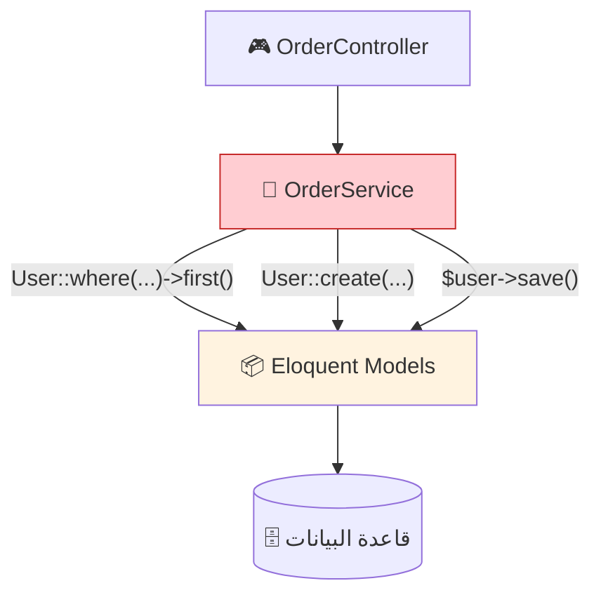
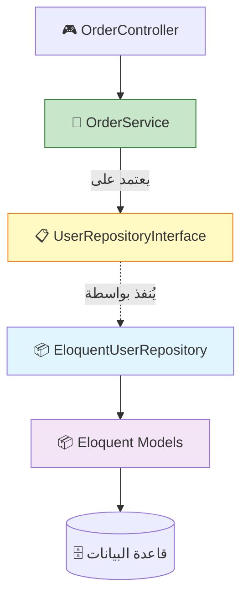
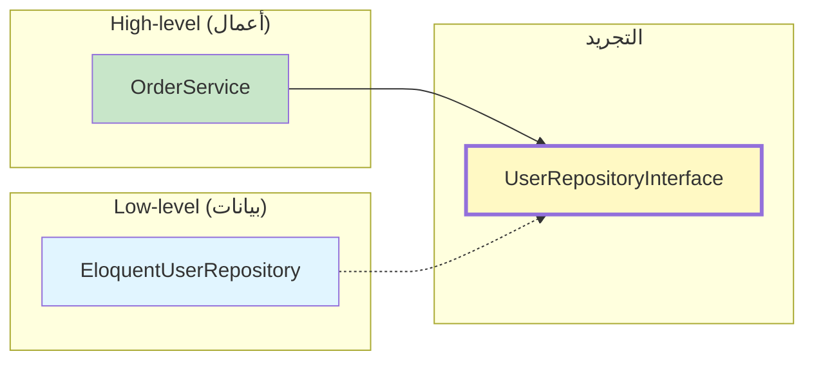
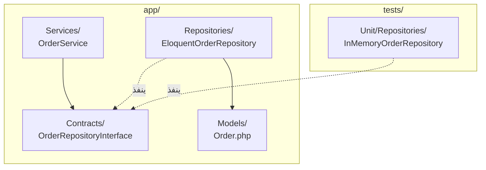
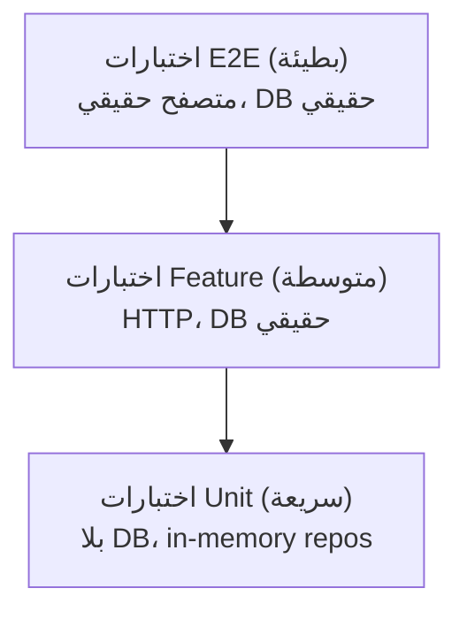

<div dir="rtl">

# الفصل 3: Repository Pattern
## فصل منطق الأعمال عن الوصول إلى البيانات

---

## 1. المشكلة قبل هذه العمارة

بعد تبنّي Service Layer (الفصل 2)، تجد الفرق غالباً نقطة ألم جديدة: خدماتهم مقترنة بشدة بـ Eloquent. دعني أعرض لك ما يبدو عليه هذا.

### 😱 الأعراض

```php
class OrderService
{
    public function place(OrderData $data): Order
    {
        // ❌ استعلامات Eloquent في الـ Service
        $existing = Order::where('user_id', $data->userId)
            ->where('status', 'pending')
            ->where('created_at', '>=', now()->subHour())
            ->first();

        if ($existing) {
            throw new DuplicateOrderException();
        }

        // ❌ تلاعب مباشر بـ Eloquent
        $order = new Order();
        $order->user_id = $data->userId;
        $order->total = $data->total;
        $order->status = 'pending';
        $order->save();

        // ❌ علاقات Eloquent
        foreach ($data->items as $item) {
            $order->items()->create([
                'product_id' => $item->productId,
                'quantity'   => $item->quantity,
            ]);
        }

        // ❌ المزيد من استعلامات Eloquent
        $order->load(['items.product', 'user']);

        return $order;
    }
}
```

**المشاكل خفية لكنها شديدة:**

#### 🐌 1. اختبارات بطيئة
لاختبار هذا الـ Service، تحتاج:
- قاعدة بيانات حقيقية (MySQL/PostgreSQL/SQLite)
- إعداد migrations
- Factories
- قاعدة بيانات اختبار

اختبار Service واحد = 50ms. مجموعة من 100 اختبار = 5+ ثوانٍ. **مجموعة الاختبار بطيئة لأن كل اختبار "unit" هو فعلياً اختبار تكامل.**

#### 🔒 2. قفل قاعدة البيانات
خدمتك تعرف عن Eloquent. للتبديل:
- Eloquent → Doctrine؟ أعد كتابة كل Service.
- MySQL → MongoDB؟ أعد كتابة كل Service.
- قاعدة بيانات SQL → API خارجي؟ أعد كتابة كل Service.

منطق الأعمال **متشابك** مع طبقة الاستمرارية.

#### 🧩 3. N+1 مخفي
```php
return Order::with('items')->get();
```
ثم في View:
```blade
@foreach ($orders as $order)
    {{ $order->items->sum('total') }}
@endforeach
```
قرار "هل يجب eager load؟" متناثر. يجب أن ينسق الـ Service والـ View.

#### 🧪 4. المحاكاة صعبة
```php
// كيف تُحاكي Order::where(...)->first()؟
// لا تستطيع، لأنها method staticة.
```
تلجأ الفرق إلى:
- إعادة هيكلة methods إلى instance methods (تفقد سحر Eloquent)
- استخدام معاملات قاعدة البيانات في الاختبارات (بطيئة)
- تخطي اختبارات Service unit تماماً

#### 🐛 5. منطق الاستعلام متناثر
```php
// في OrderService
$activeOrders = Order::where('status', 'active')->get();

// في OrderController
$recentOrders = Order::where('created_at', '>=', now()->subDay())->get();

// في OrderReport
$bigOrders = Order::where('total', '>', 1000)->get();
```

نفس المفهوم ("الطلبات النشطة") يتم استعلامه بشكل مختلف في 3 أماكن. **غيّر تعريف "نشط" ويجب أن تجد كل مكان.**

#### 🤯 6. السحر هش
methods Eloquent الـ staticة تبدو كـ methods نموذج، لكنها فعلياً استعلامات:
```php
$count = User::count(); // استعلام
$user->count;           // accessor
$user->count();         // ❌ الـ method غير موجودة
```
المطورون الجدد يخلطون بين هذه. الـ Service "يعرف" خفايا Eloquent، وهي معرفة ضمنية.

### الألم الحقيقي

بعد تبنّي Service Layer، لديك:
```php
Service
  ↓ (يعرف عن)
Eloquent Model
  ↓ (يعرف عن)
Database
```

الـ Service **مستوى واحد من التجريد** بعيداً عن قاعدة البيانات. لاختبار منطق الأعمال بمعزل حقيقي، تحتاج **مستويين من التجريد**:

```php
Service
  ↓ (يعرف عن)
Repository Interface   ← مجرد
  ↓ (يُنفذ بواسطة)
Eloquent Repository    ← ملموس
  ↓ (يعرف عن)
Database
```

هذا هو **Repository Pattern**.

---

## 2. لماذا اخترعت هذه العمارة

### السياق التاريخي

**Repository Pattern** من **Domain-Driven Design لـ Eric Evans** (2003) و **"Patterns of Enterprise Application Architecture" لـ Martin Fowler** (2002).

**الأصول (Java المؤسسي في التسعينيات):**

واجهت Java المؤسسية:
- **مصادر بيانات متعددة** (Oracle للطلبات، DB2 للمخزون، mainframe للعملاء)
- **فرق موزعة** (فرق مختلفة تمتلك قواعد بيانات مختلفة)
- **مشاكل قابلية الاختبار** (حاويات EJB كانت بطيئة وصعبة الاختبار)
- **تجزئة ORM** (Hibernate، TopLink، iBATIS، JDBC خام)

اختُرع الـ Repository كـ **واجهة شبيهة بالمجموعة** لمخزن كائنات المجال. أخفى مصدر البيانات الأساسي.

**الرؤية (Fowler):**

> *"الـ Repository يتوسط بين المجال وطبقات تعيين البيانات، working كـ مجموعة في الذاكرة من كائنات المجال."*

الفكرة الأساسية: **الـ Service يفكر في الـ Repository كقائمة في الذاكرة.** أضف، أزل، ابحث، استعلام — جميعها مثل `List<User>`. الـ Service لا يعرف أن هناك قاعدة بيانات، استعلام SQL، أو API طرف ثالث.

**لماذا غزت Laravel:**

Service Container و Facades في Laravel جعلا interfaces و bindings تافهة:
```php
$this->app->bind(UserRepositoryInterface::class, EloquentUserRepository::class);
```

النمط يناسب فلسفة Laravel: **اتفاقية مع المرونة**.

### الفكرة الجوهرية

Repository هو كلاس:
- ينفذ interface (العقد)
- يوفر methods لاستعلام، حفظ، حذف كائنات المجال
- يخفي آلية الاستمرارية (Eloquent، MongoDB، API)
- يُرجع كائنات المجال، وليس نتائج استعلام

الـ Service يعتمد على **الـ interface**، وليس **التنفيذ**. هذا هو **Dependency Inversion Principle** في العمل.

---

## 3. تشبيه من الحياة الواقعية

### 📚 المكتبة

للمكتبة كتب. يريد رواد المكتبة إيجاد كتب.

**بدون Repository:**
يدخل الرائد إلى الرفوف، يعرف نظام ديوي العشري، يتسلق السلّم، يجد الكتاب. يجب أن يعرف الرائد **كيف تُخزّن الكتب**.

**مع Repository:**
يذهب الرائد إلى أمين المكتبة: "هل يمكنك أن تجد لي كتاباً عن العمارة؟" يبحث أمين المكتبة في الفهرس، يحضر الكتاب، يسلمه. لا يعرف الرائد أو يهتم بنظام الحفظ.

**أمين المكتبة هو الـ Repository.** الرائد هو **الـ Service**. نظام تخزين المكتبة هو **قاعدة البيانات**.

- الرائد (Service) يسأل: "ابحث عن كتب لـ Martin Fowler"
- أمين المكتبة (Repository) يُرجع: كائنات `Book`
- الرائد لا يعرف ما إذا كانت الكتب على رفوف، في قاعدة بيانات، أو في مستودع
- يمكن لأمين المكتبة تغيير نظام التخزين (الانتقال إلى مبنى جديد) دون التأثير على رواد المكتبة

### 🍽️ المطعم المُحسَّن

تذكر تشبيه المطعم؟ **النادل (Service)** يأخذ طلبك: "سأطلب السلمون."

**مدير المطبخ (Repository)** يعرف:
- أين يُخزّن السلمون
- كيف يطبخه
- ما المكونات المتوفرة في المخزون

النادل لا يعرف. النادل يقول فقط "سلمون" ويحصل على "طبق سلمون."

إذا غير المطبخ الموردين (Eloquent → MongoDB)، لا يتأثر النادل.

### 🎯 الرؤية الأساسية

> **الـ Repository هو API شبيه بالمجموعة لبياناتك.**
> **الـ Service يعامل الـ Repository كقائمة في الذاكرة.**

كود الـ Service يبدو هكذا:
```php
$user = $this->users->find($id);          // مثل وصول المصفوفة
$users = $this->users->findActive();       // مثل التصفية
$this->users->save($user);                 // مثل تخزين المصفوفة
$this->users->delete($user);               // مثل unset
```

لا SQL. لا Eloquent. فقط عمليات المجال.

---

## 4. الشرح البصري

### قبل: Service مقترن بـ Eloquent



### بعد: Repository Pattern



### Dependency Inversion



**القاعدة:** High-level (Service) يعتمد على التجريد (Interface). Low-level (التنفيذ) يعتمد أيضاً على التجريد. **لا اعتمادية مباشرة بين High-level و Low-level.**

### ما يعيش أين



---

## 5. دورة حياة الطلب

### قبل: Service مع Eloquent

```
🌐 المتصفح: GET /users/123
   ↓
🎮 UserController
   - $user = User::find(123);
   - return view('users.show', compact('user'));
   ↓
📦 Eloquent
   - SELECT * FROM users WHERE id = 123
   - إرجاع User model
   ↓
🗄️ قاعدة البيانات
   ↓
📦 ترطيب الـ model
   ↓
🎮 إرجاع view
   ↓
🌐 المتصفح
```

### بعد: Service + Repository

```
🌐 المتصفح: GET /users/123
   ↓
🎮 UserController
   - $user = $this->users->find(123);  ← يستدعي Repository
   - return view('users.show', compact('user'));
   ↓
💼 UserService
   - $user = $this->users->find(123);  ← يستدعي Repository
   - $user->last_login_at = now();
   - $this->users->save($user);  ← يستدعي Repository
   - return $user;
   ↓
📋 UserRepositoryInterface
   - find(int $id): ?User
   - save(User $user): void
   ↓
📦 EloquentUserRepository  (التنفيذ)
   - public function find(int $id): ?User
       return User::find($id);
   - public function save(User $user): void
       $user->save();
   ↓
📦 Eloquent
   ↓
🗄️ قاعدة البيانات
```

### الفرق الأساسي

في كلتا الحالتين، تُضرب قاعدة البيانات. لكن الآن:
- **الـ Service لا يعرف** ما إذا كان Eloquent، MongoDB، أو API.
- **الـ Controller أيضاً لا يعرف**.
- يمكن للاختبار تبديل `EloquentUserRepository` بـ `InMemoryUserRepository`.
- تبديل قواعد البيانات يعني كتابة تنفيذ جديد، وليس تغيير الـ Service.

---

## 6. هيكل المجلدات

```
app/
├── Http/
│   └── Controllers/
│       └── UserController.php
│
├── Services/                              ← 💼 Service Layer
│   ├── UserService.php
│   └── Contracts/                         ← Interfaces
│       ├── UserServiceInterface.php
│       └── UserRepositoryInterface.php
│
├── Repositories/                          ← 💾 طبقة الوصول إلى البيانات
│   ├── Eloquent/
│   │   ├── EloquentUserRepository.php
│   │   └── EloquentOrderRepository.php
│   ├── Contracts/                         ← إعادة تصدير الـ interfaces
│   │   ├── UserRepositoryInterface.php
│   │   └── OrderRepositoryInterface.php
│   └── InMemory/                          ← للاختبارات
│       ├── InMemoryUserRepository.php
│       └── InMemoryOrderRepository.php
│
├── Models/
│   ├── User.php
│   └── Order.php
│
└── Providers/
    └── RepositoryServiceProvider.php      ← ربط الـ interfaces
```

### لماذا يوجد كل مجلد

| المجلد | الغرض |
|--------|-------|
| `app/Repositories/Eloquent/` | تنفيذات الإنتاج باستخدام Eloquent |
| `app/Repositories/Contracts/` | Interfaces التي تحدد عقود الـ Repository |
| `app/Repositories/InMemory/` | تنفيذات الاختبار باستخدام المصفوفات |
| `app/Providers/RepositoryServiceProvider.php` | يربط الـ interfaces بالتنفيذات |

### خاص بـ Laravel 11/12/13

في Laravel الحديث، يمكنك تسجيل repositories في `app/Providers/AppServiceProvider.php`:

```php
public function register(): void
{
    $this->app->bind(
        \App\Repositories\Contracts\UserRepositoryInterface::class,
        \App\Repositories\Eloquent\EloquentUserRepository::class
    );
}
```

أو أنشئ `RepositoryServiceProvider` مخصص للتنظيم.

---

## 7. مثال Laravel كامل

### 🏥 السيناريو: نظام مستشفى — Patient Repository

### الخطوة 1: الـ Interface (app/Repositories/Contracts/PatientRepositoryInterface.php)

```php
<?php

namespace App\Repositories\Contracts;

use App\Models\Patient;
use Illuminate\Contracts\Pagination\LengthAwarePaginator;
use Illuminate\Support\Collection;

interface PatientRepositoryInterface
{
    public function find(int $id): ?Patient;

    public function findOrFail(int $id): Patient;

    public function findByEmail(string $email): ?Patient;

    public function findByMedicalRecordNumber(string $mrn): ?Patient;

    /**
     * @param array<string, mixed> $criteria
     */
    public function findOneBy(array $criteria): ?Patient;

    /**
     * @param array<string, mixed> $criteria
     * @return Collection<int, Patient>
     */
    public function findBy(array $criteria): Collection;

    /**
     * @return Collection<int, Patient>
     */
    public function findActive(): Collection;

    /**
     * @return Collection<int, Patient>
     */
    public function findAdmittedOn(\DateTimeInterface $date): Collection;

    /**
     * @param array<string, mixed> $attributes
     */
    public function create(array $attributes): Patient;

    public function update(Patient $patient, array $attributes): Patient;

    public function delete(Patient $patient): bool;

    public function paginate(int $perPage = 15, array $filters = []): LengthAwarePaginator;
}
```

**لاحظ:** الـ interface ليس به SQL، ليس به Eloquent. يتحدث لغة المجال: "find active patients"، "find admitted on date"، "create".

### الخطوة 2: تنفيذ Eloquent (app/Repositories/Eloquent/EloquentPatientRepository.php)

```php
<?php

namespace App\Repositories\Eloquent;

use App\Models\Patient;
use App\Repositories\Contracts\PatientRepositoryInterface;
use Illuminate\Contracts\Pagination\LengthAwarePaginator;
use Illuminate\Database\Eloquent\Builder;
use Illuminate\Support\Collection;

class EloquentPatientRepository implements PatientRepositoryInterface
{
    public function __construct(
        private Patient $model,
    ) {}

    public function find(int $id): ?Patient
    {
        return $this->model->find($id);
    }

    public function findOrFail(int $id): Patient
    {
        return $this->model->findOrFail($id);
    }

    public function findByEmail(string $email): ?Patient
    {
        return $this->model->where('email', $email)->first();
    }

    public function findByMedicalRecordNumber(string $mrn): ?Patient
    {
        return $this->model->where('medical_record_number', $mrn)->first();
    }

    public function findOneBy(array $criteria): ?Patient
    {
        return $this->buildQueryFromCriteria($criteria)->first();
    }

    public function findBy(array $criteria): Collection
    {
        return $this->buildQueryFromCriteria($criteria)->get();
    }

    public function findActive(): Collection
    {
        return $this->model
            ->where('status', 'active')
            ->orderBy('name')
            ->get();
    }

    public function findAdmittedOn(\DateTimeInterface $date): Collection
    {
        return $this->model
            ->whereHas('admissions', function (Builder $q) use ($date) {
                $q->whereDate('admitted_at', $date->format('Y-m-d'));
            })
            ->with(['admissions' => function (Builder $q) use ($date) {
                $q->whereDate('admitted_at', $date->format('Y-m-d'));
            }])
            ->get();
    }

    public function create(array $attributes): Patient
    {
        return $this->model->create($attributes);
    }

    public function update(Patient $patient, array $attributes): Patient
    {
        $patient->update($attributes);
        return $patient;
    }

    public function delete(Patient $patient): bool
    {
        return $patient->delete();
    }

    public function paginate(int $perPage = 15, array $filters = []): LengthAwarePaginator
    {
        $query = $this->model->newQuery();

        if (isset($filters['search'])) {
            $query->where(function (Builder $q) use ($filters) {
                $q->where('name', 'like', "%{$filters['search']}%")
                  ->orWhere('email', 'like', "%{$filters['search']}%")
                  ->orWhere('medical_record_number', 'like', "%{$filters['search']}%");
            });
        }

        if (isset($filters['status'])) {
            $query->where('status', $filters['status']);
        }

        return $query->orderBy('name')->paginate($perPage);
    }

    /**
     * @param array<string, mixed> $criteria
     */
    private function buildQueryFromCriteria(array $criteria): Builder
    {
        $query = $this->model->newQuery();
        foreach ($criteria as $key => $value) {
            $query->where($key, $value);
        }
        return $query;
    }
}
```

### الخطوة 3: تنفيذ In-Memory للاختبار (tests/Repositories/InMemoryPatientRepository.php)

```php
<?php

namespace Tests\Repositories;

use App\Models\Patient;
use App\Repositories\Contracts\PatientRepositoryInterface;
use Illuminate\Contracts\Pagination\LengthAwarePaginator;
use Illuminate\Support\Collection;
use Illuminate\Pagination\LengthAwarePaginator as Paginator;

class InMemoryPatientRepository implements PatientRepositoryInterface
{
    /** @var array<int, Patient> */
    private array $patients = [];

    private int $nextId = 1;

    public function find(int $id): ?Patient
    {
        return $this->patients[$id] ?? null;
    }

    public function findOrFail(int $id): Patient
    {
        if (!isset($this->patients[$id])) {
            throw new \Illuminate\Database\Eloquent\ModelNotFoundException();
        }
        return $this->patients[$id];
    }

    public function findByEmail(string $email): ?Patient
    {
        foreach ($this->patients as $p) {
            if ($p->email === $email) return $p;
        }
        return null;
    }

    public function findByMedicalRecordNumber(string $mrn): ?Patient
    {
        foreach ($this->patients as $p) {
            if ($p->medical_record_number === $mrn) return $p;
        }
        return null;
    }

    public function findOneBy(array $criteria): ?Patient
    {
        foreach ($this->patients as $p) {
            if ($this->matches($p, $criteria)) return $p;
        }
        return null;
    }

    public function findBy(array $criteria): Collection
    {
        return collect($this->patients)
            ->filter(fn ($p) => $this->matches($p, $criteria))
            ->values();
    }

    public function findActive(): Collection
    {
        return $this->findBy(['status' => 'active']);
    }

    public function findAdmittedOn(\DateTimeInterface $date): Collection
    {
        // مبسّط لأغراض الاختبار
        return collect($this->patients);
    }

    public function create(array $attributes): Patient
    {
        $patient = new Patient($attributes);
        $patient->id = $this->nextId++;
        $this->patients[$patient->id] = $patient;
        return $patient;
    }

    public function update(Patient $patient, array $attributes): Patient
    {
        $patient->fill($attributes);
        return $patient;
    }

    public function delete(Patient $patient): bool
    {
        unset($this->patients[$patient->id]);
        return true;
    }

    public function paginate(int $perPage = 15, array $filters = []): LengthAwarePaginator
    {
        $items = collect($this->patients);
        if (isset($filters['search'])) {
            $items = $items->filter(fn ($p) =>
                str_contains($p->name, $filters['search']) ||
                str_contains($p->email, $filters['search'])
            );
        }
        $page = request()->input('page', 1);
        return new Paginator(
            $items->forPage($page, $perPage)->values(),
            $items->count(),
            $perPage,
            $page,
        );
    }

    private function matches(Patient $p, array $criteria): bool
    {
        foreach ($criteria as $key => $value) {
            if ($p->{$key} !== $value) return false;
        }
        return true;
    }
}
```

### الخطوة 4: الـ Service باستخدام الـ Repository (app/Services/PatientService.php)

```php
<?php

namespace App\Services;

use App\DataTransferObjects\PatientData;
use App\Events\PatientRegistered;
use App\Exceptions\DuplicatePatientException;
use App\Models\Patient;
use App\Repositories\Contracts\PatientRepositoryInterface;
use App\Services\Contracts\NotificationServiceInterface;
use Illuminate\Support\Facades\DB;
use Illuminate\Support\Facades\Log;

class PatientService
{
    public function __construct(
        private PatientRepositoryInterface $patients,
        private NotificationServiceInterface $notifier,
    ) {}

    public function register(PatientData $data): Patient
    {
        return DB::transaction(function () use ($data) {
            // 1. تحقق من التكرار
            if ($this->patients->findByEmail($data->email)) {
                throw new DuplicatePatientException("البريد مسجل بالفعل");
            }

            if ($this->patients->findByMedicalRecordNumber($data->mrn)) {
                throw new DuplicatePatientException("الرقم الطبي مستخدم بالفعل");
            }

            // 2. أنشئ المريض
            $patient = $this->patients->create([
                'name'                  => $data->name,
                'email'                 => $data->email,
                'date_of_birth'         => $data->dateOfBirth,
                'medical_record_number' => $data->mrn,
                'status'                => 'active',
            ]);

            // 3. أطلق الحدث
            event(new PatientRegistered($patient));

            // 4. سجل
            Log::info('تم تسجيل المريض', ['patient_id' => $patient->id]);

            return $patient;
        });
    }

    public function findActive(): \Illuminate\Support\Collection
    {
        return $this->patients->findActive();
    }

    public function deactivate(Patient $patient): Patient
    {
        return $this->patients->update($patient, ['status' => 'inactive']);
    }
}
```

**لاحظ:** الـ Service لا يقول `Patient::where(...)->first()`. يقول `$this->patients->findByEmail(...)`. **لا Eloquent مرئي.**

### الخطوة 5: الـ Controller النحيف (app/Http/Controllers/PatientController.php)

```php
<?php

namespace App\Http\Controllers;

use App\DataTransferObjects\PatientData;
use App\Http\Requests\StorePatientRequest;
use App\Repositories\Contracts\PatientRepositoryInterface;
use App\Services\PatientService;
use Illuminate\Http\RedirectResponse;
use Illuminate\View\View;

class PatientController extends Controller
{
    public function __construct(
        private PatientService $service,
        private PatientRepositoryInterface $patients,
    ) {}

    public function index(): View
    {
        $patients = $this->patients->paginate(15);
        return view('patients.index', compact('patients'));
    }

    public function store(StorePatientRequest $request): RedirectResponse
    {
        $patient = $this->service->register(PatientData::fromRequest($request));
        return redirect()->route('patients.show', $patient);
    }

    public function show(int $id): View
    {
        $patient = $this->patients->findOrFail($id);
        return view('patients.show', compact('patient'));
    }
}
```

### الخطوة 6: ربط Service Provider (app/Providers/RepositoryServiceProvider.php)

```php
<?php

namespace App\Providers;

use App\Repositories\Contracts\PatientRepositoryInterface;
use App\Repositories\Eloquent\EloquentPatientRepository;
use Illuminate\Support\ServiceProvider;

class RepositoryServiceProvider extends ServiceProvider
{
    public function register(): void
    {
        $this->app->bind(
            PatientRepositoryInterface::class,
            EloquentPatientRepository::class
        );
    }
}
```

### الخطوة 7: اختبار Unit للـ Service (بلا قاعدة بيانات!)

```php
<?php

namespace Tests\Unit\Services;

use App\DataTransferObjects\PatientData;
use App\Exceptions\DuplicatePatientException;
use App\Models\Patient;
use App\Services\Contracts\NotificationServiceInterface;
use App\Services\PatientService;
use Illuminate\Support\Facades\Event;
use Mockery;
use Tests\Repositories\InMemoryPatientRepository;
use Tests\TestCase;

class PatientServiceTest extends TestCase
{
    private InMemoryPatientRepository $patientRepo;
    private PatientService $service;

    protected function setUp(): void
    {
        parent::setUp();

        $this->patientRepo = new InMemoryPatientRepository();
        $notifier = Mockery::mock(NotificationServiceInterface::class);
        $notifier->shouldReceive('send')->zeroOrMoreTimes();

        $this->service = new PatientService($this->patientRepo, $notifier);
    }

    public function test_register_creates_patient(): void
    {
        Event::fake();

        $data = new PatientData(
            name: 'Alice',
            email: 'alice@example.com',
            dateOfBirth: '1990-01-01',
            mrn: 'MRN-12345',
        );

        $patient = $this->service->register($data);

        $this->assertNotNull($patient->id);
        $this->assertEquals('Alice', $patient->name);
        $this->assertEquals('alice@example.com', $patient->email);
    }

    public function test_register_throws_exception_on_duplicate_email(): void
    {
        $this->expectException(DuplicatePatientException::class);

        $this->patientRepo->create([
            'name' => 'موجود',
            'email' => 'taken@example.com',
            'date_of_birth' => '1990-01-01',
            'medical_record_number' => 'MRN-11111',
        ]);

        $this->service->register(new PatientData(
            name: 'جديد',
            email: 'taken@example.com',
            dateOfBirth: '1990-01-01',
            mrn: 'MRN-22222',
        ));
    }

    public function test_find_active_returns_only_active_patients(): void
    {
        $this->patientRepo->create(['name' => 'A', 'email' => 'a@x.com', 'status' => 'active', 'medical_record_number' => '1', 'date_of_birth' => '1990-01-01']);
        $this->patientRepo->create(['name' => 'B', 'email' => 'b@x.com', 'status' => 'inactive', 'medical_record_number' => '2', 'date_of_birth' => '1990-01-01']);

        $active = $this->service->findActive();

        $this->assertCount(1, $active);
        $this->assertEquals('A', $active->first()->name);
    }
}
```

**هذا الاختبار:**
- يعمل في **ميلي ثانية** (بلا DB)
- يختبر **منطق الأعمال** (فحص التكرار، إلخ)
- يستخدم **نفس Repository interface** كإنتاج
- سيمر حتى لو بدلت من MySQL إلى MongoDB

---

## 8. شرح عميق

### Dependency Inversion Principle في العمل

Repository Pattern هو المثال القانوني لـ **Dependency Inversion**:

```
قبل (اعتمادية على التنفيذ):
    OrderService ──→ EloquentUserRepository
    (high-level يعتمد على low-level)

بعد (اعتمادية على التجريد):
    OrderService ──→ UserRepositoryInterface ←─── EloquentUserRepository
    (كلاهما يعتمد على التجريد)
```

**لماذا هذا مهم:**
- يصرح الـ Service بما يحتاجه (interface)
- يوفر التنفيذ ذلك (كلاس)
- يمكن لأي منهما التغيير دون التأثير على الآخر
- الاختبارات توفر تنفيذاً مختلفاً

### مبدأ "تجاهل الاستمرارية" (Persistence Ignorance)

مفهوم DDD أساسي: **طبقة المجال يجب ألا تعرف عن الاستمرارية**.

```php
// ❌ واعٍ بالاستمرارية
class OrderService
{
    public function find(int $id): ?Order
    {
        return Order::with('items')->where('id', $id)->first();
    }
}

// ✅ متجاهل للاستمرارية
class OrderService
{
    public function find(int $id): ?Order
    {
        return $this->orders->find($id); // الـ Repository يتعامل مع الاستمرارية
    }
}
```

الـ Service يفكر في مفاهيم المجال. الـ Repository يتعامل مع التفاصيل التقنية.

### ما الذي يذهب في الـ Repository؟

**يشمل في الـ Repository:**
- ✅ `find($id)`، `findByEmail()`، `findActive()`
- ✅ `create($attributes)`، `update($model, $attributes)`، `delete($model)`
- ✅ `paginate()`، methods الاستعلام
- ✅ `attach()` / `detach()` للعلاقات (أحياناً)
- ✅ العمليات المجمعة

**لا يشمل في الـ Repository:**
- ❌ منطق الأعمال ("إذا كان الإجمالي > 1000، طبق خصماً")
- ❌ التفويض ("المسؤولون فقط يمكنهم رؤية هذا")
- ❌ التأثيرات الجانبية (إرسال البريد، التسجيل)
- ❌ العمليات عبر-aggregates

**القاعدة:** Repository هو **CRUD + استعلامات** لـ aggregate واحد. لا شيء أكثر.

### ما هو "Aggregate"؟

في DDD، **Aggregate** هو عنقود من كائنات المجال يُعامل كوحدة واحدة. على سبيل المثال:
- **Patient Aggregate**: Patient, PatientContact, PatientInsurance
- **Order Aggregate**: Order, OrderItem, OrderShipping

الـ Repository يستمر **جذر** الـ aggregate. تغييرات الجذر تتتالي.

في Laravel، "aggregate" غالباً ما يكون Eloquent model واحد. الـ Repository يخفي Eloquent خلف CRUD.

### نمط Repository العام المضاد

```php
// ❌ نمط مضاد
interface BaseRepositoryInterface
{
    public function find($id);
    public function findAll();
    public function create(array $data);
    public function update($id, array $data);
    public function delete($id);
}
```

هذا عام جداً. كل Repository يصبح ممراً بلا قيمة.

**الإصلاح:** كل Repository لديه methods خاصة بمجاله:

```php
// ✅ خاص بالمجال
interface PatientRepositoryInterface
{
    public function findActive();
    public function findAdmittedOn(\DateTimeInterface $date);
    public function findByMedicalRecordNumber(string $mrn);
    // ...
}
```

### متى تُرجع Collections مقابل نتائج مُصفّحة

```php
// للقوائم الصغيرة والثابتة
public function findActive(): Collection;  // < 1000 عنصر

// للقوائم غير المحدودة
public function paginate(int $perPage = 15): LengthAwarePaginator;  // يمكن أن تكون ملايين

// للسجلات الفردية
public function find(int $id): ?Patient;
public function findOrFail(int $id): Patient;
```

الـ Repository يقرر ما هو مناسب لحالة الاستخدام.

### نمط Query Specification (متقدم)

للاستعلامات المعقدة، يمكنك استخدام **Specification Pattern** (الفصل 24):

```php
// PatientRepositoryInterface
public function findMatching(Specification $spec): Collection;

// الاستخدام
$spec = new ActivePatientSpec()
    ->and(new AdmittedThisWeekSpec())
    ->and(new InDepartmentSpec('Cardiology'));

$patients = $this->patients->findMatching($spec);
```

هذا أكثر تقدماً؛ سنغطيه في الفصل 24.

---

## 9. المزايا

### ✅ 1. اختبارات Unit سريعة كالبرق
الميزة القاتلة. اختبار unit يستخدم InMemoryRepository يعمل في **ميلي ثانية**، ليس ثوانٍ. يمكن لمجموعة الاختبار الكاملة العمل في **ثوانٍ**، ليس دقائق.

### ✅ 2. استمرارية قابلة للتبديل
بدّل من Eloquent إلى Doctrine، MongoDB، أو API خارجي:
- اكتب `MongoPatientRepository` جديد ينفذ `PatientRepositoryInterface`
- اربطه في Service Provider
- **صفر تغييرات في Services أو Controllers**

### ✅ 3. منطق استعلام مركزي
كل منطق "find active patients" في مكان واحد: `EloquentPatientRepository::findActive()`. غيّر التعريف مرة واحدة، جميع المستهلكين يُحدّثون.

### ✅ 4. قابل للمحاكاة في الاختبارات
الـ Service يعتمد على **الـ interface**. الاختبارات تحقن mock أو تنفيذ in-memory. لا حاجة لقاعدة بيانات.

### ✅ 5. حدود واضحة
- Service: منطق الأعمال
- Repository: الوصول إلى البيانات
- Model: بنية البيانات
- Controller: HTTP

كل واحد له وظيفة واضحة.

### ✅ 6. تحسين الأداء في مكان واحد
تحتاج لإضافة eager loading؟ إضافة index؟ تخزين استعلام مؤقتاً؟ **الكل في الـ Repository.** مرة واحدة. كل مستهلك يستفيد.

### ✅ 7. نمذجة مجال أفضل
interface الـ Repository يستخدم لغة المجال (`findActive`، `findAdmittedOn`) بدلاً من اللغة التقنية (`where status = active`).

### ✅ 8. إعداد بيانات اختبار مبسط
في الاختبارات، املأ مسبقاً الـ repository في الذاكرة. لا factories، لا DB seeding، لا migrations.

### ✅ 9. أسهل في القراءة
كود الـ Service يقرأ كمنطق أعمال، وليس وصول قاعدة بيانات.

### ✅ 10. التغليف
منطق الاستعلام الداخلي (joins، subqueries، التحسينات) مخفي. المستهلكون لا يرونه.

### ✅ 11. أسهل في إعادة الهيكلة
تريد تقسيم جدول؟ دمج جداول؟ إضافة طبقة كاش؟ جميع التغييرات في تنفيذ الـ Repository.

### ✅ 12. يدعم Hexagonal Architecture
Repositories هي "ports" في Ports & Adapters. الـ Service هو "domain logic". التنفيذ هو "adapter". (انظر الفصل 10.)

---

## 10. العيوب

### ❌ 1. Boilerplate
كل كيان يحتاج:
- Interface
- تنفيذ Eloquent
- (اختيارياً) تنفيذ اختبار
- ربط في Service Provider

لـ 20 كيان، هذا 60+ ملف فقط لـ Repositories.

### ❌ 2. Eloquent هو بالفعل Repository
Eloquent هو أساساً نمط Repository بحد ذاته. تغليفه يضيف طبقة دون إضافة قيمة دائماً.

```php
// Eloquent
User::find($id)

// Repository
$this->users->find($id)  // يستدعي User::find($id) داخلياً
```

الـ Repository غلاف. هل يستحق التحويل غير المباشر؟

### ❌ 3. تطوير أبطأ
للنماذج الأولية، Repository Pattern يبطئك:
- حدد الـ interface
- نفّذ
- اربط في provider
- احقن في Service
- اختبر

MVC أسرع للنماذج الأولية.

### ❌ 4. انتفاخ الـ Interface
```php
interface UserRepositoryInterface
{
    public function find($id);
    public function findByEmail($email);
    public function findByName($name);
    public function findActive();
    public function findInactive();
    public function findByRole($role);
    public function findCreatedBetween($start, $end);
    public function findWithRecentOrders();
    // ... 30 method أخرى
}
```

**الإصلاح:** استخدم **Specification Pattern** للاستعلامات المعقدة، أو قسّم إلى Repositories متعددة.

### ❌ 5. methods خاصة بـ Eloquent تتسرب
أحياناً تحتاج `withTrashed()`، `with()`، أو `lockForUpdate()`. هذه خاصة بـ Eloquent. يجب أن يكشفها الـ interface بطريقة ما.

**الإصلاح:** استخدم أنواع إرجاع `Builder` خام، أو أضف methods محددة مثل `findWithRelations($id, $relations)`.

### ❌ 6. Repository ≠ Aggregate
في DDD، الـ Repository لـ **Aggregate Root**. Patient لديه عناوين كثيرة، لكن ليس لديك `AddressRepository`. Patient Repository يتعامل مع جميع العناوين.

في Laravel، الفرق غالباً ينشئ Repository لكل Model، حتى عندما لا تكون Models جذور aggregate. هذا سوء فهم لـ DDD.

### ❌ 7. مصدران للحقيقة
الـ interface يقول "find active" لكن التنفيذ يحدد ما يعنيه "active". إذا كان الـ interface عاماً (`findBy(['status' => 'active'])`)، المعنى في الـ Service. إذا كان محدداً (`findActive()`)، المعنى في الـ Repository.

**الإصلاح:** كن متسقاً. methods الخاصة بالمجال تذهب في الـ Repository؛ المعايير العامة تذهب في الـ Service.

### ❌ 8. انحدار الأداء
تنفيذ Repository ساذج يمكن أن يكون أبطأ من Eloquent المباشر (مثلاً عدم استخدام eager loading). يجب أن يعرف المطورون Eloquent جيداً لكتابة Repositories فعالة.

### ❌ 9. صعب للاستعلامات المعقدة
بعض الاستعلامات معقدة بطبيعتها (joins، subqueries، unions). نمذجتها كـ Repository methods يمكن أن يكون محرجاً.

**الإصلاح:** استخدم Query Objects، Specifications، أو SQL خام للحالات المعقدة.

### ❌ 10. ليست كل مصادر البيانات متساوية
Repository لـ Eloquent و Repository لـ API مختلفان جداً. يجب أن يكون الـ interface "المقام المشترك الأدنى" — يفقد بعض الميزات.

### ❌ 11. فخ "Repository العام"
```php
class BaseRepository
{
    public function find($model, $id) { return $model::find($id); }
    public function create($model, $data) { return $model::create($data); }
}
```

هذا نمط مضاد. الـ Repository العام ليس له قيمة مجال. تجنبه.

---

## 11. الأخطاء الشائعة

### ❌ الخطأ 1: Repository كممر لـ Eloquent

```php
// ❌ بلا قيمة
class EloquentUserRepository
{
    public function find($id) { return User::find($id); }
    public function create($data) { return User::create($data); }
}
```

**الإصلاح:** أضف methods خاصة بالمجال تخفي التعقيد.

### ❌ الخطأ 2: إرجاع Eloquent Collections في الـ Interface

```php
// ❌ اقتران وثيق
interface UserRepositoryInterface
{
    public function findActive(): \Illuminate\Database\Eloquent\Collection;
}
```

**الإصلاح:** أرجع `\Illuminate\Support\Collection` (المجموعة الأساسية).

### ❌ الخطأ 3: وضع منطق الأعمال في الـ Repository

```php
// ❌ منطق أعمال في repository
class EloquentUserRepository
{
    public function findActive(): Collection
    {
        $users = User::where('status', 'active')->get();

        // ❌ منطق أعمال هنا
        foreach ($users as $user) {
            $user->discount = $user->totalSpent() > 1000 ? 0.1 : 0;
        }

        return $users;
    }
}
```

**الإصلاح:** منطق الأعمال يبقى في الـ Service. الـ Repository يُرجع البيانات الخام.

### ❌ الخطأ 4: Repository واحد لكل Model دون تفكير

```php
// ❌ نمط مضاد: كل model يحصل على repository
PatientRepository, AddressRepository, EmailRepository,
PhoneRepository, InsuranceRepository, EmergencyContactRepository...
```

**الإصلاح:** Repository واحد لكل **Aggregate Root**. في تطبيق Laravel بسيط، هذا غالباً 1:1 مع Models، لكن في مجالات معقدة، عدة Models قد تكون aggregate واحد.

### ❌ الخطأ 5: methods معايير عامة تتجاوز methods محددة

```php
// ❌ نمط مضاد: "catch-all" findBy
$user = $this->users->findBy(['email' => 'x@y.com']);
$user = $this->users->findBy(['name' => 'Alice']);
$user = $this->users->findBy(['id' => 1]);
```

هذا مجرد `where()` بخطوات إضافية.

**الإصلاح:** استخدم methods محددة (`findByEmail`) للاستعلامات الشائعة، و `findBy` فقط للمعايير الديناميكية حقاً.

### ❌ الخطأ 6: Repository methods تُرجع Query Builders

```php
// ❌ تسرب التجريد
public function query(): Builder
{
    return User::query();
}
```

الآن المستهلكون يمكنهم كتابة أي استعلام Eloquent. الـ Repository لا يضيف قيمة.

**الإصلاح:** أرجع Collections محددة أو paginators، وليس query builders.

### ❌ الخطأ 7: نسيان تحديث Repository الاختبار

تضيف method جديد إلى الـ interface لكن تنسى تنفيذه في `InMemoryUserRepository`. اختبار unit يفشل. كود الإنتاج "يعمل" لكن التجريد مكسور.

**الإصلاح:** اجعل repository الاختبار `abstract` أو لديك فحص CI أن جميع methods منفذة.

### ❌ الخطأ 8: Repository methods تُطلق تأثيرات جانبية

```php
// ❌ تأثير جانبي في repository
public function create(array $data): User
{
    $user = User::create($data);
    Mail::to($user)->send(new WelcomeMail($user)); // ❌ لا
    return $user;
}
```

**الإصلاح:** الـ Repository يفعل CRUD فقط. الـ Service يتعامل مع التأثيرات الجانبية.

### ❌ الخطأ 9: Eloquent المباشر في الـ Service

```php
// ❌ يهزم الغرض
class OrderService
{
    public function place(OrderData $data): Order
    {
        $user = User::find($data->userId); // ❌ يتجاوز UserRepository
        // ...
    }
}
```

**الإصلاح:** اذهب دائماً عبر الـ Repository. حتى لو كان فقط `$this->users->find($id)`.

### ❌ الخطأ 10: نسيان الربط في الاختبارات

```php
// في اختبار
public function test_something()
{
    $service = new OrderService(); // ❌ لا repository مربوط
}
```

**الإصلاح:** اربط repository اختبار في `setUp()`:

```php
protected function setUp(): void
{
    parent::setUp();
    $this->app->bind(UserRepositoryInterface::class, InMemoryUserRepository::class);
}
```

---

## 12. تأثير الأداء

### الـ Repository له تكلفة وقت تشغيل ضئيلة

استدعاء method هو استدعاء method. `$this->users->find($id)` هو نفسه `User::find($id)` من حيث CPU.

### حيث يمكن أن يعاني الأداء

#### 🐌 1. تنفيذ ساذج

```php
// ❌ بطيء: 1 + N استعلام
public function findActive(): Collection
{
    return $this->model->where('status', 'active')->get();
}

// في View
@foreach ($patients as $p)
    {{ $p->doctor->name }} <!-- N+1 -->
@endforeach
```

**الإصلاح:** Eager load في الـ Repository:

```php
// ✅ سريع: 2 استعلام
public function findActive(): Collection
{
    return $this->model->where('status', 'active')->with('doctor')->get();
}
```

#### 🐌 2. indexes مفقودة

الـ Repository يمكن أن يخفي مشاكل الـ index. `where('email', $email)` سريع فقط مع index.

**الإصلاح:** تأكد أن الـ migrations تضيف indexes. وثقها.

#### 🐌 3. Eager Loading غير ضروري

```php
// ❌ يحمّل كل شيء
public function find(int $id): ?Patient
{
    return $this->model->with(['doctor', 'nurse', 'appointments', 'prescriptions'])->find($id);
}
```

**الإصلاح:** methodان: `find()` و `findWithRelations($id, $relations)`.

### تحسين الأداء في الـ Repository

الـ Repository هو **المكان الصحيح** للتحسين:

```php
public function findActive(): Collection
{
    return Cache::remember('active_patients', 3600, function () {
        return $this->model
            ->where('status', 'active')
            ->with('doctor:id,name')
            ->select(['id', 'name', 'doctor_id'])
            ->get();
    });
}
```

التخزين المؤقت، eager loading، اختيار الأعمدة جميعها تحدث في الـ Repository. الـ Service و Controller لا يتغيران.

### الحكم

**الـ Repository لا يضيف overhead وقت تشغيل.** يمكن أن **يخفي** مشاكل الأداء إذا لم تكن حذراً، لكنه يمكن أيضاً أن يكون **المكان المركزي** للتحسين. الانضباط هو نفسه كما هو الحال مع Eloquent المباشر — الـ Repository يجعله أكثر تركيزاً.

---

## 13. الاختبار

### هرم الاختبار يصبح هرمياً حقاً



مع Repositories، يمكنك الحصول على **العديد من اختبارات Unit السريعة** و **عدد أقل من اختبارات التكامل الأبطأ**.

### اختبار Unit: Service + InMemoryRepository (بلا DB)

```php
class OrderServiceTest extends TestCase
{
    public function test_place_order_creates_order_and_deducts_stock(): void
    {
        $orderRepo = new InMemoryOrderRepository();
        $productRepo = new InMemoryProductRepository();
        $productRepo->create(['id' => 1, 'name' => 'Widget', 'stock' => 10]);
        $payment = Mockery::mock(PaymentGateway::class);
        $payment->shouldReceive('charge')->andReturn(true);

        $service = new OrderService($orderRepo, $productRepo, $payment);

        $order = $service->place(new OrderData(
            userId: 1,
            items: [['productId' => 1, 'quantity' => 3]],
            paymentMethod: 'credit_card',
        ));

        $this->assertEquals('pending', $order->status);
        $this->assertEquals(7, $productRepo->find(1)->stock);
    }
}
```

**وقت التشغيل: ~5ms.** بلا DB. منطق خالص.

### اختبار Feature: Controller + EloquentRepository (DB حقيقي)

```php
class OrderControllerTest extends TestCase
{
    use RefreshDatabase;

    public function test_user_can_place_order(): void
    {
        $user = User::factory()->create();
        $product = Product::factory()->create(['stock' => 10]);

        $response = $this->actingAs($user)->post('/orders', [
            'items' => [['product_id' => $product->id, 'quantity' => 3]],
            'payment_method' => 'credit_card',
        ]);

        $response->assertRedirect();
        $this->assertDatabaseHas('orders', ['user_id' => $user->id]);
    }
}
```

**وقت التشغيل: ~200ms.** DB حقيقي. يتحقق من التكامل.

### محاكاة الـ Repository

```php
public function test_controller_calls_service(): void
{
    $mock = $this->mock(OrderRepositoryInterface::class);
    $mock->shouldReceive('create')->once()->andReturn(new Order(['id' => 1]));

    $response = $this->post('/orders', [...]);
    $response->assertRedirect();
}
```

اختبار الـ Controller يُحاكي الـ Repository. لا حاجة لـ DB.

### استراتيجية الاختبار

| نوع الاختبار | يستخدم | قاعدة بيانات؟ | السرعة | التغطية |
|-------------|--------|---------------|--------|----------|
| Service Unit | InMemoryRepository | لا | <10ms | منطق الأعمال |
| Controller Feature | EloquentRepository (حقيقي) | نعم | ~200ms | HTTP + Service + DB |
| Controller Unit | MockedRepository | لا | <10ms | التوجيه HTTP فقط |
| Repository Test | EloquentRepository (حقيقي) | نعم | ~100ms | صحة الاستعلام |

الـ Repository يفتح **اختبارات unit حقيقية** لطبقة الـ Service.

---

## 14. الاستخدام المؤسسي

### متى تستخدم المؤسسات الـ Repository

**جميع تطبيقات Laravel الجادة تقريباً تستخدم Repositories** على الأقل لكيانات المجال الأساسية. شركات مثل:
- **Automattic** (خدمات backend لـ WordPress.com)
- **Envato** (السوق)
- **Toyota** (أنظمة داخلية مؤسسية)
- **Disney** (إدارة المحتوى)
- **The New York Times** (أنظمة النشر)

الـ Repository ممارسة قياسية في:
- أنظمة البنوك (التدقيق، متعدد DB)
- أنظمة الرعاية الصحية (HIPAA، تكامل متعدد الأنظمة)
- التجارة الإلكترونية (متعدد القنوات، قابلية التوسع)
- منصات SaaS (متعدد المستأجرين، backends قابلة للتبديل)

### متى يكون الـ Repository ضرورياً

- ✅ **مصادر بيانات متعددة** (DB رئيسي + read replica + API خارجي)
- ✅ **اختبارات Unit يجب أن تعمل في ميلي ثانية** (خط أنابيب CI/CD)
- ✅ **Domain-Driven Design** هو الهدف
- ✅ **استمرارية قابلة للتبديل** متطلب (مثلاً، أثناء ترحيل قاعدة البيانات)
- ✅ **فريق 5+ مطورين** (حدود واضحة للوصول إلى البيانات)
- ✅ **تطبيق طويل العمر** (2+ سنوات)

### متى الـ Repository مبالغة

- ❌ تطبيق CRUD بسيط
- ❌ مشروع مطور واحد
- ❌ نموذج أولي / MVP
- ❌ دائماً Eloquent، أبداً أي شيء آخر
- ❌ الأداء حرج والـ Repositories تضيف overhead

### النمط "الضبط تماماً"

لمعظم تطبيقات Laravel:
- ✅ استخدم Repositories لـ **كيانات المجال الأساسية** (User, Order, Product)
- ❌ لا تستخدم Repositories لـ **الجداول المساعدة** (sessions, cache, logs)
- ❌ لا تستخدم Repositories لـ **المُدارة بواسطة framework** (migrations, jobs)

هذا يعطيك فائدة قابلية الاختبار دون الإفراط في الهندسة.

### الـ Repository في العمارة الأكبر

في **Clean Architecture** (الفصل 8)، Repositories هي **interfaces في طبقة المجال** مع تنفيذات في طبقة Infrastructure. طبقة Application (Use Cases) تستخدمها.

في **DDD** (الفصل 9)، Repositories مملوكة لـ Aggregate Root. الـ Repository هو الطريقة الوحيدة لتحميل/حفظ Aggregates.

في **Hexagonal Architecture** (الفصل 10)، Repositories هي **outbound ports** مع تنفيذات Eloquent/MongoDB/API.

في جميع الحالات، الـ Repository هو الحد بين منطق الأعمال والبيانات.

---

## 15. قسم المقارنة

### Repository مقابل Eloquent المباشر

| الجانب | Eloquent المباشر | Repository |
|--------|------------------|------------|
| سرعة الاختبار | بطيء (DB مطلوب) | سريع (in-memory ممكن) |
| قابل للمحاكاة | صعب | سهل |
| تغيير قاعدة البيانات | لمس كل ملف | لمس تنفيذ واحد |
| لغة المجال | شبيهة بـ SQL | خاصة بالمجال |
| Boilerplate | منخفض | أعلى |
| قابلية الاكتشاف | منتشرة | مركزية |

### Repository مقابل Service Layer

| الجانب | Service Layer | Repository |
|--------|---------------|------------|
| الغرض | ينسق العمليات | يلخص الوصول إلى البيانات |
| يعرف عن | أشياء متعددة | قاعدة البيانات |
| لديه منطق أعمال | نعم | لا |
| حالة استخدام | "تقديم طلب" | "البحث عن مستخدم بالـ ID" |

**يتزاوجان معاً.** Services تنسق؛ Repositories تستمر.

### Repository مقابل Query Builder

| الجانب | Query Builder | Repository |
|--------|---------------|------------|
| يُرجع | Builder / Collection | كائنات المجال |
| قابل للمحاكاة | صعب (شبيه بالـ static) | سهل (interface) |
| لغة المجال | شبيهة بـ SQL | خاصة بالمجال |
| قابل لإعادة الاستخدام | محدود | عالي |

### Repository مقابل Specification Pattern

| الجانب | Repository | Specification |
|--------|------------|---------------|
| الدقة | لكل aggregate | لكل معيار |
| قابل للتركيب | لا (methods محددة) | نعم (and, or, not) |
| حالة استخدام | استعلامات ثابتة | استعلامات ديناميكية |

**يتزاوجان معاً** (الفصل 24). استخدم Specifications عندما يكون لديك استعلامات ديناميكية كثيرة.

### Repository مقابل Active Record (Eloquent)

| الجانب | Active Record | Repository |
|--------|---------------|------------|
| البيانات + السلوك | نفس الكلاس | منفصلان |
| الاستمرارية | في الـ model | في الـ repository |
| منطق المجال | في الـ model | في الـ service |

Eloquent هو Active Record. Repositories تفصل عن Active Record.

### المقارنة الرئيسية

| النمط | الغرض | سرعة الاختبار | Boilerplate | القيمة |
|-------|-------|----------------|-------------|--------|
| Eloquent المباشر | الاستمرارية | بطيء | لا شيء | منخفضة للاختبار |
| Helper Functions | منطق عديم الحالة | بطيء | منخفض | منخفضة |
| Service Layer | التنسيق | سريع (مع mock repos) | متوسط | عالية |
| Repository | تجريد البيانات | سريع (in-memory) | عالي | عالية |
| Action | عملية واحدة | سريع | متوسط | عالية |
| Active Record (Eloquent) | الاستمرارية + السلوك | بطيء | لا شيء | منخفضة للتطبيقات الكبيرة |

---

## 16. مسار التطور

### التقدم القياسي لمشروع Laravel

```
📊 الشهر 1: "Eloquent المباشر"
   - $user = User::find($id);
   - الألم: صعب الاختبار، صعب تبديل DB

   ↓ الألم: "أريد اختبار unit بدون قاعدة بيانات"

📊 الشهر 3: "أضف Repositories"
   - Interface + تنفيذ Eloquent
   - تنفيذ InMemory للاختبارات
   - Service يعتمد على interface
   - الألم: "الـ interface منتفخ بـ 30 method"

   ↓ الألم: "الكيانات المختلفة لها احتياجات مختلفة"

📊 الشهر 6: "Repositories مُحسَّنة"
   - Repository واحد لكل aggregate
   - methods خاصة بالمجال
   - Specifications للاستعلامات الديناميكية
   - الألم: "منطق المجال في services، لكن Eloquent في كل مكان"

   ↓ الألم: "أريد مجال نقي"

📊 الشهر 9: "طبقة المجال (Clean/DDD)"
   - Repositories في طبقة المجال
   - تنفيذات في Infrastructure
   - Application services (use cases) تستدعي repositories
   - الألم: "سياقات bounded مختلفة تحتاج repositories مختلفة"

   ↓ الألم: "الفرق المختلفة تحتاج للتطور باستقلال"

📊 السنة 1: "Modular Monolith"
   - كل module لديه repositories خاصة به
   - التواصل بين الوحدات عبر interfaces
   - الألم: "بعض الوحدات تحتاج للتوسع باستقلال"

   ↓ الألم: "نحتاج لنشرات معزولة"

📊 السنة 2: "Microservices"
   - كل service لديه repositories خاصة به
   - التواصل عبر APIs/أحداث
```

### متى تتخطى الـ Repository

**تخطَّ إذا:**
- تطبيق CRUD بسيط
- دائماً Eloquent
- أبداً اختبار unit بدون DB
- سرعة التطوير > سرعة الاختبارات

**اعتمد إذا:**
- اختبارات Unit يجب أن تكون سريعة (خط أنابيب CI)
- مصادر بيانات متعددة ممكنة
- الفريق كبير
- مشروع طويل الأجل

الـ Repository هو **العمارة البوابة** إلى Clean، Hexagonal، و DDD. بدونها، تلك العمارات مستحيلة.

---

## 17. أسئلة المقابلة

### مبتدئ

1. **ما هو Repository Pattern؟**
   <details>
   <summary>الإجابة</summary>

   Repository Pattern هو طبقة تجريد بين منطق الأعمال واستمرارية البيانات. يحدد interface لعمليات CRUD على كائن مجال، مع تنفيذات ملموسة (Eloquent، MongoDB، in-memory، إلخ). يعتمد الـ Service على الـ interface، وليس التنفيذ.
   </details>

2. **لماذا تستخدم Repository بدلاً من استدعاء Eloquent مباشرة؟**
   <details>
   <summary>الإجابة</summary>

   لجعل منطق الأعمال قابلاً للاختبار دون قاعدة بيانات، للسماح بتبديل طبقة الاستمرارية، ولمركزية منطق الاستعلام. مع Repository، يمكنك اختبار unit لـ Service في ميلي ثانية مع تنفيذ in-memory. بدونه، كل اختبار يتطلب قاعدة بيانات حقيقية.
   </details>

3. **ما هو interface؟**
   <details>
   <summary>الإجابة</summary>

   Interface هو عقد يحدد توقيعات methods بدون تنفيذ. كلاسات "تنفذ" interfaces. كلاسات أخرى تعتمد على الـ interface، مما يسمح بتنفيذات متعددة. في Laravel، تُربط الـ interfaces بالتنفيذات في Service Provider.
   </details>

4. **ما الفرق بين interface و abstract class؟**
   <details>
   <summary>الإجابة</summary>

   Interface يحدد فقط توقيعات methods (لا تنفيذ). Abstract class يمكن أن يكون به توقيعات وتنفيذات. كلاس يمكنه تنفيذ عدة interfaces لكن يمدد كلاس واحد فقط. استخدم interfaces لـ "ماذا" (العقود)؛ استخدم abstract classes لـ "ماذا" + مشترك "كيف" (template method).
   </details>

5. **ما هو Dependency Inversion Principle؟**
   <details>
   <summary>الإجابة</summary>

   الوحدات عالية المستوى (Services) يجب ألا تعتمد على وحدات منخفضة المستوى (Repositories). كلاهما يجب أن يعتمد على تجريدات (interfaces). هذا هو "D" في SOLID. يمكّن قابلية الاختبار، المرونة، والفصل.
   </details>

### متوسط

6. **ما هو "test double"؟ سمّ 3 أنواع.**
   <details>
   <summary>الإجابة</summary>

   Test double هو بديل للاعتمادية الحقيقية. الأنواع:
   - Dummy: يُمرر لكن لا يُستخدم أبداً
   - Stub: يُرجع قيم مبرمجة مسبقاً
   - Mock: يتحقق من السلوك (هل تم استدعاؤه؟ بأي arguments؟)
   - Spy: يسجل الاستدعاءات للتحقق اللاحق
   - Fake: تنفيذ عامل (مثلاً، قاعدة بيانات in-memory)
   </details>

7. **لماذا يجب أن يكون interface الـ Repository في namespace منفصل عن التنفيذ؟**
   <details>
   <summary>الإجابة</summary>

   حتى يعتمد المستهلكون (Services) فقط على الـ interface، وليس التنفيذ. إذا كان كلاهما في نفس الـ namespace، من السهل استيراد الكلاس الملموس بالخطأ. namespace الـ interface يجعل اتجاه الاعتمادية واضحاً.
   </details>

8. **كيف تربط interface بتنفيذ في Laravel؟**
   <details>
   <summary>الإجابة</summary>

   في method `register()` لـ Service Provider:
   ```php
   $this->app->bind(
       UserRepositoryInterface::class,
       EloquentUserRepository::class
   );
   ```
   أو كـ singleton:
   ```php
   $this->app->singleton(
       UserRepositoryInterface::class,
       EloquentUserRepository::class
   );
   ```
   </details>

9. **ما الفرق بين `bind` و `singleton` في container Laravel؟**
   <details>
   <summary>الإجابة</summary>

   `bind` ينشئ instance جديد في كل مرة تُطلب فيها الاعتمادية. `singleton` ينشئ instance واحد ويعيد استخدامه. استخدم `singleton` للخدمات عديمة الحالة (مثل Repositories) لتوفير الذاكرة. استخدم `bind` عندما تكون الحالة مهمة أو تريد instance جديد في كل مرة.
   </details>

10. **هل يمكن لـ Repository method أن يُرجع paginator؟**
    <details>
   <summary>الإجابة</summary>

    نعم. للقوائم غير المحدودة، إرجاع `LengthAwarePaginator` مناسب. الـ interface يُعلن نوع الإرجاع، وكل من Eloquent و InMemory execution execution execution execution ينفذان paginators. هذا نمط شائع لصفحات الفهرس.
    </details>

### متقدم

11. **كيف تتعامل مع Repository يحتاج للاستعلام عبر aggregates متعددة؟**
    <details>
   <summary>الإجابة</summary>

    لا تفعل. الـ Repository لـ aggregate واحد. الاستعلامات عبر-aggregates تنتمي إلى Query Service أو Specification يجمع بين repositories متعددة. على سبيل المثال، "ابحث عن جميع الطلبات للمرضى النشطين" هو استعلام، وليس Repository method على Order أو Patient.
    </details>

12. **متى تستخدم Specifications مقابل methods Repository محددة؟**
    <details>
   <summary>الإجابة</summary>

    methods محددة: عندما يكون الاستعلام ثابتاً وقابلاً لإعادة الاستخدام (مثلاً، `findActive`). Specifications: عندما يكون الاستعلام ديناميكياً وقابلاً للتركيب (مثلاً، "نشط وفي طب القلب وقبول هذا الأسبوع"). Specifications هي "Specification Pattern" (الفصل 24).
    </details>

13. **فريقك منقسم: Repository واحد لكل Model مقابل Repository واحد لكل Aggregate. كيف تقرر؟**
    <details>
   <summary>الإجابة</summary>

    الـ Repository يجب أن يكون لكل **Aggregate Root**، وليس لكل Model. في تطبيق Laravel بسيط حيث كل Model هو aggregate الخاص به، هم متكافئون. في مجالات معقدة، aggregate يمتد عبر عدة Models (مثلاً، Order + OrderItem + OrderShipping). Repository واحد يتعامل مع الجميع.

    القاعدة: إذا كان حذف الجذر يجب أن يتتالي إلى أجزائه، فهم aggregate واحد. Repository واحد.
    </details>

14. **كيف تهاجر من قاعدة كود "بلا repository" إلى واحدة مع Repositories دون كسر كل شيء؟**
    <details>
   <summary>الإجابة</summary>

    Strangler Fig Pattern:
    (1) اختر Service واحد لديه أكثر منطق استعلام مكرر
    (2) حدد الـ Repository interface بناءً على احتياجاته الفعلية
    (3) نفّذ بـ Eloquent (نفس الاستعلامات، ملفوفة فقط)
    (4) اربط في Service Provider
    (5) أعد هيكلة الـ Service لاستخدام الـ Repository
    (6) شغل جميع الاختبارات؛ السلوك لم يتغير
    (7) كرر للـ Service التالي

    كل هجرة صغيرة. لا إعادة كتابة كبيرة.
    </details>

15. **هل يجب أن تُرجع Repositories Entities أم Models؟**
    <details>
   <summary>الإجابة</summary>

    في DDD الصارم: أرجع Entities (كائنات مجال غنية). في Laravel: أرجع Models (Eloquent) للبراغماتية. Eloquent Models قريبة من Entities. يمكن للـ Repository إخفاء Eloquent بإرجاع نوع مختلف، لكن هذا نادر في Laravel.

    الإجابة البراغماتية: أرجع Eloquent Models. لا تُفرط في الهندسة.
    </details>

### خبير

16. **صمم Repository متعدد المستأجرين حيث كل مستأجر لديه بيانات معزولة. كيف يتغير الـ Repository؟**
    <details>
   <summary>الإجابة</summary>

    يصبح الـ Repository واعياً بالمستأجر. كل استعلام يتضمن `WHERE tenant_id = ?`. يأتي معرف المستأجر الحالي من خدمة `TenantContext`.

    ```php
    class EloquentTenantPatientRepository
    {
        public function __construct(
            private Patient $model,
            private TenantContext $tenant,
        ) {}

        public function find(int $id): ?Patient
        {
            return $this->model
                ->where('tenant_id', $this->tenant->id())
                ->find($id);
        }
    }
    ```

    الـ Service لا يحتاج لمعرفة المستأجرين. الـ Repository يفرض العزل.
    </details>

17. **ترى استعلامات N+1 في الإنتاج. الـ Repository من المفترض أن يصلح هذا. لماذا لا يزال يحدث؟**
    <details>
   <summary>الإجابة</summary>

    الـ Repository يخفي الوصول إلى البيانات لكن لا يعمل eager loading تلقائياً. الإصلاح:
    (1) دقق الـ Repository: هل تم الإعلان عن eager loads؟
    (2) أضف `with()` في methods الـ Repository
    (3) استخدم `Model::preventLazyLoading()` في dev للفشل السريع
    (4) استخدم package `beyondcode/laravel-query-detector` للعثور على N+1s
    (5) أضف اختبار يتحقق من عدد الاستعلامات

    الـ Repository هو المكان الصحيح للإعلان عن eager loading — مرة واحدة.
    </details>

18. **قارن Repositories في Laravel مقابل Java/Spring. ما الفرق؟**
    <details>
   <summary>الإجابة</summary>

    في Spring، Repositories مواطنون من الدرجة الأولى مع توليد قائم على annotations (Spring Data JPA: `interface UserRepository extends JpaRepository<User, Long> {}`). التنفيذات تُولّد تلقائياً. في Laravel، تكتب كلاً من interface والتنفيذ يدوياً.

    نهج Spring: صفر boilerplate، لكن تحكم أقل.
    نهج Laravel: boilerplate أكثر، تحكم كامل.

    كلاهما يحقق نفس الهدف المعماري.
    </details>

---

## 18. التمارين

### التمرين 1: أضف Repository لمشروعك

اختر Service في مشروعك الحالي يحتوي على 3+ استعلامات Eloquent. أعد هيكلة:
- حدد `RepositoryInterface`
- نفّذ `EloquentRepository`
- أنشئ `InMemoryRepository` للاختبارات
- اربط في Service Provider
- أعد هيكلة Service ليستخدم الـ interface
- أضف اختبار unit باستخدام InMemoryRepository
- تحقق أن اختبارات feature الأصلية لا تزال تنجح

### التمرين 2: methods خاصة بالمجال

صمم `ProductRepositoryInterface` لتطبيق تجارة إلكترونية مع:
- `findActive()`
- `findOutOfStock()`
- `findByCategory(int $categoryId)`
- `findLowStock(int $threshold)`
- `findBestSellers(int $limit)`
- `search(string $query)`
- `create(array $data)`، `update()`، `delete()`

نفّذ نسخة Eloquent. اكتب نسخة InMemory.

### التمرين 3: معاينة Specification Pattern

أضف method `findMatching(Specification $spec)` إلى الـ Repository. حدد 2 specifications: `ActiveProductSpec` و `InStockSpec`. الـ Repository يجمعهم بـ AND.

### التمرين 4: هرم الاختبار

أعد هيكلة اختبار feature يستخدم قاعدة بيانات حقيقية. استبدل الـ Service باختبار unit يستخدم InMemoryRepository. تحقق أنه أسرع 10 مرات.

### التمرين 5: Repository في API

ابنِ endpoint API `/api/v1/products` بحيث:
- يستخدم ProductRepository للاستعلامات
- يستخدم API Resources للمخرجات
- لديه اختبارات feature مع DB حقيقي
- لديه اختبارات unit مع InMemoryRepository

### التمرين 6: تنفيذ متعدد

نفّذ `PatientRepositoryInterface` بثلاث طرق:
- `EloquentPatientRepository` (إنتاج)
- `InMemoryPatientRepository` (اختبارات unit)
- `CachedPatientRepository` (decorator، يلف الـ Eloquent بـ Cache::remember)

اربط في الإنتاج: `PatientRepositoryInterface → CachedPatientRepository → EloquentPatientRepository`.

### التمرين 7: تدقيق Repository

دقّق مشروعك:
- كم Service يستخدم Eloquent المباشر؟
- كم استعلام Eloquent مكرر عبر Services؟
- كم سيستفيد من Repository؟
- أعد هيكلة أفضل 3 مرشحين

### التمرين 8: نمط Repository العام المضاد

ابنِ "generic" Repository وشاهد لماذا هو سيء:
- `class BaseRepository { public function find($model, $id) { return $model::find($id); } }`
- استخدمه لـ 3 models مختلفة
- لاحظ فقدان methods الخاصة بالمجال
- أعد الهيكلة إلى Repositories لكل-aggregate

### التمرين 9: تدريب المحاكاة

اكتب اختبار Service بحيث:
- يُحاكي الـ Repository بـ Mockery
- يتحقق أن الـ Repository تم استدعاؤه بـ arguments محددة
- يتحقق أن الـ Service يتعامل بشكل صحيح مع إرجاع الـ Repository

### التمرين 10: Repository مع Specifications

لميزة بحث معقدة (مثلاً، "ابحث عن منتجات في الفئة X، بتقييم > 4، بسعر $10-$100، في المخزون")، استخدم Specifications بدلاً من method Repository طويل.

---

## 🎯 ملخص

**Repository Pattern** يفصل منطق الأعمال عن الوصول إلى البيانات. يمكّن:
- **اختبارات unit سريعة** دون قاعدة بيانات
- **استمرارية قابلة للتبديل** (Eloquent، MongoDB، API)
- **منطق استعلام مركزي**
- **لغة المجال** بدلاً من SQL

**الخلاصات الرئيسية:**
- حدد interface، وليس كلاس فقط
- نفّذ بـ Eloquent للإنتاج
- نفّذ بـ in-memory للاختبارات
- اربط في Service Provider
- استخدم أسماء methods خاصة بالمجال
- أرجع كائنات المجال، وليس query builders

**متى تستخدم:**
- اختبارات Unit تحتاج أن تكون سريعة
- مصادر بيانات متعددة ممكنة
- فريق 5+ مطورين
- مشروع طويل الأجل

**متى لا تستخدم:**
- تطبيق CRUD بسيط
- نموذج أولي فردي
- دائماً Eloquent، أبداً أي شيء آخر

**الخطوة التالية:** ادمج Services مع Repositories (الفصل 4) للحصول على عمارة تطبيق كاملة.

> *"الـ Repository هو الحد بين ما يفعله الكود وكيف تُخزّن البيانات. الـ Service يفكر في لغة المجال؛ الـ Repository يتحدث SQL. يلتقيان عند الـ interface."*

</div>
