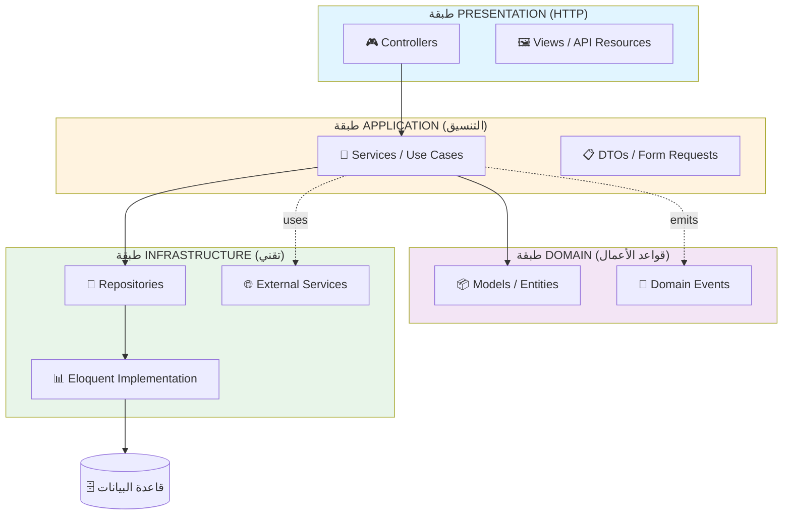
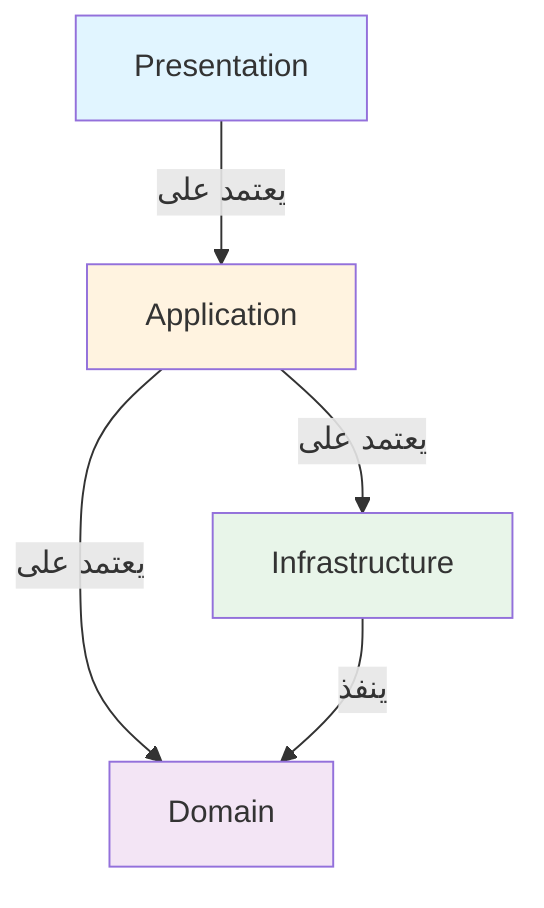
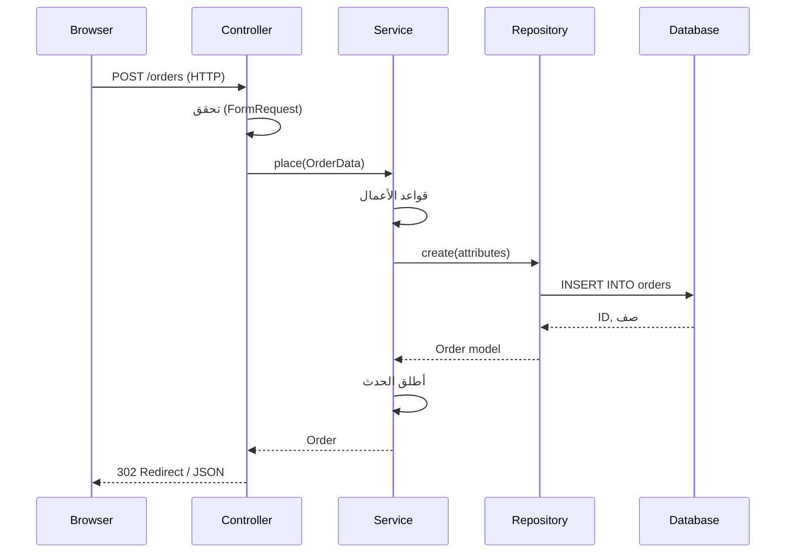
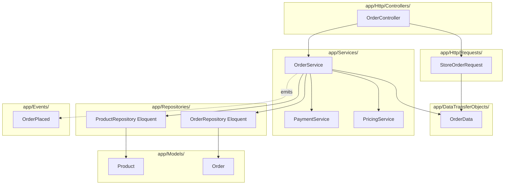
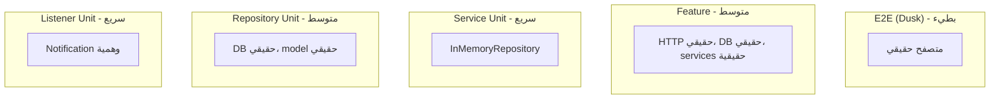

<div dir="rtl">

# الفصل 4: Service + Repository Pattern
## عمارة التطبيق الكاملة

---

## 1. المشكلة قبل هذه العمارة

بعد تبنّي Service Layer (الفصل 2) و Repository Pattern (الفصل 3) بشكل منفصل، تجد الفرق غالباً أنهم يستخدمونها بمعزل عن بعضها. Services تفعل الكثير. Repositories تتسرب إلى Controllers. القطع لا تتناسب معاً.

### 😱 الأعراض

**العرض 1: سوء الاستخدام المختلط**
```php
class OrderController
{
    public function store(Request $request)
    {
        $validated = $this->orderService->validateInput($request);
        
        // ❌ الـ Controller لا يزال يستدعي Repository مباشرة
        $order = $this->orderRepository->create($validated);
        
        // ❌ الـ Controller ينسق
        $this->paymentService->charge($order);
        $this->emailService->send($order);
        $this->inventoryService->decrement($order);
        
        return redirect()->route('orders.show', $order);
    }
}
```

**المشكلة:** الـ Controller يفعل 4 أشياء — validation، الاستمرارية، الدفع، والإشعارات. هناك Service، لكنه يُستخدم لـ method واحد فقط. الـ Repository يُستخدم مباشرة من قبل الـ Controller.

**العرض 2: الـ Service المنتفخ**
```php
class OrderService
{
    public function __construct(
        private OrderRepository $orderRepo,
        private PaymentRepository $paymentRepo,
        private InventoryRepository $inventoryRepo,
        private UserRepository $userRepo,
        private ProductRepository $productRepo,
        private CouponRepository $couponRepo,
        private ShippingRepository $shippingRepo,
        private TaxRepository $taxRepo,
        private NotificationService $notifier,
        private EmailService $mailer,
        private SmsService $sms,
        private AnalyticsService $analytics,
        private LoyaltyService $loyalty,
    ) {}

    public function place(OrderData $data): Order
    {
        // 800 سطر من التنسيق
    }
}
```

**المشكلة:** Service واحد بـ 12 اعتمادية. يفعل كل شيء. لا يمكن اختباره دون محاكاة 12 شيئاً.

**العرض 3: حدود غير متسقة**
```php
// Service A يستخدم Repository
class OrderService
{
    public function __construct(private OrderRepository $orders) {}
    public function place(OrderData $data): Order
    {
        $order = $this->orders->create($data);
        return $order;
    }
}

// Service B يستخدم Eloquent مباشرة
class ProductService
{
    public function create(array $data): Product
    {
        return Product::create($data); // ❌ يتجاوز Repository
    }
}

// Service C لا يستخدم تجريداً
class InventoryService
{
    public function check(int $productId): bool
    {
        $stock = Stock::where('product_id', $productId)->first();
        return $stock->quantity > 0;
    }
}
```

**المشكلة:** لا اتساق. بعض Services تستخدم Repositories، بعضها يستخدم Eloquent مباشرة، بعضها لا يستخدم أياً منهما. المطورون الجدد لا يعرفون الاتفاقية.

**العرض 4: حدود المعاملة خاطئة**
```php
class OrderController
{
    public function store(Request $request)
    {
        DB::beginTransaction();
        try {
            $order = $this->orderService->place($request->all());
            $this->paymentService->charge($order);
            DB::commit();
        } catch (\Exception $e) {
            DB::rollback();
        }
    }
}
```

**المشكلة:** الـ Controller يمتلك المعاملة. لا يمكن استدعاء الـ Service من أمر CLI دون تذكر أن تلتف بمعاملة.

### الألم الحقيقي

بعد استخدام Services و Repositories بمعزل عنهما، يسأل الفريق:
- "أين بالضبط يجب أن أضع هذا المنطق؟"
- "من يمتلك المعاملة؟"
- "هل يجب أن يكون هذا Service method أو Repository method؟"
- "كيف أمنع الـ Controller من فعل الكثير؟"
- "كيف أمنع الـ Service من أن يصبح كلاس إله؟"

هذه الأسئلة تحتاج **قواعد معمارية**، وليس مجرد اتفاقيات. نحتاج **عمارة كاملة** تحدد:
- ماذا تفعل Controllers
- ماذا تفعل Services
- ماذا تفعل Repositories
- كيف تتفاعل
- أين تعيش المعاملات
- أين تُرمى الاستثناءات
- أين تذهب التأثيرات الجانبية

هذه هي **Service + Repository Architecture**.

---

## 2. لماذا اخترعت هذه العمارة

### السياق التاريخي

تركيبة Service Layer + Repository Pattern نشأت من حركات **DDD و Clean Architecture** في أوائل الألفينيات. التأثيرات الرئيسية:

**1. DDD لـ Eric Evans (2003)**
- ميز بين **Domain Services** (المنطق الذي لا يناسب كيان) و **Application Services** (التنسيق).
- حدد **Repositories** كطريقة الوصول الوحيدة إلى aggregates.
- أسس العمارة الطبقية: Presentation → Application → Domain → Infrastructure.

**2. EAA لـ Martin Fowler (2002)**
- وثق Service Layer كنمط.
- وثق Repository كنمط.
- أظهر كيف يعملان معاً.

**3. "Implementing DDD" لـ Vaughn Vernon (2013)**
- صقل التركيبة.
- عرض أمثلة من العالم الحقيقي.
- جعلها عملية لمطوري Java/C#.

**4. تبني Laravel**
Service Container و Facades و Service Providers في Laravel جعلت هذه التركيبة طبيعية. تبناها المجتمع كـ **العمارة الافتراضية** للتطبيقات غير التافهة.

### الفكرة الجوهرية

Service + Repository Architecture لديها 4 طبقات واضحة:

```
┌────────────────────────────────────────┐
│ PRESENTATION (Controllers, Views)      │  ← اهتمامات HTTP
├────────────────────────────────────────┤
│ APPLICATION (Services, Use Cases)      │  ← التنسيق
├────────────────────────────────────────┤
│ DOMAIN (Models, Business Rules)        │  ← منطق الأعمال
├────────────────────────────────────────┤
│ INFRASTRUCTURE (Repositories, DB)      │  ← التفاصيل التقنية
└────────────────────────────────────────┘
```

كل طبقة لديها:
- **مسؤولية واحدة**
- **مدخلات ومخرجات واضحة**
- **قواعد اعتمادية صارمة** (الطبقات العليا تعرف الأدنى؛ الأدنى لا تعرف العليا)

هذا ليس مجرد MVC++. إنها **عمارة تطبيق منضبطة**.

---

## 3. تشبيه من الحياة الواقعية

### 🏢 بنية الشركة

تخيل شركة بها 4 أقسام:

**1. خدمة العملاء (Presentation)**
- تستقبل مكالمات العملاء
- تسأل: "ماذا تحتاج؟"
- تحول إلى القسم المناسب
- ترد على العميل

**2. العمليات (Application Service)**
- تستلم الطلب من خدمة العملاء
- تخطط: "نحتاج لفعل A، B، C، D بالترتيب"
- تنسق الفرق المتخصصة المناسبة
- تُبلّغ مرة أخرى

**3. الفرق المتخصصة (Domain)**
- المحاسبة: تتعامل مع المال
- المخزون: يتعامل مع المخزون
- القانوني: يتعامل مع العقود
- كل فريق لديه خبرته وقواعده الخاصة

**4. التخزين وتكنولوجيا المعلومات (Infrastructure)**
- خزائن الملفات الفعلية
- قواعد البيانات
- الخوادم
- الأرشيفات

**القواعد:**
- خدمة العملاء لا تلمس أبداً خزائن الملفات
- العمليات لا تفعل عمل المحاسبة بنفسها
- المحاسبة لا ترى العملاء
- التخزين لا يقرر ما يُحتفظ به

**Service + Repository Architecture هي بالضبط هذا.**

- **Controller** = خدمة العملاء
- **Service** = العمليات
- **Model/Domain** = الفرق المتخصصة
- **Repository** = التخزين وتكنولوجيا المعلومات

### 🍽️ المطعم المُحسَّن

**النادل (Controller)** يأخذ طلبك. لا يطبخ. لا يخزن الطعام.

**الشيف (Service)** ينسق: "نحتاج لطهي السلمون، تقديمه، واستدعاء العميل." لا يعرف من يأكل.

**المتخصص (Domain)** يعرف: كيف يطبخ السلمون، أي درجة حرارة، أي أطباق جانبية. الشيف يستدعي المتخصص.

**المخزن (Repository)** يحتفظ بالمكونات. لا يطبخ. لا يخدم. المتخصص يجلب من المخزن.

**القواعد:**
- النادل لا يدخل المطبخ أبداً
- الشيف لا يخزن المكونات أبداً
- المتخصص لا يرى العميل أبداً
- المخزن لا يقرر ما يُطهى

**كل دور ذو غرض واحد. التدفق واضح.**

### 🎯 الرؤية الأساسية

> **كل طبقة لها وظيفة واحدة.**
> **كل طبقة تتحدث فقط إلى الطبقة التي تحتها.**
> **لا طبقة تتجاوز إلى طبقة غير مجاورة.**

هذا هو **قانون ديميتر** و **Dependency Inversion Principle** مجتمعين.

---

## 4. الشرح البصري

### العمارة ذات الـ 4 طبقات



### اتجاه الاعتمادية



**القاعدة:**
- Presentation يعتمد على Application
- Application يعتمد على Domain
- Application يعتمد على Infrastructure
- Infrastructure ينفذ interfaces المجال

**لا اعتمادية عكسية.** المجال لا يعرف شيئاً عن Presentation، Application، أو Infrastructure.

### تدفق الطلب



### ما يعيش أين



---

## 5. دورة حياة الطلب

### التدفق الكامل: تقديم طلب

```
🌐 1. المتصفح
   المستخدم يُرسل: POST /orders
   Body: { items: [...], shipping_address, payment_method, coupon }

📍 2. نقطة الدخول (public/index.php)
   Laravel يُقلع، ينشئ Request، يشغل middleware

🛡️ 3. الـ Middleware
   - تم التحقق من CSRF
   - تم مصادقة المستخدم
   - تم التحقق من rate limit

🛣️ 4. التوجيه
   Route::post('/orders', [OrderController::class, 'store'])

🎮 5. الـ Controller (app/Http/Controllers/OrderController.php) — 8 سطور
```php
public function store(StoreOrderRequest $request, OrderService $service)
{
    $order = $service->place(OrderData::fromRequest($request));
    return response()->redirect()->route('orders.show', $order);
}
```

📋 6. Form Request (app/Http/Requests/StoreOrderRequest.php)
   - يتحقق من المدخلات (rules)
   - يفوض (policies)
   - يُرجع 422 مع أخطاء إذا غير صالح
   - يُرجع بيانات منظفة إذا صالحة

📦 7. DTO (app/DataTransferObjects/OrderData.php)
   - مصنع ثابت: OrderData::fromRequest($request)
   - بيانات نقية، بلا اعتمادات Laravel
   - مُمرر إلى Service

💼 8. الـ Service (app/Services/OrderService.php) — 50 سطر
```php
public function place(OrderData $data): Order
{
    return DB::transaction(function () use ($data) {
        // 1. قواعد الأعمال
        $this->validateStock($data);
        $this->validateCoupon($data);

        // 2. حساب التسعير (يفوّض)
        $pricing = $this->pricing->calculate($data);

        // 3. معالجة الدفع (يفوّض)
        $payment = $this->payments->charge($data->paymentMethod, $pricing->total);

        // 4. إنشاء الطلب (يفوّض إلى repository)
        $order = $this->orders->create([
            'user_id' => $data->userId,
            'pricing' => $pricing,
            'payment' => $payment,
        ]);

        // 5. إضافة العناصر (يفوّض)
        $this->orders->addItems($order, $data->items);

        // 6. تقليل المخزون (يفوّض)
        $this->products->decrementStock($data->items);

        // 7. وضع علامة على الكوبون كمستخدم (يفوّض)
        $this->coupons->markUsed($data->couponCode);

        // 8. إطلاق الحدث
        event(new OrderPlaced($order));

        return $order;
    });
}
```

💾 9. الـ Repository (app/Repositories/EloquentOrderRepository.php)
```php
public function create(array $data): Order
{
    return Order::create($data);
}

public function addItems(Order $order, array $items): void
{
    $order->items()->createMany($items);
}
```

📊 10. Eloquent
   - INSERT INTO orders ...
   - INSERT INTO order_items ...

🗄️ 11. قاعدة البيانات
   - معاملة ذرية
   - جميع الإدخالات تنجح أو جميعها تتراجع

📢 12. إطلاق الحدث
   - حدث OrderPlaced
   - Listeners تعمل (بريد ترحيب، مزامنة المخزون، تحليلات)

🌐 13. الاستجابة
   - الـ Controller يُرجع redirect
   - HTTP 302
   - المتصفح ينتقل إلى /orders/123
```

### ماذا تفعل كل طبقة

| الطبقة | المدخلات | المخرجات | الوظيفة |
|--------|---------|---------|---------|
| **Controller** | HTTP Request | HTTP Response | ترجمة HTTP من/إلى المجال |
| **FormRequest** | مدخلات خام | بيانات تم التحقق منها | التحقق، التفويض |
| **DTO** | Array / Request | كائن مكتوب | شكل البيانات |
| **Service** | DTO | كائن مجال | تنسيق سير عمل الأعمال |
| **Repository** | كائن مجال / بيانات | كائن مجال | الاستمرار، الاستعلام |
| **Eloquent** | استعلام | صفوف | الوصول إلى قاعدة البيانات |
| **Event** | كائن مجال | n/a | إخطار التأثيرات الجانبية |
| **Listener** | حدث | تأثير جانبي | التفاعل مع الأحداث |

---

## 6. هيكل المجلدات

### عمارة التطبيق الكاملة

```
app/
├── Http/
│   ├── Controllers/
│   │   ├── Controller.php
│   │   ├── OrderController.php
│   │   └── ProductController.php
│   │
│   ├── Requests/                          ← التحقق والتفويض
│   │   ├── StoreOrderRequest.php
│   │   └── UpdateProductRequest.php
│   │
│   ├── Resources/                         ← تشكيل مخرجات API
│   │   ├── OrderResource.php
│   │   └── ProductResource.php
│   │
│   └── Middleware/
│       └── EnsureUserIsAdmin.php
│
├── Services/                              ← 💼 طبقة Application
│   ├── OrderService.php
│   ├── PricingService.php
│   ├── PaymentService.php
│   ├── InventoryService.php
│   └── Contracts/
│       ├── PaymentGatewayInterface.php
│       └── ShippingProviderInterface.php
│
├── DataTransferObjects/                   ← 📋 بيانات مكتوبة
│   ├── OrderData.php
│   ├── ProductData.php
│   └── PricingResult.php
│
├── Repositories/                          ← 💾 طبقة Infrastructure
│   ├── Contracts/
│   │   ├── OrderRepositoryInterface.php
│   │   └── ProductRepositoryInterface.php
│   └── Eloquent/
│       ├── EloquentOrderRepository.php
│       └── EloquentProductRepository.php
│
├── Models/                                ← 📦 طبقة Domain
│   ├── Order.php
│   ├── Product.php
│   └── User.php
│
├── Events/                                ← 📢 Domain Events
│   ├── OrderPlaced.php
│   └── ProductOutOfStock.php
│
├── Listeners/                             ← ⚙️ التأثيرات الجانبية
│   ├── SendOrderConfirmationEmail.php
│   ├── NotifyWarehouseOfOrder.php
│   └── TrackOrderAnalytics.php
│
├── Exceptions/                            ← 🚨 استثناءات المجال
│   ├── InsufficientStockException.php
│   ├── PaymentDeclinedException.php
│   └── OrderNotFoundException.php
│
├── Jobs/                                  ← ⚡ عمل غير متزامن
│   ├── ProcessPaymentWebhook.php
│   └── GenerateInvoicePdf.php
│
├── Console/
│   └── Commands/
│       ├── ProcessPendingOrders.php
│       └── ImportProductsCommand.php
│
├── Policies/                              ← 🔐 التفويض
│   ├── OrderPolicy.php
│   └── ProductPolicy.php
│
└── Providers/
    ├── AppServiceProvider.php
    ├── DomainServiceProvider.php          ← ربط Repositories
    ├── EventServiceProvider.php           ← تسجيل Listeners
    └── AuthServiceProvider.php
```

### لماذا يوجد كل مجلد

| المجلد | الطبقة | الغرض |
|--------|-------|-------|
| `Http/Controllers/` | Presentation | استقبال HTTP، إرجاع HTTP |
| `Http/Requests/` | Presentation | التحقق، التفويض |
| `Http/Resources/` | Presentation | تشكيل مخرجات API |
| `Services/` | Application | تنسيق سير عمل الأعمال |
| `DataTransferObjects/` | Application | حاويات بيانات مكتوبة |
| `Repositories/` | Infrastructure | الاستمرار والاستعلام |
| `Models/` | Domain | كيانات الأعمال |
| `Events/` | Domain | أشياء حدثت |
| `Listeners/` | Application | التفاعل مع الأحداث |
| `Exceptions/` | Domain | أخطاء خاصة بالمجال |
| `Jobs/` | Application | عمل غير متزامن / في طابور |
| `Policies/` | Domain | قواعد التفويض |
| `Console/Commands/` | Application | نقاط دخول CLI |
| `Providers/` | Infrastructure | ربط interfaces، تسجيل services |

### التعيين

| مفهوم العمارة | مجلد Laravel |
|----------------|--------------|
| Presentation | `Http/Controllers`, `Http/Requests`, `Http/Resources` |
| Application | `Services`, `Jobs`, `Console/Commands` |
| Domain | `Models`, `Events`, `Policies`, `Exceptions` |
| Infrastructure | `Repositories`, `Providers` |

---

## 7. مثال Laravel كامل

### 🏥 السيناريو: نظام قبول المستشفى (عمارة كاملة)

### الخطوة 1: استثناءات المجال (app/Exceptions/)

```php
<?php

namespace App\Exceptions;

class AdmissionException extends \DomainException {}

class RoomUnavailableException extends AdmissionException
{
    public static function forRoom(int $roomId): self
    {
        return new self("الغرفة {$roomId} غير متاحة للقبول.");
    }
}

class DoctorUnavailableException extends AdmissionException
{
    public static function forDoctor(int $doctorId): self
    {
        return new self("الطبيب {$doctorId} غير متاح.");
    }
}

class DuplicateAdmissionException extends AdmissionException {}
```

### الخطوة 2: عقد الـ Repository (app/Repositories/Contracts/)

```php
<?php

namespace App\Repositories\Contracts;

use App\Models\Admission;
use App\Models\Patient;
use App\Models\Room;
use Illuminate\Support\Collection;

interface AdmissionRepositoryInterface
{
    public function find(int $id): ?Admission;
    public function findActiveForPatient(int $patientId): ?Admission;
    public function findByRoom(int $roomId): Collection;
    public function findAdmittedOn(\DateTimeInterface $date): Collection;
    public function create(array $attributes): Admission;
    public function update(Admission $admission, array $attributes): Admission;
    public function delete(Admission $admission): bool;
}

interface RoomRepositoryInterface
{
    public function find(int $id): ?Room;
    public function findAvailable(int $id): ?Room;
    public function markOccupied(int $id): Room;
    public function markAvailable(int $id): Room;
}

interface PatientRepositoryInterface
{
    public function find(int $id): ?Patient;
    public function findOrFail(int $id): Patient;
}
```

### الخطوة 3: تنفيذات Eloquent (app/Repositories/Eloquent/)

```php
<?php

namespace App\Repositories\Eloquent;

use App\Models\Admission;
use App\Repositories\Contracts\AdmissionRepositoryInterface;
use Illuminate\Support\Collection;

class EloquentAdmissionRepository implements AdmissionRepositoryInterface
{
    public function __construct(private Admission $model) {}

    public function find(int $id): ?Admission
    {
        return $this->model->find($id);
    }

    public function findActiveForPatient(int $patientId): ?Admission
    {
        return $this->model
            ->where('patient_id', $patientId)
            ->where('status', 'admitted')
            ->first();
    }

    public function findByRoom(int $roomId): Collection
    {
        return $this->model
            ->where('room_id', $roomId)
            ->where('status', 'admitted')
            ->get();
    }

    public function findAdmittedOn(\DateTimeInterface $date): Collection
    {
        return $this->model
            ->whereDate('admitted_at', $date->format('Y-m-d'))
            ->with('patient', 'doctor', 'room')
            ->get();
    }

    public function create(array $attributes): Admission
    {
        return $this->model->create($attributes);
    }

    public function update(Admission $admission, array $attributes): Admission
    {
        $admission->update($attributes);
        return $admission;
    }

    public function delete(Admission $admission): bool
    {
        return $admission->delete();
    }
}
```

### الخطوة 4: حدث المجال (app/Events/)

```php
<?php

namespace App\Events;

use App\Models\Admission;
use Illuminate\Foundation\Events\Dispatchable;
use Illuminate\Queue\SerializesModels;

class PatientAdmitted
{
    use Dispatchable, SerializesModels;

    public function __construct(
        public readonly Admission $admission,
    ) {}
}
```

### الخطوة 5: الـ DTO (app/DataTransferObjects/)

```php
<?php

namespace App\DataTransferObjects;

use App\Http\Requests\StoreAdmissionRequest;

class AdmissionData
{
    public function __construct(
        public readonly int $patientId,
        public readonly int $doctorId,
        public readonly int $roomId,
        public readonly string $reason,
        public readonly \DateTimeInterface $admittedAt,
        public readonly ?string $notes = null,
    ) {}

    public static function fromRequest(StoreAdmissionRequest $request): self
    {
        return new self(
            patientId:  $request->integer('patient_id'),
            doctorId:   $request->integer('doctor_id'),
            roomId:     $request->integer('room_id'),
            reason:     $request->string('reason'),
            admittedAt: $request->date('admitted_at'),
            notes:      $request->string('notes'),
        );
    }
}
```

### الخطوة 6: Form Request (app/Http/Requests/StoreAdmissionRequest.php)

```php
<?php

namespace App\Http\Requests;

use App\Models\Admission;
use Illuminate\Foundation\Http\FormRequest;

class StoreAdmissionRequest extends FormRequest
{
    public function authorize(): bool
    {
        return $this->user()->can('create', Admission::class);
    }

    public function rules(): array
    {
        return [
            'patient_id'  => ['required', 'exists:patients,id'],
            'doctor_id'   => ['required', 'exists:doctors,id'],
            'room_id'     => ['required', 'exists:rooms,id'],
            'reason'      => ['required', 'string', 'max:500'],
            'admitted_at' => ['required', 'date'],
            'notes'       => ['nullable', 'string', 'max:2000'],
        ];
    }
}
```

### الخطوة 7: الـ Service (app/Services/AdmissionService.php) — الجوهرة

```php
<?php

namespace App\Services;

use App\DataTransferObjects\AdmissionData;
use App\Events\PatientAdmitted;
use App\Exceptions\DoctorUnavailableException;
use App\Exceptions\DuplicateAdmissionException;
use App\Exceptions\RoomUnavailableException;
use App\Models\Admission;
use App\Repositories\Contracts\AdmissionRepositoryInterface;
use App\Repositories\Contracts\PatientRepositoryInterface;
use App\Repositories\Contracts\RoomRepositoryInterface;
use App\Services\Contracts\NotificationServiceInterface;
use Illuminate\Support\Facades\DB;
use Illuminate\Support\Facades\Log;

class AdmissionService
{
    public function __construct(
        private AdmissionRepositoryInterface $admissions,
        private RoomRepositoryInterface $rooms,
        private PatientRepositoryInterface $patients,
        private NotificationServiceInterface $notifier,
    ) {}

    public function admit(AdmissionData $data): Admission
    {
        return DB::transaction(function () use ($data) {
            // 1. تحقق من وجود المريض
            $patient = $this->patients->findOrFail($data->patientId);

            // 2. تحقق من عدم وجود قبول نشط
            if ($this->admissions->findActiveForPatient($patient->id)) {
                throw new DuplicateAdmissionException(
                    "المريض {$patient->id} لديه قبول نشط بالفعل."
                );
            }

            // 3. تحقق من توفر الغرفة
            $room = $this->rooms->findAvailable($data->roomId);
            if (!$room) {
                throw RoomUnavailableException::forRoom($data->roomId);
            }

            // 4. تحقق من توفر الطبيب (مفوّض)
            $this->ensureDoctorAvailable($data->doctorId);

            // 5. أنشئ القبول
            $admission = $this->admissions->create([
                'patient_id'  => $data->patientId,
                'doctor_id'   => $data->doctorId,
                'room_id'     => $room->id,
                'reason'      => $data->reason,
                'admitted_at' => $data->admittedAt,
                'notes'       => $data->notes,
                'status'      => 'admitted',
            ]);

            // 6. ضع علامة على الغرفة كمشغولة
            $this->rooms->markOccupied($room->id);

            // 7. أطلق الحدث
            event(new PatientAdmitted($admission));

            // 8. سجل للتدقيق
            Log::info('تم قبول المريض', [
                'admission_id' => $admission->id,
                'patient_id'   => $admission->patient_id,
                'user_id'      => auth()->id(),
            ]);

            return $admission->fresh(['patient', 'doctor', 'room']);
        });
    }

    public function discharge(int $admissionId, ?string $notes = null): Admission
    {
        return DB::transaction(function () use ($admissionId, $notes) {
            $admission = $this->admissions->find($admissionId);
            if (!$admission) {
                throw new \DomainException("القبول {$admissionId} غير موجود.");
            }

            if ($admission->status !== 'admitted') {
                throw new \DomainException(
                    "لا يمكن الإخراج: الحالة هي {$admission->status}"
                );
            }

            $admission = $this->admissions->update($admission, [
                'status'          => 'discharged',
                'discharged_at'   => now(),
                'discharge_notes' => $notes,
            ]);

            $this->rooms->markAvailable($admission->room_id);

            return $admission;
        });
    }

    private function ensureDoctorAvailable(int $doctorId): void
    {
        $activeCount = $this->admissions->findByRoom(0)
            ->where('doctor_id', $doctorId)
            ->where('status', 'admitted')
            ->count();

        if ($activeCount >= 10) {
            throw DoctorUnavailableException::forDoctor($doctorId);
        }
    }
}
```

### الخطوة 8: الـ Controller النحيف (app/Http/Controllers/AdmissionController.php)

```php
<?php

namespace App\Http\Controllers;

use App\DataTransferObjects\AdmissionData;
use App\Http\Requests\StoreAdmissionRequest;
use App\Models\Admission;
use App\Services\AdmissionService;
use Illuminate\Http\RedirectResponse;
use Illuminate\View\View;

class AdmissionController extends Controller
{
    public function __construct(
        private AdmissionService $service,
    ) {}

    public function index(): View
    {
        $admissions = Admission::with(['patient', 'doctor', 'room'])
            ->latest()
            ->paginate(15);

        return view('admissions.index', compact('admissions'));
    }

    public function store(StoreAdmissionRequest $request): RedirectResponse
    {
        $admission = $this->service->admit(
            AdmissionData::fromRequest($request)
        );

        return redirect()
            ->route('admissions.show', $admission)
            ->with('success', 'تم قبول المريض بنجاح.');
    }

    public function show(Admission $admission): View
    {
        return view('admissions.show', compact('admission'));
    }

    public function destroy(Admission $admission): RedirectResponse
    {
        $this->service->discharge($admission->id);
        return redirect()
            ->route('admissions.index')
            ->with('success', 'تم إخراج المريض.');
    }
}
```

### الخطوة 9: الـ Listener (app/Listeners/NotifyNurseOnAdmission.php)

```php
<?php

namespace App\Listeners;

use App\Events\PatientAdmitted;
use App\Services\Contracts\NotificationServiceInterface;
use Illuminate\Events\Attributes\AsEventListener;

#[AsEventListener(event: PatientAdmitted::class)]
class NotifyNurseOnAdmission
{
    public function __construct(
        private NotificationServiceInterface $notifier,
    ) {}

    public function handle(PatientAdmitted $event): void
    {
        $room = $event->admission->room;
        $patient = $event->admission->patient;

        $this->notifier->send(
            to: $room->nurse?->phone ?? config('hospital.default_nurse'),
            message: "قبول جديد: {$patient->name} في الغرفة {$room->number}",
        );
    }
}
```

### الخطوة 10: أمر CLI (app/Console/Commands/AdmitPatientCommand.php)

```php
<?php

namespace App\Console\Commands;

use App\DataTransferObjects\AdmissionData;
use App\Services\AdmissionService;
use Illuminate\Console\Command;

class AdmitPatientCommand extends Command
{
    protected $signature = 'patient:admit
                            {patient : معرف المريض}
                            {doctor : معرف الطبيب}
                            {room : معرف الغرفة}
                            {reason : السبب}';

    protected $description = 'قبول مريض (يستخدم من الطوارئ / استقبال الهاتف)';

    public function handle(AdmissionService $service): int
    {
        try {
            $admission = $service->admit(new AdmissionData(
                patientId:  (int) $this->argument('patient'),
                doctorId:   (int) $this->argument('doctor'),
                roomId:     (int) $this->argument('room'),
                reason:     (string) $this->argument('reason'),
                admittedAt: now(),
            ));

            $this->info("تم قبول المريض: #{$admission->id}");
            return self::SUCCESS;
        } catch (\App\Exceptions\AdmissionException $e) {
            $this->error("فشل القبول: {$e->getMessage()}");
            return self::FAILURE;
        }
    }
}
```

**لاحظ:** أمر CLI يستخدم نفس `AdmissionService`. **لا تكرار للكود.**

### الخطوة 11: Service Provider للربط (app/Providers/RepositoryServiceProvider.php)

```php
<?php

namespace App\Providers;

use App\Repositories\Contracts\AdmissionRepositoryInterface;
use App\Repositories\Contracts\PatientRepositoryInterface;
use App\Repositories\Contracts\RoomRepositoryInterface;
use App\Repositories\Eloquent\EloquentAdmissionRepository;
use App\Repositories\Eloquent\EloquentPatientRepository;
use App\Repositories\Eloquent\EloquentRoomRepository;
use Illuminate\Support\ServiceProvider;

class RepositoryServiceProvider extends ServiceProvider
{
    public function register(): void
    {
        $this->app->bind(AdmissionRepositoryInterface::class, EloquentAdmissionRepository::class);
        $this->app->bind(PatientRepositoryInterface::class, EloquentPatientRepository::class);
        $this->app->bind(RoomRepositoryInterface::class, EloquentRoomRepository::class);
    }
}
```

### الخطوة 12: معالج الاستثناء (bootstrap/app.php في Laravel 11+)

```php
<?php

use App\Exceptions\AdmissionException;
use App\Exceptions\RoomUnavailableException;
use App\Exceptions\DuplicateAdmissionException;
use Illuminate\Foundation\Application;
use Illuminate\Foundation\Configuration\Exceptions;

return Application::configure(basePath: dirname(__DIR__))
    ->withExceptions(function (Exceptions $exceptions) {
        $exceptions->render(function (AdmissionException $e, $request) {
            if ($request->expectsJson()) {
                return response()->json([
                    'error' => class_basename($e),
                    'message' => $e->getMessage(),
                ], match (true) {
                    $e instanceof RoomUnavailableException => 409,
                    $e instanceof DuplicateAdmissionException => 409,
                    default => 422,
                });
            }

            return back()
                ->withInput()
                ->withErrors(['admission' => $e->getMessage()]);
        });
    })
    ->create();
```

### الصورة الكاملة

```
🌐 المتصفح / CLI / الطابور
   ↓
📍 التوجيه + Middleware
   ↓
🎮 Controller (10 سطور)
   ↓
📋 FormRequest (التحقق)
   ↓
📦 DTO (بيانات مكتوبة)
   ↓
💼 Service (سير عمل الأعمال)
   ↓ (يفوّض إلى)
   ├── 💾 Repository (الاستمرارية)
   ├── 💾 Repositories أخرى
   ├── ⚙️ Services أخرى
   ├── 📢 الأحداث
   └── 🚨 الاستثناءات
   ↓
🗄️ قاعدة البيانات
```

**لاحظ:** كل طبقة لها وظيفة واحدة. كل طبقة تتحدث فقط إلى الطبقة التي تحتها. الـ Controller **8 سطور**. الـ Service **80 سطر، لكن منظم جيداً**.

---

## 8. شرح عميق

### قواعد العمارة

#### القاعدة 1: الـ Controllers نحيفة

```php
// ✅ جيد: 8 سطور
public function store(StoreOrderRequest $request, OrderService $service)
{
    $order = $service->place(OrderData::fromRequest($request));
    return redirect()->route('orders.show', $order);
}

// ❌ سيء: 100 سطر
public function store(Request $request)
{
    // التحقق، الاستعلامات، منطق الأعمال، التأثيرات الجانبية
}
```

**القاعدة:** method الـ Controller يجب أن يكون **5-15 سطر كحد أقصى**. أي شيء أكثر في الطبقة الخاطئة.

#### القاعدة 2: الـ Services لا تعرف عن HTTP

```php
// ❌ سيء
public function place(Request $request): RedirectResponse
{
    // Service يعتمد على HTTP
}

// ✅ جيد
public function place(OrderData $data): Order
{
    // Service لا يعرف شيئاً عن HTTP
}
```

**القاعدة:** Service يقبل DTOs/primitives، يُرجع كائنات مجال. **أبداً** Request/Response.

#### القاعدة 3: الـ Repositories ليس لديها منطق أعمال

```php
// ❌ سيء
public function findActiveWithDiscount(): Collection
{
    $users = User::where('active', true)->get();
    foreach ($users as $user) {
        $user->discount = $user->calculateDiscount(); // ❌ منطق أعمال
    }
    return $users;
}

// ✅ جيد
public function findActive(): Collection
{
    return User::where('active', true)->get();
}
```

**القاعدة:** Repositories تفعل CRUD + استعلامات. منطق الأعمال في Services أو Models.

#### القاعدة 4: المعاملات تعيش في الـ Services

```php
// ❌ سيء: المعاملة في Controller
DB::beginTransaction();
$service->doStuff();
DB::commit();

// ✅ جيد: المعاملة في Service
public function doStuff() {
    return DB::transaction(function () {
        // كل العمل
    });
}
```

**القاعدة:** method الـ Service هو **حد وحدة العمل**. المعاملة تلتف به.

#### القاعدة 5: التأثيرات الجانبية أحداث، وليس كود inline

```php
// ❌ سيء
public function place(OrderData $data): Order
{
    $order = $this->orders->create($data);
    Mail::to($order->user)->send(new OrderConfirmation($order));
    Analytics::track('order_placed');
    Http::post(config('webhooks.orders'), [...]);
    return $order;
}

// ✅ جيد
public function place(OrderData $data): Order
{
    $order = $this->orders->create($data);
    event(new OrderPlaced($order));
    return $order;
}
// Listeners تتعامل مع التأثيرات الجانبية
```

**القاعدة:** Services تُطلق الأحداث. Listeners تتعامل مع التأثيرات الجانبية. هذا يفصل سير العمل الأساسي عن الضوضاء.

#### القاعدة 6: الاستثناءات مجال، وليس HTTP

```php
// ❌ سيء
public function place(): RedirectResponse
{
    if (!$this->isValid()) {
        return back()->withErrors(['msg' => 'غير صالح']); // ❌ HTTP في service
    }
}

// ✅ جيد
public function place(): Order
{
    if (!$this->isValid()) {
        throw new InvalidOrderException("الطلب غير صالح"); // ❌ استثناء مجال
    }
}
```

**القاعدة:** Services ترمي استثناءات المجال. معالج استثناء عالمي يترجم إلى HTTP.

#### القاعدة 7: التفويض في Policies، وليس Controllers

```php
// ❌ سيء: في Controller
public function update(Request $request, Order $order)
{
    if ($order->user_id !== auth()->id()) {
        abort(403);
    }
    $order->update($request->validated());
}

// ✅ جيد: في FormRequest
public function authorize(): bool
{
    return $this->user()->can('update', $this->route('order'));
}
```

**القاعدة:** التفويض مركزي في Policies. الـ FormRequest يستدعيها.

### قواعد الاعتمادية (صارمة)

```
Presentation → Application
Application  → Domain
Application  → Infrastructure
Infrastructure → Domain (ينفذ interfaces)
Domain       → (لا شيء أعلاه)
```

**أمثلة على الانتهاكات:**

| الانتهاك | لماذا سيء |
|----------|-----------|
| Domain Model يستخدم `request()->input()` | المجال يعرف عن HTTP |
| Repository يرمي استثناءات HTTP | Repository يعرف عن HTTP |
| Service يُرجع JSON | Service يعرف عن استجابات API |
| Controller يستخدم `DB::table()` | Controller يعرف عن استعلامات DB |
| Model يُطلق الأحداث مباشرة | Model يعرف عن نظام الأحداث |
| Service يستخدم `auth()->user()` | Service مقترن بسياق مستخدم محدد |

### أين يذهب ماذا: ورقة الغش

| الاهتمام | الطبقة | الملف |
|----------|-------|------|
| قواعد التحقق | Presentation | FormRequest |
| التفويض | Domain | Policy |
| التوجيه | Presentation | routes/*.php |
| Middleware | Presentation | Http/Middleware |
| تشكيل مخرجات API | Presentation | API Resource |
| استجابات خطأ HTTP | Presentation | Exception Handler |
| قواعد الأعمال | Application | Service |
| سير عمل متعدد الخطوات | Application | Service |
| معاملات قاعدة البيانات | Application | Service |
| إرسال البريد | Application | Listener |
| إطلاق Webhooks | Application | Listener |
| استعلامات قاعدة البيانات | Infrastructure | Repository |
| مخطط قاعدة البيانات | Infrastructure | Migration |
| استدعاءات API خارجية | Infrastructure | API Client / Service |
| التخزين المؤقت | Infrastructure | Cache layer |
| التسجيل | Infrastructure | (في كل مكان، لكن غالباً في Service) |
| استثناءات المجال | Domain | Exceptions/ |
| سلوك Model | Domain | Model methods |
| أحداث المجال | Domain | Events/ |
| كائنات القيمة | Domain | Domain/ValueObjects/ |

---

## 9. المزايا

### ✅ 1. الوضوح
كل ملف له مكان واضح. كل اهتمام له منزل واضح. المطورون الجدد يمكنهم إيجاد الكود بسرعة.

### ✅ 2. قابلية الاختبار
- **اختبارات Service** تستخدم InMemoryRepositories (بلا DB)
- **اختبارات Controller** تستخدم services حقيقية + repos حقيقية (مع DB)
- **اختبارات Repository** تتحقق من الاستعلامات
- كل طبقة قابلة للاختبار بمعزل

### ✅ 3. قابلية إعادة الاستخدام
نفس `OrderService::place()` يُستدعى من:
- Web Controller
- API Controller
- أمر CLI
- Job في الطابور
- كود اختبار

### ✅ 4. قابلية الصيانة
غيّر سير عمل الطلب؟ عدّل Service واحد. غيّر التحقق؟ عدّل FormRequest واحد. غيّر قاعدة البيانات؟ عدّل Repository واحد. **التغييرات محلية.**

### ✅ 5. تنفيذ قابل للتبديل
بدّل Eloquent إلى MongoDB؟ اكتب Repository جديد. Service و Controller لا يتغيران.

### ✅ 6. منطق مجال مركزي
قواعد الأعمال تعيش في Services (أو Models). مكان واحد لإيجاد "كيف نحسب التسعير؟"

### ✅ 7. تأثيرات جانبية مفصولة
الأحداث و Listeners تفصل "ماذا حدث" عن "ماذا نفعل بشأنه."

### ✅ 8. السلامة المعاملتية
الـ Service يمتلك المعاملة. كل نقطة دخول تحصل على ذرية تلقائياً.

### ✅ 9. واجهات أمامية متعددة
نفس Service يشغّل ويب، API، موبايل، CLI. المنطق في مكان واحد.

### ✅ 10. إعادة هيكلة أسهل
العمارة تدعم النمو:
- Service يصبح كبيراً جداً → قسّم إلى services أصغر
- Repository يصبح منتفخاً → أضف Specifications
- المجال يصبح معقداً → استخرج Domain Model
- الفريق يتوسع → قسّم إلى modules

### ✅ 11. مراجعات كود أفضل
يمكن للمراجعين قراءة Controllers النحيفة بسرعة. يغوصون في Services عند الحاجة. يثقون في Repositories.

### ✅ 12. سرعة الانضمام
مطور جديد يتعلم:
- "أين يذهب هذا؟" — هناك إجابة.
- "كيف أختبر هذا؟" — هناك نمط.
- "لماذا منظم بهذه الطريقة؟" — القواعد واضحة.

---

## 10. العيوب

### ❌ 1. ملفات أكثر
لميزة صغيرة، لديك:
- Controller
- FormRequest
- DTO
- Service
- Repository interface
- Repository implementation
- Event
- Listener
- Exception

هذا 9 ملفات لميزة واحدة. **Boilerplate عالي.**

### ❌ 2. منحنى التعلم
يجب على المطورين الجدد تعلم:
- الطبقات الـ 4
- ماذا يذهب أين
- لماذا هذه القواعد
- متى يكسرونها

هذا يستغرق أسابيع. حتى ذلك الحين، الكود في غير محله.

### ❌ 3. الإفراط في الهندسة لتطبيقات بسيطة
تطبيق CRUD بـ 5 Controllers لا يحتاج 4 طبقات. الـ overhead حقيقي.

### ❌ 4. شلل "أين يذهب هذا؟"
يناقش المطورون:
- "هل هذا التحقق في FormRequest أم Service؟"
- "هل منطق الأعمال هذا في Service أم Model؟"
- "هل هذا الاستعلام method أم Specification؟"

بدون اتفاقيات قوية، تصبح المناقشات لا نهائية.

### ❌ 5. Repository يصبح غلاف
إذا كانت Repositories مجرد `find($id)` → `Model::find($id)`، فهي ممرات. الـ interface لا يضيف شيئاً.

### ❌ 6. Service لا يزال يمكن أن ينتفخ
مع 5-7 اعتمادات، Service "مقبول". مع 15، هو كلاس إله. الانضباط مطلوب.

### ❌ 7. صعوبة الانتقال
بمجرد أن يكون لديك هذه العمارة، إزالتها صعبة. العديد من الملفات تشير إلى العديد من الملفات الأخرى. إعادة الهيكلة إلى عمارة مختلفة مشروع كبير.

### ❌ 8. Eloquent و المجال لا يزالان متشابكان
نماذج Eloquent لديها `$fillable`، `casts`، علاقات — جميعها اهتمامات استمرارية. في DDD الصارم، كائن المجال ليس لديه أي من هذا. Service + Repository في Laravel لا يزال لديه Eloquent كمجال.

### ❌ 9. صعوبة الترحيل
بمجرد أن يكون لديك هذه العمارة، إزالتها صعبة. العديد من الملفات تشير إلى العديد من الملفات الأخرى. إعادة الهيكلة إلى عمارة مختلفة مشروع كبير.

### ❌ 10. صعوبة Service في أن يصبح منتفخاً
مع 5-7 اعتمادات، Service "مقبول". مع 15، هو كلاس إله. الانضباط مطلوب.

---

## 11. الأخطاء الشائعة

### ❌ الخطأ 1: وضع منطق الأعمال في الـ Controller

```php
// ❌ سيء
public function store(Request $request)
{
    $discount = 0;
    if ($request->coupon_code) {
        $coupon = Coupon::where('code', $request->coupon_code)->first();
        if ($coupon->isValid()) {
            $discount = $coupon->value;
        }
    }
    $total = $request->subtotal - $discount;
    $order = Order::create([...]);
}
```

**الإصلاح:** انقل كل المنطق إلى Service. الـ Controller هو 8 سطور فقط.

### ❌ الخطأ 2: الـ Service يستخدم `auth()->user()` مباشرة

```php
// ❌ سيء: Service مقترن بـ auth
public function place(OrderData $data): Order
{
    $user = auth()->user();
    $order = Order::create(['user_id' => $user->id, ...]);
    return $order;
}
```

**الإصلاح:** اقبل المستخدم كمعامل:

```php
public function place(User $user, OrderData $data): Order
{
    $order = Order::create(['user_id' => $user->id, ...]);
    return $order;
}
```

### ❌ الخطأ 3: الـ Repository يُرجع Query Builders

```php
// ❌ سيء
public function getQuery(): Builder
{
    return User::query();
}
```

**الإصلاح:** أرجع Collection محددة أو كائنات محددة.

### ❌ الخطأ 4: تخطي الـ DTO

```php
// ❌ سيء
public function place(array $data): Order
{
    // ما المفاتيح؟ ما الأنواع؟ ما المطلوب؟
}
```

**الإصلاح:** استخدم DTO دائماً.

```php
public function place(OrderData $data): Order
{
    // Type-safe، موثق ذاتياً
}
```

### ❌ الخطأ 5: وضع التحقق في الـ Service

```php
// ❌ سيء
public function place(OrderData $data): Order
{
    if (!filter_var($data->email, FILTER_VALIDATE_EMAIL)) {
        throw new \InvalidArgumentException('بريد غير صالح');
    }
}
```

**الإصلاح:** التحقق في FormRequest. الـ Service يثق بمدخلاته.

### ❌ الخطأ 6: الـ Listener يفعل الكثير

```php
// ❌ سيء: 500 سطر
class SendOrderConfirmationEmail
{
    public function handle(OrderPlaced $event)
    {
        // أنشئ البريد
        // أرسل البريد
        // سجله
        // تتبع التحليلات
        // حدّث CRM
        // أعلم المستودع
        // أطلق webhook
        // ... 500 سطر أخرى
    }
}
```

**الإصلاح:** listener واحد لكل تأثير جانبي. عدة listeners = عدة كلاسات.

### ❌ الخطأ 7: الـ Service يستدعي الـ Controller

```php
// ❌ نمط مضاد
class OrderService
{
    public function place(OrderData $data)
    {
        $order = $this->orders->create($data);
        // ❌ Service يُرجع استجابة HTTP
        return response()->json(['order' => $order], 201);
    }
}
```

**الإصلاح:** Service يُرجع كائن مجال. الـ Controller يتعامل مع HTTP.

### ❌ الخطأ 8: لا تسلسل استثناءات

```php
// ❌ سيء: استثناءات عامة
throw new \Exception("الغرفة غير متاحة");
throw new \Exception("البريد موجود بالفعل");
```

**الإصلاح:** استثناءات خاصة بالمجال مع تسلسل.

```php
class DomainException extends \Exception {}
class AdmissionException extends DomainException {}
class RoomUnavailableException extends AdmissionException {}
```

### ❌ الخطأ 9: الـ Repository يفعل joins عبر aggregates

```php
// ❌ سيء: Repository يربط Order و Product
public function findOrdersWithProducts(): Collection
{
    return DB::table('orders')
        ->join('products', 'orders.product_id', '=', 'products.id')
        ->get();
}
```

**الإصلاح:** كل Repository يتعامل مع aggregate واحد. الاستعلامات عبر-aggregates في query service أو Specification.

### ❌ الخطأ 10: الـ DTO يعكس الـ Model

```php
// ❌ سيء
class OrderData
{
    public function __construct(
        public readonly int $id,
        public readonly int $user_id,
        public readonly float $total,
        public readonly string $status,
        public readonly Carbon $created_at,
        // ... 20 حقل آخر
    ) {}
}
```

**الإصلاح:** DTO لـ **المدخلات** إلى Service. استخدم `OrderResource` منفصل (API Resource) للمخرجات.

---

## 12. تأثير الأداء

### العمارة لها تكلفة وقت تشغيل ضئيلة

استدعاء method هو استدعاء method. الطبقات تضيف:
- استدعاء دالة إضافي واحد (ميكروثانية)
- إنشاء كائن إضافي واحد (ميكروثانية)
- لا استعلامات قاعدة بيانات إضافية
- لا استدعاءات شبكة إضافية

### حيث يمكن أن يعاني الأداء

#### 🐌 1. Eager Loading غير ضروري في الـ Repository

```php
// ❌ يحمّل دائماً كل شيء
public function find(int $id): ?Order
{
    return Order::with(['items', 'items.product', 'user', 'shipping'])->find($id);
}
```

**الإصلاح:** methods متعددة (`find`، `findWithItems`، `findFull`).

#### 🐌 2. N+1 في الـ Service

```php
// ❌ Service يفعل استعلاماته الخاصة
$orders = $this->orders->findAll();
foreach ($orders as $order) {
    $order->user = $this->users->find($order->user_id);
}
```

**الإصلاح:** استخدم Repository مع eager loading.

#### 🐌 3. تأثيرات جانبية متزامنة

```php
// ❌ يحجب الطلب
public function place(OrderData $data): Order
{
    $order = $this->orders->create($data);
    Mail::to($order->user)->send(new Confirmation($order)); // ❌ بطيء
    Http::post($webhookUrl, $order->toArray()); // ❌ بطيء
    return $order;
}
```

**الإصلاح:** ضع التأثيرات الجانبية في طابور.

```php
// ✅ Listeners في طابور
class SendOrderConfirmationEmail implements ShouldQueue
{
    // ...
}
```

#### 🐌 4. Eager Loading المفرط في الـ Repository

```php
// ❌ يحمّل 100MB من البيانات عندما تحتاج 1MB
public function find(int $id): ?User
{
    return User::with(['posts', 'posts.comments', 'orders', 'addresses'])->find($id);
}
```

**الإصلاح:** methods محددة لاحتياجات محددة.

### حيث يتحسن الأداء

#### ⚡ 1. تحسين الاستعلام المركزي

الـ Repository هو **المكان الوحيد** لتحسين الاستعلامات. أضف eager loading مرة واحدة؛ كل مستهلك يستفيد.

#### ⚡ 2. التخزين المؤقت في الـ Repository

```php
public function findActive(): Collection
{
    return Cache::remember('active_users', 3600, function () {
        return $this->model->where('status', 'active')->get();
    });
}
```

#### ⚡ 3. فصل التأثيرات الجانبية

يصبح التخزين في طابور طبيعياً لأن الأحداث و Listeners منفصلة.

### الحكم

العمارة نفسها **محايدة للأداء**. انضباط تنظيم الكود يجعل الأداء **أسهل في التفكير**. الـ Repository هو المكان الصحيح للتحسين؛ الـ Service هو المكان المناسب لتنسيق العمل غير المتزامن.

---

## 13. الاختبار

### استراتيجية الاختبار



### اختبار Unit للـ Service (بلا DB)

```php
class OrderServiceTest extends TestCase
{
    public function test_place_creates_order_with_correct_data(): void
    {
        Event::fake();

        $orderRepo = new InMemoryOrderRepository();
        $productRepo = new InMemoryProductRepository();
        $productRepo->create(['id' => 1, 'name' => 'Widget', 'stock' => 10]);
        $payment = Mockery::mock(PaymentGateway::class);
        $payment->shouldReceive('charge')->andReturn(true);

        $service = new OrderService($orderRepo, $productRepo, $payment);

        $order = $service->place(new OrderData(
            userId: 1,
            items: [['productId' => 1, 'quantity' => 3]],
            paymentMethod: 'credit_card',
        ));

        $this->assertEquals('pending', $order->status);
        Event::assertDispatched(OrderPlaced::class);
    }
}
```

**وقت التشغيل: ~5ms.** بلا DB. منطق خالص.

### اختبار Feature (HTTP + DB حقيقي)

```php
class OrderControllerTest extends TestCase
{
    use RefreshDatabase;

    public function test_user_can_place_order(): void
    {
        Event::fake();

        $user = User::factory()->create();
        $product = Product::factory()->create(['stock' => 10]);
        $this->mock(PaymentGateway::class, fn ($m) => 
            $m->shouldReceive('charge')->andReturn(new PaymentResult(success: true))
        );

        $response = $this->actingAs($user)->post('/orders', [
            'items' => [['product_id' => $product->id, 'quantity' => 3]],
            'payment_method' => 'credit_card',
        ]);

        $response->assertRedirect();
        $this->assertDatabaseHas('orders', ['user_id' => $user->id]);
        Event::assertDispatched(OrderPlaced::class);
    }
}
```

**وقت التشغيل: ~200ms.** DB حقيقي. يتحقق من التكامل.

### اختبار Unit للـ Listener (بلا DB)

```php
class SendOrderConfirmationEmailTest extends TestCase
{
    public function test_listener_sends_email_with_correct_data(): void
    {
        Mail::fake();
        $notifier = Mockery::mock(NotificationService::class);
        $notifier->shouldReceive('send')->once()
            ->withArgs(function ($to, $message) {
                return str_contains($message, 'الطلب #123');
            });

        $listener = new SendOrderConfirmationEmail($notifier);
        $listener->handle(new OrderPlaced($this->makeOrder()));

        Mail::assertSent(OrderConfirmationMail::class);
    }
}
```

### مصفوفة التغطية

| الاختبار | الغرض | السرعة | DB؟ |
|----------|-------|--------|-----|
| Service Unit | منطق الأعمال | <10ms | لا |
| Repository Unit | صحة الاستعلام | ~100ms | نعم |
| Listener Unit | التأثير الجانبي | <10ms | لا |
| Controller Feature | HTTP + سير العمل | ~200ms | نعم |
| E2E (Dusk) | رحلة المستخدم | ~5s | نعم |

العمارة تمكن **اختبارات unit سريعة** (معظم اختباراتك) و **اختبارات تكامل أبطأ أقل**.

---

## 14. الاستخدام المؤسسي

### متى تستخدم المؤسسات Service + Repository

**الغالبية العظمى من تطبيقات Laravel الجادة تستخدم هذا النمط.** إنه المعيار الفعلي للتطبيقات غير التافهة.

شركات مثل:
- **Disney** (إدارة المحتوى)
- **BBC** (النشر)
- **Toyota** (أنظمة داخلية مؤسسية)
- **9GAG** (منصة اجتماعية عالية النطاق)
- **Tesla** (أنظمة الوكلاء)
- **Slack** (إدارة المستخدمين)

### متى يكون ضرورياً

- ✅ 10+ Controllers
- ✅ 3+ مطورين
- ✅ نقاط دخول متعددة (ويب، API، CLI، jobs)
- ✅ اختبارات Unit يجب أن تكون سريعة
- ✅ تطبيق طويل العمر
- ✅ منطق أعمال غير تافه

### متى يكون مبالغة

- ❌ CRUD بسيط
- ❌ نموذج أولي فردي
- ❌ <5 Controllers
- ❌ التطبيق قصير العمر

### "العمارة الضبط تماماً"

لمعظم تطبيقات Laravel، هذه هي **العمارة التي يجب أن تستخدمها**. إنها **منطقة Goldilocks**:

- بنية أكثر من MVC وحده
- تعقيد أقل من Clean/DDD
- تحل حالة الـ 80%

### ما وراء هذا: متى تتطور

الخطوات التالية في التطور:
- **أضف DTOs في كل مكان** (الفصل 6)
- **أضف Action classes** (الفصل 5)
- **أضف CQRS** للأنظمة القراءة-الثقيلة (الفصل 13)
- **اعتمد DDD** للمجالات المعقدة (الفصل 9)
- **اعتمد Clean Architecture** للحدود الصارمة (الفصل 8)
- **اعتمد Hexagonal** للمحولات القابلة للتبديل (الفصل 10)
- **اعتمد Modular Monolith** لتوسع الفريق (الفصل 15)
- **اعتمد Microservices** للنشرات المستقلة (الفصل 16)

Service + Repository هي **الأساس**؛ الباقي **تخصصات**.

---

## 15. قسم المقارنة

### Service+Repository مقابل MVC الخالص

| الجانب | MVC الخالص | Service+Repository |
|--------|------------|-------------------|
| حجم Controller | 100+ سطر | 5-15 سطر |
| سرعة الاختبار | بطيء (DB) | سريع (in-memory) |
| قابلية إعادة الاستخدام | لكل-controller | جميع نقاط الدخول |
| منطق المجال | متناثر | مركزي |
| المعاملة | يدوي | تلقائي |
| التأثيرات الجانبية | inline | أحداث |

### Service+Repository مقابل Clean Architecture

| الجانب | Service+Repository | Clean Architecture |
|--------|--------------------|-------------------|
| نقاء المجال | بعض Eloquent | مجال خالص |
| الـ Frameworks | مقترن | مفصول |
| الطبقات | 4 (منطقية) | 4 (مجلدات فعلية) |
| التعقيد | متوسط | عالي |
| الفريق | أي | ناضج |

Service+Repository هي **نسخة Laravel البراغماتية** من Clean Architecture.

### Service+Repository مقابل DDD

| الجانب | Service+Repository | DDD |
|--------|--------------------|-----|
| Aggregates | Models | Aggregate roots غنية |
| Repositories | لكل Model | لكل Aggregate |
| أحداث المجال | نعم | نعم |
| Value Objects | نادر | مواطنون من الدرجة الأولى |
| اللغة الموحدة (Ubiquitous Language) | متغير | مركزي |

Service+Repository هي **مجموعة فرعية** من DDD. DDD تضيف aggregates، value objects، والتصميم الاستراتيجي.

### Service+Repository مقابل Modular Monolith

| الجانب | Service+Repository | Modular Monolith |
|--------|--------------------|------------------|
| الحدود | بالطبقة | بالوحدة (module) |
| بنية المجلد | مسطحة | متداخلة |
| توسع الفريق | بعض | عالي |
| الاقتران | متوسط | منخفض |

Service+Repository هي **العمارة داخل وحدة**. Modular Monolith هي **العمارة عبر الوحدات**.

### المقارنة الرئيسية

| العمارة | التعقيد | الأفضل لـ | حجم الفريق |
|---------|---------|----------|------------|
| MVC | منخفض | تطبيقات CRUD | 1-5 |
| Service Layer | متوسط | تطبيقات بمنطق | 5-15 |
| Repository | متوسط | متعدد DB | 5-15 |
| **Service + Repository** | **متوسط** | **تطبيقات قياسية** | **5-20** |
| Action | متوسط | API عالي الحركة | 5-20 |
| DTO | منخفض | طبقة API | أي |
| Clean | عالي | مجالات معقدة | 10+ |
| DDD | عالي | استراتيجي | 10+ |
| Hexagonal | عالي | فصل | 5+ |
| Microservices | عالي جداً | نطاق ضخم | 20+ |

---

## 16. مسار التطور

### المسار القياسي لمشروع Laravel

```
📊 الشهر 1: "فقط اشحنه"
   - MVC خالص
   - Controllers ضخمة
   - الألم: methods بطول 200 سطر في Controller

   ↓

📊 الشهر 3: "أحتاج لإعادة استخدام هذا"
   - Service Layer مُدخل
   - Controllers نحيفة
   - الألم: "أريد اختبارات unit، وليس feature tests"

   ↓

📊 الشهر 6: "أريد تبديل قاعدة البيانات"
   - Repository Pattern مضاف
   - InMemoryRepository للاختبارات
   - Service يعتمد على interface
   - الألم: "منطق المجال في Services، لكن Eloquent في كل مكان"

   ↓

📊 الشهر 9: "أريد مجال نقي"
   - أضف DTOs
   - أضف Domain Events
   - أضف Domain Exceptions
   - ربما استخرج Aggregate Roots
   - الألم: "مجالات مختلفة مختلطة في تطبيق واحد"

   ↓

📊 السنة 1: "أحتاج حدود وحدات"
   - Modular Monolith
   - كل module لديه Services + Repositories خاصة به
   - الألم: "بعض الوحدات تحتاج للتوسع باستقلال"

   ↓

📊 السنة 2: "أحتاج لنشرات معزولة"
   - Microservices
   - كل module خدمة منفصلة
   - الألم: "الأنظمة الموزعة صعبة"

   ↓

📊 السنة 3: "أحتاج لتدقيق كامل"
   - Event Sourcing
   - كل تغيير حالة هو حدث
   - نماذج القراءة هي إسقاطات
```

### الرؤية الأساسية: Service + Repository هي الأساس

بدون Services و Repositories، **لا يمكنك** تبنّي:
- Clean Architecture
- DDD
- Hexagonal
- Modular Monolith
- Microservices
- Event Sourcing

هم **المتطلب الأساسي** لكل ما يأتي بعدهم.

### متى تتوقف

ليس كل مشروع يتطور إلى microservices. كثير يبقى عند Service + Repository لعمر التطبيق. **هذا جيد.** هذه هي **العمارة الصحيحة لـ 80% من تطبيقات Laravel**.

الخطوة التالية فقط مبررة عندما ألم العمارة الحالية يتجاوز تكلفة الجديدة.

---

## 17. أسئلة المقابلة

### مبتدئ

1. **ما هي Service Layer + Repository Pattern؟**
   <details>
   <summary>الإجابة</summary>

   هي عمارة ذات 4 طبقات:
   - Presentation: Controllers, Requests, Resources
   - Application: Services, DTOs, Events
   - Domain: Models, Exceptions, Policies
   - Infrastructure: Repositories, Providers

   Services تنسق سير عمل الأعمال باستخدام Repositories للوصول إلى البيانات. العمارة تفرض حدوداً واضحة واعتمادات.
   </details>

2. **ما الفرق بين Service و Repository؟**
   <details>
   <summary>الإجابة</summary>

   Service ينسق عمليات الأعمال (مثلاً، "تقديم طلب": تحقق، اشحن، استمر، أعلم). Repository يلخص الوصول إلى البيانات (مثلاً، "ابحث عن مستخدم بالـ ID"). Services تستخدم Repositories. لديهم مسؤوليات مختلفة.
   </details>

3. **أين يجب أن يعيش التحقق؟**
   <details>
   <summary>الإجابة</summary>

   التحقق من المدخلات (required، format، uniqueness) يعيش في FormRequest classes. التحقق من قواعد الأعمال (مثلاً، "يجب أن يكون عمر المستخدم 18+") يعيش في الـ Service. الـ Service يثق بمدخلاته من FormRequest؛ يفرض قواعد المجال.
   </details>

4. **لماذا تستخدم DTO بدلاً من array؟**
   <details>
   <summary>الإجابة</summary>

   DTOs مكتوبة (autocompletion، مساعدة IDE)، موثقة ذاتياً، ثابتة (readonly)، وصريحة حول الحقول المطلوبة/الاختيارية. Arrays فضفاضة؛ DTOs صارمة.
   </details>

5. **ما هو Event و Listener؟**
   <details>
   <summary>الإجابة</summary>

   الحدث يمثل شيئاً حدث (OrderPlaced, UserRegistered). Listener يتفاعل مع الحدث (أرسل بريد، حدّث المخزون، سجل). Services تُطلق الأحداث؛ Listeners تتعامل مع التأثيرات الجانبية. هذا يفصل سير العمل عن ردود الفعل.
   </details>

### متوسط

6. **أين يجب أن تعيش معاملات DB؟ لماذا؟**
   <details>
   <summary>الإجابة</summary>

   في الـ Service. الـ Service هو حد وحدة العمل. كل نقطة دخول (Controller، CLI، Job) تحصل على ذرية تلقائياً. إذا كان Controller يمتلك المعاملة، يجب على كل نقطة دخول أن تتذكر أن تلتف.
   </details>

7. **ما هو Domain Exception؟ كيف يختلف عن Exception عام؟**
   <details>
   <summary>الإجابة</summary>

   Domain Exception يمثل انتهاك قاعدة أعمال (InsufficientStockException، PaymentDeclinedException). هو خاص بالمجال. الـ Service يرميه؛ معالج استثناء عالمي يترجم إلى HTTP. الاستثناءات العامة (`\Exception`) لا تحمل معنى المجال.
   </details>

8. **كيف تتعامل مع "التأثيرات الجانبية" في طبقة Service؟**
   <details>
   <summary>الإجابة</summary>

   أطلق أحداث من الـ Service. Listeners تتعامل مع التأثيرات الجانبية. هذا يبقي الـ Service مركّزاً على سير العمل الأساسي ويسمح بإضافة أو إزالة أو تخزين التأثيرات الجانبية في طابور باستقلال.
   </details>

9. **ماذا يذهب في FormRequest مقابل الـ Service؟**
   <details>
   <summary>الإجابة</summary>

   FormRequest: التحقق على مستوى HTTP (required، format، exists)، التفويض.
   Service: التحقق من قواعد المجال (مثلاً، "إذا كان المستخدم VIP، تخطى هذا الفحص")، سير عمل الأعمال.

   الـ FormRequest يضمن أن المدخلات جيدة التشكيل. الـ Service يضمن قواعد الأعمال.
   </details>

10. **هل يجب أن يستخدم الـ Service `auth()->user()` مباشرة؟**
    <details>
   <summary>الإجابة</summary>

    لا. يجب أن يقبل الـ Service المستخدم كمعامل. استخدام `auth()` يقترن الـ Service بسياق مستخدم محدد (يفشل لـ jobs في الطابور، أوامر CLI، والاختبارات). مرر المستخدم صراحة.
    </details>

### متقدم

11. **فريقك لديه 5 services، كل منها بـ 3+ اعتمادات. بعضها يشارك اعتمادات (مثلاً، OrderRepo، UserRepo). كيف تنظم؟**
    <details>
    <summary>الإجابة</summary>

    الخيارات:
    (1) ابقها منفصلة لكن استخدم interfaces مشتركة — Services لا تزال تحقن ما تحتاجه.
    (2) اجمعها في كلاس "Service Container" (نمط "Service Registry").
    (3) استخدم منسق أعلى مستوى (مثلاً، CheckoutService الذي يستخدم OrderService، PaymentService).
    (4) قسّم إلى modules حسب المجال.

    القاعدة: تجنب services الآلهة بـ 10+ اعتمادات. فكك حسب المجال.
    </details>

12. **قارن Service+Repository بـ Action Pattern. متى تستخدم كلاً منهما؟**
    <details>
    <summary>الإجابة</summary>

    Service+Repository: مجمع العمليات حسب المجال (OrderService.place، OrderService.cancel، OrderService.refund).
    Action Pattern: كلاس واحد لكل عملية (PlaceOrderAction، CancelOrderAction، RefundOrderAction).

    Service+Repository: أفضل للعمليات ذات الصلة، ملفات أقل.
    Action: أفضل لسير العمل المتميز، ملفات أكثر لكن كل واحد ذو غرض واحد.

    اختر حسب الدقة. بعض الفرق تخلط: OrderService للاستعلامات، Actions للكتابات.
    </details>

13. **كيف تتعامل مع المعاملات عبر-aggregates في هذه العمارة؟**
    <details>
    <summary>الإجابة</summary>

    method الـ Service يمتلك المعاملة. يستخدم Repositories متعددة (واحد لكل aggregate) ضمن نفس `DB::transaction()`. الـ Service هو المكان الوحيد الذي يعرف عن aggregates متعددة في وقت واحد.

    مثال: `OrderService::place()` يستخدم `OrderRepository`، `InventoryRepository`، و `PaymentRepository` جميعها ضمن معاملة واحدة.
    </details>

14. **خدمتك بها منطق أعمال يعتمد على الوقت. كيف تجعله قابلاً للاختبار؟**
    <details>
    <summary>الإجابة</summary>

    استخدم `Carbon::setTestNow()` في Laravel أو احقن `Clock` interface. لا يجب أن يستدعي الـ Service `now()` مباشرة إذا كانت النتيجة حاسمة للاختبار.

    مثال: `Carbon::setTestNow('2026-01-01')` قبل الاختبار، ثم تأكد أن الطلب تم إنشاؤه بالطابع الزمني الصحيح.
    </details>

15. **كيف تختبر أن الحدث تم إطلاقه بالبيانات الصحيحة؟**
    <details>
    <summary>الإجابة</summary>

    استخدم `Event::fake()` ثم `Event::assertDispatched(OrderPlaced::class, function ($event) { return $event->order->id === 1; })`. event fakes في Laravel قوية للتحقق من الإطلاق دون تشغيل Listeners فعلياً.
    </details>

### خبير

16. **صمم عمارة Service+Repository لـ SaaS متعدد المستأجرين. ما المختلف؟**
    <details>
    <summary>الإجابة</summary>

    أضف خدمة `TenantContext` تحمل المستأجر الحالي. الـ Repository يحقن هذا ويضيف `WHERE tenant_id = ?` لكل استعلام. الـ Service لا يحتاج لمعرفة المستأجرين.

    ```php
    class EloquentOrderRepository
    {
        public function __construct(
            private Order $model,
            private TenantContext $tenant,
        ) {}

        public function find(int $id): ?Order
        {
            return $this->model
                ->where('tenant_id', $this->tenant->id())
                ->find($id);
        }
    }
    ```

    الـ Service غير واعٍ بالمستأجر؛ الـ Repository يفرض العزل.
    </details>

17. **فريقك ينتقل من Service+Repository إلى Modular Monolith. ما خطة الهجرة؟**
    <details>
    <summary>الإجابة</summary>

    (1) حدد bounded contexts (Sales، Billing، Shipping).
    (2) اجمع Services و Repositories حسب السياق في `app/Modules/Sales/`، إلخ.
    (3) حدد التواصل بين الوحدات عبر interfaces في `app/Modules/Sales/Contracts/`.
    (4) استخدم Service Provider لكل وحدة لتسجيل الربط.
    (5) انقل الكود تدريجياً؛ شغل جميع الاختبارات بعد كل نقل.
    (6) أضف namespaces على مستوى الوحدة لمنع الوصول العابر العرضي.

    Service+Repository تجعل هذه الهجرة أسهل بكثير لأن الحدود واضحة بالفعل.
    </details>

18. **قارن هرم الاختبار في MVC الخالص مقابل Service+Repository. أيهما أصح؟**
    <details>
    <summary>الإجابة</summary>

    MVC الخالص: معظم الاختبارات feature (بطيئة)، اختبارات unit قليلة (صعبة الكتابة). الهرم مقلوب.
    Service+Repository: اختبارات unit كثيرة (سريعة، مع in-memory repos)، بعض اختبارات feature (تحقق من التكامل)، اختبارات E2E قليلة.

    هرم Service+Repository أصح: تغذية راجعة أسرع، تغطية أفضل، اختبارات أقل هشاشة.
    </details>

---

## 18. التمارين

### التمرين 1: إعادة هيكلة Controller

خذ fat controller من مشروعك (أو استخدم المثال في الفصل 1) و:
1. استخرج التحقق إلى FormRequest
2. أنشئ DTO
3. أنشئ Service
4. أنشئ Repository interface وتنفيذ Eloquent
5. قلّل الـ Controller إلى <15 سطر
6. أضف اختبار Service unit (بلا DB)
7. تحقق أن اختبارات feature لا تزال تنجح

### التمرين 2: بناء نظام مكتبة بعمارة كاملة

ابنِ مكتبة مع:
- كتب (CRUD عبر Service+Repository)
- أعضاء (CRUD)
- إعارات (سير عمل: استعارة، إرجاع، تجديد)
- كل عملية تستخدم FormRequest، DTO، Service، Repository
- أحداث المجال لـ "BookBorrowed"، "BookReturned"
- استثناءات المجال لـ "BookUnavailable"، "MemberHasOverdue"
- Listeners لـ "SendOverdueReminder"، "UpdateBookAvailability"

### التمرين 3: هرم الاختبار

خذ تطبيق Laravel. اكتب:
- 10 اختبارات Service unit (باستخدام InMemoryRepository)
- 3 اختبارات Controller feature (باستخدام DB حقيقي)
- 2 اختبارات Repository
- قس فرق الوقت

### التمرين 4: Service متعدد نقاط الدخول

ابنِ `ReportService::generate($date)` بحيث:
- يُستدعى من Controller (تنزيل)
- يُستدعى من أمر CLI (cron)
- يُستدعى من job في طابور (غير متزامن)
- يُرجع نفس بيانات التقرير
- اختبر جميع نقاط الدخول الـ 3

### التمرين 5: سلسلة أحداث المجال

ابنِ سير عمل "تسجيل مستخدم":
- `UserService::register()` ينشئ المستخدم، يُطلق `UserRegistered`
- Listeners: `SendWelcomeEmail`، `AssignDefaultRole`، `CreateUserProfile`، `TrackRegistration`
- كل listener في طابور
- يجب أن تكمل جميع Listeners لاعتبار المستخدم "مسجلاً بالكامل"
- اكتب اختبارات تتحقق أن جميع Listeners تعمل

### التمرين 6: تسلسل الاستثناءات

ابنِ تسلسل استثناءات المجال لتطبيق تجارة إلكترونية:
- `CommerceException` (أساسي)
- `OrderException` → `InsufficientStockException`، `InvalidCouponException`، `OrderAlreadyShippedException`
- `PaymentException` → `PaymentDeclinedException`، `PaymentTimeoutException`
- ارمِ من Services
- التقط في معالج استثناء عالمي
- أرجع JSON لـ API، redirect لـ ويب

### التمرين 7: Service معاملي

ابنِ `MoneyTransferService` بحيث:
- يخصم من الحساب A
- يضيف للحساب B
- يسجل transaction
- الكل في معاملة DB واحدة
- اختبر أن حالات الفشل الجزئي تتراجع
- استخدم job في طابور للإشعار

### التمرين 8: تحسين الـ Repository

خذ Repository بـ 5 methods. لكل method:
- تحقق من وجود eager loading مناسب
- أضف indexes حيث مفقودة
- خزّن الاستعلامات المكلفة مؤقتاً
- أضف اختبارات تتحقق من عدد الاستعلامات

### التمرين 9: أساس متعدد الوحدات

أعد هيكلة monolith إلى بنية معيارية:
- أنشئ `app/Modules/Patient/` مع Services، Repositories خاصة به
- أنشئ `app/Modules/Billing/`
- كل module لديه ServiceProvider خاص به
- التواصل بين الوحدات عبر interfaces
- تحقق أن جميع الاختبارات لا تزال تنجح

### التمرين 10: تدقيق العمارة

دقّق مشروعك الحالي:
- عدّ Controllers، Services، Repositories
- حدد fat controllers (>50 سطر)
- حدد fat services (>200 سطر)
- حدد Eloquent المباشر في Controllers
- حدد services بـ 5+ اعتمادات
- اقترح خطة إعادة هيكلة
- نفّذ أفضل 3 تغييرات

---

## 🎯 ملخص

**Service + Repository Pattern** هي **عمارة التطبيق الكاملة** لمعظم مشاريع Laravel. هي:
- تحل مشكلة fat controller
- تمكن اختبارات unit سريعة
- مركزية منطق الأعمال
- فصل الوصول إلى البيانات
- تدعم واجهات أمامية متعددة
- توفر حدوداً واضحة

**الخلاصات الرئيسية:**
- Controllers نحيفة (5-15 سطر)
- Services تنسق (سير عمل الأعمال)
- Repositories تستمر (الوصول إلى البيانات)
- DTOs هي مدخلات/مخرجات مكتوبة
- الأحداث تفصل التأثيرات الجانبية
- استثناءات المجال للأخطاء التجارية
- FormRequests للتحقق من المدخلات
- Policies للتفويض

**متى تستخدم:**
- 10+ Controllers
- 3+ مطورين
- نقاط دخول متعددة
- تطبيق طويل العمر
- اختبارات Unit يجب أن تكون سريعة

**متى لا تستخدم:**
- CRUD بسيط
- نموذج أولي فردي
- <5 Controllers

**الخطوة التالية:** عندما يكون لديك **عمليات مميزة ذات غرض واحد**، استخدم **Action Pattern** (الفصل 5).

> *"الـ Service هو الدماغ. الـ Repository هو الذاكرة. الـ Controller هو الفم. الـ Model هو الجسم. لكل دور؛ معاً، يعملون."*

</div>
