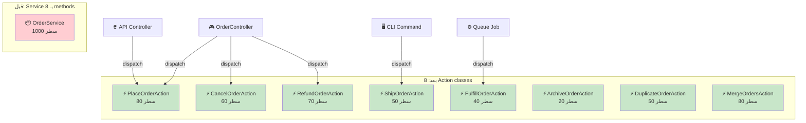
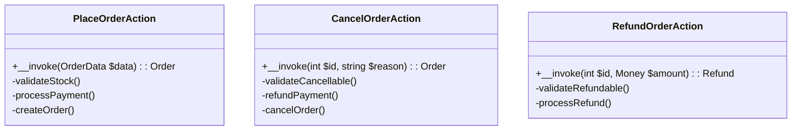
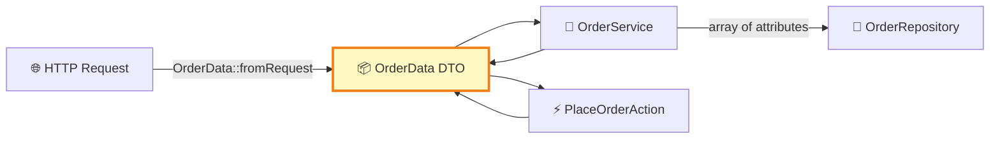
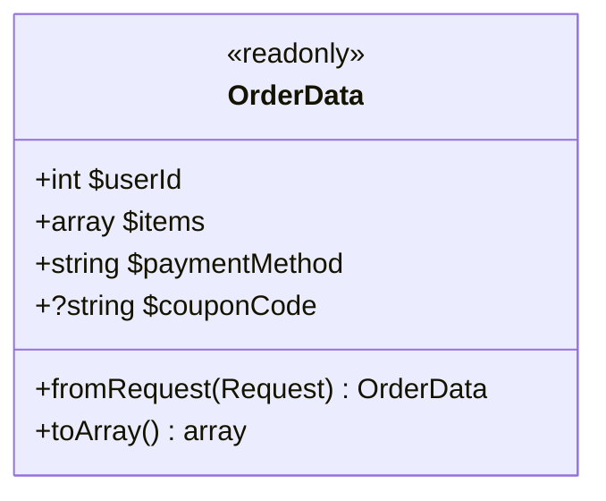
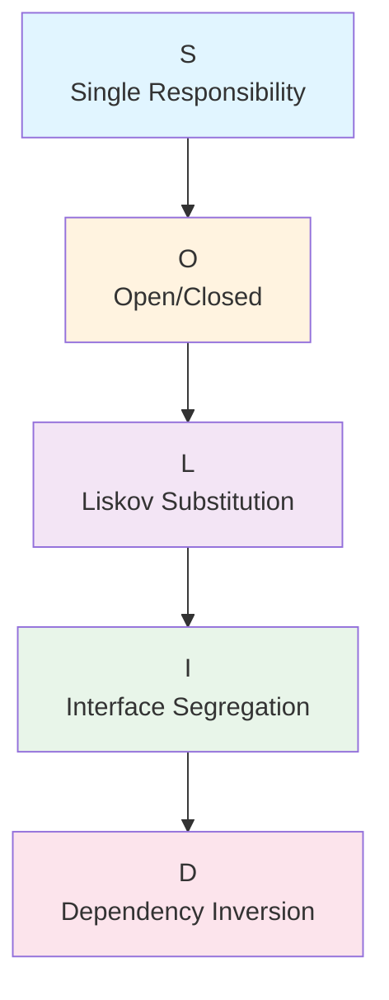
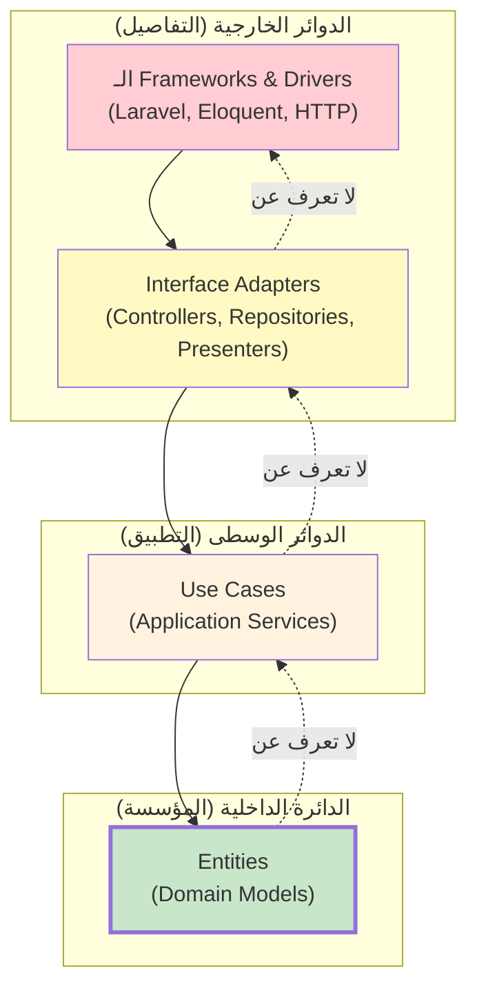

<div dir="rtl">

# الفصول 5-8: Action، DTO، SOLID، و Clean Architecture
## الأنماط التأسيسية والمتقدمة

---

# الفصل 5: Action Pattern
## كلاس واحد، عملية واحدة

---

## 1. المشكلة قبل هذه العمارة

Service + Repository Architecture (الفصل 4) يقدم خدمات تنمو مع الوقت. `OrderService` بـ 50 سطر يصبح كلاس إله بـ 500 سطر. كل method يفعل شيئاً واحداً، لكن **جميعها تعيش معاً**.

### "God Service" — الأعراض

```php
class OrderService
{
    public function place(OrderData $data): Order { /* 80 سطر */ }
    public function cancel(int $id, string $reason): Order { /* 60 سطر */ }
    public function refund(int $id, Money $amount): Refund { /* 70 سطر */ }
    public function ship(int $id, TrackingData $data): Shipment { /* 50 سطر */ }
    public function fulfill(int $id): Order { /* 40 سطر */ }
    public function archive(int $id): void { /* 20 سطر */ }
    public function duplicate(int $id): Order { /* 50 سطر */ }
    public function merge(int $sourceId, int $targetId): Order { /* 80 سطر */ }
    public function split(int $id, array $quantities): array { /* 70 سطر */ }
    // ... 10 methods أخرى
}
```

**الألم:**
- 1000+ سطر في ملف واحد
- 15 اعتمادية في الـ constructor
- صعب اختبار العمليات الفردية بمعزل
- عدة مطورين يعدلون نفس الملف (تعارضات دمج)
- لا يمكن إعادة استخدام عملية واحدة في سياق مختلف دون سحب الكلاس كاملاً

### النمط المضاد "Fat Method"

```php
class OrderService
{
    public function place(OrderData $data): Order
    {
        // 80 سطر تفعل كل شيء لـ "تقديم طلب"
        // صعب القراءة، صعب الاختبار، صعب إعادة الهيكلة
    }
}
```

**الألم:** method واحد لديه خطوات كثيرة. لا يمكنك اختبار "خطوة البريد" دون إعداد كل شيء.

---

## 2. لماذا اخترعت هذه العمارة

**Action Pattern** (يُسمى أيضاً "Command Pattern" في بعض السياقات) نشأ من حاجتين:

1. **Single Responsibility على مستوى العملية** — كل عملية تستحق كلاسها الخاص.
2. **Composability** — يمكن ربط Actions، تخزينها في طابور، إعادة محاولتها، تدقيقها باستقلال.

مجتمع Laravel روّج له عبر إرشادات وحزم Spatie. اليوم هو نمط شائع في:
- APIs عالية الحركة
- تطبيقات بسير عمل معقد
- أنظمة تحتاج لتدقيق أو إعادة تشغيل العمليات

### الفكرة الجوهرية

بدلاً من:
```
OrderService
├── place()
├── cancel()
├── refund()
```

لدينا:
```
app/Actions/
├── PlaceOrderAction.php
├── CancelOrderAction.php
├── RefundOrderAction.php
```

كل action هو **كلاس واحد، عملية واحدة**. كل واحد لديه method `execute()` أو `__invoke()` واحدة. كل واحد لديه فقط الاعتمادات التي يحتاجها.

---

## 3. تشبيه من الحياة الواقعية

### 🏢 المستشار المتخصص

شركة استشارية لديها مشاريع كثيرة. كل مشروع يقوده **مستشار متخصص**:
- مستشار تسويق
- مستشار مالي
- مستشار تكنولوجيا
- مستشار موارد بشرية

كل مستشار لديه:
- **تخصص واحد**
- **أدواته الخاصة** (فقط ما يحتاجه)
- **مخرج واحد** (نتيجة المشروع)

الشركة ليس لديها "مستشار عام" يفعل كل شيء. كل عملية هي **مشاركة منفصلة ومركّزة**.

نفس الشيء مع Action Pattern: كل عملية هي **مستشار متخصص**.

### 🍽️ الشيف المتخصص

في مطبخ طعام راقي:
- شيف الصلصات
- شيف المعجنات
- شيف الشواء
- شيف الأسماك

كل واحد متخصص. الشيف الرئيسي ينسقهم. لكن كل متخصص لديه:
- محطته الخاصة
- أدواته الخاصة
- وظيفة واحدة

Action Pattern هو نفسه. كل عملية **متخصصة**.

---

## 4. الشرح البصري



### بنية Action Class



---

## 5. دورة حياة الطلب

```
🌐 المتصفح: POST /orders
   ↓
🎮 OrderController
   - $order = app(PlaceOrderAction::class)($data);
   - return redirect()->route('orders.show', $order);
   ↓
⚡ PlaceOrderAction::__invoke(OrderData $data): Order
   - DB::transaction { ... }
   - validate, charge, persist, dispatch event
   ↓
💾 Repository
   ↓
🗄️ قاعدة البيانات
```

---

## 6. هيكل المجلدات

```
app/
├── Actions/
│   ├── Order/
│   │   ├── PlaceOrderAction.php
│   │   ├── CancelOrderAction.php
│   │   ├── RefundOrderAction.php
│   │   ├── ShipOrderAction.php
│   │   └── ArchiveOrderAction.php
│   ├── User/
│   │   ├── RegisterUserAction.php
│   │   ├── DeactivateUserAction.php
│   │   └── ChangeUserRoleAction.php
│   └── Product/
│       ├── CreateProductAction.php
│       └── DiscontinueProductAction.php
│
├── Http/Controllers/
├── Services/                       ← اختياري: للمنطق الشامل
├── Repositories/
└── Models/
```

---

## 7. مثال Laravel كامل

### الخطوة 1: الـ Action (app/Actions/Order/PlaceOrderAction.php)

```php
<?php

namespace App\Actions\Order;

use App\DataTransferObjects\OrderData;
use App\Events\OrderPlaced;
use App\Exceptions\InsufficientStockException;
use App\Models\Order;
use App\Repositories\Contracts\OrderRepositoryInterface;
use App\Repositories\Contracts\ProductRepositoryInterface;
use App\Services\Contracts\PaymentGatewayInterface;
use Illuminate\Support\Facades\DB;
use Illuminate\Support\Facades\Log;

class PlaceOrderAction
{
    public function __construct(
        private OrderRepositoryInterface $orders,
        private ProductRepositoryInterface $products,
        private PaymentGatewayInterface $payments,
    ) {}

    public function __invoke(OrderData $data): Order
    {
        return DB::transaction(function () use ($data) {
            $this->validateStock($data);
            $pricing = $this->calculatePricing($data);
            $payment = $this->processPayment($data, $pricing['total']);
            $order = $this->createOrder($data, $pricing, $payment);
            $this->decrementStock($data);
            event(new OrderPlaced($order));
            Log::info('تم تقديم الطلب', ['order_id' => $order->id]);
            return $order;
        });
    }

    private function validateStock(OrderData $data): void
    {
        foreach ($data->items as $item) {
            $product = $this->products->find($item->productId);
            if (!$product || $product->stock < $item->quantity) {
                throw new InsufficientStockException(
                    "مخزون غير كافٍ للمنتج {$item->productId}"
                );
            }
        }
    }

    private function calculatePricing(OrderData $data): array
    {
        $subtotal = 0;
        foreach ($data->items as $item) {
            $subtotal += $item->price * $item->quantity;
        }
        $tax = $subtotal * 0.08;
        return ['subtotal' => $subtotal, 'tax' => $tax, 'total' => $subtotal + $tax];
    }

    private function processPayment(OrderData $data, float $total): array
    {
        return $this->payments->charge($data->paymentMethod, $total);
    }

    private function createOrder(OrderData $data, array $pricing, array $payment): Order
    {
        return $this->orders->create([
            'user_id' => $data->userId,
            'subtotal' => $pricing['subtotal'],
            'tax' => $pricing['tax'],
            'total' => $pricing['total'],
            'payment_id' => $payment['id'],
            'status' => 'paid',
        ]);
    }

    private function decrementStock(OrderData $data): void
    {
        foreach ($data->items as $item) {
            $this->products->decrementStock($item->productId, $item->quantity);
        }
    }
}
```

### الخطوة 2: الـ Controller (النحيف) (app/Http/Controllers/OrderController.php)

```php
<?php

namespace App\Http\Controllers;

use App\Actions\Order\PlaceOrderAction;
use App\Actions\Order\CancelOrderAction;
use App\DataTransferObjects\OrderData;
use App\Http\Requests\StoreOrderRequest;
use App\Models\Order;
use Illuminate\Http\RedirectResponse;

class OrderController extends Controller
{
    public function store(StoreOrderRequest $request, PlaceOrderAction $action): RedirectResponse
    {
        $order = $action(OrderData::fromRequest($request));
        return redirect()->route('orders.show', $order)->with('success', 'تم تقديم الطلب!');
    }

    public function destroy(Order $order, CancelOrderAction $action): RedirectResponse
    {
        $action($order->id, 'طلب العميل');
        return redirect()->route('orders.index')->with('success', 'تم إلغاء الطلب.');
    }
}
```

### الخطوة 3: الـ Cancel Action (app/Actions/Order/CancelOrderAction.php)

```php
<?php

namespace App\Actions\Order;

use App\Exceptions\OrderNotCancellableException;
use App\Models\Order;
use App\Repositories\Contracts\OrderRepositoryInterface;
use App\Services\Contracts\PaymentGatewayInterface;
use Illuminate\Support\Facades\DB;

class CancelOrderAction
{
    public function __construct(
        private OrderRepositoryInterface $orders,
        private PaymentGatewayInterface $payments,
    ) {}

    public function __invoke(int $orderId, string $reason): Order
    {
        return DB::transaction(function () use ($orderId, $reason) {
            $order = $this->orders->findOrFail($orderId);

            if (!in_array($order->status, ['pending', 'paid'])) {
                throw new OrderNotCancellableException(
                    "لا يمكن إلغاء الطلب في الحالة: {$order->status}"
                );
            }

            if ($order->status === 'paid') {
                $this->payments->refund($order->payment_id, $order->total);
            }

            return $this->orders->update($order, [
                'status' => 'cancelled',
                'cancellation_reason' => $reason,
                'cancelled_at' => now(),
            ]);
        });
    }
}
```

### الخطوة 4: أمر CLI (إعادة استخدام الـ Action)

```php
<?php

namespace App\Console\Commands;

use App\Actions\Order\CancelOrderAction;
use Illuminate\Console\Command;

class CancelOrderCommand extends Command
{
    protected $signature = 'order:cancel {orderId} {reason}';

    public function handle(CancelOrderAction $action): int
    {
        try {
            $action((int) $this->argument('orderId'), (string) $this->argument('reason'));
            $this->info('تم إلغاء الطلب.');
            return self::SUCCESS;
        } catch (\Exception $e) {
            $this->error($e->getMessage());
            return self::FAILURE;
        }
    }
}
```

**نفس الـ Action يُستدعى من Controller، CLI، و(محتملاً) job في طابور.**

---

## 8. شرح عميق

### لماذا `__invoke()`؟

method `__invoke()` السحرية تجعل الكلاس **callable**. بدلاً من:
```php
$action = new PlaceOrderAction(...);
$order = $action->execute($data);
```

يمكنك فعل:
```php
$action = app(PlaceOrderAction::class);
$order = $action($data);
```

هذا يجعل الـ syntax نظيفاً والكلاس يبدو كدالة.

### Action مقابل Service: القرار

| استخدم Action عندما | استخدم Service عندما |
|--------------------|---------------------|
| عملية محددة واحدة | عمليات متعددة ذات صلة |
| سير عمل واضح ومفرد | منطق شامل |
| حالة استخدام مميزة | مجموعة مجال |
| مثال: "PlaceOrder" | مثال: "OrderManagement" |

**عملياً:** استخدم Actions لـ **عمليات الأعمال المميزة** (Place, Cancel, Refund, Ship). استخدم Services لـ **المنطق المساعد** (حساب التسعير، أدوات التحقق).

### تركيب Action

Actions يمكنها استدعاء Actions أخرى:

```php
class RegisterUserAction
{
    public function __construct(
        private CreateUserAction $createUser,
        private SendWelcomeEmailAction $sendEmail,
        private AssignDefaultRoleAction $assignRole,
    ) {}

    public function __invoke(UserData $data): User
    {
        $user = ($this->createUser)($data);
        ($this->sendEmail)($user);
        ($this->assignRole)($user, 'member');
        return $user;
    }
}
```

هذا **التركيب**: Actions صغيرة تبني سير عمل أكبر.

### انضباط الاعتمادية

كل Action يجب أن يكون لديه **فقط الاعتمادات التي يحتاجها**:

```php
// ✅ جيد: 2 اعتمادية
class PlaceOrderAction
{
    public function __construct(
        private OrderRepositoryInterface $orders,
        private PaymentGatewayInterface $payments,
    ) {}
}

// ❌ سيء: 8 اعتمادات (على الأرجح يفعل الكثير)
class PlaceOrderAction
{
    public function __construct(
        private OrderRepositoryInterface $orders,
        private ProductRepositoryInterface $products,
        private PaymentGatewayInterface $payments,
        private NotificationServiceInterface $notifier,
        private AnalyticsServiceInterface $analytics,
        private LoyaltyServiceInterface $loyalty,
        private CouponRepositoryInterface $coupons,
        private ShippingServiceInterface $shipping,
    ) {}
}
```

**القاعدة:** إذا كان Action لديه أكثر من 3-4 اعتمادات، ربما يفعل الكثير. قسّمه.

---

## 9. المزايا

- ✅ **Single Responsibility** على مستوى العملية
- ✅ **سهل الاختبار** (Action واحد = اختبار واحد)
- ✅ **لا تعارضات دمج** (كل مطور يمتلك Actions مختلفة)
- ✅ **قابل لإعادة الاستخدام** عبر Controllers، CLI، jobs
- ✅ **قابل للاكتشاف** (ملف واحد لكل عملية، سهل الإيجاد)
- ✅ **قابل للتدقيق** (كل عملية كلاس؛ يمكنك تسجيل/تتبعها)
- ✅ **قابل للتخزين في طابور** (Actions يمكن تخزينها بسهولة مع `ShouldQueue`)

## 10. العيوب

- ❌ **تكاثر الملفات** (10 عمليات = 10 كلاسات)
- ❌ **سهل الإفراط في التجزئة** (كل سطر يجب ألا يكون Action)
- ❌ **أصعب في التنقل** (سير عمل "Order" الآن 5 ملفات)
- ❌ **تجميع أقل حسب المجال** (العمليات ذات الصلة ملفات منفصلة)

## 11. الأخطاء الشائعة

- ❌ **إنشاء Action لكل method** (إفراط في التجزئة)
- ❌ **Actions تستدعي Actions تستدعي Actions** (التركيب العميق صعب التصحيح)
- ❌ **Actions بـ 10 اعتمادات** (على الأرجح تفعل الكثير)
- ❌ **وضع التحقق في Actions** (التحقق ينتمي في FormRequest)
- ❌ **إرجاع استجابات HTTP من Actions** (أرجع كائنات مجال)

## 12. تأثير الأداء

**لا شيء.** Actions مجرد كلاسات بـ methods. نفس أداء Services.

## 13. الاختبار

```php
class PlaceOrderActionTest extends TestCase
{
    public function test_action_places_order_with_correct_data(): void
    {
        Event::fake();

        $action = new PlaceOrderAction(
            new InMemoryOrderRepository(),
            new InMemoryProductRepository(),
            Mockery::mock(PaymentGateway::class, fn ($m) => $m->shouldReceive('charge')->andReturn(['id' => 'pay_123']))
        );

        $order = $action(new OrderData(
            userId: 1,
            items: [new OrderItemData(productId: 1, quantity: 2, price: 10)],
            paymentMethod: 'credit_card',
        ));

        $this->assertEquals(20, $order->total);
        Event::assertDispatched(OrderPlaced::class);
    }
}
```

**اختبار unit خالص، بلا DB، يعمل في ميلي ثانية.**

## 14. الاستخدام المؤسسي

يُستخدم في:
- **Spatie** (الاستشارات التي روّجت له)
- **Mailerlite** (منصة البريد)
- **APIs عالية الحركة** المختلفة

**متى تستخدم:**
- 10+ عمليات مميزة لكل مجال
- كل عملية مفاهيمياً منفصلة
- الفريق يحتاج للتوسع (مطورون مختلفون يملكون عمليات مختلفة)
- العمليات قابلة للتدقيق فردياً

**متى تتجنب:**
- CRUD بسيط (3-5 عمليات)
- العمليات مرتبطة ارتباطاً وثيقاً (التقسيم مصطنع)
- مطور فردي على مشروع صغير

## 15. المقارنة

| الجانب | Service | Action |
|--------|---------|--------|
| عدد الملفات | قليل | كثير |
| الدقة | خشن | ناعم |
| قابلية الاكتشاف | Service مكان واحد | Action ملف واحد لكل عملية |
| قابلية إعادة الاستخدام | عالية | عالية |
| توسع الفريق | تعارضات ممكنة | موزع |
| سرعة الاختبار | سريع (مع mock repos) | سريع |

| النمط | ملف لكل | الأفضل لـ |
|-------|---------|----------|
| Service | المجال | العمليات ذات الصلة |
| Action | العملية | العمليات المميزة |
| Use Case | قصة المستخدم | Clean Architecture |

## 16. مسار التطور

```
MVC (place() في Controller)
   ↓
Service Layer (place() في Service)
   ↓
Service Bloat (Service بـ 1000 سطر)
   ↓
Action Pattern (كلاس واحد لكل عملية)
   ↓
??? (عندما حتى Actions خشنة جداً، اعتبر CQRS أو DDD)
```

## 17. أسئلة المقابلة

1. **ما هو Action Pattern؟**
   - كلاس لكل عملية، قابل للاستدعاء عبر `__invoke()`. ذو غرض واحد، اختبار واحد.

2. **Action مقابل Service؟**
   - Service: مجموعة عمليات ذات صلة على مجال. Action: عملية محددة واحدة.

3. **كيف تختبر Action؟**
   - اختبار unit مع اعتمادات وهمية. بلا DB.

4. **متى لا تستخدم Actions؟**
   - CRUD بسيط، عمليات مرتبطة، فرق صغيرة.

5. **هل يمكن لـ Actions استدعاء Actions؟**
   - نعم، لكن تجنب التركيب العميق (3+ مستويات).

## 18. التمارين

1. **أعد هيكلة Service بـ 500 سطر إلى 8 Actions.**
2. **ابنِ module `User` بـ 5 Actions** (Register، Deactivate، ChangeRole، Delete، Restore).
3. **سلسلة Actions** — `OnboardUserAction` يستدعي `CreateUserAction`، `SendWelcomeAction`، `AssignRoleAction`.
4. **هرم الاختبار** — اكتب 10 اختبارات Action unit؛ قس الوقت.
5. **دقق مشروعك** — اعثر على أكبر Service، اقترح إعادة هيكلة Action.

---

> *"Action Pattern هو وحدة العمل في شكل كائن. كل Action صغير، مركز، وقابل للاختبار. سير العمل مركب من Actions."*

---

# الفصل 6: DTO Pattern
## عبور حدود الطبقات بأمان

---

## 1. المشكلة قبل هذه العمارة

في تطبيق Laravel نموذجي، تتدفق البيانات بين الطبقات بطرق غير متوقعة:

```php
// Controller يمرر array إلى Service
$order = $service->place($request->all());

// Service يمرر array إلى Repository
$this->orders->create($data);

// Service يُرجع array من Repository
$user = $this->users->find($id);
return ['user' => $user->toArray()];

// Controller يمرر Request إلى Action
$action($request);

// Service يستخدم Request مباشرة
$user = auth()->user();
$order = $this->orders->create($request->all());
```

**المشاكل:**

1. **لا type safety** — `array $data` يمكن أن يكون أي شيء
2. **لا مساعدة IDE** — لا تعرف ما المفاتيح الموجودة
3. **لا تحقق** — الأخطاء الإملائية في المفاتيح تفشل بصمت
4. **اقتران** — Services تعتمد على كائنات HTTP `Request`
5. **صعب إعادة الهيكلة** — أعد تسمية مفتاح، اعثر على كل استخدام

---

## 2. لماذا اخترعت هذه العمارة

**DTO (Data Transfer Object)** من J2EE (أوائل الألفينيات). تم توحيده في كتاب Martin Fowler EAA (2002) وكان عنصراً أساسياً في اللغات مكتوبة الأنواع بشدة (Java، C#) لعقود.

أضافت PHP خصائص مكتوبة في 7.4، مما جعل DTOs عملية. تبنّي Laravel لـ DTOs تسارع مع `readonly` properties في PHP 8.0.

**الفكرة الجوهرية:** DTO هو **حاوية بيانات مكتوبة وثابتة** تحمل البيانات التي تعبر حدود الطبقات. ليس لديه سلوك (فقط properties). إنه "الطرد" الذي تسافر فيه البيانات.

---

## 3. تشبيه من الحياة الواقعية

### 📦 حاوية الشحن

حاوية شحن لديها:
- شكل قياسي (خصائص مكتوبة)
- محتويات (بيانات)
- ملصق (اسم الكلاس)
- بيان (arguments الـ constructor)

الشاحن لا يهتم بما بداخلها. المستقبل يفكها. تعبر الحاوية المحيطات والشاحنات والقطارات دون تغيير الشكل.

DTO هو **حاوية شحن للبيانات**. تعبر من Controller إلى Service إلى Action دون تغيير الشكل.

### 📋 النموذج الضريبي

نموذج ضريبي لديه:
- حقول محددة (الاسم، SSN، الدخل)
- كل حقل له نوع (نص، رقم)
- يُملأ النموذج مرة واحدة
- ثم يُمرر لمصلحة الضرائب

DTO هو **نموذج مكتوب** للبيانات.

---

## 4. الشرح البصري



### تشريح DTO



---

## 5. دورة حياة الطلب

```
🌐 المتصفح: POST /orders { items: [...], payment_method: 'card' }
   ↓
📋 FormRequest يتحقق
   ↓
📦 DTO: OrderData::fromRequest($request)
   - ينشئ كائن readonly مكتوب
   ↓
💼 Service أو Action يستقبل OrderData
   - وصول type-safe: $data->userId، $data->items
   ↓
💾 Repository يستقبل array (أو DTO آخر)
   ↓
🗄️ قاعدة البيانات
```

---

## 6. هيكل المجلدات

```
app/
├── DataTransferObjects/             ← 📦 DTOs
│   ├── OrderData.php
│   ├── OrderItemData.php
│   ├── UserData.php
│   ├── PricingResult.php
│   └── Api/
│       ├── OrderApiData.php
│       └── UserApiData.php
│
├── Http/Controllers/
├── Services/
└── ...
```

---

## 7. مثال Laravel كامل

### الخطوة 1: DTO المدخلات (app/DataTransferObjects/OrderData.php)

```php
<?php

namespace App\DataTransferObjects;

use App\Http\Requests\StoreOrderRequest;

class OrderData
{
    /**
     * @param array<int, OrderItemData> $items
     */
    public function __construct(
        public readonly int $userId,
        public readonly array $items,
        public readonly string $paymentMethod,
        public readonly ?string $couponCode = null,
        public readonly ?string $shippingAddress = null,
        public readonly ?\DateTimeInterface $placedAt = null,
    ) {}

    public static function fromRequest(StoreOrderRequest $request): self
    {
        return new self(
            userId: $request->integer('user_id'),
            items: array_map(
                fn (array $item) => OrderItemData::fromArray($item),
                $request->input('items', [])
            ),
            paymentMethod: $request->string('payment_method'),
            couponCode: $request->string('coupon_code'),
            shippingAddress: $request->string('shipping_address'),
        );
    }

    public function total(): float
    {
        return array_sum(array_map(fn ($i) => $i->price * $i->quantity, $this->items));
    }
}
```

### الخطوة 2: DTO المتداخل (app/DataTransferObjects/OrderItemData.php)

```php
<?php

namespace App\DataTransferObjects;

class OrderItemData
{
    public function __construct(
        public readonly int $productId,
        public readonly int $quantity,
        public readonly float $price,
    ) {}

    public static function fromArray(array $data): self
    {
        return new self(
            productId: (int) $data['product_id'],
            quantity: (int) $data['quantity'],
            price: (float) $data['price'],
        );
    }

    public function toArray(): array
    {
        return [
            'product_id' => $this->productId,
            'quantity' => $this->quantity,
            'price' => $this->price,
        ];
    }
}
```

### الخطوة 3: DTO المخرجات (app/DataTransferObjects/PricingResult.php)

```php
<?php

namespace App\DataTransferObjects;

class PricingResult
{
    public function __construct(
        public readonly float $subtotal,
        public readonly float $discount,
        public readonly float $tax,
        public readonly float $shipping,
        public readonly float $total,
    ) {}

    public function toArray(): array
    {
        return [
            'subtotal' => $this->subtotal,
            'discount' => $this->discount,
            'tax' => $this->tax,
            'shipping' => $this->shipping,
            'total' => $this->total,
        ];
    }
}
```

### الخطوة 4: الـ Service يستخدم DTO (app/Services/PricingService.php)

```php
<?php

namespace App\Services;

use App\DataTransferObjects\OrderData;
use App\DataTransferObjects\PricingResult;
use App\Repositories\Contracts\CouponRepositoryInterface;

class PricingService
{
    public function __construct(
        private CouponRepositoryInterface $coupons,
    ) {}

    public function calculate(OrderData $data): PricingResult
    {
        $subtotal = $data->total();

        $discount = 0;
        if ($data->couponCode) {
            $coupon = $this->coupons->findByCode($data->couponCode);
            if ($coupon && $coupon->isValid($subtotal)) {
                $discount = $coupon->applyTo($subtotal);
            }
        }

        $taxableAmount = $subtotal - $discount;
        $tax = $taxableAmount * 0.08;
        $shipping = $this->calculateShipping($data);
        $total = $taxableAmount + $tax + $shipping;

        return new PricingResult(
            subtotal: $subtotal,
            discount: $discount,
            tax: $tax,
            shipping: $shipping,
            total: $total,
        );
    }

    private function calculateShipping(OrderData $data): float
    {
        return 5.99; // مبسّط
    }
}
```

### الخطوة 5: الـ Controller (app/Http/Controllers/OrderController.php)

```php
<?php

namespace App\Http\Controllers;

use App\Actions\Order\PlaceOrderAction;
use App\DataTransferObjects\OrderData;
use App\Http\Requests\StoreOrderRequest;
use Illuminate\Http\RedirectResponse;

class OrderController extends Controller
{
    public function store(StoreOrderRequest $request, PlaceOrderAction $action): RedirectResponse
    {
        $dto = OrderData::fromRequest($request);
        $order = $action($dto);
        return redirect()->route('orders.show', $order);
    }
}
```

---

## 8. شرح عميق

### لماذا Readonly؟

`readonly` properties تمنع التعديل:

```php
$dto = new OrderData(userId: 1, ...);
$dto->userId = 2; // ❌ خطأ: لا يمكن تعديل خاصية readonly
```

هذا **type safety** على مستوى البيانات. DTO غير قابل للتغيير بمجرد إنشائه.

### المصانع الثابتة: `fromArray`، `fromRequest`

DTOs تستخدم **static factory methods** للبناء من مصادر مختلفة:

```php
$dto = OrderData::fromArray($array);
$dto = OrderData::fromRequest($request);
$dto = OrderData::fromEloquent($model);
```

الـ Service لا يهتم كيف تم إنشاء DTO. يتلقى فقط كائناً مكتوباً.

### DTOs مقابل API Resources

| الجانب | DTO | API Resource |
|--------|-----|--------------|
| الغرض | عبور الطبقات | تشكيل المخرجات |
| الاتجاه | وارد (غالباً) | صادر |
| القابلية للتغيير | Readonly | Readonly |
| حالة الاستخدام | مدخل Service | استجابة API |

استخدم **DTOs للمدخلات**، **API Resources للمخرجات**.

### DTOs مقابل Value Objects (DDD)

| الجانب | DTO | Value Object |
|--------|-----|--------------|
| السلوك | لا شيء | لديه methods |
| الهوية | لا شيء | لا شيء |
| المساواة | غير معرّفة | معرّفة |
| عدم القابلية للتغيير | نعم | نعم |
| حالة الاستخدام | نقل البيانات | مفاهيم المجال |

كائن `Money` value object لديه `add()`، `subtract()`، `equals()`. DTO `MoneyData` يحمل القيمة فقط.

---

## 9. المزايا

- ✅ **Type safety** — IDE autocomplete، تحليل ثابت
- ✅ **موثق ذاتياً** — توقيع الـ constructor يوضح جميع الحقول المطلوبة
- ✅ **غير قابل للتغيير** — لا يمكن تعديله بالخطأ
- ✅ **يفصل الطبقات** — Service لا يعرف عن Request
- ✅ **سهل الاختبار** — `new OrderData(...)` بسيط
- ✅ **صديق لإعادة الهيكلة** — أعد تسمية property، IDE يجد جميع الاستخدامات

## 10. العيوب

- ❌ **ملفات أكثر** — DTO واحد لكل عملية
- ❌ **overhead التعيين** — تحويل array ↔ DTO
- ❌ **مطول** — `userId` مقابل `$data['user_id']`
- ❌ **يمكن إساءة استخدامه** — DTO لكل قيمة مفرطة

## 11. الأخطاء الشائعة

- ❌ **DTOs التي تعكس Models** — DTO يجب أن يعكس العملية، ليس الـ schema
- ❌ **وضع المنطق في DTOs** — ابقها كحاويات بيانات
- ❌ **القابلية للتغيير** — لا تستخدم DTOs قابلة للتغيير أبداً
- ❌ **DTOs متداخلة بدون مصانع** — `OrderItemData::fromArray()` يبقي التعيين نظيفاً
- ❌ **DTOs التي تتضمن Eloquent models** — يهزم الغرض

## 12. تأثير الأداء

**ضئيل.** إنشاء DTO هو مجرد `new ClassName(...)` — بضع ميكروثوانٍ.

## 13. الاختبار

DTOs سهلة الاختبار:

```php
public function test_dto_calculates_total(): void
{
    $dto = new OrderData(
        userId: 1,
        items: [
            new OrderItemData(productId: 1, quantity: 2, price: 10.0),
            new OrderItemData(productId: 2, quantity: 1, price: 20.0),
        ],
        paymentMethod: 'card',
    );

    $this->assertEquals(40.0, $dto->total());
}
```

## 14. الاستخدام المؤسسي

**قياسي في تطبيقات Laravel الحديثة.** شركات مثل:
- **Spatie** (تستخدمها في جميع حزمها)
- **Cashier** (حزمة الاشتراك في Laravel)
- **معظم قواعد كود Laravel الجادة**

**متى تستخدم:** دائماً لنقل البيانات عبر الطبقات.

**متى لا تستخدم:** methods داخلية تافهة، بيانات ذات استخدام واحد.

## 15. المقارنة

| النمط | الغرض | Readonly؟ | لديه منطق؟ |
|-------|-------|-----------|-----------|
| DTO | نقل البيانات | نعم | لا |
| Value Object | مفاهيم المجال | نعم | نعم |
| API Resource | تشكيل المخرجات | نعم | أدنى |
| Form Request | التحقق من المدخلات | نعم | نعم |
| Model | الاستمرارية | لا | نعم |

## 16. مسار التطور

```
Arrays (بيانات خام)
   ↓
Arrays مكتوبة الأنواع (لا تزال arrays)
   ↓
DTOs (مكتوبة، readonly)
   ↓
Value Objects (مع منطق المجال) [DDD]
```

## 17. أسئلة المقابلة

1. **ما هو DTO؟**
   - Data Transfer Object: حاوية بيانات مكتوبة وثابتة لنقل البيانات عبر الطبقات.

2. **DTO مقابل Form Request؟**
   - Form Request: التحقق من مدخلات HTTP. DTO: نقل.

3. **لماذا readonly؟**
   - منع التعديل العرضي؛ threading أكثر أماناً.

4. **DTO مقابل Model؟**
   - Model: الاستمرارية + السلوك. DTO: بيانات خالصة.

5. **متى تستخدم DTOs؟**
   - دائماً لنقل البيانات عبر الطبقات؛ خاصة Services و Actions.

## 18. التمارين

1. **أنشئ DTOs لتطبيق تجارة إلكترونية**: `CreateOrderData`، `UpdateProfileData`، `ProductFilterData`.
2. **DTOs متداخلة**: `OrderData` مع عناصر `OrderItemData[]`.
3. **المصانع الثابتة**: `fromArray`، `fromRequest`، `fromModel`.
4. **اختبر DTOs**: تحقق من أن method `total()` يعمل.
5. **أعد هيكلة arrays إلى DTOs** في Service موجود.

---

> *"DTO هو الطرد الذي تُشحن فيه بياناتك. يعبر من Controller إلى Service إلى Action، محافظاً على شكله، سالماً محتوياته."*

---

# الفصل 7: SOLID Principles
## النظرية التي تربط كل شيء

---

## 1. المشكلة قبل هذه العمارة

قبل SOLID، كان تصميم البرمجيات مخصصاً:
- "أفضل الممارسات" تختلف حسب الشركة
- جودة الكود كانت ذاتية
- إعادة الهيكلة محفوفة بالمخاطر
- أعضاء الفريق الجدد يتعلمون بالتجربة والخطأ
- "الكود الجيد" كان فناً، ليس علماً

احتاجت الصناعة لـ **مبادئ مشتركة** لتقييم التصميم.

---

## 2. لماذا اخترعت هذه العمارة

**Robert C. Martin (Uncle Bob)** قدّم SOLID في التسعينيات ووحّده في ورقته عام 2000 *"Design Principles and Design Patterns"*. الهدف: **مجموعة مبادئ، عند تطبيقها، تجعل البرمجيات أكثر قابلية للصيانة، والمرونة، والفهم.**

نشأت هذه المبادئ من مراقبة **ما يجعل الكود يشيخ جيداً** مقابل **ما يجعل الكود يتعفن**.

### الرؤية الجوهرية

الكود يتعفن عندما:
- التغييرات في مكان واحد تتطلب تغييرات في أماكن كثيرة
- كلاس واحد لديه أسباب كثيرة للتغيير
- الكلاسات الفرعية تنكسر عندما يتغير الأب
- لا يمكنك التوسيع دون التعديل
- التفاصيل تتسرب عبر الحدود

SOLID هو الترياق. خمسة مبادئ، هدف واحد: **برمجيات تشيخ بأناقة**.

---

## 3. تشبيه من الحياة الواقعية

### 🏢 الشركة المنظمة جيداً

تخيل شركة بها:
- **S**ingle Responsibility: كل قسم له وظيفة واحدة
- **O**pen/Closed: الأقسام مفتوحة لمهام جديدة لكن مغلقة للتعديل
- **L**iskov Substitution: أي مدير يمكنه ملء مكان أي مدير آخر
- **I**nterface Segregation: كل واجهة (دور الموظف) مركّزة
- **D**ependency Inversion: الأقسام تعتمد على السياسات، ليس على تطبيقات بعضها البعض

هذا هو SOLID. نفس المبادئ تنطبق على البرمجيات.

---

## 4. الشرح البصري: المبادئ الخمسة



---

## 5. دورة حياة الطلب (بمصطلحات SOLID)

طلب Laravel نموذجي يمر عبر طبقات، كل منها يحترم SOLID:

```
Controller (SRP: يتعامل مع HTTP)
   ↓ يعتمد على
Service Interface (DIP: تجريد)
   ↑ منفّذ بواسطة
Service (SRP: منطق الأعمال، OCP: قابل للتوسيع)
   ↓ يعتمد على
Repository Interface (DIP, ISP: methods مركّزة)
   ↑ منفّذ بواسطة
Eloquent Repository (LSP: قابل للاستبدال)
```

كل كلاس لديه **وظيفة واحدة**. كل واحد يمكن **توسيعه دون تعديل**. كل واحد **يعتمد على تجريدات**.

---

## 6. هيكل المجلدات (متوافق مع SOLID)

```
app/
├── Http/Controllers/        ← SRP: HTTP فقط
├── Services/                ← SRP: منطق الأعمال
│   └── Contracts/           ← ISP: interfaces صغيرة
├── Repositories/
│   ├── Contracts/           ← ISP, DIP
│   └── Eloquent/            ← LSP: التنفيذات
├── Models/                  ← SRP: البيانات + السلوك
└── Providers/               ← DIP: الربط
```

---

## 7. مثال Laravel: جميع المبادئ الخمسة

### S — Single Responsibility Principle

**كلاس يجب أن يكون لديه سبب واحد، وسبب واحد فقط، للتغيير.**

```php
// ❌ سيء: أسباب متعددة للتغيير
class User
{
    public function save() { /* DB */ }
    public function sendWelcomeEmail() { /* Email */ }
    public function generateReport() { /* Reporting */ }
    public function validateInput() { /* Validation */ }
}
// يتغير هذا الكلاس عندما: schema DB، قالب البريد، صيغة التقرير، قواعد التحقق تتغير.

// ✅ جيد: مسؤولية واحدة
class User extends Model
{
    // فقط بيانات المستخدم وسلوكه
}

class WelcomeEmail
{
    public function send(User $user) { /* Email فقط */ }
}

class UserReport
{
    public function generate(User $user) { /* تقرير فقط */ }
}
```

### O — Open/Closed Principle

**الكلاسات يجب أن تكون مفتوحة للتوسيع لكن مغلقة للتعديل.**

```php
// ❌ سيء: إضافة method دفع جديدة تتطلب تعديل الكلاس
class PaymentProcessor
{
    public function process(Payment $payment)
    {
        switch ($payment->method) {
            case 'stripe': $this->chargeStripe($payment); break;
            case 'paypal': $this->chargePaypal($payment); break;
            case 'crypto': $this->chargeCrypto($payment); break; // ← تعديل مطلوب
        }
    }
}

// ✅ جيد: إضافة method جديدة توسع، لا تعدل
interface PaymentGatewayInterface
{
    public function charge(float $amount, array $details): PaymentResult;
}

class StripePaymentGateway implements PaymentGatewayInterface { /* ... */ }
class PayPalPaymentGateway implements PaymentGatewayInterface { /* ... */ }
class CryptoPaymentGateway implements PaymentGatewayInterface { /* ... */ } // ← توسيع

class PaymentProcessor
{
    public function __construct(private PaymentGatewayInterface $gateway) {}

    public function process(Payment $payment)
    {
        return $this->gateway->charge($payment->amount, $payment->details);
    }
}
```

### L — Liskov Substitution Principle

**الأنواع الفرعية يجب أن تكون قابلة للاستبدال بأنواعها الأساسية.**

```php
// ❌ سيء: Square ليس قابلاً للاستبدال بـ Rectangle
class Rectangle
{
    public function setWidth(int $w) { $this->width = $w; }
    public function setHeight(int $h) { $this->height = $h; }
    public function area(): int { return $this->width * $this->height; }
}

class Square extends Rectangle
{
    public function setWidth(int $w)
    {
        $this->width = $w;
        $this->height = $w; // ❌ ينتهك LSP
    }
}

// ✅ جيد: تسلسلات منفصلة أو تركيب
interface ShapeInterface
{
    public function area(): float;
}

class Rectangle implements ShapeInterface { /* ... */ }
class Square implements ShapeInterface { /* ... */ }
```

في Laravel:
```php
// ❌ سيء: عقد Repository منتهك
interface UserRepositoryInterface
{
    public function findActive(): Collection; // يُرجع User
}

class EloquentUserRepository implements UserRepositoryInterface
{
    public function findActive(): Collection
    {
        return Admin::where('active', true)->get(); // ❌ يُرجع Admin، ليس User
    }
}

// ✅ جيد: يُرجع النوع الصحيح
public function findActive(): Collection
{
    return User::where('active', true)->get();
}
```

### I — Interface Segregation Principle

**العملاء يجب ألا يُجبروا على الاعتماد على methods لا يستخدمونها.**

```php
// ❌ سيء: interface منتفخ
interface UserRepositoryInterface
{
    public function find($id);
    public function create(array $data);
    public function update($id, array $data);
    public function delete($id);
    public function sendEmail($id, $message);
    public function generateReport($id);
    public function exportToCsv();
    public function syncWithCrm();
}

// ✅ جيد: interfaces مفصولة
interface UserReaderInterface
{
    public function find($id);
    public function findActive();
}

interface UserWriterInterface
{
    public function create(array $data);
    public function update($id, array $data);
    public function delete($id);
}

interface UserNotificationInterface
{
    public function sendEmail($id, $message);
}
```

### D — Dependency Inversion Principle

**الوحدات عالية المستوى يجب ألا تعتمد على وحدات منخفضة المستوى. كلاهما يجب أن يعتمد على تجريدات.**

```php
// ❌ سيء: عالي المستوى يعتمد على منخفض المستوى
class OrderService
{
    public function place(OrderData $data)
    {
        $order = Order::create($data->toArray()); // ❌ Eloquent مباشر
        Mail::to($order->user)->send(new OrderConfirmation($order)); // ❌ Mail facade مباشر
    }
}

// ✅ جيد: كلاهما يعتمد على تجريدات
class OrderService
{
    public function __construct(
        private OrderRepositoryInterface $orders,    // ← تجريد
        private NotificationServiceInterface $notifier, // ← تجريد
    ) {}

    public function place(OrderData $data)
    {
        $order = $this->orders->create($data->toArray());
        $this->notifier->send($order->user, "تم تقديم الطلب: #{$order->id}");
    }
}
```

---

## 8. شرح عميق

### لماذا هذه الخمسة؟

حدد Uncle Bob هذه كـ **الخمسة الأكثر تأثيراً**. هم:

1. **Cohesive** (SRP) — كلاس يفعل شيئاً واحداً
2. **Open to growth** (OCP) — توسع دون كسر
3. **Substitutable** (LSP) — الأنواع قابلة للتنبؤ
4. **Focused** (ISP) — interfaces أدنى
5. **Decoupled** (DIP) — اعتماد على تجريدات

معاً، ينتجون **كود سهل التغيير**.

### سلسلة الاعتمادية

```
DIP → يمكّن → الاختبار (محاكاة interfaces)
SRP → يمكّن → الفهم (وظيفة واحدة في كل مرة)
OCP → يمكّن → التوسيع (أضف ميزات، لا تعدل)
LSP → يمكّن → الاستبدال (استبدل التنفيذات بأمان)
ISP → يمكّن → التركيز (interfaces صغيرة، ليست منتفخة)
```

### SOLID و Laravel

تصميم Laravel **عميق التوافق مع SOLID**:
- **Service Container** → DIP (يحل التجريدات)
- **Eloquent** → LSP (نمط Repository قابل للاستبدال)
- **Facades** → أحياناً تنتهك DIP (استخدم بحذر)
- **Events** → SRP (فصل التأثيرات الجانبية)
- **Service Providers** → DIP (ربط interfaces)

### متى يصبح SOLID مبالغة

SOLID **جيد دائماً**، لكن **تطبيقه الصارم** يمكن أن يؤدي إلى:
- كلاسات صغيرة جداً بلا شيء تفعله
- interfaces كثيرة جداً
- تحويل غير مباشر مفرط

**الإجابة البراغماتية:** طبّق SOLID على **الأجزاء التي ستتغير**. لا تنشئ interface لكلاس لن يكون له تنفيذ ثانٍ أبداً.

---

## 9. المزايا

- ✅ **مفردات معيارية للصناعة** — "هذا ينتهك SRP" مفهوم عالمياً
- ✅ **مراجعات كود أفضل** — المبادئ موضوعية
- ✅ **صيانة أسهل** — كود بمسؤولية واحدة أسهل في التغيير
- ✅ **اختبار أفضل** — DIP يمكّن المحاكاة
- ✅ **قابلية توسع أفضل** — OCP يسمح بالنمو
- ✅ **توافق أفضل للفريق** — مبادئ مشتركة

## 10. العيوب

- ❌ **منحنى التعلم** — 5 مبادئ للاستيعاب
- ❌ **التطبيق المفرط** — يمكن أن يؤدي إلى الإفراط في الهندسة
- ❌ **تفسيرات ذاتية** — ما الذي يُحسب "سبباً واحداً"؟
- ❌ **مقايضات** — أحياناً انتهاك مبدأ واحد ضروري

## 11. الأخطاء الشائعة

- ❌ **إنشاء interfaces لكل شيء** — DIP لا يعني "interface دائماً"
- ❌ **كلاسات صغيرة جداً لا تفعل شيئاً** — SRP لا يعني "method واحد لكل كلاس"
- ❌ **تسلسلات جامدة** — التطبيق المفرط لـ OCP ينشئ أشجاراً غير قابلة للصيانة
- ❌ **انتهاكات YAGNI** — تصميم لمستقبلات افتراضية

## 12. تأثير الأداء

**لا شيء.** SOLID عن تنظيم الكود، ليس وقت التشغيل.

## 13. الاختبار

SOLID يمكّن **اختبار أفضل**:

- **SRP** → اختبار واحد لكل كلاس
- **DIP** → محاكاة الاعتمادات بسهولة
- **ISP** → interfaces صغيرة للمحاكاة
- **OCP** → نقاط التوسيع قابلة للاختبار
- **LSP** → قابلية الاستبدال قابلة للتحقق

## 14. الاستخدام المؤسسي

**عالمي.** كل مطور كبير يعرف SOLID. إنه **اللغة المشتركة** لتصميم البرمجيات.

## 15. المقارنة

| المبدأ | الاهتمام | عرض لانتهاكه |
|--------|---------|---------------|
| SRP | التماسك | "God class" بأكثر من 1000 سطر |
| OCP | التوسيع | تعديل الكود لإضافة ميزات |
| LSP | الاستبدال | كلاس فرعي يكسر عقد الأب |
| ISP | التركيز | كلاس ينفذ methods غير مستخدمة |
| DIP | الفصل | الاختبارات تتطلب قاعدة بيانات حقيقية |

## 16. مسار التطور

```
كود غير منظم (لا مبادئ)
   ↓
"أفضل الممارسات" (ذاتية)
   ↓
SOLID (مبادئ موضوعية)
   ↓
Design Patterns (تطبيقات ملموسة)
   ↓
Architectural Patterns (Clean, DDD, Hexagonal)
```

## 17. أسئلة المقابلة

1. **ماذا تعني كل حرف في SOLID؟**
   - Single Responsibility، Open/Closed، Liskov Substitution، Interface Segregation، Dependency Inversion.

2. **SRP: كلاس يجب أن يكون لديه ___ سبب للتغيير.**
   - واحد.

3. **DIP: الوحدات عالية المستوى يجب أن تعتمد على ___**
   - التجريدات، وليس التطبيقات الملموسة.

4. **OCP: كلاس يجب أن يكون ___ للتوسيع لكن ___ للتعديل.**
   - مفتوح / مغلق.

5. **متى يصبح SOLID إفراطاً في الهندسة؟**
   - عندما تُنشأ interfaces لكلاسات لن يكون لها تنفيذ ثانٍ. عندما تُقسَّم كلاسات صغيرة جداً بلا سلوك.

## 18. التمارين

1. **حدد انتهاكات SOLID** في fat controller. أعد الهيكلة.
2. **طبّق OCP** على نظام دفع: أضف بوابة جديدة دون تعديل الكود الموجود.
3. **طبّق ISP** على Repository منتفخ: قسّم إلى Reader/Writer.
4. **طبّق DIP** على Service: اعتمد على interface، اربط التنفيذ.
5. **دقق مشروعك**: كم انتهاك SOLID موجود؟

---

> *"SOLID ليست قائمة مراجعة. إنها طريقة للتفكير في التغيير. الكود الذي يتبع SOLID يشيخ جيداً. الذي لا يفعل، لا يفعل."*

---

# الفصل 8: Clean Architecture
## قاعدة الاعتمادية

---

## 1. المشكلة قبل هذه العمارة

مع نمو تطبيقات Laravel، حتى مع Service + Repository، تظهر مشاكل:

```php
// Service يستخدم Eloquent مباشرة
$user = User::find($id);

// Model يستخدم Request
public function saveFromRequest(Request $request) { ... }

// Repository يُرجع Eloquent Models
public function find(int $id): User { ... }
```

**الألم:**
- منطق المجال **متشابك مع Eloquent**
- تبديل الـ frameworks هو **إعادة كتابة**
- اختبار Unit يتطلب **Eloquent يعمل**
- "الأعمال" مخفية في تفاصيل الـ framework

تحتاج عمارة حيث **قواعد الأعمال لا تعرف عن الـ frameworks، قواعد البيانات، أو HTTP**.

---

## 2. لماذا اخترعت هذه العمارة

**Robert C. Martin (Uncle Bob)** قدّم Clean Architecture في 2012، بناءً على أفكار من:
- **Hexagonal Architecture** (Alistair Cockburn، 2005)
- **Onion Architecture** (Jeffrey Palermo، 2008)
- **DDD** (Eric Evans، 2003)

الرؤية الدافعة: **الـ frameworks تفاصيل. الأعمال هي الجوهر.** ابنِ النظام بحيث الأعمال مستقلة عن الـ frameworks.

### قاعدة الاعتمادية

> *"اعتمادات الكود يجب أن تشير فقط إلى الداخل، نحو السياسات عالية المستوى."*

الدوائر الداخلية تعرف شيئاً عن الخارجية. الأعمال لا تهتم بقاعدة البيانات. حالات الاستخدام لا تهتم بالـ framework.

---

## 3. تشبيه من الحياة الواقعية

### 🏛️ بنية الحكومة

حكومة لديها:
- **الدستور** (الأعمق): قواعد الأرض
- **القوانين** (التالي): تطبق على حالات محددة
- **السياسات** (التالي): كيف تُطبق القوانين
- **الإدارات** (الأبعد): كيف تُنفذ السياسات

الدستور لا يعرف عن إدارة المركبات. DMV تطبق السياسات، المبنية على القوانين، المشتقة من الدستور.

**يمكنك استبدال DMV ("محول") دون تغيير الدستور ("الأعمال").**

Clean Architecture هي نفسها. الطبقات الداخلية (الأعمال) مستقرة. الطبقات الخارجية (frameworks) قابلة للاستبدال.

---

## 4. الشرح البصري



### الطبقات الأربع

| الطبقة | تحتوي | تعتمد على |
|--------|-------|------------|
| **Entities** | قواعد الأعمال، نماذج المجال | لا شيء |
| **Use Cases** | منطق التطبيق، التنسيق | Entities |
| **Interface Adapters** | Controllers، Presenters، Repositories | Use Cases |
| **Frameworks & Drivers** | Laravel، Eloquent، DB، HTTP | Interface Adapters |

---

## 5. دورة حياة الطلب

```
🌐 المتصفح
   ↓
🛣️ Router (طبقة Framework)
   ↓
🎮 Controller (Interface Adapter)
   - يترجم HTTP إلى مدخلات use case
   ↓
⚙️ Use Case (طبقة Application)
   - ينفذ سير عمل الأعمال
   - منطق أعمال خالص
   ↓
📦 Entity (طبقة Domain)
   - قواعد الأعمال
   - تغييرات الحالة
   ↓
💾 Repository Interface (معرّف في المجال، منفّذ في البنية)
   ↓
📊 Eloquent Repository (Framework)
   ↓
🗄️ قاعدة البيانات
```

---

## 6. هيكل المجلدات

```
app/
├── Domain/                              ← 🏛️ الأعمق (المؤسسة)
│   ├── Entities/
│   │   ├── Order.php
│   │   ├── Patient.php
│   │   └── Money.php                    ← Value Object
│   ├── ValueObjects/
│   │   ├── Email.php
│   │   └── Address.php
│   ├── Events/                          ← أحداث المجال
│   │   └── OrderPlaced.php
│   ├── Exceptions/
│   │   └── InsufficientStockException.php
│   └── Repositories/                    ← interfaces فقط
│       ├── OrderRepositoryInterface.php
│       └── PatientRepositoryInterface.php
│
├── Application/                         ← ⚙️ Use Cases
│   ├── UseCases/
│   │   ├── PlaceOrderUseCase.php
│   │   ├── CancelOrderUseCase.php
│   │   └── AdmitPatientUseCase.php
│   ├── DTOs/
│   │   ├── PlaceOrderInput.php
│   │   └── PlaceOrderOutput.php
│   └── Ports/                           ← Interfaces للطبقات الخارجية
│       ├── PaymentGatewayInterface.php
│       └── NotificationServiceInterface.php
│
├── Infrastructure/                      ← 🔌 الأبعد (التفاصيل)
│   ├── Http/
│   │   └── Controllers/
│   │       └── OrderController.php
│   ├── Persistence/
│   │   └── Eloquent/
│   │       ├── EloquentOrderRepository.php
│   │       └── Models/
│   │           └── OrderModel.php       ← نموذج Eloquent (مختلف عن Entity)
│   ├── Services/
│   │   ├── StripePaymentGateway.php
│   │   └── EmailNotificationService.php
│   └── Providers/
│       └── AppServiceProvider.php
│
└── Providers/
    └── BoundaryServiceProvider.php      ← يربط interfaces بالتنفيذات
```

---

## 7. مثال Laravel كامل

### الخطوة 1: Domain Entity (app/Domain/Entities/Order.php)

```php
<?php

namespace App\Domain\Entities;

use App\Domain\Events\OrderPlaced;
use App\Domain\Exceptions\InvalidOrderStateException;
use App\Domain\ValueObjects\Money;
use App\Domain\ValueObjects\OrderId;
use App\Domain\ValueObjects\UserId;
use Illuminate\Support\Collection;

class Order
{
    /** @var Collection<int, OrderItem> */
    private Collection $items;

    private array $domainEvents = [];

    public function __construct(
        private readonly OrderId $id,
        private readonly UserId $userId,
        private readonly Money $total,
        private string $status = 'pending',
    ) {
        $this->items = collect();
    }

    public function addItem(OrderItem $item): void
    {
        if ($this->status !== 'pending') {
            throw new InvalidOrderStateException(
                "لا يمكن إضافة عناصر لطلب {$this->status}."
            );
        }
        $this->items->push($item);
    }

    public function place(): void
    {
        if ($this->items->isEmpty()) {
            throw new InvalidOrderStateException("لا يمكن تقديم طلب فارغ.");
        }
        $this->status = 'placed';
        $this->domainEvents[] = new OrderPlaced($this);
    }

    public function cancel(): void
    {
        if (!in_array($this->status, ['pending', 'placed'])) {
            throw new InvalidOrderStateException(
                "لا يمكن إلغاء طلب في الحالة: {$this->status}"
            );
        }
        $this->status = 'cancelled';
    }

    public function pullDomainEvents(): array
    {
        $events = $this->domainEvents;
        $this->domainEvents = [];
        return $events;
    }

    public function id(): OrderId { return $this->id; }
    public function userId(): UserId { return $this->userId; }
    public function total(): Money { return $this->total; }
    public function status(): string { return $this->status; }
    public function items(): Collection { return $this->items; }
}
```

### الخطوة 2: Value Objects (app/Domain/ValueObjects/Money.php)

```php
<?php

namespace App\Domain\ValueObjects;

class Money
{
    public function __construct(
        public readonly float $amount,
        public readonly string $currency = 'USD',
    ) {
        if ($amount < 0) {
            throw new \InvalidArgumentException("لا يمكن أن يكون المبلغ سالباً.");
        }
    }

    public function add(self $other): self
    {
        $this->assertSameCurrency($other);
        return new self($this->amount + $other->amount, $this->currency);
    }

    public function multiply(float $factor): self
    {
        return new self($this->amount * $factor, $this->currency);
    }

    public function equals(self $other): bool
    {
        return $this->amount === $other->amount && $this->currency === $other->currency;
    }

    private function assertSameCurrency(self $other): void
    {
        if ($this->currency !== $other->currency) {
            throw new \InvalidArgumentException("عدم تطابق العملة.");
        }
    }
}
```

### الخطوة 3: Repository Interface في المجال (app/Domain/Repositories/OrderRepositoryInterface.php)

```php
<?php

namespace App\Domain\Repositories;

use App\Domain\Entities\Order;
use App\Domain\ValueObjects\OrderId;
use App\Domain\ValueObjects\UserId;

interface OrderRepositoryInterface
{
    public function findById(OrderId $id): ?Order;
    public function findActiveForUser(UserId $userId): ?Order;
    public function save(Order $order): void;
}
```

### الخطوة 4: Use Case (app/Application/UseCases/PlaceOrderUseCase.php)

```php
<?php

namespace App\Application\UseCases;

use App\Application\DTOs\PlaceOrderInput;
use App\Application\DTOs\PlaceOrderOutput;
use App\Application\Ports\NotificationServiceInterface;
use App\Application\Ports\PaymentGatewayInterface;
use App\Domain\Entities\Order;
use App\Domain\Entities\OrderItem;
use App\Domain\Exceptions\InsufficientStockException;
use App\Domain\Repositories\OrderRepositoryInterface;
use App\Domain\ValueObjects\Money;
use App\Domain\ValueObjects\OrderId;
use App\Domain\ValueObjects\ProductId;
use App\Domain\ValueObjects\UserId;

class PlaceOrderUseCase
{
    public function __construct(
        private OrderRepositoryInterface $orderRepository,
        private PaymentGatewayInterface $paymentGateway,
        private NotificationServiceInterface $notifier,
    ) {}

    public function execute(PlaceOrderInput $input): PlaceOrderOutput
    {
        $order = new Order(
            id: new OrderId(uniqid()),
            userId: new UserId($input->userId),
            total: new Money(0),
        );

        // أضف العناصر
        foreach ($input->items as $item) {
            $order->addItem(new OrderItem(
                productId: new ProductId($item->productId),
                quantity: $item->quantity,
                price: new Money($item->price),
            ));
        }

        // احسب الإجمالي
        $total = new Money(0);
        foreach ($order->items() as $item) {
            $total = $total->add($item->price->multiply($item->quantity));
        }

        // قدّم الطلب (يثير حدث المجال)
        $order->place();

        // استمر
        $this->orderRepository->save($order);

        // اشحن الدفع (port)
        $this->paymentGateway->charge($total, $input->paymentMethod);

        // أعلم (port)
        $this->notifier->send($order->userId(), "تم تقديم الطلب: {$order->id()->value}");

        return new PlaceOrderOutput($order->id()->value, $total->amount);
    }
}
```

### الخطوة 5: تنفيذ Eloquent Repository (app/Infrastructure/Persistence/Eloquent/EloquentOrderRepository.php)

```php
<?php

namespace App\Infrastructure\Persistence\Eloquent;

use App\Domain\Entities\Order;
use App\Domain\Repositories\OrderRepositoryInterface;
use App\Domain\ValueObjects\OrderId;
use App\Domain\ValueObjects\UserId;
use App\Infrastructure\Persistence\Eloquent\Models\OrderEloquentModel;

class EloquentOrderRepository implements OrderRepositoryInterface
{
    public function findById(OrderId $id): ?Order
    {
        $model = OrderEloquentModel::find($id->value);
        return $model ? $this->toEntity($model) : null;
    }

    public function findActiveForUser(UserId $userId): ?Order
    {
        $model = OrderEloquentModel::where('user_id', $userId->value)
            ->where('status', '!=', 'cancelled')
            ->first();
        return $model ? $this->toEntity($model) : null;
    }

    public function save(Order $order): void
    {
        OrderEloquentModel::updateOrCreate(
            ['id' => $order->id()->value],
            [
                'user_id' => $order->userId()->value,
                'total' => $order->total()->amount,
                'status' => $order->status(),
            ]
        );
    }

    private function toEntity(OrderEloquentModel $model): Order
    {
        // اعين نموذج Eloquent لـ Domain entity
        return new Order(
            id: new OrderId($model->id),
            userId: new UserId($model->user_id),
            total: new Money($model->total),
            status: $model->status,
        );
    }
}
```

### الخطوة 6: الـ Controller (app/Infrastructure/Http/Controllers/OrderController.php)

```php
<?php

namespace App\Infrastructure\Http\Controllers;

use App\Application\DTOs\PlaceOrderInput;
use App\Application\UseCases\PlaceOrderUseCase;
use App\Http\Requests\StoreOrderRequest;
use Illuminate\Http\RedirectResponse;

class OrderController extends Controller
{
    public function __construct(
        private PlaceOrderUseCase $placeOrder,
    ) {}

    public function store(StoreOrderRequest $request): RedirectResponse
    {
        $output = $this->placeOrder->execute(new PlaceOrderInput(
            userId: $request->integer('user_id'),
            items: $request->input('items', []),
            paymentMethod: $request->string('payment_method'),
        ));

        return redirect()->route('orders.show', $output->orderId);
    }
}
```

### الخطوة 7: الوصل (app/Providers/BoundaryServiceProvider.php)

```php
<?php

namespace App\Providers;

use App\Application\Ports\NotificationServiceInterface;
use App\Application\Ports\PaymentGatewayInterface;
use App\Domain\Repositories\OrderRepositoryInterface;
use App\Infrastructure\Persistence\Eloquent\EloquentOrderRepository;
use App\Infrastructure\Services\EmailNotificationService;
use App\Infrastructure\Services\StripePaymentGateway;
use Illuminate\Support\ServiceProvider;

class BoundaryServiceProvider extends ServiceProvider
{
    public function register(): void
    {
        // المجال → البنية
        $this->app->bind(
            OrderRepositoryInterface::class,
            EloquentOrderRepository::class
        );

        // ports التطبيق → محولات البنية
        $this->app->bind(
            PaymentGatewayInterface::class,
            StripePaymentGateway::class
        );
        $this->app->bind(
            NotificationServiceInterface::class,
            EmailNotificationService::class
        );
    }
}
```

---

## 8. شرح عميق

### الحد

نقطة Clean Architecture الكاملة هي **الحد** بين:
- **قواعد الأعمال** (داخلي) — ما يفعله نظامك للأعمال
- **التفاصيل التقنية** (خارجي) — كيف يُنفذ

الحد يُرسم بـ **interfaces**. المجال يحدد interfaces؛ البنية تنفذها. الاعتمادات تشير للداخل.

### لماذا المجال بلا استيرادات Laravel

```php
// ❌ سيء: المجال يعتمد على Eloquent
namespace App\Domain\Entities;
use Illuminate\Database\Eloquent\Model;

class Order extends Model { /* ... */ }

// ✅ جيد: المجال بلا framework
namespace App\Domain\Entities;

class Order
{
    public function place(): void { /* منطق خالص */ }
}
```

**لماذا؟** لأنه إذا بدلت من Eloquent إلى Doctrine، أو من Laravel إلى Symfony، المجال لا يتغير. **الأعمال مستقرة؛ الـ framework قابل للاستبدال.**

### نموذج Eloquent هو "تفصيل"

`OrderEloquentModel` هو **اهتمام استمرارية**. يربط Domain `Order` بجدول قاعدة البيانات. إنه **adapter** بمصطلحات Clean Architecture.

**هذا الفرق الكبير عن Laravel العادي:**
- Laravel العادي: `Order` IS the Eloquent model
- Clean Architecture: `Order` هو Domain entity؛ `OrderEloquentModel` هو محول قاعدة البيانات

### المقايضة

**المزايا:**
- المجال **مستقل عن الـ framework**
- اختبارات Unit تعمل في **ميلي ثانية** (بلا Eloquent)
- تبديل الـ frameworks هو **تمريرة porting**، ليس إعادة كتابة
- قواعد الأعمال **صريحة ومركزة**

**العيوب:**
- **Boilerplate ضخم** — كل كيان له إصدار Domain و إصدار Eloquent
- **تكلفة التعيين** — Domain ↔ Eloquent
- **بطيء لـ CRUD** — مبالغة لتطبيقات بسيطة
- **منحنى تعلم أكثر حدة** — Value Objects، Aggregates، إلخ.

---

## 9. المزايا

- ✅ **استقلالية الـ Framework** — بدّل Laravel بـ Symfony
- ✅ **استقلالية قاعدة البيانات** — بدّل Eloquent بـ MongoDB
- ✅ **قابلية الاختبار** — المجال يُختبر بلا Eloquent
- ✅ **وضوح الأعمال** — قواعد المجال صريحة
- ✅ **طول العمر** — المجال ينجو من تغييرات التقنية
- ✅ **قابلية إعادة الاستخدام** — المجال يمكنه تشغيل ويب، موبايل، CLI

## 10. العيوب

- ❌ **تعقيد عالي** — طبقات كثيرة
- ❌ **Boilerplate** — 2x كلاسات لكل كيان
- ❌ **تكلفة التعيين** — Domain ↔ Eloquent
- ❌ **بطيء لـ CRUD** — مبالغة لتطبيقات بسيطة
- ❌ **منحنى تعلم أكثر حدة** — Value Objects، Aggregates
- ❌ **قدرة الفريق** — يتطلب مطورين كبار

## 11. الأخطاء الشائعة

- ❌ **وضع Laravel في المجال** — يهزم الغرض
- ❌ **تخطي Value Objects** — تتسرب primitives
- ❌ **أخطاء التعيين** — أخطاء Domain ↔ Eloquent
- ❌ **كيانات فقيرة (Anemic)** — كيانات بلا سلوك
- ❌ **التطبيق المفرط** — لـ CRUD app، هذا مبالغة

## 12. تأثير الأداء

**overhead صغير** — تعيين Domain ↔ Eloquent. ميكروثوانٍ لكل طلب. ضئيل على نطاق واسع.

## 13. الاختبار

```php
class PlaceOrderUseCaseTest extends TestCase
{
    public function test_use_case_places_order(): void
    {
        $orderRepo = Mockery::mock(OrderRepositoryInterface::class);
        $orderRepo->shouldReceive('save')->once();
        $payment = Mockery::mock(PaymentGatewayInterface::class);
        $payment->shouldReceive('charge')->once();
        $notifier = Mockery::mock(NotificationServiceInterface::class);
        $notifier->shouldReceive('send')->once();

        $useCase = new PlaceOrderUseCase($orderRepo, $payment, $notifier);
        $output = $useCase->execute(new PlaceOrderInput(
            userId: 1,
            items: [['productId' => 1, 'quantity' => 1, 'price' => 10]],
            paymentMethod: 'card',
        ));

        $this->assertNotNull($output->orderId);
    }
}
```

**بلا DB، بلا Eloquent، بلا Laravel. اختبار unit خالص، ميلي ثانية.**

## 14. الاستخدام المؤسسي

يُستخدم في:
- **مجالات معقدة** (البنوك، الرعاية الصحية، التأمين)
- **أنظمة طويلة العمر** (10+ سنوات)
- **أنظمة متعددة القنوات** (ويب، موبايل، API، batch)
- **أنظمة خاضعة للامتثال** (PCI, HIPAA)

## 15. المقارنة

| الجانب | Service+Repo | Clean Architecture |
|--------|--------------|-------------------|
| المجال في | Eloquent Models | كيانات خالصة |
| الطبقات | 4 (منطقية) | 4 (مجلدات فعلية) |
| Boilerplate | متوسط | عالي |
| استقلالية الـ Framework | لا | نعم |
| سرعة الاختبار | سريع (in-memory repos) | أسرع (بلا Eloquent) |

## 16. مسار التطور

```
MVC
   ↓
Service Layer
   ↓
Service + Repository
   ↓
Clean Architecture (عندما يحتاج المجال لاستقلالية عن الـ framework)
   ↓
DDD (عندما يكون المجال هو الاهتمام الأساسي)
```

## 17. أسئلة المقابلة

1. **قاعدة الاعتمادية تقول...**
   - اعتمادات الكود تشير فقط للداخل، نحو السياسات عالية المستوى.

2. **ما الذي في أعمق دائرة؟**
   - Entities — قواعد أعمال موجودة حتى بدون نظام برمجي.

3. **ما هو "port" في Clean Architecture؟**
   - interface معرّف في طبقة Application، منفّذ بواسطة طبقة Infrastructure.

4. **الفرق بين Clean و Hexagonal؟**
   - متشابهان جداً؛ Hexagonal يؤكد على ports/adapters، Clean يؤكد على قاعدة الاعتمادية.

5. **متى تستخدم Clean Architecture؟**
   - عندما يكون المجال معقداً والـ framework/قاعدة البيانات قابلين للاستبدال.

## 18. التمارين

1. **خذ Service من مشروعك** واستخرج المجال إلى مجلد منفصل بلا Eloquent.
2. **أنشئ Value Object** لـ `Money` مع `add()`، `subtract()`، `equals()`.
3. **ابنِ PlaceOrderUseCase** يعتمد فقط على interfaces، بلا Eloquent.
4. **اختبر الـ use case** بلا قاعدة بيانات.
5. **دقق** — اعثر على كلاسات المجال التي تستورد `Illuminate`.

---

> *"Clean Architecture تقول: الأعمال لا تهتم بـ Laravel. الأعمال لا تهتم بـ MySQL. ابنِ الأعمال أولاً؛ دع التفاصيل تتكيف معها."*

</div>
