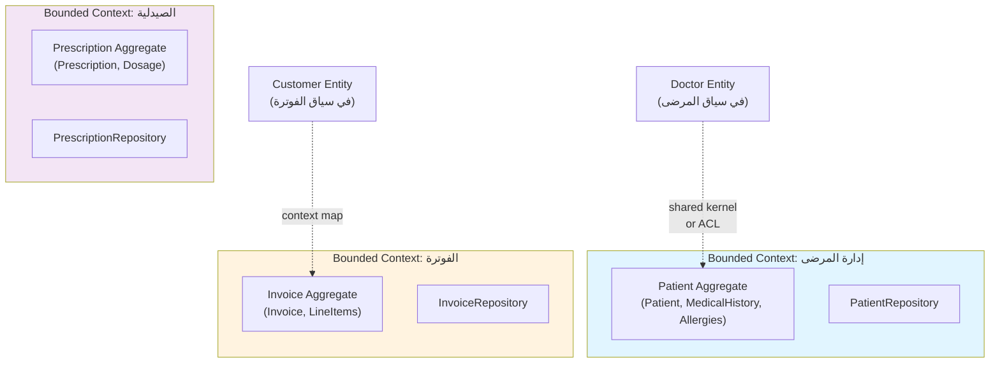
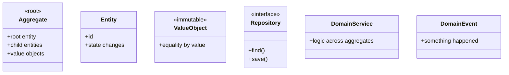
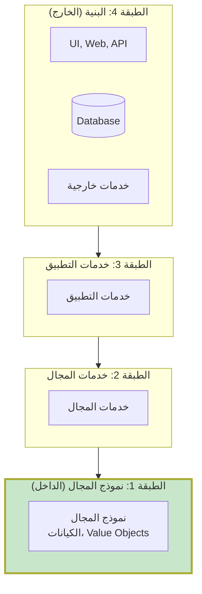

<div dir="rtl">

# الفصول 9-13: DDD، Hexagonal، CQRS والمزيد
## العمارة المتقدمة

---

# الفصل 9: Domain-Driven Design (DDD)
## الأعمال في المركز

---

## 1. المشكلة قبل هذه العمارة

حتى مع Clean Architecture، تكافح الفرق لـ **نمذجة الأعمال** في الكود:

```php
class Order
{
    public $userId, $items, $total, $status;  // البيانات
}

class OrderService
{
    public function place(OrderData $data): Order
    {
        // ❌ قواعد أعمال متناثرة في الـ service
        if ($data->total > 1000) { ... }
        if ($this->hasItems($data)) { ... }
        // ...
    }
}
```

**الألم:**
- **لغة الأعمال** ("تقديم طلب"، "قبول مريض"، "إخراج") في methods الـ Service
- **قواعد الأعمال** ("المريض تحت 18 يحتاج ولي أمر") متناثرة
- **خبراء المجال** (موظفو المستشفى، المصرفيون) لا يستطيعون قراءة الكود
- **الكود لا يعكس الأعمال**

تحتاج عمارة حيث **الكود IS نموذج الأعمال**.

---

## 2. لماذا اخترعت هذه العمارة

**Eric Evans** نشر *"Domain-Driven Design: Tackling Complexity in the Heart of Software"* في 2003. الأطروحة:

> *"قلب البرمجيات هو قدرتها على حل المشاكل المتعلقة بالمجال لمستخدمها. جميع الميزات الأخرى، مهما كانت حيوية، تدعم هذا الغرض الأساسي."*

**الرؤية الجوهرية:** مشاريع البرمجيات تفشل عندما **التنفيذ التقني** ينحرف عن **نموذج الأعمال**. DDD يوائمهما.

### اللبنات الأساسية

يوفر DDD مفردات للنمذجة:
- **Entity** — لديه هوية
- **Value Object** — ليس لديه هوية، فقط قيمة
- **Aggregate** — عنقود من الكيانات يُعامل كوحدة
- **Repository** — يستمر aggregates
- **Domain Service** — منطق لا يناسب كيان
- **Domain Event** — شيء حدث
- **Bounded Context** — حد نموذج
- **Ubiquitous Language** — مفردات مشتركة

---

## 3. تشبيه من الحياة الواقعية

### 🏥 النموذج الإداري للمستشفى

مستشفى به أقسام كثيرة:
- **أمراض القلب** (bounded context)
- **طب الأطفال** (bounded context)
- **الفوترة** (bounded context)

لكل قسم:
- **لغته** ("مريض" في أمراض القلب تعني "مريض قلبي"؛ في الفوترة، "دافع")
- **نماذجه** (أمراض القلب يتتبع تخطيطات القلب؛ الفوترة يتتبع الفواتير)
- **قواعده** (أمراض القلب لا يهتم بالتأمين؛ الفوترة لا يهتم بتخطيطات القلب)

**نفس الشخص** هو "مريض" في أمراض القلب و"عميل" في الفوترة. **النماذج لا تحاول أن تكون عالمية** — إنها محدودة بسياقها.

**Bounded Context** في DDD هو بالضبط هذا: كل جزء من النظام له نموذجه، لغته، وقواعده.

### 📦 الـ Aggregate

فكر في **طلب** كـ aggregate:
- Order (الجذر) — لديه هوية
- OrderItems (الأجزاء) — تنتمي للطلب
- ShippingAddress (الجزء) — ينتمي للطلب

لا يمكنك تعديل OrderItem دون المرور عبر Order. **الطلب هو حد الاتساق.**

---

## 4. الشرح البصري



### اللبنات الأساسية



---

## 5. دورة حياة الطلب (DDD)

```
🌐 المتصفح
   ↓
🛣️ Router
   ↓
🎮 Controller (حد Bounded Context)
   ↓
📋 Application Service (ينسق use case)
   ↓
🎯 Aggregate (تُفرض قواعد الأعمال)
   ↓
💾 Repository (يستمر الـ aggregate)
   ↓
📢 Domain Event (يثيره الـ aggregate)
   ↓
⚙️ Event Handler (يتفاعل مع الحدث)
   ↓
🗄️ قاعدة البيانات
```

---

## 6. هيكل المجلدات (DDD في Laravel)

```
app/
├── Patient/                              ← Bounded Context
│   ├── Domain/
│   │   ├── Models/
│   │   │   ├── Patient.php              ← Aggregate Root
│   │   │   ├── MedicalHistory.php       ← Entity
│   │   │   └── Allergy.php              ← Value Object
│   │   ├── Events/
│   │   │   └── PatientAdmitted.php
│   │   ├── Exceptions/
│   │   │   └── DuplicatePatientException.php
│   │   ├── Repositories/
│   │   │   └── PatientRepositoryInterface.php
│   │   └── Services/
│   │       └── PatientDomainService.php
│   ├── Application/
│   │   ├── UseCases/
│   │   │   └── AdmitPatientUseCase.php
│   │   └── DTOs/
│   │       └── AdmitPatientInput.php
│   └── Infrastructure/
│       ├── Http/Controllers/
│       │   └── PatientController.php
│       └── Persistence/
│           └── EloquentPatientRepository.php
│
├── Billing/                              ← Bounded Context آخر
│   ├── Domain/
│   ├── Application/
│   └── Infrastructure/
│
├── Pharmacy/
└── Shared/                               ← Shared Kernel (نادر!)
    └── ValueObjects/
        └── Money.php
```

---

## 7. مثال Laravel كامل: Patient Aggregate

### الخطوة 1: Value Objects (app/Patient/Domain/Models/Allergy.php)

```php
<?php

namespace App\Patient\Domain\Models;

class Allergy
{
    public function __construct(
        public readonly string $substance,
        public readonly string $severity,  // 'mild' | 'moderate' | 'severe'
        public readonly ?string $reaction = null,
    ) {
        if (!in_array($severity, ['mild', 'moderate', 'severe'])) {
            throw new \InvalidArgumentException("شدة غير صالحة: $severity");
        }
    }

    public function isSevere(): bool
    {
        return $this->severity === 'severe';
    }
}
```

### الخطوة 2: Value Object للبريد (app/Shared/ValueObjects/Email.php)

```php
<?php

namespace App\Shared\ValueObjects;

class Email
{
    public function __construct(public readonly string $value)
    {
        if (!filter_var($value, FILTER_VALIDATE_EMAIL)) {
            throw new \InvalidArgumentException("بريد غير صالح: $value");
        }
    }

    public function equals(self $other): bool
    {
        return strtolower($this->value) === strtolower($other->value);
    }

    public function __toString(): string
    {
        return $this->value;
    }
}
```

### الخطوة 3: Patient Aggregate Root (app/Patient/Domain/Models/Patient.php)

```php
<?php

namespace App\Patient\Domain\Models;

use App\Patient\Domain\Events\PatientAdmitted;
use App\Patient\Domain\Events\PatientDischarged;
use App\Patient\Domain\Exceptions\AlreadyAdmittedException;
use App\Patient\Domain\Exceptions\NotAdmittedException;
use App\Shared\ValueObjects\Email;
use Illuminate\Support\Collection;

class Patient
{
    /** @var Collection<int, Allergy> */
    private Collection $allergies;

    private array $domainEvents = [];

    private function __construct(
        public readonly string $id,
        public readonly string $name,
        public readonly Email $email,
        public readonly \DateTimeInterface $dateOfBirth,
        public readonly string $medicalRecordNumber,
        public readonly string $status = 'active',
    ) {
        $this->allergies = collect();
    }

    /** Factory method لفرض invariants */
    public static function register(
        string $id,
        string $name,
        Email $email,
        \DateTimeInterface $dateOfBirth,
        string $medicalRecordNumber,
    ): self {
        $patient = new self($id, $name, $email, $dateOfBirth, $medicalRecordNumber);
        $patient->domainEvents[] = new PatientRegistered($patient);
        return $patient;
    }

    public function addAllergy(Allergy $allergy): void
    {
        // قاعدة أعمال: لا حساسية مكررة
        if ($this->allergies->contains(fn ($a) => $a->substance === $allergy->substance)) {
            throw new \DomainException("الحساسية لـ {$allergy->substance} مسجلة بالفعل.");
        }
        $this->allergies->push($allergy);
    }

    public function admit(string $roomId, \DateTimeInterface $when): void
    {
        if ($this->status === 'admitted') {
            throw new AlreadyAdmittedException(
                "المريض {$this->id} مقبول بالفعل في الغرفة الحالية"
            );
        }
        // قاعدة أعمال: الحساسية الشديدة يجب الإشارة إليها قبل القبول
        if ($this->hasSevereAllergies()) {
            throw new \DomainException(
                "المريض لديه حساسية شديدة؛ يجب مسح العلامة قبل القبول."
            );
        }
        $this->status = 'admitted';
        $this->domainEvents[] = new PatientAdmitted($this);
    }

    public function discharge(): void
    {
        if ($this->status !== 'admitted') {
            throw new NotAdmittedException("المريض {$this->id} غير مقبول.");
        }
        $this->status = 'discharged';
        $this->domainEvents[] = new PatientDischarged($this);
    }

    public function hasSevereAllergies(): bool
    {
        return $this->allergies->contains(fn ($a) => $a->isSevere());
    }

    public function pullDomainEvents(): array
    {
        $events = $this->domainEvents;
        $this->domainEvents = [];
        return $events;
    }

    public function allergies(): Collection { return $this->allergies; }
}
```

### الخطوة 4: حدث المجال (app/Patient/Domain/Events/PatientAdmitted.php)

```php
<?php

namespace App\Patient\Domain\Events;

use App\Patient\Domain\Models\Patient;

class PatientAdmitted
{
    public function __construct(public readonly Patient $patient) {}
}
```

### الخطوة 5: Repository Interface في المجال (app/Patient/Domain/Repositories/PatientRepositoryInterface.php)

```php
<?php

namespace App\Patient\Domain\Repositories;

use App\Patient\Domain\Models\Patient;
use App\Shared\ValueObjects\Email;

interface PatientRepositoryInterface
{
    public function findById(string $id): ?Patient;
    public function findByEmail(Email $email): ?Patient;
    public function findByMedicalRecordNumber(string $mrn): ?Patient;
    public function save(Patient $patient): void;
}
```

### الخطوة 6: Use Case / Application Service (app/Patient/Application/UseCases/AdmitPatientUseCase.php)

```php
<?php

namespace App\Patient\Application\UseCases;

use App\Patient\Application\DTOs\AdmitPatientInput;
use App\Patient\Domain\Models\Patient;
use App\Patient\Domain\Repositories\PatientRepositoryInterface;
use App\Shared\Events\DomainEventDispatcher;
use Illuminate\Support\Facades\DB;

class AdmitPatientUseCase
{
    public function __construct(
        private PatientRepositoryInterface $patients,
        private DomainEventDispatcher $events,
    ) {}

    public function execute(AdmitPatientInput $input): void
    {
        DB::transaction(function () use ($input) {
            $patient = $this->patients->findById($input->patientId);
            if (!$patient) {
                throw new \DomainException("المريض غير موجود");
            }

            // الـ Aggregate يفرض قواعد الأعمال
            $patient->admit($input->roomId, $input->admittedAt);

            // استمر
            $this->patients->save($patient);

            // أطلق أحداث المجال
            foreach ($patient->pullDomainEvents() as $event) {
                $this->events->dispatch($event);
            }
        });
    }
}
```

### الخطوة 7: تنفيذ Eloquent (app/Patient/Infrastructure/Persistence/EloquentPatientRepository.php)

```php
<?php

namespace App\Patient\Infrastructure\Persistence;

use App\Patient\Domain\Models\Patient;
use App\Patient\Domain\Models\Allergy;
use App\Patient\Domain\Repositories\PatientRepositoryInterface;
use App\Patient\Infrastructure\Persistence\Models\PatientEloquentModel;
use App\Shared\ValueObjects\Email;

class EloquentPatientRepository implements PatientRepositoryInterface
{
    public function findById(string $id): ?Patient
    {
        $model = PatientEloquentModel::with('allergies')->find($id);
        return $model ? $this->toEntity($model) : null;
    }

    public function save(Patient $patient): void
    {
        PatientEloquentModel::updateOrCreate(
            ['id' => $patient->id],
            [
                'name' => $patient->name,
                'email' => $patient->email->value,
                'date_of_birth' => $patient->dateOfBirth,
                'medical_record_number' => $patient->medicalRecordNumber,
                'status' => $patient->status,
            ]
        );
    }

    private function toEntity(PatientEloquentModel $model): Patient
    {
        // استخدم reflection أو factory لتجاوز الـ constructor
        $patient = Patient::register(
            id: $model->id,
            name: $model->name,
            email: new Email($model->email),
            dateOfBirth: new \DateTimeImmutable($model->date_of_birth),
            medicalRecordNumber: $model->medical_record_number,
        );

        return $patient;
    }
}
```

---

## 8. شرح عميق

### الـ Bounded Context

Bounded Context هو **حد نموذج**. داخله، المصطلحات لها معنى محدد. خارجه، قد تعني شيئاً آخر.

**مثال:**
- "مريض" في السياق **السريري**: لديه تاريخ طبي، حساسيات، غرفة
- "عميل" في سياق **الفوترة**: لديه فواتير، طرق دفع
- "عضو" في سياق **التأمين**: لديه بوالص، مطالبات

هذه **ثلاثة نماذج مختلفة** لنفس الشخص. كل سياق له Entity خاصة به. يتواصلون عبر:
- **Shared Kernel** (نادر؛ فقط لمفاهيم مشتركة مستقرة جداً)
- **Context Map** (ترجمة بين النماذج)
- **Anti-Corruption Layer** (مترجم يحمي نموذجك من الآخرين)

### الـ Aggregate

Aggregate هو **حد اتساق**. داخله، جميع التغييرات ذرية. خارجه، يمكنك الوصول فقط للجذر.

**مثال: Order Aggregate**
- Order (الجذر) — لديه OrderItems، ShippingAddress
- يمكنك فقط تعديل OrderItems من خلال Order
- الـ Repository يستمر الـ aggregate كاملاً (Order + Items)
- أجزاء أخرى من النظام ترى Order فقط؛ لا تعرف عن items

**لماذا؟** لمنع **التناقضات**:
- Order يقول "5 عناصر"
- OrderItem يقول "عنصر واحد"
- هذا انتهاك اتساق

**الـ aggregate يفرض invariants.**

### أحداث المجال

حدث المجال يمثل **شيئاً حدث في الماضي**:
- `PatientAdmitted` (ليس `AdmitPatient`)
- `OrderPlaced` (ليس `PlaceOrder`)
- `MoneyTransferred` (ليس `TransferMoney`)

الـ aggregate يثير الأحداث. طبقة Application تُطلقها. سياقات أخرى تتفاعل.

### اللغة الموحدة (Ubiquitous Language)

**اللغة الموحدة** هي المفردات المشتركة بين المطورين وخبراء المجال. تُستخدم في:
- الكود (`Patient.admit()`، ليس `Patient.hospitalize()`)
- المحادثات ("تم قبول المريض في الغرفة 12")
- الوثائق

إذا انحرفت اللغة، ينحرف النموذج.

---

## 9. المزايا

- ✅ **وضوح الأعمال** — الكود يعكس المجال
- ✅ **التواصل** — المطورون والخبراء يشاركون المفردات
- ✅ **النمطية** — bounded contexts مستقلة
- ✅ **قابلية الصيانة** — قواعد الأعمال في الـ aggregate
- ✅ **قابلية الاختبار** — aggregates خالصة سهلة الاختبار
- ✅ **التطور** — السياقات يمكن أن تتطور باستقلال

## 10. العيوب

- ❌ **منحنى تعلم حاد** — مفاهيم كثيرة
- ❌ **يتطلب خبرة بالمجال** — المطورون يجب أن يتعلموا الأعمال
- ❌ **مراسم عالية** — أحداث، repositories، factories
- ❌ **مبالغة للمجالات البسيطة** — تطبيقات CRUD لا تحتاج هذا
- ❌ **صعوبة إعادة الهيكلة** — bounded contexts صعبة التغيير بمجرد تعيينها

## 11. الأخطاء الشائعة

- ❌ **محاولة صنع نموذج عالمي واحد** — يؤدي إلى entity إله
- ❌ **تخطي اللغة الموحدة** — الكود يستخدم مصطلحات تقنية
- ❌ **aggregates فقيرة (Anemic)** — كيانات بلا سلوك
- ❌ **aggregates كبيرة** — كل كيان في جذر واحد
- ❌ **حدود خاطئة** — السياسات مقسمة بشكل غير صحيح

## 12. تأثير الأداء

**overhead صغير** — تحميل aggregate، إطلاق أحداث. ميكروثوانٍ.

## 13. الاختبار

```php
class PatientTest extends TestCase
{
    public function test_admit_records_event(): void
    {
        $patient = Patient::register(
            id: 'p1',
            name: 'Alice',
            email: new Email('alice@example.com'),
            dateOfBirth: new \DateTimeImmutable('1990-01-01'),
            medicalRecordNumber: 'MRN-1',
        );

        $patient->admit('room-1', new \DateTimeImmutable());

        $this->assertEquals('admitted', $patient->status);
        $events = $patient->pullDomainEvents();
        $this->assertCount(1, $events);
        $this->assertInstanceOf(PatientAdmitted::class, $events[0]);
    }

    public function test_cannot_admit_with_severe_allergies(): void
    {
        $patient = Patient::register(/* ... */);
        $patient->addAllergy(new Allergy('البنسلين', 'severe'));

        $this->expectException(\DomainException::class);
        $patient->admit('room-1', new \DateTimeImmutable());
    }
}
```

**اختبارات unit خالصة، بلا Eloquent، بلا DB. الـ aggregate هو الوحدة.**

## 14. الاستخدام المؤسسي

يُستخدم في:
- **مجالات الأعمال المعقدة** (البنوك، التأمين، الرعاية الصحية، الخدمات اللوجستية)
- **أنظمة طويلة العمر** (10+ سنوات)
- **مشاريع متعددة الفرق** (bounded contexts = حدود الفريق)
- **خاضعة للامتثال** (تدقيق واضح، قواعد واضحة)

**لا يُستخدم في:** CRUD بسيط، نماذج أولية، تطبيقات صغيرة.

## 15. المقارنة

| الجانب | Clean Architecture | DDD |
|--------|-------------------|-----|
| التركيز | الطبقات | نموذج المجال |
| Bounded contexts | لا | نعم |
| اللغة الموحدة | لا | نعم |
| Aggregates | اختياري | جوهري |
| أحداث المجال | اختياري | نعم |
| التعقيد | عالي | أعلى |

DDD هي **Clean Architecture + التصميم الاستراتيجي**.

## 16. مسار التطور

```
MVC
   ↓
Service Layer
   ↓
Service + Repository
   ↓
Clean Architecture (استقلالية الـ framework)
   ↓
DDD (المجال في المركز)
   ↓
Bounded Contexts (نماذج متعددة)
   ↓
Context Maps (أنماط التكامل)
```

## 17. أسئلة المقابلة

1. **ما هو Aggregate؟**
   - عنقود من كائنات المجال يُعامل كوحدة واحدة لتغييرات البيانات. الكيان الجذري هو نقطة الدخول الوحيدة.

2. **ما هو Bounded Context؟**
   - حد داخله النموذج متسق. سياقات مختلفة يمكن أن يكون لها نماذج مختلفة لنفس المفهوم.

3. **لماذا يُسمى "Ubiquitous Language"؟**
   - تُستخدم في كل مكان: في الكود، في المحادثة، في الوثائق. تربط المطورين بخبراء المجال.

4. **الفرق بين Entity و Value Object؟**
   - Entity لديه هوية (يُتتبع مع مرور الوقت). Value Object يُعرَّف فقط بقيمه؛ لا هوية.

5. **متى لا تستخدم DDD؟**
   - CRUD بسيط، نماذج أولية، فرق صغيرة، لا مجال معقد.

## 18. التمارين

1. **حدد 3 bounded contexts** في تطبيق تجارة إلكترونية.
2. **ابنِ Patient aggregate** مع القبول، الحساسيات، والإخراج.
3. **حدد Ubiquitous Language** مع خبير مجال.
4. **نفّذ Value Object** (Money, Email, Address).
5. **اعين السياقات** — كيف تتواصل الفوترة مع إدارة المرضى؟

---

> *"DDD ليست عن الأنماط. إنها عن مواءمة الكود مع الأعمال. الأنماط أدوات؛ المواءمة هي الهدف."*

---

# الفصل 10-12: Hexagonal، Onion، Ports & Adapters
## ثلاثة أشقاء، عائلة واحدة

هذه العمارات الثلاث متشابهة لدرجة أنها غالباً ما تُخلط بينها. جميعها تشارك نفس الفكرة الجوهرية: **فصل الأعمال عن التفاصيل التقنية من خلال المنافذ والمحولات**. تختلف في التركيز والاستعارة.

---

# الفصل 10: Hexagonal Architecture
## المنافذ والمحولات في المركز

---

## المشكلة قبل هذه العمارة

حتى مع Clean Architecture، الفرق تجد أن:
- منطق الأعمال **مقترن بشدة بتقنيات محددة**
- تبديل قاعدة البيانات يعني إعادة كتابة المجال
- الاختبار يتطلب قاعدة البيانات الحقيقية، خادم البريد، إلخ.
- "الأعمال" تتسرب إلى الـ framework

**الألم:** الأعمال تعتمد على قاعدة البيانات. الأعمال تعتمد على HTTP. **الاعتمادات خاطئة.**

---

## لماذا اخترعت هذه العمارة

**Alistair Cockburn** صك "Hexagonal Architecture" في 2005. أراد حل:
- "كيف أختبر تطبيقي دون قاعدة البيانات؟"
- "كيف أشغّل تطبيبي بواجهات مختلفة (ويب، CLI، موبايل)؟"
- "كيف أؤجل قرارات التقنية؟"

الاستعارة: تطبيق له **شكل سداسي** مع **منافذ** على كل جانب. كل منفذ هو نقطة اتصال بالعالم الخارجي. **المحولات** تتصل بالمنافذ.

### الفكرة الجوهرية

```
       [Web UI]  [CLI]  [Mobile]
            \      |      /
             \     |     /
            المنافذ  |  المنافذ
              \   |   /
               \  |  /
            ┌──────┴──────┐
            │             │
            │  التطبيق   │
            │   (الجوهر)  │
            │             │
            └──────┬──────┘
               \   |   /
                \  |  /
            المنافذ  |  المنافذ
              /   |   \
             /    |    \
       [MySQL] [Email] [API]
```

**التطبيق في المركز. لديه منافذ (interfaces). المحولات (التنفيذات الملموسة) تتصل. التطبيق لا يعرف عن المحولات.**

---

## تشبيه من الحياة الواقعية

### 🔌 مقبس الطاقة

مقبس الطاقة هو **منفذ**. شاحن هاتفك **محول**. المقبس لا يعرف إذا كنت ستوصل هاتفاً أو كمبيوتر محمول أو مصباحاً.

التطبيق هو **المقبس**. المحولات (Eloquent، MongoDB، Stripe) تتصل. التطبيق لا يعرف أي واحد متصل.

### 🏢 الشركة

لديها **أدوار** (منافذ): "محاسب"، "محامي"، "مهندس". أشخاص محددون (محولات) يملؤون تلك الأدوار. الشركة لا تهتم إذا كان المحاسب Alice أو Bob؛ تهتم بأن هناك محاسباً.

---

## مثال Laravel كامل

### المنافذ (app/Core/Ports/Out/OrderRepositoryPort.php)

```php
<?php

namespace App\Core\Ports\Out;

use App\Core\Domain\Order;

interface OrderRepositoryPort
{
    public function findById(string $id): ?Order;
    public function save(Order $order): void;
}
```

### المجال (app/Core/Domain/Order.php)

```php
<?php

namespace App\Core\Domain;

class Order
{
    public function __construct(
        public readonly string $id,
        public readonly string $userId,
        public readonly float $total,
        private string $status = 'pending',
    ) {}

    public function place(): void
    {
        $this->status = 'placed';
    }

    public function status(): string { return $this->status; }
}
```

### Use Case (app/Core/Services/PlaceOrderService.php)

```php
<?php

namespace App\Core\Services;

use App\Core\Domain\Order;
use App\Core\Ports\Out\OrderRepositoryPort;
use App\Core\Ports\Out\PaymentGatewayPort;

class PlaceOrderService
{
    public function __construct(
        private OrderRepositoryPort $orders,
        private PaymentGatewayPort $payments,
    ) {}

    public function execute(string $userId, array $items, string $paymentMethod): Order
    {
        $total = array_sum(array_map(fn ($i) => $i['price'] * $i['quantity'], $items));
        $order = new Order(uniqid(), $userId, $total);
        $order->place();
        $this->orders->save($order);
        $this->payments->charge($total, $paymentMethod);
        return $order;
    }
}
```

### المحول (app/Adapters/Driven/Persistence/EloquentOrderRepository.php)

```php
<?php

namespace App\Adapters\Driven\Persistence;

use App\Core\Domain\Order;
use App\Core\Ports\Out\OrderRepositoryPort;

class EloquentOrderRepository implements OrderRepositoryPort
{
    public function findById(string $id): ?Order
    {
        $row = \DB::table('orders')->where('id', $id)->first();
        return $row ? new Order($row->id, $row->user_id, $row->total, $row->status) : null;
    }

    public function save(Order $order): void
    {
        \DB::table('orders')->updateOrInsert(
            ['id' => $order->id],
            [
                'user_id' => $order->userId,
                'total' => $order->total,
                'status' => $order->status(),
            ]
        );
    }
}
```

### محول القيادة (app/Adapters/Driving/Http/OrderController.php)

```php
<?php

namespace App\Adapters\Driving\Http;

use App\Core\Services\PlaceOrderService;
use Illuminate\Http\Request;
use Illuminate\Http\RedirectResponse;

class OrderController
{
    public function __construct(
        private PlaceOrderService $placeOrder,
    ) {}

    public function store(Request $request): RedirectResponse
    {
        $order = $this->placeOrder->execute(
            $request->integer('user_id'),
            $request->input('items', []),
            $request->string('payment_method'),
        );

        return redirect()->route('orders.show', $order->id);
    }
}
```

---

# الفصل 11: Onion Architecture

**Jeffrey Palermo** صك "Onion Architecture" في 2008. نفس الفكرة، استعارة مختلفة: **طبقات كالبصلة**.



### الطبقات (خارج → داخل)

1. **البنية** — UI، الاستمرارية، الأنظمة الخارجية
2. **خدمات التطبيق** — حالات الاستخدام، التنسيق
3. **خدمات المجال** — منطق الأعمال الذي لا يناسب الكيانات
4. **نموذج المجال** — الكيانات، Value Objects، Aggregates

### الفرق الرئيسي عن Clean/Hexagonal

Onion تؤكد أن **نموذج المجال هو الطبقة الأعمق**. كل شيء آخر خارج.

---

# الفصل 12: Ports & Adapters

**نفس العائلة، تركيز مختلف.** Ports & Adapters هي نفسها Hexagonal، لكن تؤكد:
- **Ports** = الـ interfaces المجردة
- **Adapters** = التطبيقات الملموسة

### Hexagonal مقابل Ports & Adapters مقابل Onion مقابل Clean

هذه الأربعة **متشابهة تقريباً**. الاختلافات تجميلية في الغالب:

| المفهوم | Hexagonal | Onion | Clean | Ports & Adapters |
|---------|-----------|-------|-------|------------------|
| **الاستعارة** | سداسي | بصلة | دوائر | منافذ/محولات |
| **الأعمق** | التطبيق | نموذج المجال | الكيانات | التطبيق |
| **الفكرة الأساسية** | منافذ/محولات | طبقات | قاعدة الاعتمادية | الفصل |
| **المنشأ** | Cockburn 2005 | Palermo 2008 | Martin 2012 | Cockburn/متنوع |
| **في Laravel** | `app/Core` + `app/Adapters` | `app/Domain` + `app/Application` + `app/Infrastructure` | `app/Domain` + `app/Application` + `app/InterfaceAdapters` + `app/Frameworks` | `app/Ports` + `app/Adapters` |

**عملياً:** اختر واحدة وكن متسقاً. تحقق نفس الهدف.

---

## المزايا (للثلاثة)

- ✅ **استقلالية الـ Framework** — بدّل Laravel بـ Symfony
- ✅ **قابلية الاختبار** — اختبارات unit خالصة، بلا بنية تحتية
- ✅ **محولات قابلة للتبديل** — غيّر DB، بريد، دفع دون تغيير الأعمال
- ✅ **حدود واضحة** — المنفذ هو العقد
- ✅ **متعدد القنوات** — نفس التطبيق، واجهات متعددة
- ✅ **طول العمر** — المجال ينجو من تغييرات التقنية

## العيوب (للثلاثة)

- ❌ **مراسم عالية** — interfaces كثيرة، تنفيذات كثيرة
- ❌ **Boilerplate** — 2x كلاسات لكل شيء
- ❌ **overhead التعيين** — مجال ↔ استمرارية
- ❌ **بطيء لـ CRUD** — مبالغة لتطبيقات بسيطة
- ❌ **منحنى تعلم أكثر حدة** — مفاهيم كثيرة

## 11-18. الأنماط الشائعة عبر الثلاثة

**بنية المجلدات:** المجال (الأعمق) → التطبيق → المحولات/البنية (الأبعد)

**القواعد:**
- المجال بلا استيرادات framework
- التطبيق يعتمد على المجال
- المحولات تعتمد على التطبيق
- الربط (bindings) في Composition Root (Service Provider)

**الاختبار:**
- المجال: اختبارات unit خالصة
- التطبيق: مع mock ports
- المحولات: اختبارات تكامل مع بنية تحتية حقيقية

**متى تستخدم:**
- مجال أعمال معقد
- مصادر بيانات / قنوات متعددة
- نظام طويل العمر
- حاجة لاستقلالية الـ framework

**متى لا تستخدم:**
- CRUD بسيط
- نموذج أولي
- مشروع صغير بمطور واحد

## المقارنة الرئيسية

| الجانب | Service+Repo | Clean | Hexagonal | DDD |
|--------|--------------|-------|-----------|-----|
| المجال في | Eloquent Models | كيانات خالصة | كيانات خالصة | Aggregates |
| الطبقات | 4 (منطقية) | 4 (فعلية) | 2 (جوهر + محولات) | Bounded contexts |
| Bounded contexts | لا | لا | لا | نعم |
| Boilerplate | متوسط | عالي | عالي | الأعلى |
| استقلالية الـ Framework | لا | نعم | نعم | نعم |
| الأفضل لـ | تطبيقات قياسية | مجالات معقدة | فصل | تصميم استراتيجي |

## مسار التطور

```
MVC
   ↓
Service + Repository
   ↓
Clean Architecture (Uncle Bob)
   ↓
Hexagonal Architecture (Cockburn) ←→ Onion (Palermo) ←→ Ports & Adapters
   ↓
DDD (مع bounded contexts، aggregates، ubiquitous language)
   ↓
Modular Monolith / Microservices (bounded contexts متعددة في وحدات نشر)
```

## أسئلة المقابلة

1. **ما هو "port" في Hexagonal Architecture؟**
   - interface يحدد كيف يتحدث التطبيق إلى العالم الخارجي.

2. **الفرق بين Hexagonal و Clean؟**
   - متشابهان جداً؛ تركيز مختلف واستعارة مختلفة في الغالب.

3. **ما هي قاعدة الاعتمادية؟**
   - اعتمادات الكود تشير فقط للداخل، نحو جوهر التطبيق.

4. **منافذ القيادة مقابل المحركات؟**
   - القيادة: الخارج يستدعي للداخل (مثلاً، controllers). المحركات: التطبيق يستدعي للخارج (مثلاً، repos).

5. **متى تستخدم؟**
   - مجال معقد، استقلالية الـ framework، متعدد القنوات.

## التمارين

1. **حدد 3 منافذ** في تطبيق Laravel (القيادة: HTTP، المحركات: DB، بريد).
2. **أعد هيكلة Service** ليعتمد على منفذ بدلاً من كلاس ملموس.
3. **أضف محول CLI** يستخدم نفس use case كـ web controller.
4. **اختبر جوهر التطبيق** بمحولات وهمية.
5. **قارن** Clean، Hexagonal، و Onion في مشروعك.

---

> *"Hexagonal، Onion، Clean، Ports & Adapters — أربعة أسماء، فكرة واحدة: الأعمال هي المركز؛ كل شيء آخر قابل للاستبدال."*

---

# الفصل 13: CQRS
## Command Query Responsibility Segregation (فصل مسؤولية الأمر عن الاستعلام)

---

## 1. المشكلة قبل هذه العمارة

في تطبيق Laravel نموذجي، نفس الـ Model يُستخدم لكل من **القراءة** و **الكتابة**:

```php
class Order extends Model
{
    // يُستخدم للكتابة (create, update)
    protected $fillable = [...];

    // يُستخدم للقراءة (display)
    public function getDisplayNameAttribute() { ... }
    public function scopeActive($query) { ... }
    public function getTotalAttribute() { /* calculation */ }
}
```

**الألم:**
- الـ Model يصبح **كائن إله** (يفعل كل شيء)
- اهتمامات القراءة والكتابة **تتسرب إلى بعضها**
- "عرض" للطلب (مع حقول محسوبة) يتم تحميله حتى عند الحفظ فقط
- تحسينات الأداء تتعارض: indexes للقراءة، constraints للكتابة

**مثال من العالم الحقيقي:** صفحة ملف المستخدم تحتاج:
- معلومات المستخدم الأساسية
- عدد الطلبات
- وقت آخر تسجيل دخول
- حالة الاشتراك
- 5 أشياء مختلفة غير مطبعة

الـ Model الحالي يحمّل كل هذا حتى عندما تريد فقط تحديث البريد.

---

## 2. لماذا اخترعت هذه العمارة

**Greg Young** روّج CQRS حوالي 2010، بناءً على **CQS لـ Bertrand Meyer** (الثمانينيات).

**مبدأ CQS:** method يجب إما أن **يغير الحالة** (command) أو **يُرجع قيمة** (query)، لكن **ليس كليهما**.

**CQRS يمدد هذا:** نظام يجب أن يكون لديه **نماذج منفصلة** للقراءة والكتابة.

### الفكرة الجوهرية

```
جانب الكتابة                          جانب القراءة
==========                          =========
Command ──→  Command Handler       Query ──→  Query Handler
                  │                              │
                  ↓                              ↓
            Write Model                  Read Model (غير مطبّع)
            (تم التحقق منه)                  │
                  │                          (إسقاط)
                  ↓                              │
            Domain Events ──────→───────→ Read DB (اتساق eventual)
                                          (محسّن للاستعلامات)
```

**Commands** تغير الحالة. **Queries** تقرأ الحالة. إنها **منفصلة**.

---

## 3. تشبيه من الحياة الواقعية

### 🏢 قسما البنك

بنك لديه:
- **الصرافون** (جانب الكتابة): يتعاملون مع الإيداعات، السحوبات، التحويلات. يتحققون من العملية، يحدثون دفتر الأستاذ، يعطون إيصالاً.
- **كشوف الحسابات** (جانب القراءة): طباعة يومية لجميع المعاملات، الرصيد، الرسوم. محسّنة للقراءة.

رؤية الصارف للحساب (صف واحد، الحالة الحالية) مختلفة عن رؤية كشف الحساب (قائمة زمنية).

**البنك لا يستخدم نفس النموذج للصيارفة والكشوف.** كل واحد محسّن لغرضه.

CQRS هو نفسه: افصل **نموذج الكتابة** (تم التحقق منه، مطبّع) عن **نموذج القراءة** (غير مطبّع، محسّن للاستعلام).

### 📚 المكتبة

لديها:
- **أمين المكتبة** (جانب الكتابة): يضيف كتب، يضع علامات عليها كمستعارة، يعيدها. كل إجراء حذر، تم التحقق منه، تم تدقيقه.
- **فهرس البطاقات** (جانب القراءة): فهرس لجميع الكتب، مع العنوان، المؤلف، التوفر. محسّن للبحث.

رؤية أمين المكتبة للكتاب مختلفة عن رؤية الفهرس.

---

## 4. الشرح البصري

```mermaid
flowchart LR
    subgraph WriteSide ["جانب الكتابة (Command)"]
        Cmd[📝 Command<br/>PlaceOrderCommand]
        CmdHandler[⚙️ Command Handler<br/>PlaceOrderHandler]
        WriteModel[📦 Write Model<br/>Order (aggregate)]
        WriteDB[(🗄️ Write DB<br/>مطبّع)]
    end

    subgraph ReadSide ["جانب القراءة (Query)"]
        Q[🔍 Query<br/>GetOrderListQuery]
        QHandler[📊 Query Handler<br/>GetOrderListHandler]
        ReadModel[📋 Read Model<br/>OrderView (غير مطبّع)]
        ReadDB[(🗄️ Read DB<br/>غير مطبّع)]
    end

    Cmd --> CmdHandler
    CmdHandler --> WriteModel
    WriteModel --> WriteDB
    WriteDB -.->|event/project| ReadDB
    ReadDB --> ReadModel
    ReadModel --> QHandler
    Q --> QHandler

    style WriteSide fill:#ffcdd2
    style ReadSide fill:#c8e6c9
```

### التدفق

1. المستخدم يُرسل **Command** (مثلاً، PlaceOrderCommand)
2. **Command Handler** يتحقق ويُحدّث **Write Model**
3. Write Model يُطلق **Domain Events**
4. الأحداث **تُسقَط** في **Read Model** (غير مطبّع)
5. **Query** للمستخدم يُخدم من **Read Model** (سريع، محسّن)

---

## 5. دورة حياة الطلب

### جانب الكتابة (Command)

```
🌐 المتصفح: POST /orders
   ↓
🎮 Controller
   - $command = new PlaceOrderCommand(...);
   - $handler->handle($command);
   ↓
📝 PlaceOrderCommand
   - بيانات خالصة، بلا سلوك
   ↓
⚙️ PlaceOrderHandler
   - يتحقق من الأمر
   - يحمّل Order aggregate
   - يستدعي $order->place()
   - يستمر إلى write DB
   - يُطلق OrderPlaced event
   ↓
📦 Order (aggregate)
   - يفرض قواعد الأعمال
   - يثير الأحداث
   ↓
🗄️ Write DB
   - INSERT INTO orders ...
   - INSERT INTO order_items ...
   ↓
📢 Event: OrderPlaced مُطلق
   ↓
📊 الإسقاط: Read model مُحدّث
   - UPDATE order_views SET status = 'placed' WHERE id = ?
   ↓
✅ استجابة
```

### جانب القراءة (Query)

```
🌐 المتصفح: GET /orders
   ↓
🎮 Controller
   - $query = new GetOrderListQuery($userId);
   - $view = $handler->handle($query);
   - return $view;
   ↓
🔍 GetOrderListQuery
   - بيانات خالصة
   ↓
📊 GetOrderListHandler
   - SELECT * FROM order_views WHERE user_id = ?
   - يُرجع array من OrderView
   ↓
📋 OrderView (read model)
   - غير مطبّع
   - محسّن للاستعلام
   ↓
✅ استجابة (JSON أو HTML)
```

---

## 6. هيكل المجلدات

```
app/
├── Write/                              ← جانب الكتابة
│   ├── Orders/
│   │   ├── Commands/
│   │   │   ├── PlaceOrderCommand.php
│   │   │   └── CancelOrderCommand.php
│   │   ├── Handlers/
│   │   │   ├── PlaceOrderHandler.php
│   │   │   └── CancelOrderHandler.php
│   │   ├── Aggregates/
│   │   │   └── Order.php
│   │   └── Events/
│   │       └── OrderPlaced.php
│   └── Shared/
│       └── Bus/
│           └── CommandBus.php
│
├── Read/                               ← جانب القراءة
│   ├── Orders/
│   │   ├── Queries/
│   │   │   └── GetOrderListQuery.php
│   │   ├── Handlers/
│   │   │   └── GetOrderListHandler.php
│   │   ├── Projections/
│   │   │   └── OrderView.php
│   │   └── ReadModels/
│   │       └── OrderReadModel.php
│   └── Shared/
│       └── Bus/
│           └── QueryBus.php
│
├── Http/Controllers/
│   ├── OrderController.php             ← يستخدم Command bus للكتابة
│   └── OrderQueryController.php        ← يستخدم Query bus للقراءة
│
└── Projections/                        ← Event → Read Model
    └── OrderProjector.php
```

---

## 7. مثال Laravel كامل

### Command (app/Write/Orders/Commands/PlaceOrderCommand.php)

```php
<?php

namespace App\Write\Orders\Commands;

class PlaceOrderCommand
{
    public function __construct(
        public readonly int $userId,
        public readonly array $items,
        public readonly string $paymentMethod,
    ) {}
}
```

### Command Handler (app/Write/Orders/Handlers/PlaceOrderHandler.php)

```php
<?php

namespace App\Write\Orders\Handlers;

use App\Write\Orders\Aggregates\Order;
use App\Write\Orders\Commands\PlaceOrderCommand;
use App\Write\Orders\Events\OrderPlaced;
use App\Write\Orders\Repositories\OrderRepositoryInterface;
use Illuminate\Support\Facades\DB;
use Illuminate\Support\Facades\Event;

class PlaceOrderHandler
{
    public function __construct(
        private OrderRepositoryInterface $orders,
    ) {}

    public function handle(PlaceOrderCommand $command): void
    {
        DB::transaction(function () use ($command) {
            $order = Order::place(
                id: uniqid(),
                userId: $command->userId,
                items: $command->items,
            );

            $this->orders->save($order);

            foreach ($order->pullEvents() as $event) {
                Event::dispatch($event);
            }
        });
    }
}
```

### Read Model (app/Read/Orders/ReadModels/OrderView.php)

```php
<?php

namespace App\Read\Orders\ReadModels;

class OrderView
{
    public function __construct(
        public readonly string $id,
        public readonly int $userId,
        public readonly string $userName,        // غير مطبّع
        public readonly float $total,
        public readonly string $status,
        public readonly int $itemCount,          // محسوب مسبقاً
        public readonly string $lastUpdated,
    ) {}

    public static function fromArray(array $data): self
    {
        return new self(
            id: $data['id'],
            userId: $data['user_id'],
            userName: $data['user_name'],
            total: (float) $data['total'],
            status: $data['status'],
            itemCount: (int) $data['item_count'],
            lastUpdated: $data['last_updated'],
        );
    }
}
```

### Query (app/Read/Orders/Queries/GetOrderListQuery.php)

```php
<?php

namespace App\Read\Orders\Queries;

class GetOrderListQuery
{
    public function __construct(
        public readonly int $userId,
        public readonly int $page = 1,
        public readonly int $perPage = 20,
    ) {}
}
```

### Query Handler (app/Read/Orders/Handlers/GetOrderListHandler.php)

```php
<?php

namespace App\Read\Orders\Handlers;

use App\Read\Orders\Queries\GetOrderListQuery;
use App\Read\Orders\ReadModels\OrderView;
use Illuminate\Support\Facades\DB;

class GetOrderListHandler
{
    public function handle(GetOrderListQuery $query): array
    {
        $rows = DB::table('order_views')
            ->where('user_id', $query->userId)
            ->orderBy('last_updated', 'desc')
            ->offset(($query->page - 1) * $query->perPage)
            ->limit($query->perPage)
            ->get();

        return $rows->map(fn ($row) => OrderView::fromArray((array) $row))->all();
    }
}
```

### Projector (app/Projections/OrderProjector.php)

```php
<?php

namespace App\Projections;

use App\Write\Orders\Events\OrderPlaced;
use App\Write\Orders\Events\OrderCancelled;
use Illuminate\Support\Facades\DB;

class OrderProjector
{
    public function onOrderPlaced(OrderPlaced $event): void
    {
        DB::table('order_views')->insert([
            'id' => $event->orderId,
            'user_id' => $event->userId,
            'user_name' => $event->userName,        // محمّل من جدول Users
            'total' => $event->total,
            'status' => 'placed',
            'item_count' => count($event->items),
            'last_updated' => now(),
        ]);
    }

    public function onOrderCancelled(OrderCancelled $event): void
    {
        DB::table('order_views')
            ->where('id', $event->orderId)
            ->update(['status' => 'cancelled', 'last_updated' => now()]);
    }
}
```

### Controller (app/Http/Controllers/OrderController.php)

```php
<?php

namespace App\Http\Controllers;

use App\Read\Orders\Handlers\GetOrderListHandler;
use App\Read\Orders\Queries\GetOrderListQuery;
use App\Write\Orders\Commands\PlaceOrderCommand;
use App\Write\Orders\Handlers\PlaceOrderHandler;
use App\Write\Shared\CommandBus;
use Illuminate\Http\RedirectResponse;
use Illuminate\Http\Request;
use Illuminate\View\View;

class OrderController extends Controller
{
    public function store(Request $request, CommandBus $bus): RedirectResponse
    {
        $bus->dispatch(new PlaceOrderCommand(
            userId: $request->integer('user_id'),
            items: $request->input('items', []),
            paymentMethod: $request->string('payment_method'),
        ));

        return redirect()->route('orders.index');
    }

    public function index(Request $request, GetOrderListHandler $handler): View
    {
        $orders = $handler->handle(new GetOrderListQuery(
            userId: $request->integer('user_id'),
            page: $request->integer('page', 1),
        ));

        return view('orders.index', ['orders' => $orders]);
    }
}
```

---

## 8. شرح عميق

### الاتساق النهائي (Eventual Consistency)

جانب الكتابة يلتزم فوراً. جانب القراءة يُحدّث **بشكل غير متزامن** (عبر إسقاط الحدث). هذا يعني:
- المستخدم يقدم طلباً → الكتابة تنجح
- المستخدم يحدّث قائمة الطلبات → قد لا يرى الطلب الجديد (قاعدة بيانات القراءة لم تُحدّث بعد)
- بعد لحظة → قاعدة بيانات القراءة تُحدّث، المستخدم يرى الطلب

**هذا هو "الاتساق النهائي"** — النظام يتقارب نحو حالة متسقة، لكن مع تأخير صغير.

**لماذا نقبل هذا؟**
- القراءات **أسرع بكثير** (غير مطبّع، بلا joins)
- الكتابات **أبسط** (بلا اهتمامات قراءة)
- النظام يمكنه **التوسع باستقلال** (read replicas)

### لماذا قواعد بيانات منفصلة؟

في تطبيق CQRS كامل:
- **Write DB** مطبّع، محسّن للمعاملات
- **Read DB** غير مطبّع، محسّن للاستعلامات (يمكن أن يكون Elasticsearch، data warehouse، حتى cache)

في تطبيقات أبسط (Laravel CQRS-lite)، كلا القاعدتين نفس MySQL، لكن read model هو **جدول منفصل** يُدار بواسطة projector.

### CQRS الكامل مقابل CQRS-lite

| السيناريو | النهج |
|----------|-------|
| قراءة-ثقيلة مع views معقدة | CQRS-lite (جداول قراءة منفصلة) |
| أنماط قراءة مختلفة (بحث، تحليلات) | CQRS كامل مع read replicas |
| Microservices مع نماذج قراءة منفصلة | CQRS كامل |
| CRUD بسيط | لا تستخدم CQRS |

### نمط الـ Bus

في CQRS متطور، الأوامر والاستعلامات تمر عبر **buses**:

```php
$bus->dispatch(new PlaceOrderCommand(...));  // Command bus
$bus->ask(new GetOrderQuery(...));            // Query bus
```

الـ bus يجد المعالج المناسب. هذا يفصل المرسل عن المعالج.

---

## 9. المزايا

- ✅ **الأداء** — read model غير مطبّع، بلا joins
- ✅ **قابلية التوسع** — القراءة والكتابة تتوسعان باستقلال
- ✅ **الوضوح** — الأوامر والاستعلامات منفصلة
- ✅ **المرونة** — قواعد بيانات مختلفة لاحتياجات مختلفة
- ✅ **التدقيق** — الأحداث توثق جميع التغييرات
- ✅ **النماذج المتعددة** — Elasticsearch للبحث، MySQL للطلبات، إلخ.

## 10. العيوب

- ❌ **التعقيد** — نموذجان، قاعدتا بيانات، اتساق نهائي
- ❌ **الاتساق النهائي** — القراءات قد تكون قديمة
- ❌ **كود أكثر** — commands، queries، handlers، projections
- ❌ **مبالغة لـ CRUD البسيط**
- ❌ **صعوبة التصحيح** — حالات القراءة والكتابة يمكن أن تختلف

## 11. الأخطاء الشائعة

- ❌ **استخدام CQRS لكل شيء** — فقط للمجالات القراءة-الثقيلة المعقدة
- ❌ **الإسقاط المتزامن** — يهزم فائدة قابلية التوسع
- ❌ **نفس النموذج للجانبين** — ليس CQRS حقاً
- ❌ **تجاهل الاتساق النهائي** — UI يجب أن يتعامل مع التأخير
- ❌ **handlers غير idempotent** — يمكن إعادة تسليم الأحداث

## 12. تأثير الأداء

**تحسين رئيسي للقراءات.** أداء الكتابة مشابه.

## 13. الاختبار

- **اختبارات Command** — اختبارات unit خالصة على الـ aggregate
- **اختبارات Query** — اختبارات تكامل على read model
- **اختبارات Projector** — تحقق من event → read model
- **من النهاية للنهاية** — تحقق من الاتساق النهائي

## 14. الاستخدام المؤسسي

يُستخدم في:
- **البنوك** — حجم قراءة عالي، views معقدة
- **التجارة الإلكترونية** — كتالوج المنتجات، البحث، التحليلات
- **الشبكات الاجتماعية** — feeds، timelines
- **أنظمة متعددة القنوات** — views مختلفة لكل قناة

## 15. المقارنة

| النمط | قراءة | كتابة | الأفضل لـ |
|-------|-------|-------|----------|
| MVC | نفس النموذج | نفس النموذج | CRUD بسيط |
| Repository | نفس النموذج | نفس النموذج | تطبيقات قياسية |
| CQRS | Read model | Write model | قراءة-ثقيلة، views معقدة |
| Event Sourcing | إسقاطات | سجل الأحداث | تدقيق، سفر عبر الزمن |

## 16. مسار التطور

```
MVC (قراءة = كتابة = نفس Model)
   ↓
Service + Repository (لا تزال قراءة = كتابة)
   ↓
CQRS-lite (جداول قراءة منفصلة في نفس DB)
   ↓
CQRS كامل (قواعد بيانات منفصلة)
   ↓
Event Sourcing (الأحداث كمصدر للحقيقة)
```

## 17. أسئلة المقابلة

1. **ماذا تعني CQRS؟**
   - Command Query Responsibility Segregation (فصل مسؤولية الأمر عن الاستعلام).

2. **Command مقابل Query؟**
   - Command يغير الحالة. Query يُرجع الحالة. أبداً كلاهما.

3. **ما هو "الاتساق النهائي"؟**
   - النظام يتقارب نحو حالة متسقة بعد تأخير صغير.

4. **متى تستخدم CQRS؟**
   - قراءة-ثقيلة مع views معقدة، نماذج قراءة متعددة، حاجات تدقيق.

5. **ما هو الإسقاط (Projection)؟**
   - تحويل حدث إلى تحديث لـ read model.

## 18. التمارين

1. **ابنِ إصدار CQRS-lite** لقائمة المنتجات (جدول قراءة منفصل لـ `product_list_view`).
2. **أضف projector** يحدث جدول القراءة عند تغيير المنتجات.
3. **اختبر الاتساق النهائي** — اكتب، اقرأ فوراً، شاهد البيانات القديمة، انتظر، شاهد الجديدة.
4. **أضف read model للبحث** — جدول مختلف، محسّن للبحث.
5. **قارن الأداء** — نفس الاستعلام على جدول عادي مقابل view غير مطبّع.

---

> *"CQRS ليست عن التعقيد. إنها عن الاعتراف بأن القراءة والكتابة لهما احتياجات مختلفة. النماذج المختلفة تتيح لكل واحد التألق."*

</div>
