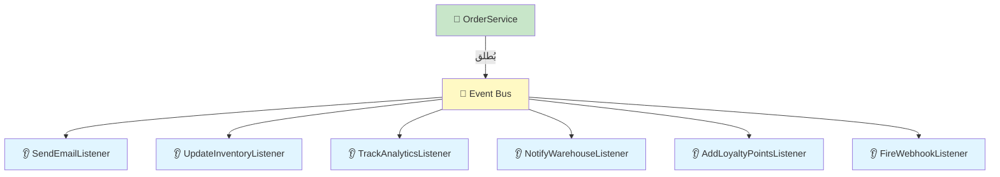
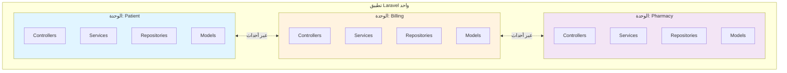
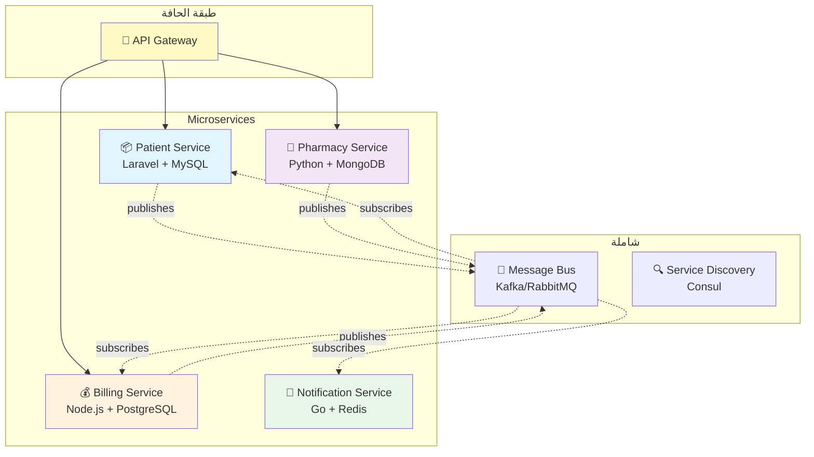
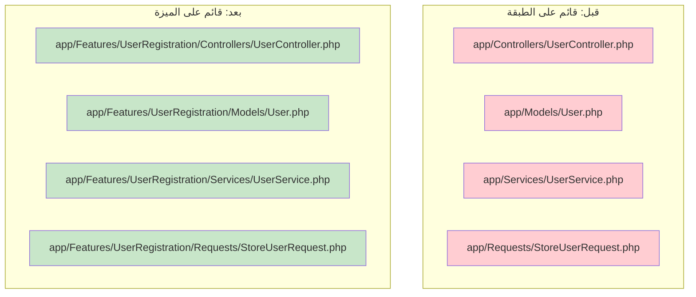
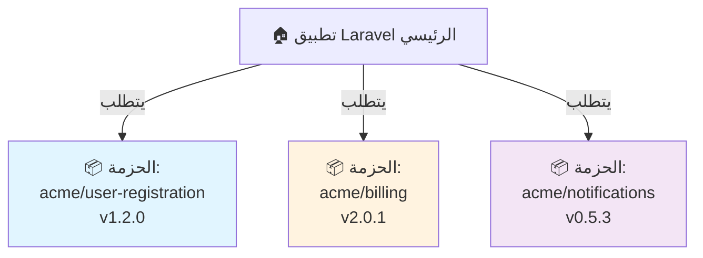

<div dir="rtl">

# الفصول 14-18: Event-Driven، Microservices، Modular، Feature-Based، Package-Based
## العمارة الموزعة والنمطية

---

# الفصل 14: Event-Driven Architecture (العمارة المدفوعة بالأحداث)
## الفصل من خلال الرسائل

---

## 1. المشكلة قبل هذه العمارة

في Service + Repository (الفصل 4)، الـ Service **يستدعي مباشرة** التأثيرات الجانبية:

```php
class OrderService
{
    public function place(OrderData $data): Order
    {
        $order = $this->orders->create($data);
        
        // ❌ استدعاءات مباشرة لتأثيرات جانبية كثيرة
        Mail::to($order->user)->send(new OrderConfirmation($order));
        Http::post($webhookUrl, $order->toArray());
        Analytics::track('order_placed', [...]);
        $this->loyalty->addPoints($order->user, $order->total);
        $this->inventory->decrement($order->items);
        // ... 5 آخرين
        
        return $order;
    }
}
```

**الألم:**
- الـ Service لديه **اعتمادات كثيرة جداً**
- إضافة تأثير جانبي جديد يتطلب **تعديل الـ Service**
- تأثير جانبي فاشل (بريد بطيء) **يحجب سير العمل**
- التأثيرات الجانبية **متناثرة** عبر قاعدة الكود

---

## 2. لماذا اخترعت هذه العمارة

Event-Driven Architecture (EDA) نشأت من message-oriented middleware (التسعينيات) واكتسبت شعبية مع:
- **أنظمة Pub/Sub** (RabbitMQ، Kafka)
- **Microservices** (الخدمات تتواصل عبر الأحداث)
- **Domain Events** (DDD)

الرؤية الجوهرية: **بدلاً من استدعاء التأثيرات الجانبية، أعلن ماذا حدث ودع الآخرين يتفاعلون.**

---

## 3. الشرح البصري



**الـ Service لا يعرف شيئاً عن Listeners. يمكن إضافة Listeners أو إزالتها أو تغييرها دون لمس الـ Service.**

---

## 4. تنفيذ Laravel

نظام الأحداث في Laravel مدفوع بالأحداث بالفعل:

```php
// Service يُطلق حدثاً
event(new OrderPlaced($order));

// Listeners يتفاعلون
class SendOrderConfirmationEmail
{
    public function handle(OrderPlaced $event): void
    {
        Mail::to($event->order->user)->send(new OrderConfirmation($event->order));
    }
}

// ضع الـ listener في طابور للمعالجة غير المتزامنة
class SendOrderConfirmationEmail implements ShouldQueue
{
    // ...
}
```

**متقدم: الأحداث الموزعة**

للأنظمة متعددة الخدمات أو متعددة التطبيقات:
```php
// في Laravel
class OrderPlaced
{
    use Dispatchable, SerializesModels;
    
    public function broadcastOn(): array
    {
        return ['orders']; // بث إلى WebSocket
    }
    
    public function broadcastAs(): string
    {
        return 'order.placed';
    }
}
```

للأحداث عبر الخدمات، استخدم queue في Laravel مع message broker:
```php
// في تطبيق Laravel واحد
OrderPlacedEvent::dispatch($order);

// في تطبيق Laravel آخر (مستهلك)
class OrderPlacedConsumer
{
    public function handle(OrderPlacedMessage $message): void
    {
        // تفاعل مع الحدث
    }
}
```

---

## 5. المزايا

- ✅ **الفصل** — Service لا يعرف عن التأثيرات الجانبية
- ✅ **القابلية للتوسع** — أضف listeners جديدة دون تغيير Service
- ✅ **غير متزامن** — ضع listeners في طابور للمعالجة في الخلفية
- ✅ **موزعة** — الأحداث يمكنها عبور حدود الخدمات
- ✅ **التدقيق** — الأحداث توثق ما حدث

## 6. العيوب

- ❌ **الاتساق النهائي** — Listeners تعمل بشكل غير متزامن، قد تتأخر
- ❌ **صعوبة التصحيح** — التتبع الموزع مطلوب
- ❌ **أخطاء eventual** — ماذا لو فشل listener؟
- ❌ **تدفق مخفي** — من الصعب رؤية الصورة الكاملة

## 7. متى تستخدم

- ✅ تأثيرات جانبية متعددة لكل عملية
- ✅ التأثيرات الجانبية يمكن أن تكون غير متزامنة
- ✅ التواصل عبر الخدمات
- ✅ حاجات التدقيق

## 8. متى لا تستخدم

- ❌ متطلبات متزامنة
- ❌ CRUD بسيط
- ❌ لا حاجات غير متزامنة

---

# الفصل 15: Modular Monolith (الوحدة المتجانسة)
## Microservices بنشر واحد

---

## 1. المشكلة قبل هذه العمارة

مع نمو تطبيقات Laravel، حتى مع Service + Repository:
- **كل الكود في مجلد واحد** (`app/`)
- **جميع الاختبارات تعمل معاً** (CI بطيء)
- **فرق متعددة تتعارض** (نفس الملفات)
- **لا حدود واضحة** (أين ينتهي منطق المريض ويبدأ منطق الفوترة؟)

---

## 2. لماذا اخترعت هذه العمارة

**Simon Brown** و **Skelton** روّجوا فكرة "Modular Monolith". الرؤية الأساسية: **يمكنك الحصول على حدود الوحدات دون microservices**.

Modular monolith:
- لديه حدود وحدات واضحة (مجلدات، namespaces)
- كل وحدة لديها Services، Repositories، Models خاصة بها
- الوحدات تتواصل عبر interfaces أو أحداث
- **يُنشر كوحدة واحدة** (تطبيق Laravel واحد، DB واحد)

---

## 3. الشرح البصري



---

## 4. هيكل المجلدات

```
app/
├── Modules/
│   ├── Patient/
│   │   ├── PatientServiceProvider.php
│   │   ├── Http/Controllers/
│   │   ├── Services/
│   │   ├── Repositories/
│   │   ├── Models/
│   │   ├── Events/
│   │   ├── Listeners/
│   │   ├── Exceptions/
│   │   ├── DTOs/
│   │   └── routes.php
│   │
│   ├── Billing/
│   │   ├── BillingServiceProvider.php
│   │   ├── ... (نفس البنية)
│   │
│   └── Pharmacy/
│       └── ...
│
└── Shared/                              ← Shared kernel (نادر!)
    └── ValueObjects/
```

### Service Provider للوحدة (app/Modules/Patient/PatientServiceProvider.php)

```php
<?php

namespace App\Modules\Patient;

use App\Modules\Patient\Repositories\Contracts\PatientRepositoryInterface;
use App\Modules\Patient\Repositories\Eloquent\EloquentPatientRepository;
use Illuminate\Support\Facades\Route;
use Illuminate\Support\ServiceProvider;

class PatientServiceProvider extends ServiceProvider
{
    public function register(): void
    {
        $this->app->bind(
            PatientRepositoryInterface::class,
            EloquentPatientRepository::class
        );
    }

    public function boot(): void
    {
        $this->loadMigrationsFrom(__DIR__ . '/Database/Migrations');
        $this->loadViewsFrom(__DIR__ . '/Resources/Views', 'patient');
        Route::middleware('web')->group(__DIR__ . '/routes.php');
    }
}
```

### تسجيل الـ provider في bootstrap/providers.php

```php
return [
    App\Providers\AppServiceProvider::class,
    App\Modules\Patient\PatientServiceProvider::class,
    App\Modules\Billing\BillingServiceProvider::class,
    App\Modules\Pharmacy\PharmacyServiceProvider::class,
];
```

---

## 5. التواصل بين الوحدات

### الخيار 1: الأحداث (اقتران فضفاض)

```php
// في وحدة Patient
event(new PatientAdmitted($patient));

// في وحدة Billing (مشترك)
class CreateAdmissionInvoice
{
    public function handle(PatientAdmitted $event): void
    {
        // أنشئ فاتورة في وحدة Billing
    }
}
```

### الخيار 2: عقود مشتركة

```php
// في Patient/Contracts
interface PatientReadRepositoryInterface
{
    public function findById(int $id): ?PatientView;
}

// في Patient
class PatientReadRepository implements PatientReadRepositoryInterface
{
    public function findById(int $id): ?PatientView
    {
        // أرجع DTO، ليس الـ model
    }
}
```

**وحدة Patient تكشف عقداً. الوحدات الأخرى تستخدمه. التنفيذ داخلي.**

---

## 6. المزايا

- ✅ **حدود الوحدات** — ملكية واضحة
- ✅ **توسع الفريق** — فرق مختلفة تمتلك وحدات مختلفة
- ✅ **أسهل في إعادة الهيكلة** — الحدود واضحة
- ✅ **مسار إلى microservices** — يمكن استخراج الوحدات لاحقاً
- ✅ **نشر واحد** — أبسط من microservices

## 7. العيوب

- ❌ **قاعدة بيانات مشتركة** — الوحدات يمكن أن تتداخل
- ❌ **جميع الاختبارات لا تزال تعمل معاً** — أبطأ من microservices
- ❌ **انضباط حدود الوحدات** — سهل الانتهاك
- ❌ **لا يزال متجانساً** — نقطة فشل واحدة

## 8. متى تستخدم

- ✅ 5+ مطورين
- ✅ مجالات أعمال متعددة
- ✅ نظام طويل العمر
- ✅ خطة لاستخراج microservices لاحقاً
- ✅ نشر واحد مقبول

## 9. متى لا تستخدم

- ❌ تطبيق صغير
- ❌ مطور فردي
- ❌ مجال واحد

---

# الفصل 16: Microservices Architecture
## النشرات المستقلة

---

## 1. المشكلة قبل هذه العمارة

حتى modular monoliths لديها:
- **نشر واحد** — خطأ واحد ينشر كل شيء
- **قاعدة بيانات واحدة** — تغييرات schema تؤثر على الجميع
- **مكدس تقني واحد** — لا يمكن استخدام Python لـ ML، Go للأداء
- **وحدة توسيع واحدة** — يجب توسيع التطبيق كله

---

## 2. لماذا اخترعت هذه العمارة

**مصطلح "microservices"** صُك حوالي 2011-2014. التأثيرات الرئيسية:
- **انتقال Netflix إلى AWS** (2008+)
- **"API mandate" في Amazon** (2002: جميع الفرق تكشف APIs)
- **قانون Conway** (المنظمات تصمم أنظمة تعكس تواصلها)

الرؤية: **المنظمات الكبيرة تحتاج خدمات قابلة للنشر باستقلال.**

---

## 3. الخصائص (حسب Lewis/Fowler)

1. **التقسيم عبر الخدمات** — وحدات قابلة للاستبدال ومستقلة
2. **التنظيم حول قدرة الأعمال** — ليس طبقات تقنية
3. **الحوكمة اللامركزية** — كل فريق يختار تقنيته
4. **إدارة البيانات اللامركزية** — كل خدمة لها DB خاصة
5. **أتمتة البنية التحتية** — CI/CD، containers
6. **نقاط نهاية ذكية، أنابيب غبية** — منطق الأعمال في الخدمات، ليس middleware
7. **التصميم للفشل** — الخدمات يمكن أن تفشل؛ الأنظمة يجب أن تتعامل

---

## 4. الشرح البصري



---

## 5. Laravel كـ Microservice

تطبيق Laravel يمكن أن يكون خدمة microservice واحدة. كل خدمة:
- لها repo خاص، DB خاص
- تكشف REST أو gRPC API
- تنشر أحداثاً إلى message broker
- لها خط أنابيب CI/CD خاص
- لها مكدس تقني خاص (Laravel, Node, Go, إلخ.)

```php
// Patient Service (Laravel) - يكشف API
Route::get('/patients/{id}', [PatientController::class, 'show']);
Route::post('/patients', [PatientController::class, 'store']);

// Patient Service ينشر أحداثاً إلى Kafka
class AdmitPatientHandler
{
    public function handle(AdmitPatientCommand $command): void
    {
        $admission = $this->service->admit($command);
        
        // انشر إلى Kafka
        Kafka::publish('patient-events')
            ->onTopic('patient.admitted')
            ->withBody(['admission_id' => $admission->id, ...])
            ->send();
    }
}
```

---

## 6. التواصل بين الخدمات

### متزامن (REST/gRPC)

```php
// Billing Service يستدعي Patient Service
$patient = Http::get('http://patient-service/patients/' . $id);
```

**المزايا:** بسيط، اتساق فوري
**العيوب:** الخدمات مقترنة؛ واحدة تفشل، الكل يفشل

### غير متزامن (الأحداث)

```php
// Patient Service ينشر
event(new PatientAdmitted($admission));

// Billing Service يستهلك (عبر queue worker)
class CreateAdmissionInvoice
{
    public function handle(PatientAdmittedMessage $message): void
    {
        // أنشئ فاتورة
    }
}
```

**المزايا:** مفصول، قابل للتوسع
**العيوب:** اتساق نهائي

---

## 7. المزايا

- ✅ **نشر مستقل** — انشر Patient بدون Billing
- ✅ **توسع مستقل** — وسّع Pharmacy 10x، اترك Patient
- ✅ **تنوع تقني** — أفضل أداة لكل وظيفة
- ✅ **استقلالية الفريق** — كل فريق يمتلك خدمته
- ✅ **المرونة** — خدمة واحدة معطلة لا تقتل الكل

## 8. العيوب

- ❌ **تعقيد النظام الموزع** — استدعاءات شبكة، حالات فشل جزئية
- ❌ **اتساق البيانات** — لا ACID عبر الخدمات
- ❌ **overhead تشغيلي** — نشرات كثيرة، قواعد بيانات كثيرة
- ❌ **تعقيد الاختبار** — اختبارات التكامل تحتاج جميع الخدمات
- ❌ **Latency** — استدعاءات الشبكة بطيئة
- ❌ **عبء DevOps** — Kubernetes، service mesh، observability

## 9. متى تستخدم

- ✅ 50+ مطور
- ✅ إيقاع نشر مستقل مطلوب
- ✅ نطاق ضخم (10K+ RPS)
- ✅ مكدسات تقنية متعددة
- ✅ نظام طويل العمر ومعقد

## 10. متى لا تستخدم

- ❌ فريق صغير (<10)
- ❌ حركة مرور منخفضة
- ❌ مجال بسيط
- ❌ اقتران وثيق مطلوب
- ❌ لا قدرة DevOps

**قاعدة عامة:** ابدأ بـ modular monolith. استخرج microservices عندما يبرر الألم.

---

# الفصل 17: Feature-Based Architecture (العمارة القائمة على الميزات)
## التقطيع العمودي

---

## 1. المشكلة قبل هذه العمارة

Laravel التقليدي ينظم **بالطبقة التقنية**:
```
app/
├── Controllers/
├── Models/
├── Services/
└── ...
```

**الألم:**
- ميزة "تسجيل المستخدم" **متناثرة** عبر جميع المجلدات
- لمس ميزة يعني تعديل **ملفات كثيرة في مجلدات كثيرة**
- مطور جديد لا يمكنه إيجاد "كل الكود لميزة المستخدم"

---

## 2. الفكرة الجوهرية

**Feature-Based Architecture** ينظم الكود **حسب الميزة**، وليس حسب الطبقة التقنية:

```
app/
├── Features/
│   ├── UserRegistration/
│   │   ├── Controllers/
│   │   ├── Models/
│   │   ├── Services/
│   │   ├── Requests/
│   │   ├── Repositories/
│   │   └── routes.php
│   ├── ProductCatalog/
│   │   └── ... (نفس البنية)
│   └── OrderProcessing/
│       └── ...
```

**كل ميزة مكتفية ذاتياً.** لمس ميزة يعني تعديل مجلد واحد.

---

## 3. الشرح البصري



---

## 4. هيكل المجلدات

```
app/
├── Features/
│   ├── UserRegistration/
│   │   ├── Http/
│   │   │   └── Controllers/
│   │   │       └── RegisterUserController.php
│   │   ├── Services/
│   │   │   └── UserRegistrationService.php
│   │   ├── Requests/
│   │   │   └── RegisterUserRequest.php
│   │   ├── Events/
│   │   │   └── UserRegistered.php
│   │   ├── Routes/
│   │   │   └── web.php
│   │   └── Providers/
│   │       └── UserRegistrationServiceProvider.php
│   │
│   ├── ProductCatalog/
│   │   └── ... (نفس البنية)
│   │
│   └── OrderProcessing/
│       └── ... (نفس البنية)
│
├── Shared/                              ← كود مشترك حقاً
│   ├── ValueObjects/
│   └── Concerns/
│
└── Providers/
    └── AppServiceProvider.php          ← يحمّل feature providers
```

### Service Provider للميزة

```php
class UserRegistrationServiceProvider extends ServiceProvider
{
    public function boot(): void
    {
        Route::middleware('web')->group(__DIR__ . '/../Routes/web.php');
    }
}
```

---

## 5. المزايا

- ✅ **قابلية الاكتشاف** — اعثر على كل كود الميزة في مكان واحد
- ✅ **التماسك** — الكود ذو الصلة يبقى معاً
- ✅ **النمطية** — الميزات مستقلة
- ✅ **توسع الفريق** — فرق مختلفة تمتلك ميزات مختلفة
- ✅ **الانضمام** — مطور جديد يتعلم ميزة واحدة في كل مرة

## 6. العيوب

- ❌ **تكرار محتمل** — قد يكون للميزات كود مشابه
- ❌ **اهتمامات شاملة** — صعب في مكانها (مثلاً، auth، logging)
- ❌ **صعوبة إعادة الهيكلة** — نقل الكود بين الميزات صعب
- ❌ **نزاعات الحدود** — "أين يذهب هذا الكود؟"

## 7. متى تستخدم

- ✅ تطبيق متعدد الميزات
- ✅ ميزات شاملة (كل واحدة مستقلة)
- ✅ توسع الفريق مطلوب
- ✅ رحلات مستخدم مميزة كثيرة

## 8. متى لا تستخدم

- ❌ تطبيق ذو ميزة واحدة
- ❌ كود مشترك ثقيل
- ❌ فريق صغير

---

# الفصل 18: Package-Based Architecture (العمارة القائمة على الحزم)
## تصميم يبدأ من Composer

---

## 1. المشكلة قبل هذه العمارة

في العمارة القائمة على الميزات، الميزات لا تزال داخل نفس مجلد `app/`. تتشارك:
- autoloader الخاص بـ Composer
- نفس الاختبارات
- نفس النشر

**الألم:** الميزات متشابكة. لا يمكنك إعادة استخدام ميزة في تطبيق آخر. لا يمكنك إصدار ميزة باستقلال.

---

## 2. الفكرة الجوهرية

**Package-Based Architecture** يعامل كل ميزة كـ **Composer package**:

```
my-app/
├── packages/
│   ├── acme/user-registration/
│   │   ├── composer.json
│   │   ├── src/
│   │   │   ├── Http/Controllers/
│   │   │   ├── Services/
│   │   │   └── ...
│   │   └── tests/
│   ├── acme/product-catalog/
│   │   └── ...
│   └── acme/order-processing/
│       └── ...
├── app/                                  ← glue خاص بالتطبيق
│   └── Http/Kernel.php
└── composer.json
```

كل حزمة **قابلة للتثبيت باستقلال** عبر Composer.

### composer.json (الجذر)

```json
{
    "require": {
        "acme/user-registration": "^1.0",
        "acme/product-catalog": "^1.0"
    },
    "autoload": {
        "psr-4": {
            "Acme\\UserRegistration\\": "packages/acme/user-registration/src/"
        }
    }
}
```

---

## 3. الشرح البصري



---

## 4. بنية الحزمة (مثلاً، user-registration)

```
packages/acme/user-registration/
├── composer.json
├── README.md
├── src/
│   ├── UserRegistrationServiceProvider.php
│   ├── Http/
│   │   └── Controllers/
│   ├── Services/
│   ├── Repositories/
│   ├── Models/
│   ├── Events/
│   ├── routes.php
│   ├── config/
│   │   └── user-registration.php
│   └── database/
│       └── migrations/
├── tests/
└── ...
```

### Service Provider للحزمة

```php
namespace Acme\UserRegistration;

use Illuminate\Support\ServiceProvider;

class UserRegistrationServiceProvider extends ServiceProvider
{
    public function register(): void
    {
        $this->mergeConfigFrom(__DIR__ . '/config/user-registration.php', 'user-registration');
    }

    public function boot(): void
    {
        $this->loadMigrationsFrom(__DIR__ . '/database/migrations');
        $this->loadRoutesFrom(__DIR__ . '/routes.php');
        $this->loadViewsFrom(__DIR__ . '/resources/views', 'user-registration');
    }
}
```

---

## 5. المزايا

- ✅ **قابلية إعادة الاستخدام** — حزمة يمكن استخدامها في أي تطبيق Laravel
- ✅ **الإصدار** — semantic versioning للميزات
- ✅ **اختبار مستقل** — حزمة لها اختباراتها الخاصة
- ✅ **مفتوح المصدر** — حزمة يمكن نشرها على Packagist
- ✅ **حدود الفريق** — فرق مختلفة تمتلك حزم مختلفة
- ✅ **مسار إلى microservices** — حزم يمكن أن تصبح خدمات

## 6. العيوب

- ❌ **overhead إعداد عالي** — Composer config، namespaces، providers
- ❌ **تعقيد الإصدار** — إدارة إصدارات حزم متعددة
- ❌ **تغييرات عبر الحزم** — تغييرات API تؤثر على جميع المستهلكين
- ❌ **عبء الوثائق** — كل حزمة تحتاج وثائق
- ❌ **تعقيد البناء** — CI لكل حزمة

## 7. متى تستخدم

- ✅ كود قابل لإعادة الاستخدام عبر المشاريع
- ✅ مساهمات مفتوحة المصدر
- ✅ microservices مخطط لها
- ✅ حدود فريق قوية
- ✅ خطوط منتجات طويلة الأجل

## 8. متى لا تستخدم

- ❌ تطبيق واحد، بلا إعادة استخدام
- ❌ فريق صغير
- ❌ متطلبات سريعة التغير

---

## المقارنة الرئيسية

| العمارة | الدقة | الأفضل لـ | قابلية إعادة الاستخدام |
|---------|-------|----------|------------------------|
| Event-Driven | التواصل | الفصل | عالية |
| Modular Monolith | المجلدات | توسع الفريق | متوسطة |
| Microservices | التطبيقات | نطاق ضخم | عالية |
| Feature-Based | المجلدات | التماسك | منخفضة |
| Package-Based | Composer | إعادة الاستخدام | الأعلى |

## مسار التطور

```
MVC (طبقات تقنية)
   ↓
Service + Repository
   ↓
Feature-Based (تقطيع عمودي)
   ↓
Modular Monolith (حدود واضحة)
   ↓
Package-Based (حزم Composer)
   ↓
Microservices (خدمات مستقلة)
```

## أسئلة المقابلة

**Event-Driven:**
1. Event مقابل Command؟ — Event يعلن الماضي؛ Command يطلب المستقبل.
2. Listeners متزامنة مقابل غير متزامنة؟ — المتزامنة تحجب؛ غير المتزامنة في طابور.
3. متى تستخدم الأحداث؟ — تأثيرات جانبية متعددة، فصل.

**Microservices:**
1. **ما الذي يجعل الخدمة "صغيرة"؟** — مسؤولية واحدة، قابلة للنشر باستقلال.
2. **التواصل المتزامن مقابل غير المتزامن؟** — المتزامن (REST) للاستعلامات؛ غير المتزامن (الأحداث) لسير العمل.
3. **اتساق البيانات في microservices؟** — الاتساق النهائي؛ لا ACID عبر الخدمات.

**Modular Monolith:**
1. **الوحدة مقابل الخدمة؟** — الوحدة = مجلد؛ الخدمة = تطبيق.
2. **متى تستخرج microservice؟** — عندما تحتاج الوحدة للتوسع باستقلال.

**Feature-Based:**
1. **الميزة مقابل الوحدة؟** — الميزة = رحلة مستخدم؛ الوحدة = وحدة تقنية.

**Package-Based:**
1. **الحزمة مقابل الوحدة؟** — الحزمة = قابلة للتثبيت عبر Composer؛ الوحدة = مجلد في التطبيق.

## التمارين

1. **حوّل ميزة إلى Composer package** — استخرج التسجيل إلى `acme/registration`.
2. **فصل التأثيرات الجانبية بأحداث** — استبدل الاستدعاءات المباشرة بـ `event()`.
3. **حدود الوحدات** — أعد هيكلة تطبيق Laravel إلى وحدات بواجهات واضحة.
4. **مدفوع بأحداث غير متزامن** — ضع listener في طابور؛ تحقق أنه يعمل في الخلفية.
5. **قارن** Modular Monolith مقابل Package-Based لمشروعك.

---

> *"Event-Driven يفصل التوقيت. Microservices يفصل النشر. Modular Monolith يفصل الملكية. Feature-Based يفصل التماسك. Package-Based يفصل إعادة الاستخدام. اختر البُعد الذي تحتاجه."*

</div>
