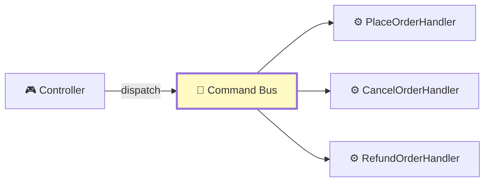
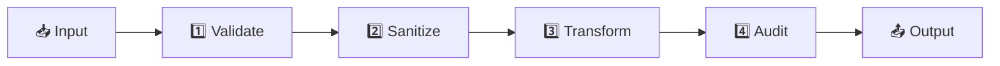
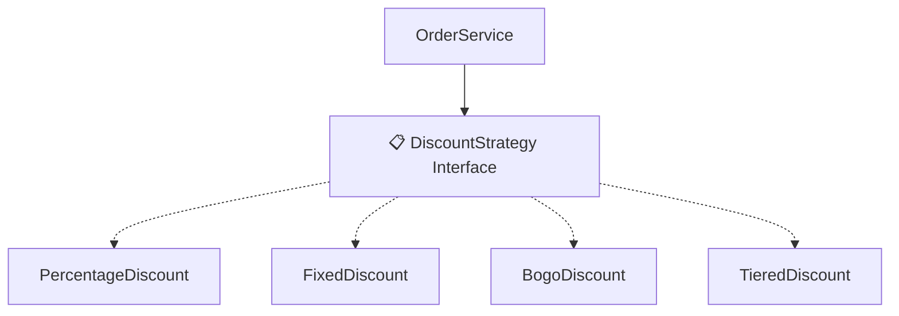
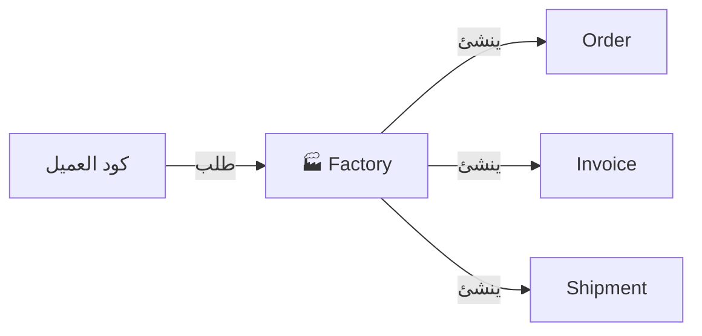

<div dir="rtl">

# الفصول 19-23: Event Sourcing، Command Bus، Pipeline، Strategy، Factory
## الأنماط المتخصصة

---

# الفصل 19: Event Sourcing (مصدر الأحداث)
## الأحداث كمصدر للحقيقة

---

## 1. المشكلة قبل هذه العمارة

في تطبيق عادي، قاعدة البيانات تحمل **الحالة الحالية**:
- جدول `orders`: الصف 1 لديه status "placed"، total 100

عندما يحدث شيء، تُحدّث الحالة (يُفقد التاريخ):
- قبل: status "pending"، total 0
- بعد: status "placed"، total 100
- الـ status "pending"؟ ذهب.

**الألم:**
- **لا سجل تدقيق** — ما كانت حالة الطلب قبل 5 دقائق؟
- **لا سفر عبر الزمن** — كيف كانت البيانات تبدو الأسبوع الماضي؟
- **لا تصحيح أخطاء** — لماذا انتهى هذا الطلب في هذه الحالة؟
- **صعب إضافة views جديدة** — لحساب مقياس جديد، تحتاج بيانات تاريخية ليس لديك

---

## 2. لماذا اخترعت هذه العمارة

**Event Sourcing** تم توحيدها في DDD (Eric Evans، 2003) وصقلها **Greg Young** وآخرون. الرؤية الجوهرية: **خزّن الأحداث، اشتق الحالة**.

إذا كنت تعرف كل حدث حدث على الإطلاق، يمكنك إعادة بناء الحالة الحالية. إذا كنت تعرف الأحداث حتى نقطة في الوقت، يمكنك إعادة بناء حالة الماضي.

---

## 3. تشبيه من الحياة الواقعية

### 🏦 دفتر أستاذ البنك

البنك لا يخزن **رصيدك الحالي**؛ يخزن كل **معاملة**:
- 2024-01-01: إيداع $100
- 2024-01-15: سحب $30
- 2024-02-01: إيداع $50

رصيدك الحالي ($120) هو **مجموع جميع المعاملات**.

**إذا اعترضت على رسوم**، البنك لا يقول "رصيدك كان X، تدين بـ Y". يقول "هذه هي جميع معاملاتك؛ دعنا نحسبها."

Event Sourcing هو نفسه: **الأحداث هي الحقيقة، الحالة مشتقة**.

### 📚 كتاب التاريخ

البلد لا يخزن "القوانين الحالية"؛ يخزن جميع القوانين التي تم تمريرها وإلغاؤها. الحالة القانونية الحالية مشتقة من التاريخ.

---

## 4. الشرح البصري

```mermaid
flowchart LR
    Command[📝 PlaceOrderCommand]
    Aggregate[📦 Order Aggregate]
    Events[📚 Event Store<br/>OrderPlaced<br/>OrderPaid<br/>OrderShipped<br/>OrderDelivered]
    Projection1[📊 OrderProjection<br/>(الحالة الحالية)]
    Projection2[📈 SalesReport<br/>(تحليلات)]
    Projection3[🔍 AuditLog<br/>(التاريخ الكامل)]

    Command --> Aggregate
    Aggregate -->|يُطلق| Events
    Events -.->|إسقاط| Projection1
    Events -.->|إسقاط| Projection2
    Events -.->|إسقاط| Projection3

    style Events fill:#fff9c4,stroke-width:3px
    style Projection1 fill:#c8e6c9
    style Projection2 fill:#c8e6c9
    style Projection3 fill:#c8e6c9
```

---

## 5. تنفيذ Laravel (مع `spatie/laravel-event-sourcing`)

### الخطوة 1: تثبيت الحزمة

```bash
composer require spatie/laravel-event-sourcing
```

### الخطوة 2: الـ Aggregate (app/Domain/Orders/OrderAggregate.php)

```php
<?php

namespace App\Domain\Orders;

use App\Domain\Orders\Events\OrderPlaced;
use App\Domain\Orders\Events\OrderPaid;
use App\Domain\Orders\Events\OrderShipped;
use Spatie\EventSourcing\AggregateRoots\AggregateRoot;

class OrderAggregate extends AggregateRoot
{
    private string $status = 'pending';
    private float $total = 0;

    public function place(string $orderId, int $userId, array $items, float $total): self
    {
        $this->recordThat(new OrderPlaced(
            orderId: $orderId,
            userId: $userId,
            items: $items,
            total: $total,
        ));

        return $this;
    }

    public function pay(string $paymentId): self
    {
        if ($this->status !== 'pending') {
            throw new \DomainException("لا يمكن دفع طلب في الحالة: {$this->status}");
        }

        $this->recordThat(new OrderPaid(
            orderId: $this->uuid(),
            paymentId: $paymentId,
        ));

        return $this;
    }

    public function ship(string $trackingNumber): self
    {
        if ($this->status !== 'paid') {
            throw new \DomainException("لا يمكن شحن طلب في الحالة: {$this->status}");
        }

        $this->recordThat(new OrderShipped(
            orderId: $this->uuid(),
            trackingNumber: $trackingNumber,
        ));

        return $this;
    }

    // Apply methods (إعادة بناء الحالة من الأحداث)
    public function applyOrderPlaced(OrderPlaced $event): void
    {
        $this->status = 'placed';
        $this->total = $event->total;
    }

    public function applyOrderPaid(OrderPaid $event): void
    {
        $this->status = 'paid';
    }

    public function applyOrderShipped(OrderShipped $event): void
    {
        $this->status = 'shipped';
    }
}
```

### الخطوة 3: الحدث (app/Domain/Orders/Events/OrderPlaced.php)

```php
<?php

namespace App\Domain\Orders\Events;

use Spatie\EventSourcing\StoredEvents\ShouldBeStored;

class OrderPlaced extends ShouldBeStored
{
    public function __construct(
        public readonly string $orderId,
        public readonly int $userId,
        public readonly array $items,
        public readonly float $total,
    ) {}
}
```

### الخطوة 4: الإسقاط (app/Projections/OrderProjection.php)

```php
<?php

namespace App\Projections;

use App\Domain\Orders\Events\OrderPlaced;
use App\Domain\Orders\Events\OrderPaid;
use App\Domain\Orders\Events\OrderShipped;
use Illuminate\Support\Facades\DB;
use Spatie\EventSourcing\EventHandlers\SimpleEventHandler;

class OrderProjection extends SimpleEventHandler
{
    public function onOrderPlaced(OrderPlaced $event): void
    {
        DB::table('orders')->insert([
            'id' => $event->orderId,
            'user_id' => $event->userId,
            'total' => $event->total,
            'status' => 'placed',
            'placed_at' => now(),
        ]);
    }

    public function onOrderPaid(OrderPaid $event): void
    {
        DB::table('orders')->where('id', $event->orderId)
            ->update(['status' => 'paid', 'paid_at' => now()]);
    }

    public function onOrderShipped(OrderShipped $event): void
    {
        DB::table('orders')->where('id', $event->orderId)
            ->update(['status' => 'shipped', 'tracking_number' => $event->trackingNumber]);
    }
}
```

### الخطوة 5: الاستخدام (app/Http/Controllers/OrderController.php)

```php
public function store(Request $request, OrderAggregate $order): RedirectResponse
{
    $order->place(
        orderId: uniqid(),
        userId: $request->integer('user_id'),
        items: $request->input('items', []),
        total: 100.0,
    )->persist();  // يحفظ الأحداث في event store

    return redirect()->route('orders.index');
}
```

---

## 6. المزايا

- ✅ **سجل تدقيق كامل** — كل تغيير مسجل
- ✅ **سفر عبر الزمن** — أعد بناء الحالة في أي نقطة
- ✅ **إعادة تشغيل الأحداث** — أعد بناء read models من الأحداث
- ✅ **التصحيح** — شاهد بالضبط ما حدث
- ✅ **views جديدة مجاناً** — اشتق إسقاطات جديدة من الأحداث
- ✅ **الامتثال** — مثالي للصناعات المنظمة

## 7. العيوب

- ❌ **التعقيد** — الأحداث، الإسقاطات، إعادة التشغيل
- ❌ **تطور المخطط** — الأحداث غير قابلة للتغيير؛ تغييرها صعب
- ❌ **نمو التخزين** — الأحداث تتراكم إلى الأبد
- ❌ **الاستعلام** — لا يمكن الاستعلام عن الأحداث مباشرة؛ تحتاج إسقاطات
- ❌ **منحنى تعلم أكثر حدة**

## 8. متى تستخدم

- ✅ متطلبات التدقيق (المالية، الرعاية الصحية، القانونية)
- ✅ حاجة لمعرفة "ماذا حدث"
- ✅ قواعد أعمال معقدة تتغير
- ✅ نماذج قراءة متعددة مطلوبة

## 9. متى لا تستخدم

- ❌ CRUD بسيط
- ❌ لا حاجات تدقيق
- ❌ فريق صغير
- ❌ تكاليف التخزين حاسمة

---

# الفصل 20: Command Bus (ناقل الأوامر)
## فصل الاستدعاءات

---

## 1. المشكلة قبل هذه العمارة

في تطبيق نموذجي، الـ Controller **يعرف مباشرة** الـ Service:

```php
class OrderController
{
    public function store(PlaceOrderService $service)
    {
        $service->place($data);
    }
}
```

**الألم:**
- الـ Controller **مقترن بـ Service محدد**
- إضافة سلوك شامل (logging، validation) يتطلب تعديل كل Controller
- لا يمكن وضع العملية في طابور
- لا يمكن تبديل المعالج

---

## 2. الفكرة الجوهرية

**Command Bus** (أو Command Pattern، أو Mediator) ينشأ من:
- **CQRS** (الأوامر تمر عبر bus)
- **Domain Events** (إطلاق الأحداث)
- **Hexagonal Architecture** (منافذ للاستدعاءات)

الفكرة: **الـ Controller يُرسل Command؛ الـ bus يجد المعالج.**

---

## 3. الشرح البصري



الـ Controller لا يعرف أي معالج يعمل. الـ bus يعرف.

---

## 4. تنفيذ Laravel (مع `tactician` أو `league/bus`)

### Bus يدوي بسيط

```php
interface CommandBusInterface
{
    public function dispatch(object $command): mixed;
}

class CommandBus implements CommandBusInterface
{
    private array $handlers = [];

    public function register(string $commandClass, string $handlerClass): void
    {
        $this->handlers[$commandClass] = $handlerClass;
    }

    public function dispatch(object $command): mixed
    {
        $commandClass = $command::class;
        if (!isset($this->handlers[$commandClass])) {
            throw new \RuntimeException("لا يوجد معالج لـ {$commandClass}");
        }
        $handler = app($this->handlers[$commandClass]);
        return $handler($command);
    }
}
```

### حالة الاستخدام

```php
// سجل المعالجات
$bus->register(PlaceOrderCommand::class, PlaceOrderHandler::class);
$bus->register(CancelOrderCommand::class, CancelOrderHandler::class);

// Controller يُرسل
public function store(Request $request, CommandBus $bus): RedirectResponse
{
    $bus->dispatch(new PlaceOrderCommand(
        userId: $request->integer('user_id'),
        items: $request->input('items', []),
    ));
    return redirect()->route('orders.index');
}
```

---

## 5. مع Tactician (نمط Decorator)

يسمح Tactician بـ decorators للاهتمامات الشاملة:

```php
$commandBus = new \League\Tactician\CommandBus([
    new \League\Tactician\Handler\CommandHandlerMiddleware(
        new \App\Handlers\CommandHandlerContainer()
    ),
    new \League\Tactician\Logger\LoggerMiddleware(new PsrLogger()),
    new \League\Tactician\Doctrine\TransactionMiddleware($entityManager),
]);
```

يمكن للـ Decorators:
- تسجيل كل أمر
- الالتفاف في معاملة
- التحقق من الأمر
- وضع الأمر في طابور

---

## 6. المزايا

- ✅ **الفصل** — Controller لا يعرف المعالج
- ✅ **اهتمامات شاملة** — decorators تتعامل مع التسجيل، المعاملات
- ✅ **التخزين في طابور** — يمكن وضع الأوامر في طابور
- ✅ **مكان واحد** — جميع استدعاءات الأوامر تمر عبر bus واحد

## 7. العيوب

- ❌ **غير مباشر** — أصعب في التتبع
- ❌ **overhead الإعداد** — سجل المعالجات
- ❌ **مبالغة لتطبيقات بسيطة**

## 8. متى تستخدم

- ✅ أوامر كثيرة، معالجات كثيرة
- ✅ سلوك شامل (تسجيل، معاملات، validation)
- ✅ تريد تخزين الأوامر في طابور
- ✅ عمارة Hexagonal/CQRS

---

# الفصل 21: Pipeline Pattern (نمط خط الأنابيب)
## سلوك قابل للتركيب

---

## 1. المشكلة قبل هذه العمارة

غالباً لديك سلسلة من العمليات:

```php
// ❌ مكرر
$result = $this->validate($input);
if (!$result['valid']) return $result;
$result = $this->sanitize($result);
$result = $this->transform($result);
$result = $this->audit($result);
return $this->save($result);
```

يُكرر هذا في كل مكان. إضافة خطوة جديدة يعني تعديل كل مكان.

---

## 2. الفكرة الجوهرية

**Pipeline Pattern** يتيح لك ربط العمليات مثل Unix pipe:

```php
$result = $pipeline
    ->send($input)
    ->through([ValidateStep::class, SanitizeStep::class, TransformStep::class, AuditStep::class])
    ->thenReturn();
```

Laravel لديه دعم pipeline مدمج: `\Illuminate\Pipeline\Pipeline`.

---

## 3. الشرح البصري



---

## 4. تنفيذ Laravel

```php
use Illuminate\Pipeline\Pipeline;

$result = app(Pipeline::class)
    ->send($orderData)
    ->through([
        \App\Pipes\ValidateOrder::class,
        \App\Pipes\CheckInventory::class,
        \App\Pipes\CalculatePricing::class,
        \App\Pipes\EnrichWithUserData::class,
    ])
    ->thenReturn();
```

### كلاس Pipe

```php
namespace App\Pipes;

use Closure;

class CheckInventory
{
    public function handle(OrderData $data, Closure $next)
    {
        // المعالجة المسبقة
        if (!$this->inventory->isAvailable($data->items)) {
            throw new InsufficientStockException();
        }
        
        $result = $next($data);
        
        // المعالجة اللاحقة
        $this->inventory->reserve($data->items);
        
        return $result;
    }
}
```

---

## 5. حالات الاستخدام

- **Middleware الطلب/الاستجابة** (middleware في Laravel IS pipeline)
- **معالجة الطلبات** (تحقق → فحص المخزون → اشحن → استمر)
- **استيراد البيانات** (تحليل → تحقق → تحويل → حفظ)
- **معالجة النماذج** (تعقيم → تحقق → إثراء)

## 6. المزايا

- ✅ **القابلية للتركيب** — اخلط وطابق الخطوات
- ✅ **قابلية إعادة الاستخدام** — نفس الخطوة في pipelines مختلفة
- ✅ **Single Responsibility** — كل خطوة تفعل شيئاً واحداً
- ✅ **سهل إضافة/إزالة الخطوات**

## 7. متى تستخدم

- ✅ تسلسل ثابت من العمليات
- ✅ الخطوات قابلة لإعادة الاستخدام عبر السياقات
- ✅ حاجة لتركيب السلوك ديناميكياً

---

# الفصل 22: Strategy Pattern (نمط الاستراتيجية)
## خوارزميات قابلة للتبديل

---

## 1. المشكلة قبل هذه العمارة

منطق شرطي لاختيار الخوارزميات:

```php
// ❌ سيء: if/else طويل أو switch
if ($discountType === 'percentage') {
    $discount = $total * 0.1;
} elseif ($discountType === 'fixed') {
    $discount = 20;
} elseif ($discountType === 'bogo') {
    $discount = $this->calculateBogo($items);
} elseif ($discountType === 'tiered') {
    $discount = $this->calculateTiered($total);
}
```

إضافة نوع خصم جديد يتطلب تعديل هذا الكود.

---

## 2. الفكرة الجوهرية

**Strategy Pattern** (Gang of Four، 1994) يغلف كل خوارزمية ككلاس:

```php
interface DiscountStrategy
{
    public function apply(float $total): float;
}

class PercentageDiscount implements DiscountStrategy { ... }
class FixedDiscount implements DiscountStrategy { ... }
class BogoDiscount implements DiscountStrategy { ... }
```

الـ Service يختار الاستراتيجية في وقت التشغيل.

---

## 3. الشرح البصري



---

## 4. تنفيذ Laravel

```php
interface DiscountStrategy
{
    public function apply(float $total, array $context = []): float;
    public function isApplicable(array $context): bool;
}

class PercentageDiscount implements DiscountStrategy
{
    public function __construct(private float $percentage) {}
    
    public function apply(float $total, array $context = []): float
    {
        return $total * ($this->percentage / 100);
    }
    
    public function isApplicable(array $context): bool { return true; }
}

class FixedDiscount implements DiscountStrategy
{
    public function __construct(private float $amount) {}
    
    public function apply(float $total, array $context = []): float
    {
        return min($this->amount, $total);
    }
    
    public function isApplicable(array $context): bool { return true; }
}

// في Service
class DiscountService
{
    /** @var DiscountStrategy[] */
    private array $strategies = [];
    
    public function addStrategy(DiscountStrategy $strategy): void
    {
        $this->strategies[] = $strategy;
    }
    
    public function applyBest(float $total, array $context = []): float
    {
        $bestDiscount = 0;
        foreach ($this->strategies as $strategy) {
            if ($strategy->isApplicable($context)) {
                $bestDiscount = max($bestDiscount, $strategy->apply($total, $context));
            }
        }
        return $bestDiscount;
    }
}
```

---

## 5. حالات الاستخدام

- **حسابات الخصم** (أنواع متعددة)
- **حسابات الشحن** (FedEx، UPS، USPS)
- **بوابات الدفع** (Stripe، PayPal - مثل Repository)
- **حسابات الضرائب** (مناطق مختلفة)
- **قواعد التسعير** (B2B، B2C، بالجملة)

## 6. المزايا

- ✅ **مفتوح/مغلق** — أضف استراتيجيات جديدة دون تعديل الكود الموجود
- ✅ **قابلية الاختبار** — كل استراتيجية مستقلة
- ✅ **اختيار وقت التشغيل** — اختر أفضل استراتيجية ديناميكياً

## 7. متى تستخدم

- ✅ خوارزميات متعددة لنفس المشكلة
- ✅ اختيار الخوارزمية يختلف في وقت التشغيل
- ✅ إضافة خوارزميات جديدة شائعة

---

# الفصل 23: Factory Pattern (نمط المصنع)
## مركزية إنشاء الكائنات

---

## 1. المشكلة قبل هذه العمارة

إنشاء الكائنات متناثر:

```php
// ❌ في Controller
$order = new Order($data);

// ❌ في Service
$order = Order::create([...]);

// ❌ في Queue job
$order = Order::findOrFail($id);
```

منطق الإنشاء مكرر، غير متسق، صعب التغيير.

---

## 2. الفكرة الجوهرية

**Factory Pattern** (GoF، 1994) يركز إنشاء الكائنات. في Laravel، تُستخدم factories بشكل شائع لـ:
- **بيانات الاختبار** (`User::factory()->create()`)
- **إنشاء كائنات معقدة** (حيث منطق الإنشاء غير تافه)

---

## 3. الشرح البصري



---

## 4. تنفيذ Laravel

### Model Factories (للاختبارات)

```php
class UserFactory extends Factory
{
    public function definition(): array
    {
        return [
            'name' => $this->faker->name(),
            'email' => $this->faker->unique()->safeEmail(),
        ];
    }

    public function unverified(): self
    {
        return $this->state(fn () => ['email_verified_at' => null]);
    }
    
    public function admin(): self
    {
        return $this->state(fn () => ['role' => 'admin']);
    }
}

// الاستخدام
$user = User::factory()->create();
$admin = User::factory()->admin()->create();
$users = User::factory()->count(10)->create();
```

### Factory مخصص (لإنشاء معقد)

```php
class OrderFactory
{
    public function __construct(
        private InventoryService $inventory,
        private PricingService $pricing,
    ) {}

    public function createFromCart(Cart $cart, User $user): Order
    {
        $items = $this->buildItems($cart);
        $total = $this->pricing->calculate($items, $user);
        
        return new Order([
            'user_id' => $user->id,
            'items' => $items,
            'total' => $total,
        ]);
    }

    public function createSubscription(User $user, Plan $plan): Subscription
    {
        // منطق إنشاء مختلف
    }
}
```

### Static Factory Method (على الكلاس نفسه)

```php
class Order
{
    public static function place(int $userId, array $items): self
    {
        $order = new self();
        $order->user_id = $userId;
        $order->items = $items;
        $order->status = 'pending';
        $order->placed_at = now();
        return $order;
    }

    public static function fromQuote(Quote $quote): self
    {
        // أنشئ من عرض سعر
    }
}

// الاستخدام
$order = Order::place($userId, $items);
$order = Order::fromQuote($quote);
```

---

## 5. حالات الاستخدام

- **توليد بيانات الاختبار** (Eloquent factories)
- **إنشاء كائنات معقدة** (مدخلات متعددة، validation)
- **إنشاء كيانات المجال** (factory methods التي تفرض invariants)

## 6. المزايا

- ✅ **إنشاء مركزي** — مكان واحد للبحث
- ✅ **قابل لإعادة الاستخدام** — نفس factory في الاختبارات، التطبيق، CLI
- ✅ **التغليف** — منطق الإنشاء مخفي
- ✅ **المتغيرات** — سهل إنشاء متغيرات "مسماة" (`admin()`، `unverified()`)

## 7. متى تستخدم

- ✅ إنشاء كائن معقد
- ✅ مسارات إنشاء متعددة
- ✅ حاجات بيانات الاختبار
- ✅ كيانات المجال التي تحتاج factory methods

---

## المقارنة الرئيسية (الفصول 19-23)

| النمط | الغرض | يحل | التكلفة |
|-------|-------|-----|---------|
| **Event Sourcing** | الأحداث كحقيقة | التدقيق، السفر عبر الزمن | التعقيد، التخزين |
| **Command Bus** | استدعاءات مفصولة | اهتمامات شاملة | غير مباشر |
| **Pipeline** | خطوات قابلة للتركيب | تسلسلات مكررة | الإعداد |
| **Strategy** | خوارزميات قابلة للتبديل | منطق شرطي | كلاسات أكثر |
| **Factory** | إنشاء مركزي | `new` متناثر | أحياناً مبالغة |

## مسار التطور

```
MVC
   ↓
Service + Repository
   ↓
Strategy + Factory (استبدال الشرطي والإنشاء المتناثر)
   ↓
Command Bus + Pipeline (تركيب السلوك)
   ↓
Event Sourcing (تدقيق كامل)
```

## أسئلة المقابلة

**Event Sourcing:**
1. **ما هو مصدر الحقيقة في ES؟** — سجل الأحداث، ليس الحالة الحالية.
2. **ما هو الإسقاط (Projection)؟** — read model مشتق من الأحداث.
3. **كيف تعيد بناء الحالة؟** — أعد تشغيل الأحداث من خلال الـ aggregate.

**Command Bus:**
1. **Command مقابل Handler؟** — Command بيانات؛ Handler ينفذه.
2. **لماذا تستخدم bus؟** — الفصل، الاهتمامات الشاملة، القابلية للتخزين في طابور.

**Pipeline:**
1. **ما هو "pipe"؟** — خطوة في سلسلة من العمليات.
2. **كيف يرتبط middleware في Laravel؟** — Middleware IS pipeline.

**Strategy:**
1. **متى تستخدم؟** — خوارزميات متعددة لنفس المشكلة.
2. **كيف تختار في وقت التشغيل؟** — حقن أو استخدم registry.

**Factory:**
1. **Eloquent Factory مقابل factory مخصص؟** — Eloquent للاختبارات؛ مخصص للإنشاء المعقد.
2. **Static factory method مقابل Factory class؟** — Static للبسيط؛ class للمعقد.

## التمارين

1. **ابنِ نظام Event Sourcing صغير** — أحداث، aggregate، projection.
2. **أضف Command Bus** لتطبيقك الموجود.
3. **أعد هيكلة if/else إلى Strategy** — مثلاً، methods الدفع.
4. **ابنِ pipeline** لمعالجة الطلب.
5. **استخدم factory** لكائن معقد (مثلاً، Order من Cart).

---

> *"Event Sourcing يقول: لا تخزن الحالة، خزن التاريخ. Command Bus يقول: لا تستدعي services، أرسل أوامر. Pipeline يقول: لا تكرر التسلسلات، ركبها. Strategy يقول: لا تشترط، ركب. Factory يقول: لا تنثر الإنشاء، مركز."*

</div>
