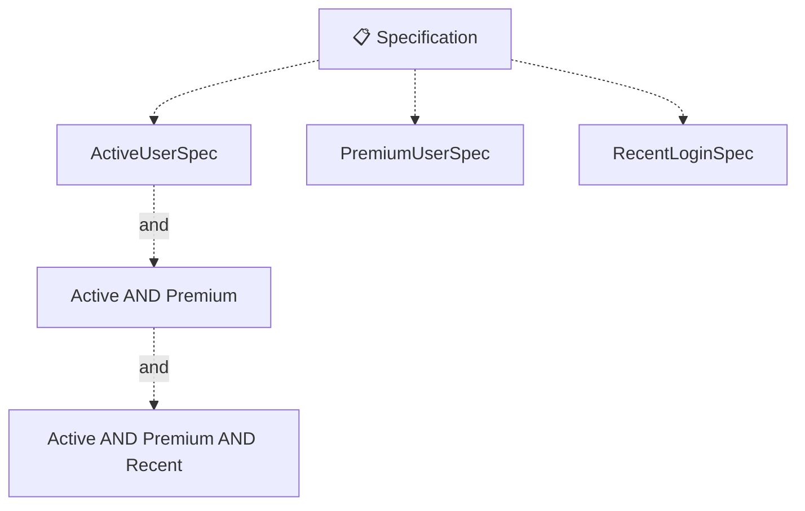
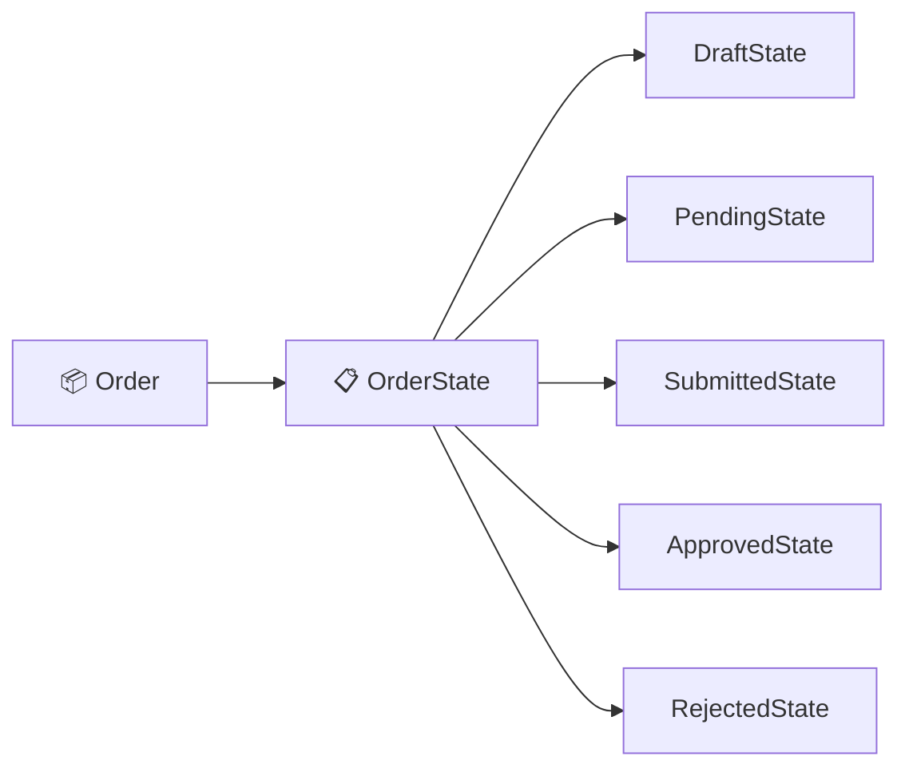
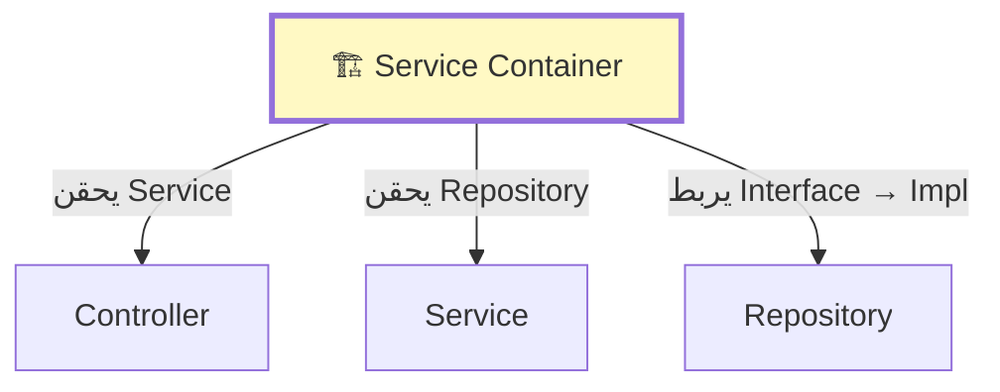

<div dir="rtl">

# الفصول 24-27: Specification، State، Observer، Dependency Injection
## الأنماط المتخصصة والنمط العالمي

---

# الفصل 24: Specification Pattern (نمط المواصفات)
## قواعد أعمال قابلة للتركيب

---

## 1. المشكلة قبل هذه العمارة

قواعد أعمال متناثرة كـ query methods:

```php
// ❌ methods متعددة، صعب التركيب
public function scopeActive($query) { return $query->where('active', true); }
public function scopePremium($query) { return $query->where('plan', 'premium'); }
public function scopeRecent($query) { return $query->where('created_at', '>=', now()->subWeek()); }

// صعب التركيب ديناميكياً
$users = User::active()->premium()->recent()->get();
// ماذا لو أراد المستخدم "نشط أو premium، لكن ليس حديثاً"؟
```

**الألم:**
- القواعد متناثرة في scopes
- تركيب القواعد ديناميكياً محرج
- قواعد الأعمال مختلطة بمنطق الاستعلام

---

## 2. الفكرة الجوهرية

**Specification Pattern** (Eric Evans، DDD؛ Martin Fowler، EAA) يغلف قواعد الأعمال كـ **كائنات قابلة للتركيب**.

كل مواصفة تجيب: "هل هذا الكائن يستوفي القاعدة؟"

```php
interface Specification
{
    public function isSatisfiedBy($candidate): bool;
    public function and(self $other): self;
    public function or(self $other): self;
    public function not(): self;
}
```

---

## 3. الشرح البصري



---

## 4. تنفيذ Laravel

### الخطوة 1: الـ Interface (app/Specifications/Specification.php)

```php
<?php

namespace App\Specifications;

interface Specification
{
    public function isSatisfiedBy($candidate): bool;
    public function and(Specification $other): self;
    public function or(Specification $other): self;
    public function not(): self;
}
```

### الخطوة 2: قاعدة مجردة (app/Specifications/AbstractSpecification.php)

```php
<?php

namespace App\Specifications;

abstract class AbstractSpecification implements Specification
{
    abstract public function isSatisfiedBy($candidate): bool;

    public function and(Specification $other): Specification
    {
        return new AndSpecification($this, $other);
    }

    public function or(Specification $other): Specification
    {
        return new OrSpecification($this, $other);
    }

    public function not(): Specification
    {
        return new NotSpecification($this);
    }
}
```

### الخطوة 3: المجمعات

```php
class AndSpecification extends AbstractSpecification
{
    public function __construct(
        private Specification $left,
        private Specification $right,
    ) {}

    public function isSatisfiedBy($candidate): bool
    {
        return $this->left->isSatisfiedBy($candidate)
            && $this->right->isSatisfiedBy($candidate);
    }
}

class OrSpecification extends AbstractSpecification
{
    public function __construct(
        private Specification $left,
        private Specification $right,
    ) {}

    public function isSatisfiedBy($candidate): bool
    {
        return $this->left->isSatisfiedBy($candidate)
            || $this->right->isSatisfiedBy($candidate);
    }
}

class NotSpecification extends AbstractSpecification
{
    public function __construct(private Specification $spec) {}

    public function isSatisfiedBy($candidate): bool
    {
        return !$this->spec->isSatisfiedBy($candidate);
    }
}
```

### الخطوة 4: مواصفات ملموسة

```php
class ActiveUserSpec extends AbstractSpecification
{
    public function isSatisfiedBy($candidate): bool
    {
        return $candidate->status === 'active';
    }
}

class PremiumUserSpec extends AbstractSpecification
{
    public function isSatisfiedBy($candidate): bool
    {
        return $candidate->plan === 'premium';
    }
}

class RecentLoginSpec extends AbstractSpecification
{
    public function __construct(private int $days = 7) {}

    public function isSatisfiedBy($candidate): bool
    {
        return $candidate->last_login_at >= now()->subDays($this->days);
    }
}
```

### الخطوة 5: الاستخدام

```php
// ركب القواعد ديناميكياً
$spec = (new ActiveUserSpec())
    ->and(new PremiumUserSpec())
    ->and(new RecentLoginSpec(30));

$matchingUsers = User::all()->filter(fn ($user) => $spec->isSatisfiedBy($user));
```

### الخطوة 6: تكامل Repository

```php
// في Repository
public function findMatching(Specification $spec): Collection
{
    return $this->model->get()
        ->filter(fn ($entity) => $spec->isSatisfiedBy($entity))
        ->values();
}

// الاستخدام
$spec = new ActiveUserSpec()->and(new PremiumUserSpec());
$users = $this->users->findMatching($spec);
```

---

## 5. حالات الاستخدام

- **فحوصات الأهلية** (الموافقة على القرض، تأهيل الخصم)
- **مرشحات البحث** (قابلة للتركيب في UI)
- **التحقق** (قواعد الأعمال)
- **التفويض** (قواعد السياسات)

## 6. المزايا

- ✅ **قابل للتركيب** — ادمج القواعد بـ `and`/`or`/`not`
- ✅ **قابل لإعادة الاستخدام** — نفس الـ spec في سياقات مختلفة
- ✅ **قابل للاختبار** — دوال خالصة
- ✅ **لغة المجال** — يقرأ كقواعد أعمال

## 7. العيوب

- ❌ **مبالغة لقواعد بسيطة**
- ❌ **يمكن أن يكون مُفرط الهندسة**
- ❌ **تكامل قاعدة البيانات يمكن أن يكون صعباً**

## 7. متى تستخدم

- ✅ قواعد أعمال معقدة قابلة للتركيب
- ✅ القواعد تتغير في وقت التشغيل
- ✅ إعادة استخدام القواعد عبر السياقات

---

# الفصل 25: State Pattern (نمط الحالة)
## سلوك يتغير بالحالة

---

## 1. المشكلة قبل هذه العمارة

آلات الحالة في كل مكان في التطبيقات:

```php
// ❌ منطق شرطي للحالة
public function submit() {
    if ($this->status === 'draft') {
        $this->status = 'pending';
    } elseif ($this->status === 'pending') {
        $this->status = 'submitted';
    }
    // ... انتقالات معقدة
}

public function canSubmit(): bool {
    return in_array($this->status, ['draft', 'pending']);
}
```

**الألم:**
- منطق الحالة متناثر
- إضافة حالة جديدة يتطلب تعديل methods كثيرة
- الانتقالات غير الصالحة سهلة السماح بها بالخطأ

---

## 2. الفكرة الجوهرية

**State Pattern** (GoF، 1994) يغلف السلوك الخاص بالحالة في كلاسات منفصلة. الكائن يفوض السلوك إلى حالته الحالية.

---

## 3. الشرح البصري



---

## 4. تنفيذ Laravel

### الخطوة 1: Interface الحالة (app/States/OrderState.php)

```php
<?php

namespace App\States;

interface OrderState
{
    public function submit(Order $order): void;
    public function approve(Order $order): void;
    public function reject(Order $order, string $reason): void;
    public function canTransitionTo(self $newState): bool;
    public function name(): string;
}
```

### الخطوة 2: الـ Order (app/Models/Order.php)

```php
class Order extends Model
{
    private OrderState $state;

    public function __construct(array $attributes = [])
    {
        parent::__construct($attributes);
        $this->state = new DraftState();
    }

    public function submit(): void
    {
        $this->state->submit($this);
    }

    public function approve(): void
    {
        $this->state->approve($this);
    }

    public function setState(OrderState $state): void
    {
        $this->state = $state;
        $this->status = $state->name();
        $this->save();
    }

    public function currentState(): OrderState
    {
        return $this->state;
    }
}
```

### الخطوة 3: حالات ملموسة (app/States/DraftState.php)

```php
class DraftState implements OrderState
{
    public function submit(Order $order): void
    {
        $order->setState(new PendingState());
    }

    public function approve(Order $order): void
    {
        throw new InvalidStateTransitionException("لا يمكن الموافقة على طلب مسودة");
    }

    public function reject(Order $order, string $reason): void
    {
        throw new InvalidStateTransitionException("لا يمكن رفض طلب مسودة");
    }

    public function canTransitionTo(OrderState $newState): bool
    {
        return $newState instanceof PendingState;
    }

    public function name(): string
    {
        return 'draft';
    }
}

class PendingState implements OrderState
{
    public function submit(Order $order): void
    {
        $order->setState(new SubmittedState());
    }

    public function approve(Order $order): void
    {
        $order->setState(new ApprovedState());
    }

    public function reject(Order $order, string $reason): void
    {
        $order->setState(new RejectedState($reason));
    }

    public function canTransitionTo(OrderState $newState): bool
    {
        return $newState instanceof SubmittedState
            || $newState instanceof ApprovedState
            || $newState instanceof RejectedState;
    }

    public function name(): string
    {
        return 'pending';
    }
}
```

### الخطوة 4: الاستخدام

```php
$order = Order::find(1);
$order->submit();       // draft → pending
$order->approve();      // pending → approved

// في Blade
@if ($order->currentState() instanceof ApprovedState)
    <button>شحن</button>
@endif
```

---

## 5. حالات الاستخدام

- **سير عمل الطلبات** (مسودة → معلق → مُقدّم → موافق)
- **الموافقة على المستندات** (تم الإنشاء → تمت المراجعة → تمت الموافقة)
- **حالات حسابات المستخدمين** (نشط → موقوف → محظور)
- **حالات الدفع** (معلق → قيد المعالجة → مكتمل → فشل)

## 6. المزايا

- ✅ **سلوك خاص بالحالة** مغلف
- ✅ **انتقالات غير صالحة ممنوعة**
- ✅ **سهل إضافة حالات جديدة**
- ✅ **منطق الحالة في مكان واحد**

## 7. متى تستخدم

- ✅ آلات حالة معقدة
- ✅ سلوك خاص بالحالة
- ✅ قواعد انتقال صارمة

---

# الفصل 26: Observer Pattern (نمط المراقب)
## إشعارات تفاعلية

---

## 1. المشكلة قبل هذه العمارة

إشعارات مقترنة بإحكام:

```php
// ❌ User class يُعلم مباشرة
class User
{
    public function save()
    {
        parent::save();
        Mail::to($this)->send(new WelcomeEmail($this));
        Analytics::track('user_created', [...]);
        // ... 5 تأثيرات جانبية أخرى
    }
}
```

**الألم:** إضافة تأثير جانبي يتطلب تعديل User class.

---

## 2. الفكرة الجوهرية

**Observer Pattern** (GoF، 1994) يفصل الموضوع (subject) عن المراقبين (observers):

- **الموضوع** لا يعرف من يستمع
- **المراقبون** يسجلون ليتم إشعارهم
- إضافة مراقب جديد لا يغير الموضوع

**Events و Listeners في Laravel** هما نمط Observer. **Model Observers في Eloquent** تطبيق مركّز.

---

## 3. الشرح البصري

```mermaid
flowchart TB
    Subject[📦 الموضوع (Model)]
    Observer1[👂 المراقب 1<br/>(إرسال بريد)]
    Observer2[👂 المراقب 2<br/>(تتبع تحليلات)]
    Observer3[👂 المراقب 3<br/>(تحديث كاش)]

    Subject -.->|يُخطر| Observer1
    Subject -.->|يُخطر| Observer2
    Subject -.->|يُخطر| Observer3
```

---

## 4. تنفيذ Laravel

### الخيار 1: Model Observers

```php
namespace App\Observers;

use App\Models\User;
use App\Events\UserCreated;

class UserObserver
{
    public function created(User $user): void
    {
        event(new UserCreated($user));
    }

    public function updated(User $user): void
    {
        if ($user->wasChanged('email')) {
            event(new UserEmailChanged($user));
        }
    }

    public function deleted(User $user): void
    {
        // تنظيف
    }
}

// سجل في AppServiceProvider
public function boot(): void
{
    User::observe(UserObserver::class);
}
```

### الخيار 2: Eloquent Events مباشرة (مدمج)

```php
// في Model
class User extends Model
{
    protected static function booted()
    {
        static::created(function (User $user) {
            // تفاعل مع الإنشاء
        });
        
        static::updated(function (User $user) {
            // تفاعل مع التحديثات
        });
    }
}
```

### الخيار 3: Observer مخصص (مفصول)

```php
interface OrderObserver
{
    public function onOrderPlaced(Order $order): void;
}

class EmailNotificationObserver implements OrderObserver
{
    public function onOrderPlaced(Order $order): void
    {
        Mail::to($order->user)->send(new OrderConfirmation($order));
    }
}

class Order
{
    /** @var OrderObserver[] */
    private array $observers = [];

    public function attach(OrderObserver $observer): void
    {
        $this->observers[] = $observer;
    }

    public function place(): void
    {
        // ... منطق الأعمال
        
        $this->notify();
    }

    private function notify(): void
    {
        foreach ($this->observers as $observer) {
            $observer->onOrderPlaced($this);
        }
    }
}

// الاستخدام
$order = new Order();
$order->attach(new EmailNotificationObserver());
$order->attach(new AnalyticsObserver());
$order->place();
```

---

## 5. حالات الاستخدام

- **أحداث دورة حياة الـ Model** (تم الإنشاء، تم التحديث، تم الحذف)
- **إشعارات مفصولة** (بريد، SMS، push)
- **إبطال الكاش** (مسح الكاش عند تغيير الـ model)
- **تسجيل التدقيق** (تسجيل كل تغيير)
- **تحديثات فهرس البحث** (إعادة الفهرسة عند التغيير)

## 6. المزايا

- ✅ **مفصول** — الموضوع لا يعرف المراقبين
- ✅ **قابل للتوسع** — أضف مراقبين دون تغيير الموضوع
- ✅ **مراقبون قابلون لإعادة الاستخدام** — نفس المراقب لمواضيع متعددة
- ✅ **مدفوع بالأحداث** — يتناسب جيداً مع Laravel

## 7. متى تستخدم

- ✅ ردود فعل متعددة لحدث ما
- ✅ تأثيرات جانبية مفصولة عن المنطق الأساسي
- ✅ إضافة ردود فعل جديدة شائعة

---

# الفصل 27: Dependency Injection (حقن الاعتمادية)
## الغراء الذي يربط كل شيء

---

## 1. المشكلة قبل هذه العمارة

إنشاء مباشر في كل مكان:

```php
// ❌ سيء: صعب الاختبار، صعب التغيير
class OrderService
{
    private $payment;
    private $mailer;
    
    public function __construct()
    {
        $this->payment = new StripePayment();
        $this->mailer = new SmtpMailer();
    }
}
```

**الألم:**
- لا يمكن تبديل Stripe بـ PayPal
- لا يمكن المحاكاة في الاختبارات
- اقتران وثيق

---

## 2. الفكرة الجوهرية

**Dependency Injection (DI)** هو أحد أكثر الأنماط أساسية. يعكس التحكم: بدلاً من أن ينشئ الكلاس اعتماداته، يتم **حقنها** من الخارج.

هناك 3 أنواع:
- **حقن Constructor** (الأكثر شيوعاً؛ مفضل)
- **حقن Setter** (أقل شيوعاً)
- **حقن Method** (لعمليات محددة)

**Service Container في Laravel** هو DI container قوي يحل الاعتمادات تلقائياً.

---

## 3. الشرح البصري



---

## 4. Service Container في Laravel

### حقن Constructor (الأكثر شيوعاً)

```php
class OrderService
{
    public function __construct(
        private OrderRepositoryInterface $orders,        // ← محقون
        private PaymentGatewayInterface $payments,        // ← محقون
        private NotificationServiceInterface $notifier,   // ← محقون
    ) {}

    public function place(OrderData $data): Order
    {
        // استخدم $this->orders، $this->payments، $this->notifier
    }
}

// Laravel يحل الاعتمادات تلقائياً
$service = app(OrderService::class);  // أو عبر type-hint
```

### حقن Method (لعمليات محددة)

```php
class OrderController
{
    public function store(
        StoreOrderRequest $request,                     // ← محقون
        OrderService $service,                            // ← محقون
        OrderRepositoryInterface $orders,                 // ← محقون
    ): RedirectResponse {
        $order = $service->place(OrderData::fromRequest($request));
        $orders->save($order);
        return redirect()->route('orders.show', $order);
    }
}
```

### ربط Interfaces بالتنفيذات

```php
// في Service Provider
public function register(): void
{
    // اربط interface بـ concrete class
    $this->app->bind(
        OrderRepositoryInterface::class,
        EloquentOrderRepository::class
    );
    
    // Singleton (instance واحد)
    $this->app->singleton(
        PaymentGatewayInterface::class,
        StripePaymentGateway::class
    );
    
    // اربط بـ instance محدد
    $this->app->instance(
        'config.special',
        new Config(['key' => 'value'])
    );
    
    // ربط سياقي (تنفيذات مختلفة لمستهلكين مختلفين)
    $this->app->when(StripeOrderProcessor::class)
        ->needs(PaymentGatewayInterface::class)
        ->give(StripePaymentGateway::class);
        
    $this->app->when(PayPalOrderProcessor::class)
        ->needs(PaymentGatewayInterface::class)
        ->give(PayPalPaymentGateway::class);
}
```

### الحل التلقائي (لا حاجة للربط)

Laravel يمكنه حل الكلاسات التي ليس لديها interfaces تلقائياً:

```php
// لا حاجة للربط
class EmailValidator
{
    public function validate(string $email): bool
    {
        return filter_var($email, FILTER_VALIDATE_EMAIL) !== false;
    }
}

// محلول تلقائياً
$validator = app(EmailValidator::class);
```

### الحل مع المعاملات

```php
// الحل اليدوي
$service = app()->make(OrderService::class, [
    'currency' => 'EUR',
]);

// في الـ constructor
class OrderService
{
    public function __construct(
        private OrderRepositoryInterface $orders,
        private string $currency = 'USD',  // ← قيمة افتراضية
    ) {}
}
```

---

## 5. أنواع DI الثلاثة

### 1. حقن Constructor (مفضل)

```php
class OrderService
{
    public function __construct(
        private OrderRepositoryInterface $orders,
        private PaymentGatewayInterface $payments,
    ) {}
}
```

**المزايا:** الاعتمادات مطلوبة، غير قابلة للتغيير
**العيوب:** Constructor طويل للاعتمادات الكثيرة

### 2. حقن Setter

```php
class ReportGenerator
{
    private ?LoggerInterface $logger = null;
    
    public function setLogger(LoggerInterface $logger): void
    {
        $this->logger = $logger;
    }
}
```

**المزايا:** اعتمادات اختيارية
**العيوب:** أقل وضوحاً؛ يمكن أن يكون في حالة غير صالحة

### 3. حقن Method

```php
class OrderProcessor
{
    public function process(Order $order, LoggerInterface $logger): void
    {
        $logger->info('معالجة الطلب');
        // ...
    }
}
```

**المزايا:** اعتمادات لكل عملية
**العيوب:** مطول

---

## 6. لماذا حقن Constructor مفضل

```php
// ✅ Constructor: الاعتمادات واضحة ومطلوبة
public function __construct(
    private OrderRepository $orders,    // مطلوب
    private PaymentGateway $payments,   // مطلوب
) {}

// ❌ Setter: الاعتمادات مخفية واختيارية
public function setOrderRepository(OrderRepository $orders): void { ... }
```

حقن Constructor:
- يجعل الاعتمادات **صريحة**
- يسمح للكلاس بأن يكون في **حالة صالحة** عند البناء
- يجعل الاختبار **بسيطاً** (مرر mocks فقط)

---

## 7. ميزات قوية في Service Container

### الحل التلقائي (Auto-Resolution)

```php
// لا حاجة للربط؛ Laravel يفحص الكلاس
class UserService
{
    public function __construct(
        private UserRepository $users,
        private EmailService $mailer,
    ) {}
}

app(UserService::class);  // يحل كلاً منهما تلقائياً
```

### Tags (ربط المجموعات)

```php
// اربط بـ tag
$this->app->tag([StripeGateway::class, PayPalGateway::class], 'payment_gateways');

// حل كل المميّزة
$gateways = app()->tagged('payment_gateways');
```

### Scoped Bindings

```php
// اربط لنطاق محدد
$this->app->scoped(WorkspaceContext::class, function () {
    return new WorkspaceContext(request('workspace_id'));
});
```

### Method Calls After Resolution

```php
$this->app->afterResolving(LoggerInterface::class, function (LoggerInterface $logger) {
    $logger->setEnvironment(app()->environment());
});
```

---

## 8. أخطاء DI الشائعة

### ❌ نمط Service Locator المضاد

```php
// ❌ سيء: الحل اليدوي في constructor أو methods
class OrderService
{
    public function place()
    {
        $repo = app(OrderRepositoryInterface::class);  // ❌ اعتماد مخفي
        $repo->save($order);
    }
}

// ✅ جيد: حقن Constructor
class OrderService
{
    public function __construct(
        private OrderRepositoryInterface $orders,
    ) {}
    
    public function place()
    {
        $this->orders->save($order);  // ✓ واضح
    }
}
```

### ❌ اعتمادات كثيرة جداً

```php
// ❌ سيء: 10 اعتمادات
class MegaService
{
    public function __construct(
        private $dep1, private $dep2, private $dep3,
        private $dep4, private $dep5, private $dep6,
        private $dep7, private $dep8, private $dep9,
        private $dep10,
    ) {}
}
```

**الإصلاح:** فكك. استخدم coordinator لديه 2-3 services، كل واحد بـ 2-3 اعتمادات.

### ❌ حقن الـ Container

```php
// ❌ سيء: حقن الـ container
class UserService
{
    public function __construct(private Container $container) {}
    
    public function getUser(int $id)
    {
        return $this->container->make(UserRepository::class)->find($id);
    }
}
```

**الإصلاح:** احقن ما تحتاجه، ليس الـ container.

### ❌ اعتمادات قابلة للتغيير

```php
// ❌ سيء: Setter لاعتمادية مطلوبة
class OrderService
{
    private OrderRepository $orders;
    
    public function setOrders(OrderRepository $orders): void
    {
        $this->orders = $orders;
    }
}
```

**الإصلاح:** استخدم حقن Constructor.

---

## 9. متى تستخدم كل نوع من DI

| النوع | استخدم عندما |
|-------|--------------|
| **Constructor** | دائماً افتراضياً؛ خاصة الاعتمادات المطلوبة |
| **Setter** | اعتمادات اختيارية، plugins |
| **Method** | اعتمادات لكل عملية، خاصة بـ action |

---

## 10. DI والاختبار

```php
public function test_service_with_mocked_dependencies(): void
{
    $mockOrderRepo = Mockery::mock(OrderRepositoryInterface::class);
    $mockOrderRepo->shouldReceive('save')->once()->andReturn(new Order());
    
    $mockPayment = Mockery::mock(PaymentGatewayInterface::class);
    $mockPayment->shouldReceive('charge')->once()->andReturn(true);
    
    $service = new OrderService($mockOrderRepo, $mockPayment);
    
    $order = $service->place(new OrderData(/* ... */));
    
    $this->assertNotNull($order);
}
```

**DI يجعل الاختبار تافهاً:** مرر mocks فقط.

---

## 11. المقارنة الرئيسية (الفصول 24-27)

| النمط | الغرض | يحل | التكلفة |
|-------|-------|-----|---------|
| **Specification** | قواعد قابلة للتركيب | منطق شرطي، تحقق متناثر | الإعداد |
| **State** | سلوك قائم على الحالة | آلات الحالة، الانتقالات | كلاسات أكثر |
| **Observer** | إشعارات تفاعلية | اقتران وثيق بالتأثيرات الجانبية | غير مباشر |
| **DI** | اعتمادات مفصولة | اقتران وثيق بالتنفيذات | الإعداد، container |

---

## 12. النمط العالمي

Dependency Injection هو **أساس كل شيء** في هذا الدليل:
- Repository Pattern يعمل بسبب DI
- Service Layer يعمل بسبب DI
- Strategy يعمل بسبب DI
- Pipeline يعمل بسبب DI
- Hexagonal يعمل بسبب DI

**DI ليس نمطاً تستخدمه أحياناً. إنه الآلية الأساسية التي تجعل جميع الأنماط الأخرى تعمل.**

---

## 13. أسئلة المقابلة

**Specification:**
1. **Specification مقابل scope؟** — Specification كائن مجال؛ scope method استعلام.
2. **كيف تدمج specs؟** — `and`، `or`، `not`.
3. **متى تستخدم؟** — قواعد أعمال ديناميكية قابلة للتركيب.

**State:**
1. **State مقابل حقل status؟** — Status تسمية؛ State كائن بسلوك.
2. **متى تستخدم؟** — آلات حالة معقدة ذات انتقالات صارمة.

**Observer:**
1. **Observer مقابل Event؟** — نفس الفكرة؛ Event هو مصطلح Laravel.
2. **متى تستخدم؟** — فصل التأثيرات الجانبية عن المنطق الأساسي.

**DI:**
1. **ما هو DI؟** — حقن الاعتمادات بدلاً من إنشائها.
2. **Constructor مقابل setter؟** — Constructor مفضل (مطلوب، غير قابل للتغيير).
3. **ما هو Service Locator؟** — حل الاعتمادات من container عالمي (نمط مضاد).
4. **ما هو DI Container؟** — أداة تحل الاعتمادات تلقائياً (Laravel's Container).
5. **لماذا DI مهم للاختبار؟** — يمكنك تمرير mocks كاعتمادات.

---

## 14. التمارين

1. **ابنِ Specification** لـ "مؤهل للخصم" (مستخدم نشط، >5 طلبات، خطة premium).
2. **ادمج Specifications** — `(نشط AND premium) OR (غير نشط AND vip)`.
3. **نفّذ State machine** لمستند (مسودة → مراجعة → موافق → منشور).
4. **أنشئ Model Observer** لنموذج User يرسل بريد ترحيب عند الإنشاء.
5. **أعد هيكلة كلاس** ليستخدم حقن Constructor بدلاً من `new`.

---

## 15. الصورة الكاملة

بعد 27 فصلاً، إليك النموذج الذهني الكامل:

```
┌─────────────────────────────────────────────────────────────┐
│ الأساس (مستخدم دائماً)                                      │
│   - MVC، DI، SOLID                                          │
├─────────────────────────────────────────────────────────────┤
│ عمارة التطبيق (التطبيقات القياسية)                          │
│   - Service Layer، Repository، DTO، Action                  │
│   - Service + Repository مجتمعين                           │
├─────────────────────────────────────────────────────────────┤
│ عمارة المؤسسات (المجالات المعقدة)                          │
│   - Clean، Hexagonal، Onion، Ports & Adapters               │
│   - DDD مع Bounded Contexts                                │
├─────────────────────────────────────────────────────────────┤
│ العمارة الموزعة (النطاق)                                    │
│   - Modular Monolith، Microservices                         │
│   - Event Sourcing، CQRS، Event-Driven                      │
├─────────────────────────────────────────────────────────────┤
│ الأنماط المتخصصة (عند الحاجة)                              │
│   - Strategy، State، Observer، Specification، Factory        │
│   - Pipeline، Command Bus، Package-Based                    │
│   - Feature-Based                                           │
└─────────────────────────────────────────────────────────────┘
```

> *"Dependency Injection هو النمط العالمي. كل نمط آخر في هذا الدليل يعمل لأن DI يجعل القطع قابلة للتوصيل. أتقن DI؛ كل شيء آخر يتبع."*

</div>
