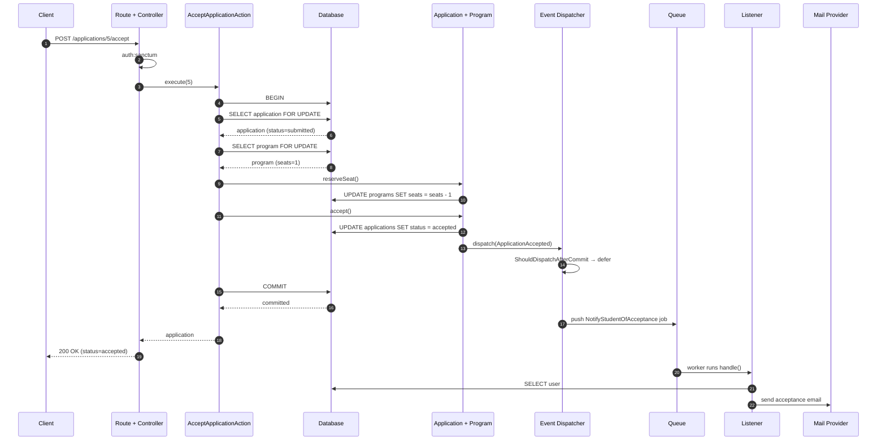

# شرح تفصيلي لصفحة «DDD في Laravel 13: خطوة بخطوة»

> **الملف المشروح:** [`ddd-laravel-step-by-step.html`](./ddd-laravel-step-by-step.html) — صفحة عربية واحدة تشرح بناء نظام قبول جامعي مبسّط باستخدام Domain-Driven Design في Laravel 13.
>
> **هذا الملف:** شرح منهجي مترابط، يتبع ترتيب الصفحة، ويفكّ كل كود سطراً بسطر، ويبيّن كيف تتصل الأجزاء ببعضها، وأين نقاط القوة وأين الثغرات. ليس إعادة كتابة للصفحة، بل قراءة بطيئة لها.
>
> **تنبيه مهم:** الكود في الصفحة نموذج تعليمي وليس مشروعاً جاهزاً للإنتاج؛ الصفحة نفسها تقول ذلك. هذا الشرح يوضح *لماذا* هي نموذج تعليمي، وما الذي ينقصها لتصل إلى الإنتاج.

---

## فهرس الشرح

1. كيف تقرأ هذا الشرح
2. الفكرة الكبيرة في ثلاث دقائق
3. خريطة الصفحة: من الاستراتيجي إلى التكتيكي إلى التطبيقي
4. الخيوط الأربعة التي تربط كل الخطوات
5. الخطوة ٠: لماذا نحتاج DDD أصلاً؟
6. الخطوة ١: اللغة المشتركة
7. الخطوة ٢: السياقات المحدودة
8. الخطوة ٣: هيكل المجلدات
9. الخطوة ٤: قاعدة البيانات
10. الخطوة ٥: كائن القيمة Gpa
11. الخطوة ٦: الـ Enum والانتقالات
12. الخطوة ٧: استثناءات المجال
13. الخطوة ٨: الكيانات بالسلوك (Program وAdmissionApplication)
14. الخطوة ٩: أحداث المجال
15. الخطوة ١٠: الـ DTO
16. الخطوة ١١: الـ Actions
17. الخطوة ١٢: الـ Listener والتواصل بين السياقات
18. الخطوة ١٣: طبقة الويب
19. الخطوة ١٤: الاختبار
20. الصورة الكاملة: مسار قبول طلب من الـ HTTP إلى الإيميل
21. جدول القرار: أين أضع الكود؟
22. ما الذي تركته الصفحة عمداً؟ (Repository، CQRS، Event Sourcing)
23. ما الذي لم تقله الصفحة؟ (ثغرات ونواقص)
24. تمارين ومراجعة ذاتية
25. قاموس المصطلحات
26. المراجع
27. ملحق: تشريح الصفحة نفسها (HTML/CSS/JS)

---

## ١. كيف تقرأ هذا الشرح

### ١.١ الغرض

الصفحة الأصلية مكتوبة بأسلوب «الفكرة بكلام بسيط، ثم لماذا، ثم الكود». هذا الشرح يكمل الناقص في هذا الأسلوب:

- **ماذا يفعل الكود سطراً بسطر؟** لأن كثيراً من الأفكار تُفهم من التفاصيل لا من الملخص.
- **لماذا هذا الترتيب بالتحديد؟** لماذا الـ Value Object قبل الـ Entity؟ ولماذا الـ Event بعد الـ Entity؟
- **كيف يرتبط الجزء بالجزء؟** الصفحة مقسّمة إلى خطوات، لكن النظام ليس خطوات منفصلة؛ هناك أربعة خيوط تمر في كل الخطوات.
- **أين الثغرات؟** الصفحة صادقة في بعض المواضع («Eloquent لا يمنع...»، «تحقق من التوثيق...»)، لكن هناك ثغرات أخرى لا تذكرها.

### ١.٢ طريقة القراءة المقترحة

- **القراءة الأولى:** اقرأ الأقسام ٢ و٣ و٤ فقط؛ ستعرف الصورة الكبيرة دون الدخول في الكود.
- **القراءة الثانية:** اقرأ خطوة خطوة بالترتيب من ٠ إلى ١٤. كل خطوة تحتوي على:
  - **ما تقوله الصفحة:** ملخص أمين لما هو مكتوب.
  - **الكود سطراً بسطر:** تفكيك تقني.
  - **الربط:** كيف تتصل هذه الخطوة بما قبلها وما بعدها.
  - **تحت المجهر:** ملاحظات، تحفظات، وأحياناً خطأ أو نقص.
- **القراءة الثالثة:** اقرأ قسم «الصورة الكاملة» ثم «جدول القرار» ثم «الثغرات». هذه الأقسام الثلاثة هي التي تحوّل المعرفة إلى قدرة على التصميم.

### ١.٣ اصطلاحات هذا الشرح

- «الصفحة» تعني ملف `ddd-laravel-step-by-step.html`.
- «النظام» يعني نظام القبول الجامعي المبسّط الذي تبنيه الصفحة.
- «المجال» يعني طبقة قواعد العمل (Domain)، وليس «المجال» بمعنى مجال الشركة التسويقي.
- عندما أقول «الصفحة صحيحة» فأنا أعني أنها صحيحة *في حدود النموذج التعليمي*، وليس أنها كود إنتاجي.
- أرقام الخطوات كما في الصفحة: من «الخطوة ٠» إلى «الخطوة ١٤».

---

## ٢. الفكرة الكبيرة في ثلاث دقائق

### ٢.١ ما الذي تبنيه الصفحة؟

تبني نموذجاً مصغّراً لنظام قبول جامعي:

- **الطالب (Student)** يقدّم على **برنامج دراسي (Program)**.
- لكل برنامج **حد أدنى للمعدل (minimum GPA)** وعدد **مقاعد (seats)**.
- الطلب له **حالة (status)**: مسودة، مُقدَّم، مقبول، مرفوض.
- التقديم يتطلب أن معدل الطالب يحقق الحد الأدنى.
- القبول يتطلب أن الطلب «مُقدَّم» وأن هناك مقعداً متاحاً.
- بعد القبول يُرسل **إشعار** (إيميل) للطالب.

هذا النطاق صغير عمداً: يكفي لإظهار كل اللبنات، ولا يغرق القارئ في تعقيد نظام حقيقي (مواعيد تقديم، وثائق، رسوم، مفاضلة، قوائم انتظار، انسحاب، اعتراض...).

### ٢.٢ ما هو DDD في جملة واحدة؟

DDD طريقة لتصميم البرمجيات المعقّدة تضع **قواعد العمل** في مركز التطبيق، وتجعل الكود يتكلم بنفس **لغة خبراء المجال**، وتفصل **السياقات** (Contexts) عن بعضها بحدود واضحة.

وهو ليس:

- هيكل مجلدات جاهز.
- حزمة Composer.
- «اكتب Repository لكل جدول».
- «اكتب Service لكل Controller».
- بديلاً عن MVC؛ بل طبقة إضافية تحت MVC عندما يكون المنطق معقّداً.

### ٢.٣ ما هي الطبقات في هذا المثال؟

النظام في الصفحة له ثلاث طبقات فعلية، رغم أن الصفحة لا تسمّيها بهذا الوضوح:

| الطبقة | ماذا تفعل؟ | أمثلة من الصفحة | هل تعرف عن HTTP؟ |
|---|---|---|---|
| **الويب / العرض (Presentation)** | تستقبل الطلب، تتحقق من الشكل، تنادي حالة استخدام، ترجع استجابة | `ApplicationController`، `SubmitApplicationRequest`، `routes/api.php` | نعم، هذه وظيفتها |
| **التطبيق (Application)** | تنسّق سيناريو واحد، تدير الـ Transaction، تجلب الكائنات | `SubmitApplicationAction`، `AcceptApplicationAction` | لا يجب أن تعرف |
| **المجال (Domain)** | القواعد، الحالات، القيم، الأحداث، الاستثناءات | `Gpa`، `ApplicationStatus`، `Program`، `AdmissionApplication`، `ApplicationAccepted` | لا يجب أن تعرف |
| **البنية التحتية (Infrastructure)** | التخزين، البريد، الطابور | Eloquent، `Mail`، Queue | ليست طبقة مستقلة في المثال |

**قاعدة الاعتماد:** الأسهم تتجه من الخارج إلى الداخل. الويب يعرف التطبيق، والتطبيق يعرف المجال، والمجال **لا يعرف** أياً منهما. لكن في هذا المثال المجال يعرف Eloquent (لأن الموديلات ترث `Model`)، وهذه نقطة سنعود إليها مراراً.

### ٢.٤ الاستراتيجي مقابل التكتيكي

الصفحة تخلط بين نوعين من DDD، وهذا طبيعي في شرح عملي:

- **DDD الاستراتيجي:** اللغة المشتركة، السياقات المحدودة، خريطة السياقات، تصنيف المجالات (Core / Supporting / Generic). هذا في الخطوات ١ و٢.
- **DDD التكتيكي:** الكيانات، كائنات القيمة، التجمّعات، الأحداث، المستودعات، خدمات المجال. هذا في الخطوات ٥ إلى ١٢.
- **التطبيق في Laravel:** الهيكل، الـ Migrations، الـ Controller، الـ Routes، الاختبار. هذا في الخطوات ٣ و٤ و١٣ و١٤.

كثير من الشروحات تبدأ بالتكتيكي مباشرة، فتخرج بـ «CRUD بأسماء ثقيلة». الصفحة هنا أفضل: بدأت بالمشكلة ثم اللغة ثم السياقات، ثم نزلت للكود. هذا الترتيب مقصود، وسنشرح لماذا في كل خطوة.

---

## ٣. خريطة الصفحة: من الاستراتيجي إلى التكتيكي إلى التطبيقي

| الخطوة | العنوان في الصفحة | النوع | ما تنتجه فعلياً | علاقتها بما قبلها |
|---|---|---|---|---|
| ٠ | لماذا نحتاج DDD أصلاً؟ | تحفيز | كود «قبل» سيئ للمقارنة | نقطة البداية |
| ١ | اللغة المشتركة | استراتيجي | قاموس مصطلحات | يترجم المشكلة إلى كلمات |
| ٢ | السياقات المحدودة | استراتيجي | Admissions + Notifications | يقسّم النظام |
| ٣ | هيكل المجلدات | تنظيمي | `app/` + `src/Domain` | يعطي اللغة مكاناً |
| ٤ | قاعدة البيانات | بنية تحتية | جدولان | يخزّن الحالة |
| ٥ | Value Object | تكتيكي | `Gpa` | أول لبنة مجال |
| ٦ | Enum | تكتيكي | `ApplicationStatus` | يحمي الحالات |
| ٧ | Exceptions | تكتيكي | ٣ استثناءات | يعطي أسماء للأخطاء |
| ٨ | Entities | تكتيكي | `Program` + `AdmissionApplication` | يضع القواعد في الكيان |
| ٩ | Domain Events | تكتيكي | `ApplicationAccepted` | يعلن ما حدث |
| ١٠ | DTO | تطبيقي | `SubmitApplicationData` | ينقل البيانات |
| ١١ | Actions | تطبيقي | `Submit...` + `Accept...` | ينسّق السيناريو |
| ١٢ | Listener | تكاملي | `NotifyStudentOfAcceptance` | يربط السياقين |
| ١٣ | طبقة الويب | تطبيقي | Controller + Request + Routes | يعرض النظام |
| ١٤ | الاختبار | تحقّق | ٣ اختبارات | يثبت الفائدة |

**ملاحظة على الترتيب:** الصفحة تضع الـ Migration (الخطوة ٤) قبل الـ Value Object والـ Entity. هذا ترتيب عملي (تحتاج الجدول لتشغيل الكود)، وليس ترتيب DDD النظري (الذي يبدأ بالمصطلحات ثم النموذج ثم التخزين). لا مشكلة في ذلك تعليمياً، لكن في مشروع حقيقي ابدأ بالنموذج والاختبارات قبل تثبيت الجدول.

---

## ٤. الخيوط الأربعة التي تربط كل الخطوات

إذا نسيت كل شيء، تذكّر أن الصفحة كلها تدور حول **أربعة خيوط**. كل خطوة تقريباً تمسّ خيطاً أو أكثر:

### ٤.١ خيط المعدل (GPA)

| المحطة | ماذا يحدث؟ |
|---|---|
| الخطوة ١ | يُعرَّف «Submit» بأنه مشروط بتحقيق الحد الأدنى للمعدل |
| الخطوة ٤ | العمود `gpa` في جدول الطلبات، و`min_gpa` في جدول البرامج |
| الخطوة ٥ | `Gpa` كائن قيمة يرفض القيم خارج 0–5، ويعرف كيف يقارن نفسه بحد أدنى |
| الخطوة ٨ | `AdmissionApplication::submit()` يسأل: هل معدلي يحقق حد البرنامج؟ |
| الخطوة ١١ | `SubmitApplicationAction` ينشئ `Gpa` من الـ DTO (فيتحقق) ثم ينادي `submit()` |
| الخطوة ١٣ | `FormRequest` يتحقق من *شكل* المعدل (رقم بين 0 و5)، لا من *قاعدة البرنامج* |
| الخطوة ١٤ | اختبار يثبت أن `new Gpa(7)` يرمي استثناءً |

### ٤.٢ خيط الحالة (Status)

| المحطة | ماذا يحدث؟ |
|---|---|
| الخطوة ١ | الحالات الأربع معرّفة: draft, submitted, accepted, rejected |
| الخطوة ٦ | `ApplicationStatus` enum + `canTransitionTo()` |
| الخطوة ٨ | `transitionTo()` الخاصة تتحقق ثم تغيّر الحالة |
| الخطوة ١١ | `AcceptApplicationAction` ينادي `accept()` الذي يمر بـ `transitionTo()` |
| الخطوة ١٤ | اختبار يثبت أن قبول طلب «مسودة» يرمي `InvalidTransition` |

### ٤.٣ خيط المقاعد (Seats)

| المحطة | ماذا يحدث؟ |
|---|---|
| الخطوة ١ | «Accept» يحجز مقعداً، ولا يصح إذا انتهت المقاعد |
| الخطوة ٤ | العمود `seats` في جدول البرامج |
| الخطوة ٨ | `Program::reserveSeat()` يتحقق ثم ينقص المقعد |
| الخطوة ١١ | `AcceptApplicationAction` يقفل صفّي الطلب والبرنامج داخل Transaction |
| الخطوة ١٤ | اختبار يثبت أن `seats = 0` يرمي `NoSeatsAvailable` |

### ٤.٤ خيط الحدث (Event)

| المحطة | ماذا يحدث؟ |
|---|---|
| الخطوة ٢ | Admissions لا يعرف Notifications؛ يعلن حدثاً ومن يهمه يستمع |
| الخطوة ٩ | `ApplicationAccepted` حدث بصيغة الماضي، يُرسل بعد الـ Commit |
| الخطوة ١١ | `accept()` يرسل الحدث بعد الحفظ |
| الخطوة ١٢ | `NotifyStudentOfAcceptance` يستمع ويضع الإيميل في الطابور |
| الخطوة ٢٠ (الصورة الكاملة) | الحدث هو الجسر بين نهاية Transaction البداية وبين الإيميل |

**لماذا هذه الخيوط مهمة؟** لأنها تجيب عن سؤال «لماذا كل هذه الملفات؟». كل ملف في الصفحة موجود لأنه يحمل جزءاً من أحد هذه الخيوط. وإذا اختفى خيط، تختفي معه مجموعة ملفات. مثلاً لو قررت أن الإشعار ليس ضرورياً، يمكنك حذف سياق Notifications كله (الخطوة ١٢) دون أن يتغيّر Admissions — وهذا بالضبط ما تعنيه «الحدود».

---

## ٥. الخطوة ٠: لماذا نحتاج DDD أصلاً؟ (المشكلة)

### ٥.١ ما تقوله الصفحة

تعرض «الطريقة التقليدية»: كل المنطق داخل الـ Controller. ثم تعدد المشاكل:

- لو أردت القبول من Command أو API آخر، تنسخ القواعد.
- أي مبرمج يستطيع كتابة `$app->status = 'accepted'` مباشرة ويتجاوز الشروط.
- القواعد تتوزع وتتكرر، وتعديل قاعدة واحدة يصبح مخاطرة.

ثم تعلن الهدف: **القواعد تعيش في مكان واحد داخل المجال، ولا أحد يتجاوزها.**

### ٥.٢ الكود سطراً بسطر

```php
public function accept($id)
{
    $app = Application::find($id);
    if ($app->status !== 'submitted') abort(422);
    $program = Program::find($app->program_id);
    if ($program->seats < 1) abort(422);
    $program->seats--; $program->save();
    $app->status = 'accepted'; $app->save();
    Mail::to($app->student->email)->send(new Accepted());
}
```

- `Application::find($id)` — يجلب الطلب. لو لم يوجد، يعيد `null`، ثم `$app->status` يرمي خطأ 500 غامض. الأصح `findOrFail`.
- `if ($app->status !== 'submitted') abort(422)` — تحقق من الحالة، لكن داخل الـ Controller. هذه قاعدة عمل، وليست قاعدة عرض.
- `Program::find($app->program_id)` — استعلام إضافي. لو البرنامج محذوف، `null` → خطأ 500.
- `if ($program->seats < 1) abort(422)` — قاعدة سعة. لكن ماذا لو تغيّر عدد المقاعد بين هذا السطر وسطر الحفظ؟ هذه ثغرة تسابق (race condition).
- `$program->seats--; $program->save();` — قراءة ثم تعديل ثم كتابة. عمليتان منفصلتان؛ اثنان من المديرين قد يقرآن `seats = 1`، كلاهما يمرّر الشرط، وكلاهما ينقص، فتصبح `-1` أو يُقبل طالبان في مقعد واحد.
- `$app->status = 'accepted'; $app->save();` — كتابة مباشرة تتجاوز أي تحقق. ولا يوجد Transaction يربط العمليتين؛ لو فشل حفظ الطلب بعد إنقاص المقعد، يضيع المقعد.
- `Mail::to(...)->send(...)` — إرسال متزامن داخل الطلب. لو فشل الإيميل بعد الحفظ، يرجع 500 للعميل مع أن القبول تم. ولو كان هناك Transaction، فسيكون الإيميل قد أُرسل ثم تُراجع المعاملة (rollback) — إشعار كاذب.
- `$app->student->email` — علاقة إضافية (N+1)، وقد يكون الطالب محذوفاً.

### ٥.٣ تحليل أعمق: ما أنواع المشاكل هنا؟

المشاكل ليست من نوع واحد، وهذا مهم لأن كل نوع يُحلّ في طبقة مختلفة:

| نوع المشكلة | مثال من الكود | أين يُحلّ؟ |
|---|---|---|
| **قاعدة عمل مبعثرة** | `status !== 'submitted'` داخل Controller | الكيان / Enum |
| **قاعدة عمل ناقصة** | لا يوجد تحقق من أن القبول يتطلب مقعداً بشكل ذرّي | الكيان + Action + قفل |
| **مشكلة تزامن (Concurrency)** | `seats--` بعد قراءة منفصلة | Transaction + `lockForUpdate` |
| **ذرّية (Atomicity)** | حفظ المقعد وحفظ الطلب منفصلان | `DB::transaction` |
| **فصل اهتمامات (Separation)** | البريد داخل Controller | Event + Listener + Queue |
| **أمان** | أي مستخدم يستطيع قبول أي طلب | Policy / Middleware |
| **قابلية الاختبار** | لاختبار قاعدة واحدة تحتاج HTTP + DB + Mail | Domain tests |
| **قابلية التوسع** | إضافة API أو Command تنسخ القواعد | Action / Use Case |

الصفحة تركز على النوعين الأول والثامن، وتذكر التزامن ضمنياً في الخطوة ١١. لكنها لا تفصل بين «قاعدة عمل» و«مشكلة تزامن» و«مشكلة أمان»؛ وهذا الفصل ضروري حتى لا تظن أن DDD وحده يحل التزامن أو الأمان. **DDD ينظّم القواعد، لكنه لا يعطيك أقفالاً ولا صلاحيات ولا Transactions.**

### ٥.٤ ما هو الحل بالضبط؟

الحل في الصفحة ليس «احذف الـ Controller». الـ Controller سيبقى، لكنه سينحف. التغيير الحقيقي:

1. **القواعد تنتقل إلى الكيان:** `AdmissionApplication::accept()` تعرف متى يصح القبول، و`Program::reserveSeat()` تعرف متى يوجد مقعد.
2. **الحالة تصبح نوعاً:** `ApplicationStatus` بدل نص حر.
3. **القيمة تصبح نوعاً:** `Gpa` بدل `float` عائم.
4. **التنسيق ينتقل إلى Action:** فتح Transaction، قفل الصفوف، جلب الكائنات، ترتيب الخطوات.
5. **الإشعار ينتقل إلى حدث:** المجال يعلن «حصل قبول»، ولا يعرف من يرسل الإيميل.
6. **الويب يبقى رفيعاً:** يستقبل، ينادي، يرد.

### ٥.٥ دفاعاً عن MVC: لا تظلم النمط

الصفحة تقارن «كل المنطق في Controller» بـ DDD، لكن المشكلة ليست في MVC نفسه. MVC نمط عرض (Presentation Pattern)، ويمكن أن يكون عندك MVC + Domain Layer. المشكلة هي **Anemic Domain Model** (نموذج فقير) و**Fat Controller** (متحكم متضخم)، وكلاهما ممكن في MVC وغير MVC.

لو كان المشروع CRUD بسيطاً (لوحة إدارة، مدونة، قائمة مهام)، فـ «المنطق في Controller + Model بسيط» قد يكون الخيار الأصح اقتصادياً. DDD يكلّف: ملفات أكثر، مفاهيم أكثر، تدريب فريق، وأحياناً استعلامات أصعب. الصفحة تقول هذا ضمنياً في الخاتمة، لكن من المهم قوله صراحة: **لا تطبّق DDD على كل النظام، بل على الـ Core Domain فقط.**

### ٥.٦ ماذا نتعلم من هذه الخطوة؟

- ابدأ من الألم، لا من النمط. «نريد DDD» ليست مشكلة.
- اكتب كود «قبل» سيئاً في الشرح؛ فهو يثبت أن النمط حلّ لمشكلة فعلية.
- المشكلة ليست تكرار الكود فقط، بل **إمكانية تجاوز القواعد**، و**عدم الذرّية**، و**تشابك المسؤوليات**.
- الحل سيكون تدريجياً: نوع، ثم كيان، ثم حدث، ثم Action. لا تقفز إلى الهيكل النهائي.

---

## ٦. الخطوة ١: اللغة المشتركة (Ubiquitous Language)

### ٦.١ ما تقوله الصفحة

قبل أي كود، اكتب المصطلحات مع تعريفها بالضبط. الكلمات ستتحول إلى أسماء كلاسات ودوال. الجدول:

| المصطلح | التعريف |
|---|---|
| Application (طلب قبول) | طلب طالب للالتحاق ببرنامج. حالاته: مسودة، مُقدَّم، مقبول، مرفوض |
| Program (برنامج) | تخصص له حد أدنى للمعدل وعدد مقاعد |
| Submit (تقديم) | الانتقال من مسودة إلى مُقدَّم، بشرط أن المعدل يحقق الحد الأدنى |
| Accept (قبول) | قبول طلب مُقدَّم، ويحجز مقعداً. لا يصح لو المقاعد انتهت |

ثم تقول: «لما تكتب `$application->accept()` يفهمها المبرمج وخبير الجامعة بنفس المعنى. هذا أهم جزء في DDD وأرخصه.»

### ٦.٢ ما هي اللغة المشتركة فعلاً؟

ليست قاموساً تُعلّقه على الحائط. هي **عقد** بين ثلاث جهات:

1. **خبير المجال** (موظف القبول): يستخدم الكلمات في العمل اليومي.
2. **المبرمج**: يستخدم نفس الكلمات في الكود والاختبارات وأسماء الجداول.
3. **المستخدم/العميل**: يرى نفس الكلمات في الواجهة ورسائل الخطأ.

عندما تنجح، يختفي «الترجمة الذهنية» بين ما يقوله الخبير وما يقرأه المبرمج. وعندما تفشل، تظهر أسماء مثل `ApplicationService2` و`status_flag` و`doAccept()`، ويصبح كل نقاش هندسي نقاشاً لغوياً.

### ٦.٣ لماذا تظهر المصطلحات في الكود؟

- `$application->submit()` تقرأ كجملة إنجليزية بسيطة: «الطلب يقدّم نفسه». هذا ليس سكراً نحوياً؛ إنه يجعل **الكود وثيقة عمل**.
- `ApplicationStatus::Submitted` أفضل من `'submitted'` لأن الخطأ الإملائي يصبح خطأ وقت ترجمة/تشغيل فوري، ولأن الـ IDE يعرض كل الحالات.
- `NoSeatsAvailable` أفضل من `abort(422)` لأن اسم الاستثناء يشرح القاعدة المنتهكة.
- أسماء الاختبارات تصبح جمل عمل: `it('cannot accept a draft application')`. هذا مباشرة من اللغة المشتركة.

### ٦.٤ تحليل الجدول: ما هو ناقص؟

الجدول جيد كنواة، لكنه ليس تعريفاً كاملاً للمجال. تنقصه أسئلة ستظهر فوراً في مشروع حقيقي:

- **من يقدّم؟** هل الطالب نفسه أم موظف القبول نيابة عنه؟
- **متى يقدّم؟** هل هناك فترة تقديم؟ هل تُقفل البرامج بعد تاريخ؟
- **هل يستطيع التقديم على أكثر من برنامج؟** هل يُمنع التقديم المكرر على نفس البرنامج؟
- **ما مقياس المعدل؟** 0–5 أم 0–4 أم نسبة مئوية؟ هل يُقرَّب؟
- **هل القبول نهائي؟** هل يمكن الانسحاب؟ هل يمكن الاعتراض على الرفض؟
- **ماذا يعني «مقعد»؟** هل يُحجز مؤقتاً؟ هل ينتهي الحجز؟ هل هناك قائمة انتظار؟
- **ماذا يحدث للطلب المرفوض؟** هل يمكن إعادة تقديمه؟
- **من يقبل؟** هل القبول يدوي أم تلقائي حسب المعدل؟

هذه الأسئلة ليست تفاصيل إدارية؛ كل واحد منها قد يصبح قاعدة في المجال، وقد يصبح حالة إضافية، وقد يصبح كياناً جديداً. الصفحة تختار أصغر مجموعة ممكنة حتى تبقى الأمثلة واضحة. **في مشروعك، اجعل الجلسة الأولى مع خبير المجال هي جلسة مصطلحات، واكتب فيها الأسئلة المفتوحة، لا الإجابات فقط.**

### ٦.٥ لماذا `AdmissionApplication` وليس `Application`؟

في الجدول الاسم `Application`، لكن الكود يستخدم `AdmissionApplication`. السبب العملي: `Application` اسم عام ومحجوز في لارافل (حاوية التطبيق، وكلاس `Illuminate\Foundation\Application`)، وقد يتعارض مع مفاهيم أخرى. إضافة `Admission` تحدد السياق: هذا طلب قبول، لا «تطبيق برمجي».

هذا مثال جيد على أن اللغة المشتركة ليست «استخدم أقصر اسم»، بل «استخدم الاسم الذي لا يلتبس في سياقك». ولو كان عندك سياقان (Admissions وScholarships)، فقد تحتاج `AdmissionApplication` و`ScholarshipApplication`، أو توحّدهما عمداً إذا كانا نفس المفهوم.

### ٦.٦ العلاقة بالخطوات التالية

كل خطوة لاحقة هي **ترجمة** لهذا الجدول:

| المصطلح | يظهر في الكود كـ |
|---|---|
| Application | `AdmissionApplication` (Model + Aggregate Root) |
| Program | `Program` (Model + Aggregate Root) |
| Submit | `SubmitApplicationAction` + `AdmissionApplication::submit()` |
| Accept | `AcceptApplicationAction` + `AdmissionApplication::accept()` + `Program::reserveSeat()` |
| الحالات | `ApplicationStatus` enum |
| «المعدل يحقق الحد الأدنى» | `Gpa::meets()` + `GpaBelowMinimum` |
| «المقاعد انتهت» | `NoSeatsAvailable` |

هذه الجدولة هي جوهر «الشرح المترابط»: لا تنظر إلى `SubmitApplicationAction` كملف منفصل، بل كترجمة لكلمة «Submit» من الجدول.

### ٦.٧ نقد لغوي: «Submit» و«Accept» أفعال، فلماذا تظهر كأسماء أحداث أيضاً؟

سترى لاحقاً:

- `AdmissionApplication::submit()` — فعل أمر/تنفيذ (Command).
- `SubmitApplicationData` — بيانات الفعل.
- `SubmitApplicationAction` — سيناريو الفعل.
- `ApplicationSubmitted` — حدث بصيغة الماضي (Event).

هذا ليس تكراراً. كل اسم يجيب عن سؤال مختلف: «ماذا نفعل؟» (Action)، «بأي بيانات؟» (DTO)، «ماذا حدث؟» (Event). اللغة المشتركة الجيدة تحافظ على هذا الفرق: **الأمر بصيغة المضارع/الأمر، والحدث بصيغة الماضي.** عندما تخلط بينهما، تجد أحداثاً اسمها `AcceptApplication` ووظائف اسمها `applicationAccepted()`، فيضيع المعنى.

---

## ٧. الخطوة ٢: تحديد السياقات (Bounded Contexts)

### ٧.١ ما تقوله الصفحة

نقسم النظام إلى جزأين:

- **Admissions:** الطلبات والبرامج والمقاعد. هذا هو **Core Domain** (قلب النظام).
- **Notifications:** إرسال الإشعارات. جزء عام (Generic).

والقاعدة: Admissions لا يعرف شيئاً عن Notifications. هو فقط يعلن «حصل شيء» (Event)، ومن يهمه الأمر يستمع.

### ٧.٢ ما هو الـ Bounded Context؟

هو **حدّ** يكون فيه للمصطلح معنى واحد فقط. كلمة `Student` قد تعني:

- في سياق القبول: شخص له معدل وطلب.
- في سياق الفوترة: شخص له رصيد وفواتير.
- في سياق المكتبة: شخص له عضوية واستعارات.

لو استخدمت نفس كلاس `Student` في الثلاثة، ستحصل على كلاس ضخم فيه حقول لا تخص أي سياق، وقواعد تتصارع. الـ Bounded Context يقول: **كل سياق له نموذجه ومصطلحاته، ولو تشابهت الأسماء.** التواصل بين السياقات يكون بترجمة صريحة (Event، API، ACL)، لا بمشاركة الكلاس.

### ٧.٣ Core / Supporting / Generic: لماذا التصنيف مهم؟

| النوع | معناه | مثال الصفحة | القرار |
|---|---|---|---|
| **Core Domain** | ما يميز الجامعة ويستحق الاستثمار | Admissions | ابنِه بعناية، وطبّق DDD هنا |
| **Supporting** | ضروري لكن ليس تميّزاً | إدارة البرامج، التقارير | ابنِه ببساطة معقولة |
| **Generic** | مشكلة محلولة عالمياً | الإشعارات، الدفع، المصادقة | اشترِ/استخدم حزمة، لا تبنِ من الصفر |

الصفحة تصنّف Notifications كـ Generic، وهذا صحيح: إرسال بريد ليس ميزة تنافسية. لكنها لا تستخدم التصنيف لاتخاذ قرار «هل نبني Notifications أم نستخدم حزمة؟» — وهي فرصة ضائعة. في مشروع حقيقي، لو كان الإشعار مجرد بريد، استخدم `Mail` + `ShouldQueue` ولا تبنِ سياقاً كاملاً. ولو كان الإشعارات مركزية (SMS، push، in-app، قوالب، تفضيلات، جدولة)، فقد تستحق سياقاً مستقلاً.

### ٧.٤ لماذا لا ينادي Admissions الـ Notifications مباشرة؟

لو كتبت داخل `accept()`:

```php
Mail::to($student->email)->send(new AcceptedMail());
```

فحصلت على:

- **اقتران (Coupling):** Admissions يعرف تفاصيل البريد والقوالب والمزوّد.
- **فشل متسلسل:** لو تعطّل مزوّد البريد، تفشل عملية القبول نفسها.
- **Transaction غير نظيفة:** هل ترسل البريد داخل Transaction أم بعدها؟ لو داخل، قد يُرسل ثم يُراجع؛ ولو بعدها، قد تُنسى.
- **اختبار أصعب:** كل اختبار قبول يحتاج `Mail::fake`.
- **توسّع أصعب:** إضافة SMS أو إشعار داخلي تتطلب تعديل `accept()`.

الحدث يحل هذا: `accept()` تقول «تم القبول» فقط. من يريد أن يرسل بريداً، أو يسجّل في التحليلات، أو يحدّث لوحة إدارية، يستمع. هذا هو **مبدأ المسؤولية الواحدة** على مستوى السياق.

### ٧.٥ لكن أين الثمن؟

الحدث ليس مجانياً:

- **اتساق نهائي (Eventual Consistency):** بعد القبول، الإيميل قد يصل بعد ثانية أو دقيقة. الواجهة التي تعرض «تم القبول» لا تضمن أن الإيميل وصل.
- **فشل صامت:** لو لم يُسجَّل الـ Listener (كما سنرى في الخطوة ١٢)، لن يشتكي أحد: القبول يعمل، والإيميل لا يصل.
- **تعقيد التشغيل:** طابور، عامل (worker)، إعادة محاولات، مراقبة وظائف فاشلة.
- **تكرار:** إعادة المحاولة قد ترسل الإيميل مرتين، إلا إذا صممت الـ Listener ليكون idempotent.
- **فقدان الحدث:** لو نجح الـ Commit ثم تعطّل التطبيق قبل دفع الـ Job، يضيع الحدث (إلا بـ Outbox Pattern).

الصفحة لا تناقش هذه الثغرات، لكنها ضرورية لأي نظام إنتاجي. سنعود إليها في الأقسام ٢٠ و٢٣.

### ٧.٦ خريطة السياقات في هذا المثال

```text
┌─────────────────────────────┐         ┌──────────────────────────────┐
│        Admissions           │         │         Notifications        │
│  (Core Domain)              │         │  (Generic)                   │
│                             │         │                              │
│  Application ── submit()    │         │  Listener:                   │
│       │      └─ accept()    │         │  NotifyStudentOfAcceptance   │
│       │                     │         │        │                     │
│       ▼                     │         │        ▼                     │
│  ApplicationAccepted  ──────┼────────▶│   Mail / Queue               │
│  (Domain Event)             │  event  │                              │
└─────────────────────────────┘         └──────────────────────────────┘
```

السهم الوحيد من Admissions إلى Notifications هو **الحدث**. لا يوجد استدعاء مباشر، ولا علاقة Eloquent، ولا `use` لكلاس من السياق الآخر (باستثناء قراءة `User` في الـ Listener، وهي نقطة سننقدها).

### ٧.٧ نقد: هل الحدود حقيقية أم تجميلية؟

في الكود، سياق Notifications:

- يقع في نفس المستودع.
- يستخدم نفس قاعدة البيانات.
- يقرأ `App\Models\User` مباشرة.
- يعتمد على حدث من Admissions.

هذا ليس «مستقلاً» بالمعنى المادي، بل **مستقل منطقياً**: يمكن حذفه دون تعديل Admissions. هذا يكفي في معظم تطبيقات لارافل. أما الفصل المادي (خدمة مستقلة، قاعدة بيانات مستقلة، رسائل عبر Kafka) فيأتي فقط عندما تحتاج فرقاً مستقلة أو مقاييس مختلفة. **لا تجعل «السياق» ذريعة لتقسيم نظام صغير إلى عشر خدمات.**

### ٧.٨ العلاقة بالخطوة التالية

بعد تحديد السياقات، تحتاج مكاناً للكود. الخطوة ٣ تجيب: `src/Domain/Admissions` و`src/Domain/Notifications`. لاحظ أن الهيكل **يتبع** السياقات، وليس العكس. لو بدأت بالمجلدات قبل تحديد الحدود، ستحصل على مجلدات لا معنى لها.

---


## ٨. الخطوة ٣: هيكل المجلدات

### ٨.١ ما تقوله الصفحة

تبقي `app/` لطبقة الويب (Controllers/Requests)، وتضيف `src/Domain` للمجال:

```text
app/Http/Controllers/ApplicationController.php   # الويب فقط
app/Http/Requests/SubmitApplicationRequest.php
src/Domain/
  Admissions/
    Actions/              # SubmitApplicationAction, AcceptApplicationAction
    DataTransferObjects/  # SubmitApplicationData
    Enums/                # ApplicationStatus
    Events/               # ApplicationSubmitted, ApplicationAccepted
    Exceptions/           # InvalidTransition, GpaBelowMinimum, NoSeatsAvailable
    Models/               # AdmissionApplication, Program
    ValueObjects/         # Gpa
  Notifications/
    Listeners/            # NotifyStudentOfAcceptance
```

وتضيف في `composer.json`:

```json
"autoload": { "psr-4": { "App\\": "app/", "Domain\\": "src/Domain/" } }
```

ثم `composer dump-autoload`.

### ٨.٢ لماذا هذا التقسيم؟

التقسيم يحاول فصل **سببين للتغيير**:

- `app/` يتغيّر لأسباب HTTP: مسار جديد، Middleware، تنسيق استجابة، مصادقة.
- `src/Domain` يتغيّر لأسباب العمل: قاعدة قبول جديدة، حالة جديدة، سياسة مقاعد.

لو وضعت الاثنين في `app/Models` و`app/Http/Controllers` فقط، سيصبح من الصعب معرفة أين تنتهي قواعد العمل وأين تبدأ تفاصيل الويب. المجلد `src/Domain` هو **إعلان نية**: ما بداخله يجب أن يكون قابلاً للاستخدام من CLI أو Queue أو API دون HTTP.

### ٨.٣ شرح كل مجلد

- **`Actions/`**: حالات الاستخدام (Use Cases). كل كلاس = سيناريو واحد. ليست «خدمات» عامة، بل أفعال محددة.
- **`DataTransferObjects/`**: كائنات نقل بيانات بسيطة، بلا منطق. تعبر الحدود بين الويب والتطبيق والمجال.
- **`Enums/`**: مجموعات قيم محدودة. هنا حالة الطلب.
- **`Events/`**: أحداث المجال بصيغة الماضي. تصف ما حدث، ولا تفعل شيئاً.
- **`Exceptions/`**: أخطاء المجال بأسماء تجارية. تشرح القاعدة المنتهكة.
- **`Models/`**: كيانات Eloquent. في DDD «نقي» لا تكون هنا، لكن في النهج البراغماتي (Spatie) تكون هنا.
- **`ValueObjects/`**: قيم بلا هوية، غير قابلة للتغيير، تتحقق من نفسها.
- **`Notifications/Listeners/`**: مستقبلو الأحداث في السياق الآخر.

### ٨.٤ لماذا `src/Domain` وليس `app/Domain`؟

كلاهما يعمل. الاختيار مسألة اصطلاح:

| الخيار | الميزة | العيب |
|---|---|---|
| `app/Domain` | يبقى كل شيء تحت `App\`، ولا حاجة لتعديل `composer.json` | يخلط المجال بتطبيق لارافل؛ يصعب لاحقاً فصل المجال |
| `src/Domain` | حدّ واضح، namespace مستقل `Domain\` | يحتاج تسجيل autoload، وقد يحتاج إعدادات إضافية للأدوات |
| Modules (`src/Admissions/...`) | كل سياق مستقل بكل طبقاته | مناسب للفرق الكبيرة، وليس لمشروع صغير |

الصفحة تختار `src/Domain` لأنه يجعل الحد واضحاً، وهو الخيار الشائع في كتاب Spatie «Laravel Beyond CRUD». لكنها لا تذكر أن `src/` يجب أن يخرج من `app/` في اختبارات الأدوات (PHPStan, Pint, Rector)، وإلا فقد لا تُفحص الملفات.

### ٨.٥ كيف يعمل PSR-4 هنا؟

```json
"autoload": {
  "psr-4": {
    "App\\": "app/",
    "Domain\\": "src/Domain/"
  }
}
```

- `App\` → `app/`: كلاس `App\Http\Controllers\ApplicationController` في `app/Http/Controllers/ApplicationController.php`.
- `Domain\` → `src/Domain/`: كلاس `Domain\Admissions\Models\AdmissionApplication` في `src/Domain/Admissions/Models/AdmissionApplication.php`.

شرطان:

1. **تطابق حالة الأحرف** بين namespace ومسار الملف (على Linux حساس).
2. **إعادة توليد autoload** بعد إضافة مسار جديد: `composer dump-autoload`.

في الإنتاج يمكن `composer dump-autoload -o` لتحسين الأداء، لكن هذا لا يغيّر المنطق.

### ٨.٦ ما الذي ينقص الهيكل؟

- **أين الـ Service Providers؟** ربط الواجهات بالتنفيذ (لو أضفت Repository) يحتاج `DomainServiceProvider` أو `AppServiceProvider`.
- **أين الـ Policies؟** الصلاحيات ليست في الهيكل، مع أن القبول عملية حساسة.
- **أين الـ Mail classes؟** `App\Mail\ApplicationAcceptedMail` مذكور في الـ Listener لكن غير موجود في الشجرة.
- **أين الاختبارات؟** عادة `tests/Unit/Domain/...` و`tests/Feature/...`، ويجب أن تحاكي الهيكل.
- **أين الـ Query Builders / Collections؟** ذُكرت في الخاتمة كبديل، لكنها ليست في الشجرة.
- **أين الـ Shared Kernel؟** لو احتجت `Gpa` في سياقين، أين تعيش؟ لا يوجد `Shared/` في الشجرة.

هذه ليست أخطاء قاتلة في نموذج تعليمي، لكنها تذكّر أن الهيكل قرار **مفتوح للتوسع**، لا قائمة نهائية.

### ٨.٧ اعتماد المجال على لارافل

الموديلات ترث `Illuminate\Database\Eloquent\Model`، والـ Listener يستخدم `Mail` و`ShouldQueue`، والـ Action يستخدم `DB`. إذن المجال ليس نقياً؛ إنه **مجال على إطار عمل**. هذا خيار واعٍ:

- **الميزة:** تستفيد من Eloquent، الـ Casts، الـ Events، الـ Container، وتكتب كوداً أقل.
- **العيب:** لا تستطيع تبديل ORM أو الإطار دون تعديل المجال، واختبار الكيانات يحتاج قاعدة بيانات (أو محاكاة).
- **البديل النقي:** كيانات PHP عادية + واجهات Repository + Mappers. أكثر عزلاً، لكنه يضاعف الكود ويصعب على فريق لارافل العادي.

الصفحة تختار النهج البراغماتي (Spatie)، وهذا مناسب لأغلب المشاريع. لكن يجب أن تكون واعياً: عندما تقول «المجال لا يعرف HTTP»، فهذا صحيح؛ وعندما تقول «المجال لا يعرف الإطار»، فهذا غير صحيح.

---

## ٩. الخطوة ٤: قاعدة البيانات (عادية جداً)

### ٩.١ ما تقوله الصفحة

DDD لا يغيّر الـ Migrations. الجداول عادية، والفرق في طريقة التعامل معها:

```php
Schema::create('programs', function (Blueprint $t) {
    $t->id();
    $t->string('name');
    $t->decimal('min_gpa', 3, 2);
    $t->unsignedInteger('seats');
    $t->timestamps();
});

Schema::create('admission_applications', function (Blueprint $t) {
    $t->id();
    $t->foreignId('student_id')->constrained('users');
    $t->foreignId('program_id')->constrained();
    $t->decimal('gpa', 3, 2);
    $t->string('status')->default('draft');
    $t->timestamps();
});
```

### ٩.٢ شرح الأعمدة

**جدول `programs`:**

- `id()` — مفتاح أساسي متزايد. الهوية (Identity) للكيان.
- `name` — اسم البرنامج. `string` = `varchar(255)` افتراضياً.
- `min_gpa` — الحد الأدنى. `decimal(3,2)` يعني 3 أرقام كلياً، منها رقمان عشريان؛ أي من `0.00` إلى `9.99`. المدى كافٍ لمقياس 0–5.
- `seats` — عدد المقاعد. `unsignedInteger` يمنع القيم السالبة على مستوى قاعدة البيانات (في MySQL). هذه **طبقة دفاع ثانية** جيدة، لكنها ليست كافية وحدها: `seats--` من قيمة 0 قد يرمي خطأ `Out of range` على MySQL في الوضع الصارم، أو يتشبّع عند 0 في أوضاع أخرى؛ في الحالتين هو خطأ SQL وليس رسالة عمل مفهومة.
- `timestamps()` — `created_at` و`updated_at`، وهي أعمدة لارافل القياسية.

**جدول `admission_applications`:**

- `id()` — هوية الطلب.
- `student_id` — مفتاح خارجي إلى `users`. `constrained('users')` يحدد الجدول يدوياً لأن اسم الجدول ليس `students`.
- `program_id` — مفتاح خارجي إلى `programs`. `constrained()` يستنتج `programs` من اسم العمود.
- `gpa` — معدل الطالب وقت التقديم. `decimal(3,2)` وليس `float`؛ هذا قرار مهم.
- `status` — نص، القيمة الافتراضية `draft`. لاحقاً يحوّله Eloquent إلى Enum.
- `timestamps()`.

### ٩.٣ لماذا `decimal` وليس `float`؟

- `float` تمثيل ثنائي تقريبي؛ قد يظهر `4.199999999` في المقارنات أو التسلسل.
- `decimal` يخزّن بدقة عشرية محددة، ويناسب المعدلات والمبالغ.
- لكن `decimal` في MySQL يُرجع **نصاً** إلى PHP، وليس `float`؛ لهذا لاحقاً يكتب الصفحة `new Gpa((float) $this->attributes['gpa'])` و`'min_gpa' => 'float'` cast.
- في المقارنات، لا تقارن `float` مباشرة إن كنت تريد دقة عالية؛ استخدم عدداً صحيحاً (مثل GPA × 100) أو `bccomp`. النموذج هنا يستخدم `float`، وهو مقبول لمقياس GPA لأن القيم صغيرة ومحدودة العشرات.

### ٩.٤ ما الذي ينقص الجدول؟

1. **قيود التفرّد:** هل يستطيع الطالب التقديم مرتين على نفس البرنامج؟ إذا لا، تحتاج `unique(['student_id', 'program_id'])`. الصفحة لا تذكر ذلك، والكود سيسمح بالتكرار.
2. **الفهارس:** `status` و`program_id` ستُستخدم في الاستعلامات (قوائم الطلبات، فرز المقبولين). أضف فهارس مناسبة.
3. **قيود `CHECK`:** `seats >= 0`، `gpa BETWEEN 0 AND 5`، `status IN (...)`. بعض قواعد البيانات تدعمها (PostgreSQL، MySQL 8+). هذه حماية على مستوى التخزين، لكنها قد تتعارض مع مرونة الترحيل.
4. **قيم افتراضية:** `seats` بلا default؛ يجب أن يكون إجبارياً عند الإنشاء. `min_gpa` كذلك.
5. **الطوابع الزمنية للعمل:** `submitted_at`، `accepted_at`، `rejected_at`، `decided_by`. `timestamps()` وحدها لا تحكي متى حدث الانتقال.
6. **سبب الرفض:** `rejection_reason`، وقد يكون مطلوباً في الواقع.
7. **الانسحاب:** `withdrawn_at` أو حالة إضافية.
8. **الاحتفاظ بالمعدل:** هل `gpa` نسخة وقت التقديم أم يُقرأ من ملف الطالب؟ النسخة (snapshot) أصح، لأن المعدل قد يتغير لاحقاً. الصفحة تفعل ذلك ضمنياً.
9. **المفتاح الخارجي:** ماذا يحدث عند حذف برنامج أو طالب؟ `restrict` أم `cascade`؟ الافتراضي في لارافل غالباً `restrict`/`no action`، وهو الأفضل للبيانات التاريخية.
10. **الجدول الزمني:** لا يوجد `intake_id` أو `semester`؛ نظام قبول حقيقي يحتاج فصل الطلبات حسب دفعة/فصل دراسي.

### ٩.٥ أين تظهر قواعد المجال في قاعدة البيانات؟

- **المقاعد:** `unsignedInteger` يحمي من السالب، لكنه لا يحمي من «قبول طالبين في مقعد واحد». هذا يحتاج Transaction + قفل + تحقق في الكيان.
- **الحالة:** `string` يسمح بأي نص؛ الـ Enum في PHP يحمي عند القراءة/الكتابة عبر Eloquent، لكن استعلام SQL مباشر أو أداة خارجية يمكنها كتابة قيمة غير صالحة. `CHECK` أو جدول مرجعي يحمي على مستوى القاعدة.
- **المعدل:** `decimal(3,2)` يسمح بـ `9.99`، بينما `Gpa` يرفض أكثر من 5. تعارض محتمل: قاعدة البيانات تقبل ما يرفضه المجال. هذا مثال على «المجال يحمي نفسه، لكن التخزين ليس حصيناً».

### ٩.٦ لماذا الخطوة ٤ قبل الخطوة ٥؟

تعليمياً: لأنك تحتاج الجدول لتشغيل الموديلات والاختبارات. نظرياً: في DDD تبدأ بالنموذج واللغة، ثم تقرر كيف تخزّنه. لكن حتى النموذج النظري لا يعيش في فراغ؛ تحتاج اختبارات سريعة، وقد تستخدم قاعدة بيانات مؤقتة. الفرق أنك **لا تجعل شكل الجدول يقود تصميم الكيان**. هنا الجدول بسيط، فلا يقود شيئاً.

### ٩.٧ علاقة الجدول بالـ Aggregate

- `admission_applications` هو جدول الـ Aggregate Root `AdmissionApplication`.
- `programs` هو جدول الـ Aggregate Root `Program`.
- كل صف في كل جدول هو **كيان** له هوية.
- لا يوجد جدول `application_items` أو `status_history` في النموذج؛ لو أضفت تاريخ الحالات، قد يصبح جزءاً من نفس الـ Aggregate (داخل حدود الاتساق) أو جدولاً مستقلاً للتدقيق (خارج الحدود).

---

## ١٠. الخطوة ٥: Value Object (المعدل Gpa)

### ١٠.١ ما تقوله الصفحة

بدل أن يكون المعدل رقماً عادياً (قد يكون 9 أو -3)، نصنع كلاساً يرفض القيم الخاطئة، وغير قابل للتغيير (`readonly`). الفائدة: أي مكان يستقبل `Gpa` يضمن أنه صحيح دون إعادة التحقق.

```php
final readonly class Gpa
{
    public function __construct(public float $value)
    {
        if ($value < 0 || $value > 5) {
            throw new InvalidArgumentException("GPA must be between 0 and 5, got {$value}");
        }
    }

    public function meets(self $minimum): bool
    {
        return $this->value >= $minimum->value;
    }
}
```

### ١٠.٢ ما هو Value Object؟

كائن قيمة له ثلاث خصائص:

1. **بلا هوية:** لا يهم «أي» كائن هو؛ يهم قيمته. `new Gpa(4.5)` و`new Gpa(4.5)` متساويان، ولا تحتاج `id`.
2. **غير قابل للتغيير (Immutable):** لا يوجد `setValue()`؛ لتغيير القيمة تنشئ كائناً جديداً.
3. **يتحقق من نفسه:** لا يمكن إنشاء كائن بقيمة غير صالحة. هذا هو الفرق الجوهري عن `float` عادي.

أمثلة أخرى: `Email`، `Money`، `PhoneNumber`، `DateRange`، `Address`. في نظام قبول: `Gpa`، `StudentNumber`، `Semester`، `SeatCount`.

### ١٠.٣ الكود سطراً بسطر

- `final` — لا يمكن وراثة الكلاس. لماذا؟ لأن الوراثة قد تعيد تعريف `meets()` أو تتجاوز التحقق، فتنكسر الضمانة. `final` يجعل العقد مغلقاً.
- `readonly class` — (PHP 8.2+) كل الخصائص يجب أن تكون `readonly`، ولا يمكن تعديلها بعد الإنشاء. هذا يجعل الكائن آمناً للمشاركة بين أجزاء النظام.
- `public float $value` — خاصية معلنة ومهيّأة عبر promoted constructor. `public` للقراءة، لكن `readonly` يمنع الكتابة بعد البناء.
- `if ($value < 0 || $value > 5)` — التحقق من المدى. القيم الحدّية `0` و`5` مسموحة.
- `throw new InvalidArgumentException(...)` — خطأ برمجي/مدخلات غير صالحة، وليس خطأ عمل مثل «المعدل أقل من المطلوب». الفرق مهم: هذا يعني «قيمة GPA نفسها غير ممكنة»، لا «الطالب لا يستحق».
- `meets(self $minimum)` — سلوك المقارنة داخل الكائن. البديل `$gpa->value >= $program->min_gpa` يسرّب التفاصيل ويسمح بمقارنات خاطئة.
- `self` في `meets(self $minimum)` — يقبل `Gpa` فقط، لا `float`. هذا يمنع مقارنة معدل بنسبة مئوية بالخطأ.

### ١٠.٤ لماذا `readonly` مهمة؟

تخيّل:

```php
$gpa = $application->gpa();
$gpa->value = 9; // لو كانت mutable، انكسرت كل الضمانات
```

مع `readonly`، هذا خطأ وقت تشغيل. لكن انتبه: `readonly` في PHP **سطحية (shallow)**. لو كان داخل الكائن مصفوفة أو كائن قابل للتغيير، يمكن تعديل محتواه. هنا `float` بسيط، فلا مشكلة.

### ١٠.٥ لماذا 0–5؟

لأن المثال يفترض مقياس GPA من 5. لكن هذا قرار مجال، لا قرار تقني. في جامعات أخرى:

- مقياس 4.0.
- نسبة مئوية 0–100.
- تقدير حرفي A–F.
- مقاييس مختلفة لكل كلية.

لو أردت نموذجاً مرناً، يمكن:

```php
final readonly class Gpa
{
    private function __construct(public float $value) {}

    public static function onScale5(float $value): self { /* ... */ }
    public static function onScale4(float $value): self { /* ... */ }
    public static function percentage(float $value): self { /* ... */ }
}
```

لكن هذا يفتح باب تعقيد «تحويل المقاييس». الأفضل: اختر مقياساً واحداً داخلياً، وحوّل عنده الحدود (Anti-Corruption Layer) إذا كان النظام يستقبل مقاييس مختلفة.

### ١٠.٦ ثغرة `NaN` (تفصيل تقني)

في PHP، `NAN` قيمة `float` ممكنة. لاحظ:

```php
NAN < 0   // false
NAN > 5   // false
```

إذن `new Gpa(NAN)` **يمرّ** من الشرط، ويُنشأ كائن بقيمة فاسدة. وبالمثل، `meets()` مع `NAN` يعطي `false` غالباً، لكن الكائن نفسه موجود. الحل:

```php
if (is_nan($value) || $value < 0 || $value > 5) {
    throw new InvalidArgumentException('GPA must be a finite number between 0 and 5');
}
```

كذلك `INF` يتم رفضه لأن `INF > 5` صحيح، لكن `NAN` حالة خاصة. هذه ليست نقطة أكاديمية: أي مدخل من JSON أو CSV قد يصل كـ `NaN` إذا لم يُتحقق منه.

### ١٠.٧ تناقض نوع الاستثناء

`Gpa` يرمي `InvalidArgumentException` (من SPL)، وليس `DomainException`. لاحقاً في الخطوة ١٢، الـ `withExceptions` يلتقط `\DomainException` فقط ويحوّله إلى 422. إذن:

- إذا وصل المدخل عبر `FormRequest`، فالتحقق `between:0,5` يمنع القيمة قبل وصولها إلى `Gpa`، فلا تظهر المشكلة في مسار HTTP العادي.
- إذا استُدعي الـ Action من CLI أو Job أو اختبار بقيمة 7، سيصل إلى `Gpa`، يرمي `InvalidArgumentException`، ولن يلتقطه الـ renderer، فيصبح خطأ 500 (أو استثناء غير معالج).
- إذا كانت قاعدة البيانات تحتوي قيمة فاسدة (مثلاً 9.99)، فـ `gpa()` سيرمي `InvalidArgumentException` عند القراءة، وقد يظهر 500.

الحل الأنظف: اجعل `Gpa` يرمي استثناء مجال مثل `InvalidGpa` يرث `DomainException`، أو اجعل الـ renderer يلتقط `InvalidArgumentException` أيضاً. لكن كن حذراً: `InvalidArgumentException` تُستخدم في كل مكان، وقد تحوّل أخطاء برمجية حقيقية إلى 422 وتخفيها. الأفضل استثناء مجال مخصص.

### ١٠.٨ لماذا لا تُستخدم كـ Eloquent Cast؟

يمكن:

```php
protected function casts(): array
{
    return ['gpa' => Gpa::class];
}
```

مع `CastsAttributes`. هذا يخفي التحويل ويضمن أن `$application->gpa` كائن `Gpa` دائماً. لكنه:

- يزيد التعقيد.
- يجعل الاستعلامات والفرز على القيمة الخام أصعب.
- قد يكسر الـ `toArray()` أو الـ JSON.

الصفحة تختار طريقة صريحة: `gpa()` تُرجع `Gpa`، والخاصية الخام تبقى `float`/`string`. هذا خيار تعليمي جيد: ترى التحويل أمامك.

### ١٠.٩ ما ينقص كائن القيمة؟

- **المساواة:** `equals(self $other): bool` بدل `==` (لأن `==` قد تقارن خصائص إضافية مستقبلاً).
- **التحويل إلى نص:** `__toString()` لعرضه في الواجهة/السجلات.
- **التقريب:** هل 4.999 يُقبل كـ 5.00؟ قرار مجال.
- **الصفر والحد الأعلى:** دوال مساعدة `zero()`، `maximum()`.
- **التحقق من نوع المدخل:** `float` مع promoted constructor يقبل `int` أيضاً (يُحوّل)، لكنه لا يقبل `"4.5"` في وضع strict types. في PHP بدون `strict_types`, string رقمي يُحوّل. أضف `declare(strict_types=1);` في كل ملفات المجال.
- **رسالة خطأ عربية/قابلة للترجمة:** الرسالة الحالية إنجليزية، وستظهر للمستخدم إذا لم تُترجم.

### ١٠.١٠ الاختبار

```php
it('accepts boundary values', function () {
    expect((new Gpa(0))->value)->toBe(0.0)
        ->and((new Gpa(5))->value)->toBe(5.0);
});

it('rejects an invalid gpa', function () {
    new Gpa(7);
})->throws(InvalidArgumentException::class);

it('compares against a minimum', function () {
    expect((new Gpa(4.5))->meets(new Gpa(4.0)))->toBeTrue()
        ->and((new Gpa(3.9))->meets(new Gpa(4.0)))->toBeFalse();
});
```

لاحظ أن هذه الاختبارات **لا تحتاج قاعدة بيانات ولا HTTP**. هذا هو مكسب DDD الأهم: أسرع وأرخص وأوضح.

---

## ١١. الخطوة ٦: Enum للحالات + الانتقالات المسموحة

### ١١.١ ما تقوله الصفحة

الحالات محصورة (لا يصير `status = 'abc'`)، والـ Enum نفسه يعرف أي انتقال مسموح:

```php
enum ApplicationStatus: string
{
    case Draft = 'draft';
    case Submitted = 'submitted';
    case Accepted = 'accepted';
    case Rejected = 'rejected';

    public function canTransitionTo(self $next): bool
    {
        return match ($this) {
            self::Draft     => $next === self::Submitted,
            self::Submitted => in_array($next, [self::Accepted, self::Rejected], true),
            default         => false, // مقبول/مرفوض: حالة نهائية
        };
    }
}
```

### ١١.٢ لماذا Enum وليس ثوابت؟

- **حصْر القيم:** لا يمكن إنشاء حالة جديدة خارج القائمة.
- **أمان النوع:** دوال تقبل `ApplicationStatus` لا تقبل أي نص.
- **`match` شامل:** إذا أضفت حالة جديدة، لا يمنعك المترجم من نسيانها (PHP لا تفرض exhaustiveness)، لكن الاختبارات والمراجعة تساعدان.
- **قابلية العرض:** `ApplicationStatus::cases()` تعطيك كل الحالات لبناء قائمة منسدلة.
- **قيمة مخزّنة:** `: string` يجعلها backed enum، فتُخزّن كـ `draft` في قاعدة البيانات وتُقرأ كـ enum.

البديل `const DRAFT = 'draft'` يعطي أسماء لكن لا يمنع تمرير `'draft'` الخام، ولا يجمع الانتقالات في مكان واحد.

### ١١.٣ الكود سطراً بسطر

- `enum ApplicationStatus: string` — enum مدعوم بقيم نصية. كل حالة لها قيمة مستقرة للتخزين ولو تغيّر اسم الحالة في الكود.
- `case Draft = 'draft';` — القيمة المخزّنة. استخدم `snake_case` أو `lowercase` بثبات.
- `canTransitionTo(self $next): bool` — دالة على الحالة الحالية. `$this` هو الحالة المصدر، `$next` هي الهدف.
- `match ($this)` — مقارنة صارمة (`===`) بين الحالات. لا يمكن استخدام `==` مع enums بمعنى غير واضح.
- `self::Draft => $next === self::Submitted` — من المسودة إلى المُقدَّم فقط.
- `self::Submitted => in_array($next, [self::Accepted, self::Rejected], true)` — من المُقدَّم إلى المقبول أو المرفوض فقط؛ `true` للمقارنة الصارمة.
- `default => false` — أي حالة أخرى (Accepted/Rejected) لا تنتقل. هذه الحالات النهائية.

### ١١.٤ ماذا تعني «حالة نهائية»؟

- `Accepted` لا يمكن أن تصبح `Rejected` أو `Draft`.
- `Rejected` لا يمكن أن تصبح `Accepted` أو `Submitted`.
- لا يوجد `Cancelled` أو `Withdrawn`.

هذا قرار مجال. في الواقع، قد تحتاج:

- **الانسحاب:** `Accepted → Withdrawn` (بشرط تحرير المقعد).
- **إعادة التقديم:** `Rejected → Submitted` في دورة/year جديد.
- **الاعتراض:** `Rejected → UnderReview`.
- **إلغاء القبول:** `Accepted → Cancelled` بقرار إداري.

إذا أضفت هذه الحالات، يجب أن تعدّل `canTransitionTo` والاختبارات وقاعدة البيانات والواجهة. وهذا بالضبط سبب وضع الانتقالات في المجال: **تغيير واحد في مكان واحد**.

### ١١.٥ الفرق بين `canTransitionTo` و`transitionTo`

- `canTransitionTo` تجيب: «هل هذا الانتقال مسموح؟» — استعلام بلا آثار.
- `transitionTo` (في الموديل، الخطوة ٨) تنفّذ: تتحقق، ثم تغيّر الحالة، أو ترمي استثناءً.

فصل السؤال عن التنفيذ مفيد: يمكنك استخدام `canTransitionTo` في واجهة إدارية لتعطيل زر «قبول» مثلاً، دون محاولة تغيير الحالة. لكن احذر: الواجهة قد تعرض قراراً قديماً؛ الحماية الحقيقية تبقى في `transitionTo` داخل المعاملة.

### ١١.٦ لماذا لا تكون الانتقالات في قاعدة البيانات؟

يمكن استخدام `CHECK` أو trigger، لكن:

- منطق الانتقال يعتمد على الحالة الحالية والهدف، وقد يحتاج سياقاً (من القبول، هل يوجد مقعد؟).
- قاعدة البيانات ليست مكاناً جيداً لرسائل العمل.
- اختبار قاعدة البيانات أصعب من اختبار Enum.

القاعدة: **الانتقالات في المجال، والقيد في قاعدة البيانات طبقة دفاع إضافية إن أردت.**

### ١١.٧ العلاقة بالـ Eloquent Cast

في الموديل:

```php
protected function casts(): array
{
    return ['status' => ApplicationStatus::class];
}
```

هذا يجعل `$application->status` كائن enum، و`$application->status->value` نصاً. عند الحفظ، Eloquent يحوّل الـ enum إلى قيمته. عند القراءة، يحوّل النص إلى enum، ويرمي `ValueError` إذا كانت القيمة غير معروفة. هذا **حماية جيدة** ضد القيم الفاسدة، لكنه يعني أن بيانات قديمة/غير صالحة قد تُعطّل القراءة. خطط للترحيل.

### ١١.٨ خطر `null`

إذا كان العمود `status` بلا قيمة افتراضية، أو أُنشئ الموديل بدون `status`، فقد يكون `$this->status` مساوياً `null`. ثم:

```php
$this->status->canTransitionTo($next)
```

يرمي `Error: Call to a member function on null` — خطأ 500 غامض. الحل:

```php
if (! $this->status instanceof ApplicationStatus) {
    throw new \LogicException('Application has no valid status');
}
```

أو اجعل العمود `NOT NULL DEFAULT 'draft'` وتأكد من أن كل إنشاء يمرّر الحالة. الصفحة تعتمد على `default('draft')` وعلى إنشاء صريح في الـ Action، لكنها لا تحمي من `null` في الكود.

### ١١.٩ Enum أم State Pattern؟

- **Enum** مناسب عندما تكون الحالات قليلة والسلوك مشتركاً، والانتقالات بسيطة.
- **State Pattern** (الفصل ٢٥ في هذا المستودع) مناسب عندما لكل حالة سلوك مختلف كثيراً (دوال، صلاحيات، واجهات)، أو عندما تريد إضافة حالات دون تعديل `match`.

الصفحة تختار Enum لأنه أبسط وأوضح. لكن لو أصبح `match` طويلاً أو تكرر في أماكن كثيرة، فكّر في State Pattern أو في جدول انتقالات مُعرَّف بيانات (data-driven).

### ١١.١٠ الاختبار

```php
it('allows draft to submitted', function () {
    expect(ApplicationStatus::Draft->canTransitionTo(ApplicationStatus::Submitted))->toBeTrue();
});

it('does not allow draft to accepted', function () {
    expect(ApplicationStatus::Draft->canTransitionTo(ApplicationStatus::Accepted))->toBeFalse();
});

it('treats accepted as terminal', function () {
    foreach (ApplicationStatus::cases() as $next) {
        expect(ApplicationStatus::Accepted->canTransitionTo($next))->toBeFalse();
    }
});
```

الاختبار الأخير يمر على كل الحالات، فيحمي من إضافة حالة جديدة ونسيانها. هذا نمط جيد: **اختبر الخاصية (property)، لا الحالة الواحدة فقط.**

---

## ١٢. الخطوة ٧: استثناءات المجال (Domain Exceptions)

### ١٢.١ ما تقوله الصفحة

لما تنكسر قاعدة، نرمي استثناءً باسم يشرح السبب بلغة العمل، بدل `abort(422)` مجهول:

```php
final class InvalidTransition extends DomainException
{
    public static function from(ApplicationStatus $from, ApplicationStatus $to): self
    {
        return new self("Cannot move application from {$from->value} to {$to->value}");
    }
}

final class GpaBelowMinimum extends DomainException
{
    public static function for(Program $program): self
    {
        return new self("GPA is below the minimum required for {$program->name}");
    }
}

final class NoSeatsAvailable extends DomainException
{
    public static function for(Program $program): self
    {
        return new self("No seats left in {$program->name}");
    }
}
```

### ١٢.٢ لماذا استثناءات مجال؟

- **اسم يعبّر عن القاعدة:** `NoSeatsAvailable` أوضح من `Exception` أو `abort(422)`.
- **فصل HTTP عن المجال:** المجال لا يعرف 422 أو 409؛ يعرف أن القاعدة انكسرت. الطبقة الخارجية تقرر رمز الاستجابة.
- **قابلية الالتقاط:** يمكنك التقاط `GpaBelowMinimum` وحدها لعرض رسالة مختلفة، أو تسجيلها، أو إعادة المحاولة.
- **توثيق حي:** قائمة الاستثناءات هي قائمة قواعد العمل التي يمكن أن تُنكسر.
- **اختبار دقيق:** `expect(fn () => ...)->toThrow(NoSeatsAvailable::class)` يثبت القاعدة، لا مجرد «حدث خطأ».

### ١٢.٣ الكود سطراً بسطر

- `final class ... extends DomainException` — `DomainException` هي فئة SPL قياسية، وترث `LogicException` (وهي `Exception`). استخدامها كأساس يعطي تسمية واضحة، ويسمح بالتقاط كل أخطاء المجال دفعة واحدة.
- `public static function from(...): self` — **named constructor**. بدل `new InvalidTransition("...")` في كل مكان، تجمع بناء الرسالة في مكان واحد.
- `return new self(...)` — تُرجع `self`، فتعمل مع الوراثة (لكن الكلاس `final`، فلا وراثة فعلياً).
- `{$from->value}` — تستخدم قيمة الـ enum المخزّنة، لا اسم الحالة، لتكون الرسالة متسقة مع السجلات.
- `GpaBelowMinimum::for(Program $program)` — تأخذ كيان `Program` كاملاً، فتستطيع ذكر اسم البرنامج. لكنها تخلق اقتراناً بين الاستثناء والكيان (الاستثناء يعرف `Program`). هل هذا مقبول؟ في نفس السياق، نعم؛ لكن لو أردت استخدام الاستثناء في سياق آخر، الأفضل تمرير `string $programName` أو `int $programId`.
- `NoSeatsAvailable::for($program)` — نفس الملاحظة.

### ١٢.٤ لماذا Named Constructors؟

قارن:

```php
throw new NoSeatsAvailable("No seats left in {$program->name}");
```

مع:

```php
throw NoSeatsAvailable::for($program);
```

الثاني:

- يضمن صياغة موحّدة.
- يسهّل إضافة معرف الطلب/البرنامج لاحقاً دون تعديل كل المواضع.
- يجعل الكود يُقرأ كجملة: «ارمِ عدم توفر مقاعد لهذا البرنامج».
- يخفي تفاصيل الرسالة عن الطبقات الأخرى.

### ١٢.٥ كيف تتحول إلى HTTP 422؟

في `bootstrap/app.php` (الخطوة ١٢):

```php
->withExceptions(function (Exceptions $exceptions) {
    $exceptions->render(fn (\DomainException $e) =>
        response()->json(['message' => $e->getMessage()], 422)
    );
})
```

هذا يلتقط أي `DomainException` ويحوّله إلى JSON. ملاحظات:

- **النوع:** `\DomainException` هو الصنف الأساس، وكل استثناءات المجال ترثه. لو أضفت `InvalidGpa extends DomainException` فسيُلتقط تلقائياً.
- **الترتيب:** الـ renderers تُنفَّذ بالترتيب؛ إذا كان هناك renderer أسبق يلتقط `Throwable`، فقد يحجب هذا. ضعه في المكان المناسب.
- **JSON فقط:** الاستجابة JSON لكل الطلبات، حتى طلبات الويب التي تتوقع HTML. الأفضل:

```php
$exceptions->render(function (\DomainException $e, $request) {
    if ($request->expectsJson()) {
        return response()->json(['message' => $e->getMessage()], 422);
    }
    return back()->withErrors(['domain' => $e->getMessage()]);
});
```

- **رمز 422:** هل هو دائماً صحيح؟ `GpaBelowMinimum` و`NoSeatsAvailable` قد تكون 422 (مدخلات مفهومة لكن غير قابلة للمعالجة) أو 409 (تعارض مع الحالة الحالية). `InvalidTransition` غالباً 409. الصفحة تستخدم 422 للكل، وهو مقبول تعليمياً، لكنه يفقد دقة REST.
- **عدم كشف التفاصيل:** الرسائل تحتوي أسماء برامج وأرقاماً. في الإنتاج، لا ترسل تفاصيل داخلية للعميل؛ سجّل التفاصيل، وأرسل رسالة عامة + رمز خطأ.

### ١٢.٦ ما ينقص هذه الاستثناءات؟

1. **أساس مشترك:** `abstract class AdmissionsException extends DomainException`، لتمييز أخطاء السياق عن أخطاء مجال أخرى.
2. **رمز خطأ ثابت:** `errorCode(): string` مثل `GPA_BELOW_MINIMUM`، ليستخدمه العميل في الترجمة/المنطق، بدل الاعتماد على نص الرسالة.
3. **بيانات منظمة:** `context(): array` تحتوي `program_id`، `required_gpa`، `actual_gpa`، `application_id`. هذا يفيد السجلات والمراقبة.
4. **الترجمة:** الرسائل إنجليزية. استخدم `__()` أو خزّن مفاتيح ترجمة.
5. **الوراثة الصحيحة:** `GpaBelowMinimum` قد ترث `InvalidGpa` أو `AdmissionsException`؛ حسب الحاجة.
6. **عدم تمرير الكيان:** كما ذُكر، تمرير `Program` يخلق اقتراناً. الأفضل تمرير بيانات بسيطة.
7. **تسجيل (Logging):** من يلتقط الاستثناء؟ الـ renderer يعرض، لكن هل يسجل؟ `report()` الافتراضي قد يسجل كل استثناء غير متوقع. أخطاء المجال المتوقعة لا يجب أن تملأ السجلات، لكنها قد تحتاج عدّادات (metrics).
8. **`InvalidArgumentException`:** كما في الخطوة ٥، `Gpa` لا يرث `DomainException`، فلا يلتقطه الـ renderer. هذا تناقض في التصميم.

### ١٢.٧ الاستثناءات ليست تحكماً في التدفق

استخدام الاستثناءات لقواعد العمل المتوقعة (مثل «لا مقاعد») مقبول في لارافل وDDD، لكنه ليس مجانياً:

- الاستثناءات بطيئة نسبياً مقارنة بالإرجاع العادي (لكن ليس بشكل مؤثر في طلب HTTP).
- تجعل التدفق أقل وضوحاً إذا كثرت.
- تتطلب التقاطاً في الطبقة الصحيحة.

البديل: `Result` object أو `Either`، لكنه غير مألوف في لارافل ويزيد التعقيد. الاستثناءات خيار عملي هنا.

### ١٢.٨ اختبار الاستثناءات

```php
it('names the transition in the message', function () {
    $e = InvalidTransition::from(ApplicationStatus::Draft, ApplicationStatus::Accepted);
    expect($e->getMessage())->toContain('draft')->toContain('accepted');
});
```

اختبار الرسالة قد يكون هشاً إذا تغيّرت الصياغة. الأفضل اختبار النوع والبيانات المنظمة (إن أضفتها)، واختبار الرسالة فقط عند الحاجة.

---


## ١٣. الخطوة ٨: الكيانات (Entities) بالسلوك

هذه أطول خطوة وأهمها. الصفحة تقول: «الموديل ما يكون مجرد حاوية بيانات. فيه دوال تعبّر عن أفعال العمل (`submit`, `accept`) وتحمي القواعد. هذا يمنع النموذج الفقير (Anemic Model).»

### ١٣.١ البرنامج `Program`: حماية قاعدة المقاعد

```php
class Program extends Model
{
    protected $guarded = [];

    protected function casts(): array
    {
        return ['min_gpa' => 'float'];
    }

    public function minGpa(): Gpa
    {
        return new Gpa($this->min_gpa);
    }

    public function reserveSeat(): void
    {
        if ($this->seats < 1) {
            throw NoSeatsAvailable::for($this);
        }
        $this->decrement('seats');
    }
}
```

**سطراً بسطر:**

- `class Program extends Model` — كيان Eloquent. في DDD هو **Aggregate Root** لبرنامج، لأن المقاعد جزء من حالة البرنامج ولا تُعدَّل إلا من خلاله.
- `protected $guarded = [];` — يسمح بتعبئة جماعية لكل الحقول (`mass assignment`). هذا سريع لكنه خطر أمني: أي مصفوفة تصل إلى `Program::create($request->all())` يمكنها تعديل `seats` أو `min_gpa` أو `id`. الأفضل `$fillable` بقائمة بيضاء.
- `protected function casts(): array` — في لارافل ١١+ يمكن تعريف الـ casts كدالة بدل خاصية. `'min_gpa' => 'float'` يحوّل القيمة العشرية النصية إلى `float`.
- `public function minGpa(): Gpa` — يعيد كائن القيمة. لاحظ أنه ينشئ كائناً جديداً كل مرة؛ لا مشكلة، فالكائن خفيف وغير قابل للتغيير.
- `if ($this->seats < 1)` — يتحقق من السعة. يفترض أن `seats` ليست `null`؛ لو كانت `null`، فالمقارنة `null < 1` تكون `true` في PHP (مع تحويل)، فيرمي `NoSeatsAvailable` — سلوك مقبول لكنه غير مقصود.
- `throw NoSeatsAvailable::for($this)` — استثناء مجال، وليس `abort(422)`.
- `$this->decrement('seats')` — ينفّذ `UPDATE programs SET seats = seats - 1, updated_at = ? WHERE id = ?` (تقريباً). هذا **أفضل من** `$this->seats--; $this->save();` لأنه ذرّي على مستوى SQL: القراءة والتعديل في جملة واحدة. لكنه:
  - لا يتحقق من `seats > 0` في جملة SQL؛ التحقق تم في PHP قبلها.
  - بين التحقق و`decrement` يمكن أن يتغيّر الصف من عملية أخرى، إلا إذا كان هناك قفل (`lockForUpdate`) في الـ Action. `reserveSeat()` وحدها **ليست آمنة للتزامن**.
  - قد لا تُطلق أحداث الموديل (`updating`/`updated`) بنفس طريقة `save()`؛ راجع سلوك الإصدار الذي تستخدمه.
  - تُحدّث `updated_at` تلقائياً (افتراضياً) لأن `$timestamps = true`.

**الفكرة الأهم:** `Program` لا تعرف كيف تُقبل الطلبات، ولا من الطالب، ولا كيف يُرسل الإشعار. تعرف شيئاً واحداً: كيف تحجز مقعداً بأمان *في سياق معاملة تقفل الصف*.

**نقد:** `reserveSeat()` ترمي استثناءً، لكنها لا تُرجع أي شيء. ماذا لو أردت معرفة المقاعد المتبقية بعد الحجز؟ يمكنك قراءة `$program->seats` بعد `decrement`؛ Eloquent يحدّث القيمة في الكائن. لكن هذا ضمني. الأفضل توثيقه أو إرجاع `int $remaining`.

**نقد آخر:** لا توجد دالة `releaseSeat()` للانسحاب أو التراجع. في نموذج كامل، تحتاجها، ويجب أن تحمي من تجاوز السعة القصوى.

### ١٣.٢ الطلب `AdmissionApplication`: الـ Aggregate Root

```php
class AdmissionApplication extends Model
{
    protected $guarded = [];

    protected function casts(): array
    {
        return ['status' => ApplicationStatus::class];
    }

    public function gpa(): Gpa
    {
        return new Gpa((float) $this->attributes['gpa']);
    }

    public function submit(Program $program): void
    {
        if (! $this->gpa()->meets($program->minGpa())) {
            throw GpaBelowMinimum::for($program);
        }

        $this->transitionTo(ApplicationStatus::Submitted);
        $this->save();

        ApplicationSubmitted::dispatch($this);
    }

    public function accept(): void
    {
        $this->transitionTo(ApplicationStatus::Accepted);
        $this->save();

        ApplicationAccepted::dispatch($this);
    }

    public function reject(): void
    {
        $this->transitionTo(ApplicationStatus::Rejected);
        $this->save();
    }

    private function transitionTo(ApplicationStatus $next): void
    {
        if (! $this->status->canTransitionTo($next)) {
            throw InvalidTransition::from($this->status, $next);
        }
        $this->status = $next;
    }
}
```

### ١٣.٣ شرح كل دالة

**`casts()`:** `status` يتحول إلى `ApplicationStatus`. لاحظ أن `gpa` **ليس** له cast، فيبقى `string` (من `decimal`)؛ لذلك `gpa()` يحوّله إلى `float` ثم إلى `Gpa`.

**`gpa()`:** تقرأ `$this->attributes['gpa']` مباشرة، لا `$this->gpa`. لماذا؟

- `$this->gpa` قد يمر بآلية `getAttribute`، ولو أضفت لاحقاً cast أو accessor باسم `gpa`، فقد يتغير السلوك أو يحدث تعارض مع دالة `gpa()`.
- `attributes` هي المصفوفة الخام، فالتصرف صريح: «خذ القيمة المخزّنة وحوّلها».
- لكن هذا يكسر تغليف Eloquent قليلاً، ويعتمد على وجود المفتاح. لو كان `gpa` غير محمّل (select جزئي)، يحدث `Undefined array key`. الأفضل `(float) $this->getAttribute('gpa')` أو cast.

**`submit(Program $program)`:**

1. `$this->gpa()` — يحوّل القيمة الخام إلى كائن قيمة (وقد يرمي `InvalidArgumentException` لو كانت فاسدة).
2. `$program->minGpa()` — يحوّل الحد الأدنى إلى كائن قيمة.
3. `meets()` — يقارن.
4. لو فشل، `GpaBelowMinimum::for($program)` — استثناء مجال.
5. `transitionTo(Submitted)` — يتحقق من الحالة ويغيّرها في الذاكرة.
6. `save()` — يكتب في قاعدة البيانات.
7. `ApplicationSubmitted::dispatch($this)` — يعلن الحدث.

**ترتيب الخطوات مهم:**

- التحقق من المعدل **قبل** تغيير الحالة: لا نغيّر ثم نراجع.
- `save()` **قبل** إرسال الحدث: لا نعلن حدثاً عن شيء لم يُحفظ.
- الحدث بعد الحفظ، لكنه مؤجّل حتى الـ Commit (لأنه `ShouldDispatchAfterCommit`).
- لو رمى `save()` استثناءً، لا يُرسل الحدث.

**`accept()`:**

1. `transitionTo(Accepted)` — يتحقق من أن الحالة `Submitted`.
2. `save()`.
3. `ApplicationAccepted::dispatch($this)`.

**لكن أين التحقق من المقاعد؟** ليس هنا. إنه في `Program::reserveSeat()`، وينسّقه `AcceptApplicationAction`. هذا هو **أخطر نقطة في التصميم**، وسنشرحها بعد قليل.

**`reject()`:** نفس النمط، لكنه **لا يرسل حدثاً**. هل هذا صحيح؟ في نظام كامل، الرفض قد يحتاج إشعاراً أيضاً. الصفحة تركز على القبول. لو أضفت `ApplicationRejected`، ستحتاج Listener مماثلاً. عدم وجوده ليس خطأً في النموذج التعليمي، لكنه نقص وظيفي.

**`transitionTo()`:**

- `private` — لا يمكن استدعاؤها من الخارج. هذا يحمي الانتقال من التجاوز المباشر *إذا* كان كل شيء يمر عبر `submit/accept/reject`.
- `if (! $this->status->canTransitionTo($next))` — يسأل الـ Enum.
- `throw InvalidTransition::from(...)` — يوضح المصدر والهدف.
- `$this->status = $next;` — يغيّر في الذاكرة فقط. الحفظ مسؤولية المستدعي.

**لماذا `transitionTo` لا تحفظ؟** لأنها قد تُستدعى داخل عملية مركبة (مثل القبول مع حجز المقعد)، وتريد التحكم في متى تحفظ. هذا فصل جيد بين «تغيير الحالة» و«تثبيت التغيير».

### ١٣.٤ المشكلة الكبرى: قبول بدون مقعد

تخيّل هذا الكود:

```php
$application = AdmissionApplication::findOrFail(5);
$application->accept(); // بدون Action، بدون reserveSeat
```

ماذا يحدث؟

- `transitionTo(Accepted)` يمر لأن الحالة `Submitted`.
- `save()` يحفظ القبول.
- `ApplicationAccepted::dispatch()` يرسل الحدث.
- **لا أحد حجز مقعداً.**
- الإيميل يُرسل، والطلب مقبول، والبرنامج لم يفقد مقعداً.

إذن الادعاء «القواعد تعيش في المجال ولا أحد يتجاوزها» **غير مكتمل**. المجال يحمي انتقال الحالة، لكنه لا يحمي **الثابت (Invariant) المركّب**: «لا قبول بدون مقعد». هذا الثابت يعبر تجمّعين (Application وProgram)، ولا يمكن أن يعيش داخل أحدهما وحده.

هذه نقطة DDD عميقة:

- **الثوابت داخل التجمّع** يحميها جذر التجمّع.
- **الثوابت بين التجمّعات** تحتاج **خدمة مجال (Domain Service)** أو **مدير عملية (Process Manager / Saga)** أو تنسيقاً في طبقة التطبيق مع ضمانات إضافية.
- الصفحة تضع التنسيق في `AcceptApplicationAction` (طبقة التطبيق)، وهو حل **براغماتي**، لكنه ليس حماية مجال كاملة. أي مستخدم للكود يمكنه تجاوز الـ Action.

**حلول ممكنة:**

1. **خدمة مجال:** `AcceptApplicationService` تعرف الطلب والبرنامج، تتحقق من الاثنين، وتنفّذ القبول. لكنها ما زالت قابلة للتجاوز إذا استُدعيت `accept()` مباشرة.
2. **جعل `accept()` تستقبل دليلاً على حجز المقعد:** مثلاً `accept(SeatReservation $reservation)`، ولا يمكن إنشاء `SeatReservation` إلا من `Program::reserveSeat()`. هذا يجعل التجاوز مستحيلاً تقنياً، لكنه يزيد التعقيد.
3. **دمج الطلب والبرنامج في تجمّع واحد:** غير عملي؛ البرنامج له دورة حياة مستقلة وآلاف الطلبات.
4. **قصر الوصول إلى `accept()` على الطبقة الداخلية:** عبر `internal` (غير موجودة في PHP) أو اصطلاح/مراجعة كود/تحليل ساكن.
5. **قبول Pragmatic DDD:** نعم، الحماية الكاملة أصعب؛ نضع التنسيق في Action، ونغطيه باختبارات، ونمنع الاستدعاء المباشر بمراجعة الكود.

الصفحة تختار (5) دون أن تسمّيه. وهذا مقبول **إذا كنت واعياً** بأن الحماية هنا اتفاقية (convention) وليست قيداً تقنياً. أما إذا كان النظام مالياً أو طبياً، فقد تحتاج (2) أو (3).

### ١٣.٥ المشكلة الثانية: تمرير `Program` إلى `submit()`

`submit(Program $program)` يمرر **كياناً آخر** (تجمّعاً آخر) إلى دالة على `AdmissionApplication`. في DDD، يُفضّل أن تشير التجمّعات إلى بعضها بالمعرّف (`program_id`)، لا بالكائن، للأسباب التالية:

- **حدود الاتساق:** تحميل `Program` داخل `AdmissionApplication` قد يجعل التجمّع أكبر مما ينبغي.
- **التزامن:** قد يكون `Program` قديماً أو مقفلاً في سياق آخر.
- **الاختبار:** تحتاج إنشاء `Program` كامل لاختبار `submit`.
- **الفصل:** `AdmissionApplication` لا تحتاج كل `Program`، بل `min_gpa` واسم البرنامج للرسالة.

**بديل أنظف:**

```php
public function submit(Gpa $minimumGpa, string $programName): void
{
    if (! $this->gpa()->meets($minimumGpa)) {
        throw GpaBelowMinimum::forName($programName);
    }
    // ...
}
```

أو:

```php
public function submit(ProgramId $programId, Gpa $minimumGpa): void
```

هذا يفصل الكيان عن الآخر. لكنه يجعل الـ Action مسؤولاً عن جلب `min_gpa` وتمريره. أيهما أفضل؟ يعتمد على تعقيد المجال. في نموذج صغير، تمرير `Program` أبسط وأوضح. في نظام كبير، المعرّف أنظف.

### ١٣.٦ المشكلة الثالثة: `save()` داخل الكيان

`submit()` و`accept()` و`reject()` تستدعي `save()` بنفسها. هذا يجعل الكيان **يعرف التخزين** (Active Record). في DDD النقي:

- الكيان يغيّر حالته فقط.
- الـ Repository أو الـ Action يحفظ.
- هذا يسهّل اختبار الكيان بلا قاعدة بيانات، ويسمح بتجميع التغييرات.

لكن في Eloquent، `save()` داخل الكيان مقبول في النهج البراغماتي، وقد يكون مرغوباً: يضمن أن أي استدعاء `accept()` يحفظ فعلاً، ولا ينسى المستدعي الحفظ. الثمن:

- لا يمكنك تغيير الحالة دون كتابة.
- لا يمكنك اختبار الكيان دون قاعدة بيانات (إلا بـ `saveQuietly` أو محاكاة).
- يمكن أن تحدث كتابات جزئية إذا استدعيت أكثر من دالة.
- يخلط مسؤولية الحالة بمسؤولية التخزين.

**بديل:**

```php
public function accept(): void
{
    $this->transitionTo(ApplicationStatus::Accepted);
    ApplicationAccepted::dispatch($this);
}
```

ثم الـ Action:

```php
$application->accept();
$application->save();
```

لكن هذا يفتح باب نسيان `save()`. الحل الوسط: `save()` في Action، مع اختبارات عقدية، أو استخدام `persist()` صريحة.

### ١٣.٧ المشكلة الرابعة: `$guarded = []` والتجاوز المباشر

الصفحة صادقة:

> «Eloquent لا يمنع أحداً من كتابة `$app->status = ...` من الخارج. DDD في لارافل اتفاق فريق (Convention) أكثر منه منع تقني.»

هذا صحيح. حتى مع `transitionTo` خاصة، يمكن:

```php
$application->status = ApplicationStatus::Accepted; // ماذا يحدث؟
$application->save();
```

مع enum cast، Eloquent سيحوّل القيمة ويحفظها. هل تمر بالتحقق؟ لا. `transitionTo` لم تُستدعَ.

**كيف تقلل هذا الخطر؟**

1. **`$fillable` بدل `$guarded = []`:** يمنع `create()` و`update()` من تعيين `status`، لكنه لا يمنع التعيين المباشر.
2. **Custom cast/mutator:** يمكنك جعل `status` خاصية `protected` مع accessor فقط، لكن Eloquent يحتاج setter داخلي. يمكن استخدام `Attribute` مع منطق يرفض التعيين إلا من سياق معروف (صعب).
3. **State Pattern:** الحالة كائن مسؤول عن الانتقالات، ويصعب تعيينها مباشرة.
4. **Architecture tests / PHPStan rules:** تمنع `$model->status =` خارج المجال (قاعدة مخصصة).
5. **مراجعة الكود:** بسيطة وفعّالة في الفرق الصغيرة.
6. **قاعدة بيانات:** trigger يمنع الانتقالات غير الصالحة (نادراً ما يُستخدم).
7. **إخفاء الموديل:** عدم إرجاعه من الـ Action، واستخدام DTO/Resource، حتى لا يعبث به Controller.

الصفحة تذكر الخيارين 1 و5. هذا كافٍ كنموذج، لكنه ليس حماية صارمة. **لا تبنِ نظاماً مالياً على «اتفاق فريق» فقط.**

### ١٣.٨ لماذا هذا أفضل من النموذج الفقير؟

**النموذج الفقير (Anemic Model):**

```php
class AdmissionApplication extends Model {
    // فقط $fillable وعلاقات
}

class ApplicationService {
    public function accept($id) {
        // كل القواعد هنا
    }
}
```

المشاكل:

- القواعد في خدمة واحدة ضخمة، أو موزعة على خدمات.
- أي كود آخر يمكنه تعديل `status` مباشرة.
- لا يوجد مكان طبيعي لسؤال «هل يمكن القبول؟».
- الاختبارات تحتاج الخدمة + قاعدة البيانات.

**النموذج الغني (Rich Model):**

- `accept()` و`submit()` و`reject()` أسماء أفعال.
- `transitionTo()` تحمي الحالة.
- `reserveSeat()` تحمي السعة.
- القواعد قريبة من البيانات التي تحميها.

لكن «غني» لا يعني «ضخم». إذا أصبح الموديل آلاف الأسطر، فقد حان وقت تقسيمه إلى Value Objects، خدمات مجال، أو State Pattern.

### ١٣.٩ ما الذي ينقص الموديلين؟

- **`HasFactory`:** الاختبارات في الخطوة ١٤ تستخدم `AdmissionApplication::factory()` و`Program::factory()`، لكن الموديلين لا يستخدمان `HasFactory`. في لارافل، بدون هذا trait، `factory()` غير متاح (إلا إذا أضفته في كلاس أساس مخصص). هذا خطأ سيعطّل الاختبارات كما هي مكتوبة.
- **`$fillable`:** كما ذُكر.
- **`$table`:** غير مطلوب، الأسماء تطابق الاصطلاح.
- **`$hidden`:** إخفاء الحقول الحساسة عند JSON.
- **العلاقات:** `student()`، `program()` غير معرّفة. الـ Listener يقرأ `student_id` يدوياً.
- **سجل الحالات:** لا يوجد `status_history` أو تدقيق.
- **`submitted_at` / `accepted_at`:** لا تُسجّل.
- **`reject()` بلا سبب:** لا `reason`.
- **`withdraw()` / `cancel()`:** غير موجودة.
- **`releaseSeat()`:** غير موجودة.
- **`isAcceptable()`:** لا توجد دالة استعلام عن قابلية القبول (قد تفيد الواجهة).
- **`declare(strict_types=1)`:** غير موجود.
- **`final`:** الموديلات غير `final`؛ يمكن وراثتها وتجاوز السلوك. ليس ضرورياً، لكنه يقلل المخاطر.

### ١٣.١٠ اختبار الكيان

```php
it('submits a draft with sufficient gpa', function () {
    $program = Program::factory()->create(['min_gpa' => 4.0]);
    $app = AdmissionApplication::factory()->create([
        'program_id' => $program->id,
        'gpa' => 4.5,
        'status' => ApplicationStatus::Draft,
    ]);

    $app->submit($program);

    expect($app->status)->toBe(ApplicationStatus::Submitted);
    $this->assertDatabaseHas('admission_applications', [
        'id' => $app->id,
        'status' => 'submitted',
    ]);
});
```

هذا اختبار تكاملي (يحتاج قاعدة بيانات) لأنه يستخدم Eloquent و`save()`. الاختبار النقي للقواعد يحتاج فصل التخزين. هذا هو الثمن الذي تدفعه مقابل النهج البراغماتي.

---

## ١٤. الخطوة ٩: الأحداث (Domain Events)

### ١٤.١ ما تقوله الصفحة

الحدث يعلن شيئاً «حصل» (بصيغة الماضي). هو الجسر بين السياقات. أضافت `ShouldDispatchAfterCommit` حتى لا يُرسل الحدث إلا بعد نجاح الـ Transaction:

```php
final class ApplicationAccepted implements ShouldDispatchAfterCommit
{
    use Dispatchable;

    public function __construct(public readonly AdmissionApplication $application) {}
}
```

### ١٤.٢ ما هو حدث المجال؟

هو **سجل حقيقة** (fact) عن شيء وقع في المجال:

- `ApplicationSubmitted` — تم تقديم الطلب.
- `ApplicationAccepted` — تم قبول الطلب.
- `ApplicationRejected` — تم رفض الطلب (غير موجود في الصفحة).
- `SeatReserved` — تم حجز مقعد (غير موجود؛ قد يكون حدثاً داخلياً).

خصائصه:

1. **بصيغة الماضي:** `Accepted`، لا `Accept`.
2. **غير قابل للتغيير:** هنا `readonly` للخاصية، والكلاس `final`.
3. **يحمل ما يكفي:** هنا كائن الطلب كاملاً.
4. **لا يحتوي منطقاً:** لا يرسل بريداً ولا يحفظ شيئاً.
5. **يعبّر عن لغة المجال:** ليس `ApplicationStatusChangedEvent`، بل `ApplicationAccepted`.

### ١٤.٣ الكود سطراً بسطر

- `final class ApplicationAccepted` — لا وراثة؛ الحدث عقد ثابت.
- `implements ShouldDispatchAfterCommit` — علامة (marker interface) تفهمها لارافل. ليست لها دوال.
- `use Dispatchable;` — trait يوفر `ApplicationAccepted::dispatch($application)` و`dispatchIf` و`dispatchUnless`. بدونها، تستخدم `event(new ApplicationAccepted(...))`.
- `public readonly AdmissionApplication $application` — خاصية عامة للقراءة فقط، تُهيّأ في البناء. الحدث يحمل الكيان كاملاً.
- `// ApplicationSubmitted بنفس الشكل` — الصفحة لا تعرضه، لكن الموديل يستورده ويستخدمه.

### ١٤.٤ ماذا يعني `ShouldDispatchAfterCommit` تقنياً؟

في `Illuminate\Events\Dispatcher::dispatch`:

- إذا كان الحدث كائناً ويُنفّذ `ShouldDispatchAfterCommit`، وكان هناك مدير معاملات، فإن لارافل **لا ينفّذ المستمعين فوراً**.
- بل يسجّل callback على مدير المعاملات.
- إذا كانت هناك معاملة نشطة، يُنفّذ الـ callback بعد `COMMIT` الناجح.
- إذا لم تكن هناك معاملة، يُنفّذ فوراً.
- إذا فشلت المعاملة (`ROLLBACK`)، لا يُنفّذ الـ callback، فلا يُرسل الحدث.

هذا يحل مشكلة «إشعار كاذب»: لو فشل حفظ الطلب بعد إرسال الحدث، لن يصل الإيميل.

**لكن انتبه:** الحدث يُرسل بعد الـ Commit، أي **خارج** المعاملة. إذا فشل المستمع (أو دفع الـ Job) بعد الـ Commit، لا يمكن التراجع عن القبول. هذا هو **الاتساق النهائي**: البيانات محفوظة، والإشعار قد يتأخر أو يفشل.

### ١٤.٥ ما الذي تحمله الحمولة (Payload)؟

الصفحة تحمل **كائن الموديل كاملاً**. هذا بسيط لكنه له آثار:

**الميزة:** المستمع يستطيع الوصول لكل الحقول والعلاقات دون استعلام إضافي (إذا كانت محمّلة).

**العيوب:**

- **حجم الرسالة:** عند وضع الحدث في الطابور، يُسلسل الكائن بكل خصائصه. قد يكون كبيراً.
- **بيانات قديمة:** إذا كان المستمع غير متزامن، قد يرى حالة لاحقة للكائن (أو نسخة قديمة، حسب طريقة التسلسل).
- **بيانات حساسة:** قد يحمل الحقل `student_id` أو حقولاً لا يجب أن تُسجَّل.
- **الاقتران:** المستمع يعتمد على شكل الموديل، وأي تغيير في الجدول قد يؤثر.
- **التحميل الكسول:** إذا حاول المستمع الوصول لعلاقة غير محمّلة، سيعمل استعلام إضافي (وقد يكون الموديل غير متصل بقاعدة البيانات في سياق آخر).

**بديل أنظف:** حدث يحمل بيانات أولية (Primitives) أو DTO صغيراً:

```php
final class ApplicationAccepted implements ShouldDispatchAfterCommit
{
    use Dispatchable;

    public function __construct(
        public readonly int $applicationId,
        public readonly int $studentId,
        public readonly int $programId,
        public readonly string $studentEmail,
    ) {}
}
```

هذا يفصل المستمع عن Eloquent، ويثبّت العقد، ويقلل الحجم. لكنه يخسر الوصول لباقي الحقول، ويحتاج قراراً حول أيها مهم.

**موقف الصفحة مفهوم:** تحمل الموديل لأنها تريد البساطة. في الإنتاج، فكّر في حدث «مُسطّح» (flattened event) أو `Event DTO`.

### ١٤.٦ هل يُسلسل الموديل كاملاً في الطابور؟

نعم، في حالة المستمع الذي ينفّذ `ShouldQueue`، لارافل يغلف المستمع في `CallQueuedListener` ويُسلسل بيانات الحدث. `CallQueuedListener` لا يستخدم `SerializesModels` (هذا trait يُستخدم في الـ Jobs المخصصة)، لذلك يُسلسل الموديل بخصائصه، وليس بمعرّفه فقط. النتيجة:

- قد يُسلسل الموديل مع علاقاته المحمّلة.
- عند إعادة التشغيل، تُستعاد نسخة من البيانات كما كانت، وليست بالضرورة قراءة جديدة من قاعدة البيانات.
- إذا كان الموديل كبيراً، تكبر رسالة الطابور.

إذا أردت ضمان قراءة حديثة، استخدم معرّفاً في الحدث واقرأ من قاعدة البيانات داخل المستمع. إذا أردت لقطة (snapshot)، احمل البيانات الأولية. **اختر بوضوح، لا بالصدفة.**

### ١٤.٧ `Dispatchable` أم `event()`؟

- `Dispatchable` يعطي واجهة أنيقة: `ApplicationAccepted::dispatch($app)`.
- `event(new ApplicationAccepted($app))` يعمل أيضاً.
- الفرق أساساً في القراءة والاختبار. `Dispatchable` تجعل الحدث أقرب إلى «أمر إرسال» لكنه ليس أمراً؛ إنه إعلان.

### ١٤.٨ أخطاء شائعة في الأحداث

1. **حدث بصيغة الأمر:** `AcceptApplication` بدل `ApplicationAccepted`. هذا يخلط بين Command وEvent.
2. **حدث يحتوي منطقاً:** إرسال بريد داخل `__construct`. لا.
3. **حدث داخل Transaction بدون تأجيل:** قد يُرسل ثم تُراجع المعاملة.
4. **حدث بعد `save()` لكن قبل `commit`:** إذا لم يكن `ShouldDispatchAfterCommit`، قد يحدث ذلك.
5. **حدث ضخم:** يحمل كل العلاقات والصور.
6. **حدث بلا إصدار:** تغيير حقوله يكسر المستمعين القدامى. أضف `eventVersion` أو تعامل مع التوافق.
7. **الاعتماد على ترتيب المستمعين:** لارافل لا يضمن ترتيباً منطقياً بين المستمعين؛ لا تبنِ منطقاً على الترتيب.
8. **حدث غير موثّق:** يجب أن يكون جزءاً من عقد السياق.

### ١٤.٩ ما ينقص الحدث في الصفحة؟

- **`occurredAt`:** متى حدث؟ مفيد للتدقيق وإعادة المعالجة.
- **معرّف الحدث:** `eventId` للتكرار/idempotency.
- **إصدار الحدث:** `version`.
- **بيانات كافية للمستمع:** الإيميل الحالي يعتمد على استعلام `User`.
- **حدث الرفض:** غير موجود.
- **حدث التقديم:** موجود ككلاس لكن غير معروض.
- **توثيق:** لا يوجد `README` للحدث وعقده.

### ١٤.١٠ الاختبار

```php
it('dispatches accepted event after commit', function () {
    Event::fake([ApplicationAccepted::class]);

    $program = Program::factory()->create(['seats' => 1]);
    $app = AdmissionApplication::factory()->create([
        'program_id' => $program->id,
        'status' => ApplicationStatus::Submitted,
    ]);

    (new AcceptApplicationAction)->execute($app->id);

    Event::assertDispatched(ApplicationAccepted::class);
});
```

مع `Event::fake`، هل يعمل `ShouldDispatchAfterCommit` كما هو؟ الـ fake يستبدل الـ dispatcher، وقد لا يحاكي تأجيل المعاملات. لهذا قد تحتاج اختباراً تكاملياً منفصلاً يثبت أن الحدث لا يُرسل عند فشل المعاملة. هذا اختبار مهم جداً وغالباً يُنسى.

---

## ١٥. الخطوة ١٠: DTO (نقل البيانات)

### ١٥.١ ما تقوله الصفحة

بدل تمرير `Request` أو مصفوفة غامضة للمجال، نمرر كائناً واضحاً بأنواع محددة. المجال لا يعرف شيئاً عن HTTP:

```php
final readonly class SubmitApplicationData
{
    public function __construct(
        public int $studentId,
        public int $programId,
        public float $gpa,
    ) {}
}
```

### ١٥.٢ ما هو الـ DTO؟

**Data Transfer Object**: كائن بسيط لنقل بيانات بين الطبقات. خصائصه:

- بلا منطق عمل.
- بلا هوية.
- غالباً غير قابل للتغيير.
- أنواع صريحة.
- يعبر حدوداً (HTTP → Application → Domain).

هو ليس:

- **Value Object:** لأن VO يتحقق من قواعده ويمثل مفهوماً مجالياً. DTO مجرد حاوية.
- **FormRequest:** لأن FormRequest يعرف HTTP والتحقق من المدخلات.
- **Eloquent Model:** لأن الموديل يعرف التخزين والعلاقات.
- **Resource:** لأن Resource يخص العرض (تحويل الموديل إلى JSON).

### ١٥.٣ الكود سطراً بسطر

- `final` — لا وراثة؛ العقد ثابت.
- `readonly class` — لا تعديل بعد الإنشاء. هذا مهم: الـ DTO يعبر طبقات، ولا تريد أن يعدله أحد في الطريق.
- `public int $studentId` — معرف الطالب. `int` صريح.
- `public int $programId` — معرف البرنامج.
- `public float $gpa` — المعدل كرقم أولي، لا كـ `Gpa`. لماذا؟ لأن الـ DTO يعبر حدوداً تقنية (HTTP/JSON)، ويُفضّل أن يكون بسيطاً. التحويل إلى `Gpa` يحدث في الـ Action أو المجال.

### ١٥.٤ لماذا لا نمرر `Request`؟

```php
public function execute(Request $request) // ❌
```

- المجال/التطبيق يعتمد على HTTP.
- لا تعرف أنواع البيانات (كل شيء `mixed`).
- يصعب الاختبار (تحتاج بناء Request).
- يمكن الوصول لبيانات غير مصرح بها.
- يعرّض الكود لهجمات mass assignment إذا مررت `$request->all()`.

### ١٥.٥ لماذا لا نمرر مصفوفة؟

```php
public function execute(array $data) // ❌
```

- لا أنواع.
- مفاتيح قد تكون خاطئة أو ناقصة.
- لا تحصل على تحليل ساكن جيد.
- إعادة التسمية صعبة.

### ١٥.٦ من يبني الـ DTO؟

الـ Controller:

```php
$application = $submit->execute(new SubmitApplicationData(
    studentId: $request->user()->id,
    programId: $request->integer('program_id'),
    gpa: $request->float('gpa'),
));
```

- `studentId` من المستخدم المصادق، **لا** من جسم الطلب. هذا يمنع انتحال الهوية.
- `programId` من الطلب، بعد التحقق `exists`.
- `gpa` من الطلب، بعد التحقق `numeric|between:0,5`.

**لماذا لا تضع `fromRequest()` داخل الـ DTO؟** لأن ذلك يجعل الـ DTO يعرف HTTP. الأفضل بناء صريح في الـ Controller، أو Factory في طبقة الويب.

### ١٥.٧ هل يتحقق الـ DTO من صحته؟

لا. `new SubmitApplicationData(gpa: 9)` ينجح. التحقق يحدث في:

1. **FormRequest:** الشكل والمدى.
2. **`Gpa`:** القيمة نفسها.
3. **`AdmissionApplication::submit()`:** قاعدة البرنامج.

هذا توزيع مقصود، لكنه قد يبدو غامضاً. **قاعدة مفيدة:** كل طبقة تتحقق مما تعرفه؛ لا تكرر التحقق إلا إذا كان الحد الفاصل يستحق.

### ١٥.٨ مشكلة `float` في الـ DTO

- `$request->float('gpa')` يحوّل النص إلى `float`. إذا كان المدخل `"4,5"` (فاصلة عشرية عربية/أوروبية)، قد يفشل التحويل أو يعطي `4.0`. تحقق من الإدخال.
- `float` قد يفقد الدقة. للمعدلات، مقبول.
- `NAN` قد يمر إذا جاء من مصدر غير HTTP. `Gpa` (بعد إضافة `is_nan`) يحمي.

### ١٥.٩ لماذا DTO في `src/Domain/.../DataTransferObjects`؟

هذا موضع جدل:

- **الحجة:** الـ DTO جزء من عقد حالة الاستخدام، وحالات الاستخدام في `Actions` داخل المجال.
- **الحجة المضادة:** الـ DTO يخص طبقة التطبيق، لا المجال. لو كان المجال نقياً، لما عرف DTO أصلاً؛ الـ Action يبني `Gpa` مباشرة.
- **عملياً:** طالما لا يحتوي DTO على `Request` أو `Response`، وجوده في `Domain` لا يضر كثيراً. لكنه يخلط حدود الطبقات.

**بديل:** `src/Application/Admissions/SubmitApplicationData.php`، و`Actions` في نفس الطبقة. الصفحة تبقي كل شيء في `Domain` للتبسيط.

### ١٥.١٠ ما ينقص الـ DTO؟

- **التحقق من عدم السلبية:** `studentId` و`programId` يجب أن يكونا موجبين. `int` لا يضمن ذلك.
- **`declare(strict_types=1)`:** يمنع التحويلات الضمنية.
- **`fromArray` / `toArray`:** مفيد للـ Jobs/API، لكنه قد يزيد التعقيد.
- **`gpa` كـ `Gpa`:** لو أردت ضمان الصحة عند حدود الـ DTO، استخدم VO. لكن ذلك يجعل الـ DTO يعتمد على المجال (وهو في المجال أصلاً).
- **`intakeId` / `semester`:** حقول ناقصة في نظام حقيقي.
- **`applicationId`:** للتعديل/القبول.

### ١٥.١١ مقارنة سريعة

| الكائن | الغرض | يعرف HTTP؟ | يتحقق؟ | له هوية؟ |
|---|---|---|---|---|
| `SubmitApplicationRequest` | تحقق من مدخلات HTTP | نعم | نعم (شكل) | لا |
| `SubmitApplicationData` | نقل بيانات للحالة | لا | لا (غالباً) | لا |
| `Gpa` | قيمة مجال | لا | نعم (قيمة) | لا |
| `AdmissionApplication` | كيان مجال | لا (نظرياً) | نعم (قواعد) | نعم |
| `ApplicationResource` | عرض JSON | نعم | لا | لا |

---


## ١٦. الخطوة ١١: Actions (حالات الاستخدام)

### ١٦.١ ما تقوله الصفحة

كل Action = **سيناريو عمل واحد**. وظيفته التنسيق: يجلب الكائنات، يفتح Transaction، وينادي دوال المجال. المنطق نفسه (القواعد) يبقى في الموديل.

### ١٦.٢ SubmitApplicationAction

```php
final class SubmitApplicationAction
{
    public function execute(SubmitApplicationData $data): AdmissionApplication
    {
        return DB::transaction(function () use ($data) {
            $program = Program::findOrFail($data->programId);

            $application = AdmissionApplication::create([
                'student_id' => $data->studentId,
                'program_id' => $program->id,
                'gpa'        => (new Gpa($data->gpa))->value, // يتحقق من الصحة
                'status'     => ApplicationStatus::Draft,
            ]);

            $application->submit($program);

            return $application;
        });
    }
}
```

**سطراً بسطر:**

- `final class` — لا وراثة؛ حالة استخدام واحدة.
- `execute` — اسم شائع. بدائل: `__invoke`، `handle`. المهم أن يكون واضحاً.
- `DB::transaction(function () use ($data) { ... })` — يفتح معاملة، ينفّذ، ويُثبّت (commit) إذا نجح، أو يُراجع (rollback) إذا رمى استثناء.
- `Program::findOrFail($data->programId)` — يجلب البرنامج أو يرمي `ModelNotFoundException` (تتحول إلى 404 عبر لارافل).
- `AdmissionApplication::create([...])` — ينشئ صفاً بحالة `Draft`. لاحظ `(new Gpa($data->gpa))->value`:
  - ينشئ كائن قيمة للتحقق.
  - يأخذ `value` (float) لتخزينه.
  - لو كانت القيمة خارج 0–5، يرمي `InvalidArgumentException` (وهي ليست `DomainException`، كما ناقشنا).
- `'status' => ApplicationStatus::Draft` — enum، وليس نصاً. الـ cast يتعامل معه.
- `$application->submit($program)` — ينادي سلوك المجال، الذي يتحقق من المعدل والانتقال، ثم يحفظ ويرسل الحدث.
- `return $application;` — يعيد الموديل للـ Controller.

**لماذا `Draft` ثم `submit()` بدلاً من إنشاء الطلب مباشرة كـ `Submitted`؟**

- لأن دورة الحياة تقول: الطلب يُنشأ مسودة أولاً، ثم يُقدَّم.
- لأن `submit()` تحتوي قاعدة المعدل والانتقال، ولا تريد تكرارها.
- لأن `ApplicationSubmitted` يجب أن يُرسل بعد تقديم فعلي.
- الثمن: كتابتان (insert ثم update) بدل كتابة واحدة. في نظام عالي الحجم، قد تستخدم `create` بحالة `Submitted` مع استدعاء دالة تحقق فقط. لكن الوضوح هنا أهم.

**ماذا لو فشل `submit()`؟** الـ Transaction تُراجع، فلا يبقى طلب مسودة. هذا جيد: لا تترك بيانات جزئية.

**ماذا لو فشل الحدث؟** الحدث مؤجّل بعد الـ Commit. إذا فشل المستمع، فلا يمكن التراجع عن الطلب. هذا هو الاتساق النهائي.

### ١٦.٣ AcceptApplicationAction

```php
final class AcceptApplicationAction
{
    public function execute(int $applicationId): AdmissionApplication
    {
        return DB::transaction(function () use ($applicationId) {
            $application = AdmissionApplication::lockForUpdate()->findOrFail($applicationId);
            $program     = Program::lockForUpdate()->findOrFail($application->program_id);

            $program->reserveSeat();   // يرمي NoSeatsAvailable لو ما فيه مقاعد
            $application->accept();    // يرمي InvalidTransition لو الحالة غلط

            return $application;
        });
    }
}
```

**سطراً بسطر:**

- `lockForUpdate()` — يضيف `FOR UPDATE` إلى استعلام SQL، فيقفل الصفوف المقروءة حتى نهاية المعاملة. هذا **قفل تشاؤمي (pessimistic lock)**.
- `AdmissionApplication::lockForUpdate()->findOrFail(...)` — يقفل صف الطلب. لماذا؟ حتى لا يقبله أو يرفضه طلب آخر في نفس اللحظة. حتى بدون قفل الطلب، `transitionTo` سيمنع القبول الثاني (الحالة ستكون `Accepted`)، لكن القفل يجعل القراءة والتحقق ذرّيين.
- `Program::lockForUpdate()->findOrFail(...)` — يقفل صف البرنامج. هذا هو القفل الحاسم للمقاعد.
- `$program->reserveSeat()` — يتحقق من `seats >= 1` ثم `decrement`. داخل القفل، لا يمكن لعملية أخرى قراءة/تعديل نفس الصف حتى تنتهي المعاملة.
- `$application->accept()` — يتحقق من الحالة، يحفظ، ويرسل الحدث (مؤجّل).
- `return $application;` — بعد الـ Commit.

**ترتيب الأقفال:** الطلب ثم البرنامج. هذا الترتيب مهم. لو كان هناك Action آخر يقفل البرنامج ثم الطلب، فقد يحدث **جمود (deadlock)**:

- المعاملة A تقفل الطلب 5، وتنتظر البرنامج 1.
- المعاملة B تقفل البرنامج 1، وتنتظر الطلب 5.
- كلاهما ينتظر الآخر.

**قاعدة:** رتّب الأقفال دائماً بنفس الترتيب في كل الكود (مثلاً حسب النوع ثم المعرّف)، أو استخدم `DB::transaction($callback, $attempts)` لإعادة المحاولة عند الجمود.

**هل `lockForUpdate` يعمل على كل قواعد البيانات؟**

- MySQL/InnoDB: نعم.
- PostgreSQL: نعم.
- SQLite: لا يدعم `FOR UPDATE` (يتجاهله)؛ الاختبارات على SQLite لن تختبر التزامن الحقيقي.
- SQL Server: نعم (بصيغة مختلفة يديرها Eloquent).

**هل القفل كافٍ؟**

- داخل معاملة واحدة، نعم، بشرط أن كل مسارات القبول تستخدم نفس الأقفال.
- إذا كان هناك كود آخر يعدّل `seats` بدون قفل، فقد يتجاوز الحماية.
- إذا كان هناك أكثر من قاعدة بيانات/خدمة، فالقفل المحلي لا يكفي؛ تحتاج تنسيقاً موزعاً أو Saga.

### ١٦.٤ ماذا لو انتهت المقاعد؟

- `reserveSeat()` يرمي `NoSeatsAvailable`.
- الـ Transaction تُراجع.
- لا يتغيّر عدد المقاعد، ولا حالة الطلب.
- الـ renderer يحوّل الاستثناء إلى 422.
- العميل يتلقى رسالة «لا مقاعد».

### ١٦.٥ ماذا لو كانت الحالة خاطئة؟

- `accept()` يرمي `InvalidTransition`.
- لكن لاحظ الترتيب: `reserveSeat()` تم أولاً! إذا كان الطلب `Draft`، فسيتم حجز مقعد ثم يفشل `accept()`، ثم تُراجع المعاملة. النتيجة النهائية صحيحة (لا تغيير)، لكن هناك **عملية حجز غير ضرورية** ثم تراجع.
- الأفضل التحقق من قابلية الانتقال **قبل** حجز المقعد:

```php
if (! $application->status->canTransitionTo(ApplicationStatus::Accepted)) {
    throw InvalidTransition::from($application->status, ApplicationStatus::Accepted);
}
$program->reserveSeat();
$application->accept();
```

أو دالة `accept()` تستقبل حجزاً. هذا يحسّن الأداء والوضوح، ويقلل النافذة الزمنية للقفل.

### ١٦.٦ لماذا `lockForUpdate` على الطلب أيضاً؟

بدون قفل الطلب:

1. المعاملة A تقرأ الطلب `Submitted`.
2. المعاملة B تقرأ الطلب `Submitted`.
3. A تحجز مقعداً وتقبل.
4. B تحجز مقعداً (إن توفر) وتقبل — لكن `transitionTo` في B ستقرأ الحالة من نسختها القديمة `Submitted`، وتمرّ! ثم `save()` يكتب `Accepted` مرة أخرى.
5. النتيجة: مقعدان محجوزان لطلب واحد، أو مقعد ضائع.

مع قفل الطلب:

- B تنتظر حتى تنتهي A.
- ثم تقرأ الحالة `Accepted`.
- `transitionTo` ترمي `InvalidTransition`.
- لا حجز إضافي.

هذا مثال ممتاز على أن **القفل ليس مجرد تحسين أداء، بل شرط صحة**.

### ١٦.٧ لماذا لا نستخدم قفلاً متفائلاً (Optimistic Locking)؟

بديل: عمود `version` في الجدول، و`UPDATE ... WHERE id = ? AND version = ?`. إذا لم يتغير أي صف، ترمي استثناء تعارض.

- **الميزة:** لا أقفال طويلة، وأداء أفضل تحت التزامن العالي.
- **العيب:** تحتاج إعادة محاولة، وتعقيد إضافي.
- **في حالة المقاعد:** قد تكون `UPDATE programs SET seats = seats - 1 WHERE id = ? AND seats > 0` كافية لضمان عدم السالب، لكنها لا تضمن أن الطلب لم يُقبل مرتين؛ تحتاج شرطاً على الحالة أيضاً.
- **الصفحة تختار التشاؤمي** لأنه أبسط وأوضح، ولأن القبول عملية قصيرة.

### ١٦.٨ مشكلة الـ Action كـ «خدمة مجال»

الصفحة تسميها Action، وتضعها في `Domain/Admissions/Actions`. هل هي:

- **Application Service** (طبقة تطبيق): تنسّق، تفتح Transaction، تجلب الكائنات.
- **Domain Service** (طبقة مجال): تحتوي منطقاً مجالياً لا يخص كياناً واحداً.

في الكود، `AcceptApplicationAction` تنسّق بين تجمّعين، وتحتوي **قاعدة عمل مركّبة** («لا قبول بدون مقعد»). هذا يجعلها أقرب إلى **Domain Service** من Application Service. لكنها أيضاً تفتح Transaction وتتعامل مع قاعدة البيانات، وهذا عمل تطبيقي.

**الخلط ليس قاتلاً**، لكنه يفسر لماذا يصعب تصنيفها. في مشروع أكبر:

- `AcceptApplicationService` (Domain Service) تحتوي القاعدة.
- `AcceptApplicationHandler` (Application Service) يفتح Transaction وينادي الخدمة.
- أو `Action` واحدة تجمع الاثنين، مع وعي بأنها طبقة تطبيق.

### ١٦.٩ مشكلات التصميم في الـ Actions

1. **الاعتماد على Facades/Static:** `DB::transaction`، `Program::findOrFail`، `AdmissionApplication::create`. هذا يجعل الاختبار أصعب (تحتاج قاعدة بيانات)، ويمنع تبديل التخزين.
2. **لا حقن تبعيات:** لا `Clock`، لا `Repository`، لا `EventDispatcher`. في اختبار الوحدة، لا يمكنك عزل الحدث بسهولة.
3. **إعادة الموديل:** يعيد `AdmissionApplication` للـ Controller، فيتسرّب Eloquent إلى طبقة الويب. الأفضل إرجاع `ApplicationId` أو DTO/Resource.
4. **لا Idempotency:** إعادة المحاولة على `accept` بعد النجاح تعطي `InvalidTransition` (422)، وليس نجاحاً. بعض العملاء يعيدون المحاولة تلقائياً؛ قد تحتاج مفتاح idempotency أو معاملة «سبق القبول» كنجاح.
5. **لا تحقق من الصلاحية:** أي مستخدم يمكنه قبول أي طلب (انظر الخطوة ١٣).
6. **لا تحقق من تاريخ/فترة:** لا مواعيد.
7. **لا تحقق من أن الطلب يخص البرنامج الصحيح:** الكود يجلب البرنامج من `application->program_id`، فهذا متسق. لكن لا يتحقق من أن الطلب يخص الطالب المصادق (في حالة submit).
8. **لا `reject` Action:** الرفض غير ممثل كحالة استخدام كاملة.
9. **لا `withdraw`:** الانسحاب غير موجود.
10. **لا تسجيل/تدقيق:** من قبل الطلب ومتى؟

### ١٦.١٠ لماذا Actions بدل Service ضخم؟

**Service ضخم:**

```php
class ApplicationService {
    public function submit(...) {}
    public function accept(...) {}
    public function reject(...) {}
    public function list(...) {}
    // ...
}
```

- كل التغييرات تلمس نفس الملف.
- يصعب معرفة من ينادي ماذا.
- يسهل إضافة دوال مترابطة بلا حدود.

**Actions:**

- كل سيناريو ملف مستقل.
- تسمية واضحة.
- اختبار مستقل.
- يمكن ربطها بصلاحيات/أحداث/سياسات بسهولة.
- الثمن: عدد ملفات أكبر، وقد تحتاج تنقّل بينها.

### ١٦.١١ اختبار الـ Action

```php
it('accepts a submitted application and reserves a seat', function () {
    $program = Program::factory()->create(['seats' => 2]);
    $app = AdmissionApplication::factory()->create([
        'program_id' => $program->id,
        'status' => ApplicationStatus::Submitted,
    ]);

    (new AcceptApplicationAction)->execute($app->id);

    expect($app->fresh()->status)->toBe(ApplicationStatus::Accepted)
        ->and($program->fresh()->seats)->toBe(1);
});
```

هذا الاختبار لا يختبر التزامن. لاختبار التزامن تحتاج عمليتين متوازيتين على قاعدة بيانات حقيقية (MySQL/Postgres)، وهو اختبار متقدم ونادر. على الأقل اختبر أن القفل موجود (بمراجعة الكود) وأن السيناريو العادي يعمل.

---

## ١٧. الخطوة ١٢: التواصل بين السياقات (Listener)

### ١٧.١ ما تقوله الصفحة

سياق Notifications يستمع لحدث Admissions. لو حذفنا Notifications كله، Admissions يشتغل بدون تغيير. لارافل تربط الـ Listener بالحدث من نوع الـ Type-hint في `handle()`:

```php
final class NotifyStudentOfAcceptance implements ShouldQueue
{
    public function handle(ApplicationAccepted $event): void
    {
        $student = \App\Models\User::find($event->application->student_id);

        Mail::to($student->email)->send(new \App\Mail\ApplicationAcceptedMail());
    }
}
```

ثم تضيف مسار الاكتشاف:

```php
return Application::configure(basePath: dirname(__DIR__))
    ->withEvents(discover: [base_path('src/Domain/*/Listeners')])
    // ...
    ->withExceptions(function (Exceptions $exceptions) {
        $exceptions->render(fn (\DomainException $e) =>
            response()->json(['message' => $e->getMessage()], 422)
        );
    })->create();
```

وتحذر: «تحقق من الصيغة في توثيق 13».

### ١٧.٢ الكود سطراً بسطر

- `final class NotifyStudentOfAcceptance` — مستمع واحد، مسؤولية واحدة.
- `implements ShouldQueue` — يُنفّذ في الطابور، لا في طلب HTTP. هذا يمنع تأخير الاستجابة إذا كان البريد بطيئاً.
- `handle(ApplicationAccepted $event)` — النوع يحدد الحدث. لارافل يكتشف ذلك.
- `\App\Models\User::find($event->application->student_id)` — يجلب الطالب. لاحظ:
  - يعتمد على `App\Models\User`، وهو كيان خارج سياق Notifications. هذا **تسريب حدّ** (انظر ١٧.٧).
  - `find()` قد يعيد `null`؛ ثم `$student->email` يرمي خطأ.
- `Mail::to($student->email)->send(...)` — يرسل بريداً.
- `ApplicationAcceptedMail` — غير معرّف في الصفحة؛ يحتاج Mailable و`view`.
- `ShouldQueue` + `send` — البريد يُرسل داخل عامل الطابور. هذا مقبول، لكنه يعني أن فشل البريد يفشل الـ Job (قابل لإعادة المحاولة).

### ١٧.٣ الاكتشاف التلقائي: الحقيقة الكاملة

هنا تحتاج دقة، لأن الصفحة نفسها تقول «تحقق من الصيغة».

**ما يعمل:**

- `withEvents(discover: [...])` موجود في لارافل ١١+ (ومستمر في ١٢/١٣).
- المسار يمكن أن يحتوي `*`، لأن `EventServiceProvider::discoverEvents()` يستخدم `glob($directory, GLOB_ONLYDIR)` قبل تمرير المجلدات إلى `DiscoverEvents::within()`.
- إذن `base_path('src/Domain/*/Listeners')` **سيُوسَّع** إلى `src/Domain/Admissions/Listeners` و`src/Domain/Notifications/Listeners`، إن وُجدا.

**ما لا يعمل:**

`DiscoverEvents::classFromFile()` يحوّل مسار الملف إلى اسم كلاس بافتراض أن الملفات تحت `app/` تنتمي إلى `App\`. الخوارزمية:
1. تأخذ المسار نسبياً إلى `base_path()`.
2. تستبدل `/` بـ `\`.
3. تستبدل البادئة `App\` بـ `app()->getNamespace()`.
4. تعيد الاسم.

لملف في `src/Domain/Notifications/Listeners/NotifyStudentOfAcceptance.php`:

- المسار النسبي: `src/Domain/Notifications/Listeners/NotifyStudentOfAcceptance.php`.
- بعد التحويل: `Src\Domain\Notifications\Listeners\NotifyStudentOfAcceptance`.
- البادئة `App\` غير موجودة، فلا تُستبدل.
- النتيجة كلاس `Src\Domain\...` **غير موجود**.
- `ReflectionClass` يرمي `ReflectionException`، و`DiscoverEvents` يتجاهله بصمت.
- النتيجة: **الـ Listener لا يُسجَّل، ولا أحد يشتكي**. القبول يعمل، الإيميل لا يصل.

هذه ثغرة حقيقية في المثال، وليست مجرد «تحقق من الصيغة». الحلول:

**الحل ١ (الأبسط والأنصح): التسجيل الصريح**

```php
// app/Providers/AppServiceProvider.php
namespace App\Providers;

use Domain\Admissions\Events\ApplicationAccepted;
use Domain\Notifications\Listeners\NotifyStudentOfAcceptance;
use Illuminate\Support\Facades\Event;
use Illuminate\Support\ServiceProvider;

class AppServiceProvider extends ServiceProvider
{
    public function boot(): void
    {
        Event::listen(
            ApplicationAccepted::class,
            NotifyStudentOfAcceptance::class,
        );
    }
}
```

- واضح، لا سحر.
- يعمل مع أي بنية مجلدات.
- يمكن اختباره بسهولة.
- لا يعتمد على `event:cache`.
- الثمن: سطر لكل حدث/مستمع.

**الحل ٢: تخصيص تخمين الأسماء**

```php
use Illuminate\Foundation\Events\DiscoverEvents;
use Illuminate\Support\Str;

DiscoverEvents::guessClassNamesUsing(function (\SplFileInfo $file, string $basePath) {
    $relative = Str::replaceFirst($basePath.DIRECTORY_SEPARATOR, '', $file->getRealPath());
    $relative = Str::replaceFirst('src'.DIRECTORY_SEPARATOR, '', $relative);
    $relative = Str::replaceLast('.php', '', $relative);

    $class = str_replace(DIRECTORY_SEPARATOR, '\\', $relative);

    if (Str::startsWith($class, 'app\\')) {
        return app()->getNamespace().Str::after($class, 'app\\');
    }

    return Str::ucfirst($class);
});
```

- ضعه في `AppServiceProvider::register()` أو في `bootstrap/app.php` قبل `create()`.
- يجب أن يعمل قبل اكتشاف الأحداث.
- يؤثر على كل الاكتشاف، فاختبره.
- أقل وضوحاً من التسجيل الصريح.

**الحل ٣: وضع المستمعين في `app/Listeners`**

- الاكتشاف الافتراضي يعمل دون إعداد.
- لكنه يخلط المستمعين في مجلد التطبيق، ويضعف فصل السياقات.
- إذا وضعت المستمعين تحت `app/Domain/.../Listeners`، فإن الاكتشاف الافتراضي قد يعمل لأن المسار النسبي يبدأ بـ `app/` فيُحوَّل إلى `App\...`. لكن هذا يعني أن المجال داخل `app/`، وهو خيار هيكلي آخر.

**الخلاصة:** لا تعتمد على الاكتشاف التلقائي خارج `app/` دون اختبار. أضف اختباراً:

```php
it('registers the acceptance listener', function () {
    Event::assertListening(
        ApplicationAccepted::class,
        NotifyStudentOfAcceptance::class,
    );
});
```

هذا الاختبار يفشل بوضوح لو لم يُسجَّل المستمع، فيكشف المشكلة مبكراً.

### ١٧.٤ `withEvents` و`event:cache`

- في الإنتاج، `php artisan event:cache` يخزّن قائمة الأحداث/المستمعين المكتشفة.
- إذا أضفت مستمعاً جديداً ولم تُحدّث الكاش، فلن يعمل.
- `php artisan event:clear` ثم `event:cache` بعد النشر.
- مع التسجيل الصريح `Event::listen`، لا تحتاج الاكتشاف، لكن الكاش قد يظل يؤثر على الأحداث المكتشفة الأخرى.

### ١٧.٥ الطابور: ماذا يحدث فعلاً؟

1. `accept()` يرسل `ApplicationAccepted` بعد الـ Commit.
2. لارافل يجد المستمع `NotifyStudentOfAcceptance`.
3. لأنه `ShouldQueue`، يدفع `CallQueuedListener` إلى الطابور.
4. عامل الطابور (`php artisan queue:work`) يأخذ الـ Job.
5. ينفّذ `handle()`.
6. يرسل البريد.
7. إذا نجح، يُحذف الـ Job.
8. إذا فشل، يُعاد المحاولة حسب `tries`/`backoff`، ثم يُسجّل في `failed_jobs`.

**ماذا لو كان الطابور `sync`؟** يُنفّذ المستمع فوراً بعد الـ Commit، داخل نفس الطلب. هذا يفيد التطوير، لكنه يعيد مشكلة التأخير وفشل البريد في الطلب.

### ١٧.٦ الفشل والتكرار (Idempotency)

- إعادة المحاولة قد ترسل البريد مرتين.
- الحل: جدول `notifications` أو `sent_emails` بمفتاح فريد (`application_id` + `type`)، أو `ShouldBeUnique` على الـ Job، أو فحص قبل الإرسال.
- `ShouldBeUnique` تمنع تشغيل نسختين متزامنتين، لكنها لا تمنع التكرار بعد انتهاء القفل.
- الأفضل: **مفتاح idempotency** منطقي، لأن البريد نفسه قد يُرسل ثم يفشل تسجيل الحالة.

### ١٧.٧ تسريب الحدود: `App\Models\User`

المستمع في سياق Notifications يقرأ `App\Models\User` مباشرة. هذا:

- يخلق اعتماداً على نموذج سياق آخر.
- يفترض أن جدول `users` موجود وأن الحقل `email` صالح.
- يجعل اختبار Notifications يحتاج جدول المستخدمين.
- يخالف مبدأ «كل سياق له نموذجه».

**بدائل:**

1. **الحدث يحمل البريد:** `ApplicationAccepted` يحتوي `studentEmail`. لكنه يخلق اعتماداً على بيانات الطالب في حدث Admissions، وقد يكون البريد قد تغيّر.
2. **خدمة استعلام مشتركة:** `StudentDirectory` interface في Notifications، تنفيذها في Infrastructure يقرأ `users`. هذا هو **Ports & Adapters**.
3. **حدث من سياق الطلاب:** `StudentEmailChanged`، وNotifications تحتفظ بآخر بريد. أكثر تعقيداً.
4. **قبول عملي:** قراءة `User` مباشرة في تطبيق صغير. وثّق ذلك كدين تقني.

الصفحة تختار (4) دون نقاش. في نظام أكبر، (2) أنظف.

### ١٧.٨ ماذا لو حُذف الطالب؟

- `User::find()` يعيد `null`.
- `$student->email` يرمي `Error`.
- الـ Job يفشل ويعيد المحاولة، ثم يفشل نهائياً.
- الحل: `$student?->email`، وإذا كان `null`، سجّل واخرج (لا تعِد المحاولة بلا فائدة)، أو استخدم `findOrFail` مع `failed()`.

### ١٧.٩ لماذا `Mail::send` وليس `Mail::queue`؟

- المستمع نفسه `ShouldQueue`، فالبريد يُرسل داخل عامل الطابور. `send` يعني «أرسل الآن داخل هذا الـ Job».
- `queue` يعني «ضع بريداً آخر في الطابور». هذا يضيف طبقة، لكنه يفصل إعادة المحاولة.
- كلاهما مقبول. `send` أبسط، ويكفي إذا كان الـ Job يعيد المحاولة.

### ١٧.١٠ اختبار المستمع

```php
it('sends an acceptance email', function () {
    Mail::fake();
    Queue::fake();

    $student = User::factory()->create();
    $app = AdmissionApplication::factory()->create([
        'student_id' => $student->id,
        'status' => ApplicationStatus::Accepted,
    ]);

    (new NotifyStudentOfAcceptance)->handle(new ApplicationAccepted($app));

    Mail::assertSent(ApplicationAcceptedMail::class, function ($mail) use ($student) {
        return $mail->hasTo($student->email);
    });
});
```

- إذا كان المستمع `ShouldQueue`، استدعاء `handle()` مباشرة يتجاوز الطابور، وهذا مفيد لاختبار المنطق.
- لاختبار أن الحدث يدفع المستمع، استخدم `Queue::fake()` و`Event::fake()` أو اختبار تكاملي.

---

## ١٨. الخطوة ١٣: طبقة الويب (Controller رفيع)

### ١٨.١ ما تقوله الصفحة

الـ Controller يفعل ثلاثة أشياء فقط: يستقبل، ينادي Action، يرد. لا قواعد هنا.

```php
class SubmitApplicationRequest extends FormRequest
{
    public function rules(): array
    {
        return [
            'program_id' => ['required', 'exists:programs,id'],
            'gpa'        => ['required', 'numeric', 'between:0,5'], // تحقق شكلي فقط
        ];
    }
}
```

```php
class ApplicationController extends Controller
{
    public function store(SubmitApplicationRequest $request, SubmitApplicationAction $submit)
    {
        $application = $submit->execute(new SubmitApplicationData(
            studentId: $request->user()->id,
            programId: $request->integer('program_id'),
            gpa: $request->float('gpa'),
        ));

        return response()->json($application, 201);
    }

    public function accept(int $id, AcceptApplicationAction $accept)
    {
        return response()->json($accept->execute($id));
    }
}
```

```php
Route::middleware('auth:sanctum')->group(function () {
    Route::post('/applications', [ApplicationController::class, 'store']);
    Route::post('/applications/{id}/accept', [ApplicationController::class, 'accept']);
});
```

### ١٨.٢ FormRequest سطراً بسطر

- `extends FormRequest` — يوفّر التحقق والتفويض قبل الوصول إلى الـ Controller.
- `rules()` — قواعد التحقق من **شكل** المدخلات.
- `'program_id' => ['required', 'exists:programs,id']` — مطلوب، ويجب أن يوجد في جدول `programs`.
- `'gpa' => ['required', 'numeric', 'between:0,5']` — رقم بين 0 و5.
- **لا يوجد `authorize()`** — في لارافل، إذا لم تُعرّف `authorize()`، يمر الطلب افتراضياً (حسب الإصدار/التنفيذ). هذا يعني أن أي مستخدم مصادق يمكنه التقديم. قد يكون مقصوداً (كل طالب يقدّم لنفسه)، لكن يجب أن يكون قراراً واعياً.
- **لا تحقق من `student_id`** — وهذا صحيح: يؤخذ من المستخدم المصادق، لا من الطلب. لو قبلته من الطلب، لأمكن انتحال الهوية.
- **التحقق من `program_id` فقط بالوجود** — لا يتحقق من أن البرنامج مفتوح، أو أن الطالب مؤهل، أو أن الفترة مفتوحة. هذه قواعد عمل، مكانها المجال/الـ Action.
- **`between:0,5` يكرر مدى `Gpa`** — ازدواجية مقصودة: الأولى تحقق شكلي عند الحدود، والثانية تحقق مجال. لكن إذا تغير المدى في `Gpa` ونسيت `FormRequest`، قد تختلف الرسائل. وحّد المصدر (مثلاً Rule مخصص أو ثابت في `Gpa`).

### ١٨.٣ Controller سطراً بسطر

- `store(SubmitApplicationRequest $request, SubmitApplicationAction $submit)` — لارافل يحقن الـ FormRequest (بعد التحقق) والـ Action (من الحاوية).
- `new SubmitApplicationData(...)` — بناء DTO بأسماء معاملات (named arguments). هذا يجعل الكود أوضح.
- `studentId: $request->user()->id` — من المستخدم المصادق. آمن.
- `programId: $request->integer('program_id')` — يحوّل إلى `int`. لاحظ أن `$request->integer()` يعيد 0 إذا لم يوجد، لكن التحقق يضمن وجوده.
- `gpa: $request->float('gpa')` — يحوّل إلى `float`.
- `response()->json($application, 201)` — يعيد الموديل كـ JSON مع 201 Created.
- `accept(int $id, AcceptApplicationAction $accept)` — لارافل يربط `{id}` من المسار. لا يوجد Route Model Binding، لأن الـ Action يجلب الموديل بنفسه.
- `return response()->json($accept->execute($id));` — 200 افتراضياً.

**ملاحظة:** إعادة الموديل مباشرة تعرض **كل الحقول** (بما أن `$guarded = []` ولا `$hidden`). أفضل: `ApplicationResource` يحدد الحقول المسموحة.

### ١٨.٤ Routes

- `auth:sanctum` — يتطلب توكن Sanctum. لا يوجد تحقق من الدور (طالب/مدير).
- `POST /applications` — تقديم.
- `POST /applications/{id}/accept` — قبول.
- لا توجد route للرفض، أو العرض، أو القائمة.
- لا توجد أسماء routes، ولا rate limiting، ولا idempotency key.
- لا توجد نسخة API (`/api/v1/...`) — قد تحتاجها لاحقاً.
- **ثغرة أمنية خطيرة:** أي مستخدم مصادق يمكنه قبول أي طلب، بما في ذلك طلبه هو! يجب:

```php
Route::post('/applications/{id}/accept', [ApplicationController::class, 'accept'])
    ->middleware('can:accept,App\Models\AdmissionApplication');
```

أو Policy:

```php
public function accept(User $user, AdmissionApplication $application): bool
{
    return $user->hasRole('admissions-officer');
}
```

وتمرير الموديل إلى Policy. الصفحة لا تذكر الصلاحيات إطلاقاً.

### ١٨.٥ الفرق بين نوعي التحقق

| النوع | السؤال | المكان | مثال |
|---|---|---|---|
| تحقق شكلي (Syntactic) | هل المدخل رقم؟ هل الحقل موجود؟ | FormRequest | `gpa` رقم بين 0 و5 |
| تحقق دلالي/عمل (Semantic) | هل المعدل يكفي هذا البرنامج؟ | المجال | `GpaBelowMinimum` |
| تحقق تفويض (Authorization) | هل يحق لهذا المستخدم؟ | Policy/Gate/Middleware | هل هو موظف قبول؟ |

خلطها يؤدي إلى:

- قواعد عمل في `rules()` لا تستطيع الوصول للموديلات بسهولة.
- رسائل خطأ غير مناسبة.
- تكرار القواعد.
- ثغرات أمنية (إذا اعتمدت على `authorize()` مفقود).

### ١٨.٦ معالجة الأخطاء

الـ renderer في `bootstrap/app.php`:

```php
->withExceptions(function (Exceptions $exceptions) {
    $exceptions->render(fn (\DomainException $e) =>
        response()->json(['message' => $e->getMessage()], 422)
    );
})
```

**ماذا يغطي؟**

- `InvalidTransition` (422)
- `GpaBelowMinimum` (422)
- `NoSeatsAvailable` (422)

**ماذا لا يغطي؟**

- `InvalidArgumentException` من `Gpa` (500)
- `ModelNotFoundException` (لارافل يحولها إلى 404 افتراضياً)
- `ValidationException` (لارافل يحولها إلى 422 مع `errors`)
- `AuthenticationException` (401)
- `AuthorizationException` (403)
- أخطاء قاعدة البيانات (500)

**جدول الرموز المقترح:**

| الحالة | الرمز الأفضل | لماذا |
|---|---|---|
| مدخلات غير صالحة (شكل) | 422 | خطأ تحقق |
| طلب غير موجود | 404 | مورد غير موجود |
| غير مصادق | 401 | يجب تسجيل الدخول |
| غير مصرح | 403 | لا صلاحية |
| انتقال حالة غير صالح | 409 Conflict | الصراع مع حالة المورد الحالية |
| لا مقاعد | 409 أو 422 | الصراع مع السعة؛ 409 أدق |
| خطأ داخلي | 500 | لا تكشف التفاصيل |

الصفحة تستخدم 422 للكل. تعليمياً مقبول، لكن API ناضج يفرّق.

**تحسين الـ renderer:**

```php
$exceptions->render(function (\DomainException $e, $request) {
    if ($request->expectsJson()) {
        return response()->json([
            'message' => $e->getMessage(),
            'code' => $e instanceof \Domain\Admissions\Exceptions\AdmissionsException
                ? $e->errorCode()
                : 'DOMAIN_ERROR',
        ], 422);
    }

    return back()->withErrors(['domain' => $e->getMessage()]);
});
```

### ١٨.٧ هل الـ Controller رفيع فعلاً؟

نعم، من حيث القواعد. لكنه:

- يبني DTO (مهمة تحويل).
- يقرأ `user()` و`integer()` و`float()`.
- يعيد الموديل مباشرة.
- لا يتحقق من الصلاحية.

هذا مقبول. «رفيع» لا يعني «فارغ»؛ يعني خالياً من قواعد العمل.

### ١٨.٨ ما ينقص طبقة الويب؟

- **Policy للقبول.**
- **Middleware للدور** (موظف قبول).
- **Rate limiting** على التقديم (منع الإغراق).
- **Idempotency key** على القبول.
- **Resource** للاستجابة.
- **Route model binding** للطلب.
- **اختبارات Feature** لكل مسار.
- **معالجة `InvalidArgumentException`** (أو تحويله إلى استثناء مجال).
- **تسجيل الأخطاء** مع معرف الطلب.
- **API versioning**.
- **`authorize()`** في FormRequest.

---

## ١٩. الخطوة ١٤: الاختبار (هنا تظهر الفائدة)

### ١٩.١ ما تقوله الصفحة

قواعد المجال تُختبر بدون HTTP وبسرعة (Pest):

```php
use Domain\Admissions\ValueObjects\Gpa;

it('rejects an invalid gpa', function () {
    new Gpa(7);
})->throws(InvalidArgumentException::class);

it('cannot accept a draft application', function () {
    $app = AdmissionApplication::factory()->create(['status' => ApplicationStatus::Draft]);

    expect(fn () => $app->accept())->toThrow(InvalidTransition::class);
});

it('does not accept when no seats left', function () {
    $program = Program::factory()->create(['seats' => 0]);
    $app = AdmissionApplication::factory()->create([
        'program_id' => $program->id,
        'status' => ApplicationStatus::Submitted,
    ]);

    expect(fn () => (new AcceptApplicationAction)->execute($app->id))
        ->toThrow(NoSeatsAvailable::class);
});
```

### ١٩.٢ الاختبار الأول: GPA

- `new Gpa(7)` يرمي `InvalidArgumentException`.
- `->throws(...)` هي صيغة Pest لاختبار الاستثناء.
- لا يحتاج قاعدة بيانات، ولا HTTP، ولا مصادقة.
- هذا هو **أرخص وأسرع** اختبار في النظام.

**ملاحظات:**

- اختبر أيضاً القيم الحدّية: 0، 5، 5.01، -0.01، `NAN`.
- اختبر `meets()`.
- اختبر الرسالة إذا كانت جزءاً من العقد.

### ١٩.٣ الاختبار الثاني: قبول مسودة

- `AdmissionApplication::factory()` — **يحتاج `HasFactory`**. الموديل في الصفحة لا يستخدمه. بدون إضافته، ستحصل على `BadMethodCallException` أو `factory() not found`.
- `create(['status' => ApplicationStatus::Draft])` — يمرر enum؛ الـ cast يتعامل معه.
- `$app->accept()` — يمر بـ `transitionTo`، يرمي `InvalidTransition`.
- `expect(fn () => ...)->toThrow(...)` — Pest يلتقط الاستثناء.
- يحتاج قاعدة بيانات (factory + model + save)، لذا ضع `RefreshDatabase` أو `DatabaseTransactions`.
- إذا كان `accept()` يرسل حدثاً قبل الاستثناء، فلن يصل؛ الاستثناء يحدث قبل `save`/`dispatch`.

**ملاحظة:** الاختبار يسمّى «cannot accept a draft application»، لكنه لا يتحقق من أن الحالة لم تتغير. أضف:

```php
expect($app->fresh()->status)->toBe(ApplicationStatus::Draft);
```

### ١٩.٤ الاختبار الثالث: لا مقاعد

- `Program::factory()->create(['seats' => 0])` — برنامج بلا مقاعد.
- `AdmissionApplication::factory()->create([... 'status' => Submitted])` — طلب مُقدَّم.
- `(new AcceptApplicationAction)->execute($app->id)` — يفتح Transaction، يقفل، يجلب، `reserveSeat()` يرمي.
- `toThrow(NoSeatsAvailable::class)` — يثبت القاعدة.
- **لا يتحقق** من أن عدد المقاعد لم يتغيّر، ولا أن حالة الطلب بقيت `Submitted`. أضف:

```php
expect($program->fresh()->seats)->toBe(0)
    ->and($app->fresh()->status)->toBe(ApplicationStatus::Submitted);
```

- **لا يختبر** التزامن. هذا اختبار سلوكي، لا اختبار تزامن.

### ١٩.٥ مشاكل عملية في الاختبارات كما هي

1. **`HasFactory` غير موجود** في الموديلين. أضفه:

```php
use Illuminate\Database\Eloquent\Factories\HasFactory;

class Program extends Model
{
    use HasFactory;
    // ...
}
```

2. **لا `RefreshDatabase`:** بدونها، قد تتسخ قاعدة البيانات بين الاختبارات، أو تفشل بسبب بيانات سابقة.
3. **الـ Factories غير معرّفة:** `ProgramFactory` و`AdmissionApplicationFactory` يجب أن توجدا، مع حقول صالحة (`name`, `min_gpa`, `seats`, `student_id`, `gpa`, `status`).
4. **`student_id`:** factory الطلب يحتاج مستخدماً موجوداً (FK). استخدم `User::factory()` أو `student_id => User::factory()`.
5. **الاستيرادات:** الاختبار يستخدم `AdmissionApplication`, `ApplicationStatus`, `Program`, `AcceptApplicationAction`, `NoSeatsAvailable`, `InvalidTransition`, `InvalidArgumentException` دون `use` ظاهر. في Pest، قد تحتاج `uses()` أو `use` في أعلى الملف.
6. **`ApplicationStatus` cast في factory:** إذا مررت نصاً `'draft'`، قد يعمل؛ الأفضل enum.
7. **SQLite والتزامن:** `lockForUpdate` لا يعمل على SQLite؛ اختبارات التزامن تحتاج MySQL/Postgres.

### ١٩.٦ ما الذي يجب أن تختبره ولا تختبره الصفحة؟

**المجال:**

- كل انتقالات الحالة (جدول كامل: 4×4).
- حدود GPA (0، 5، أكبر، أصغر، `NAN`).
- `Gpa::meets` مع قيم متساوية.
- `Program::reserveSeat` عند 0 و1 وعدة مقاعد.
- `AdmissionApplication::submit` بمعدل كافٍ/غير كافٍ.
- `submit` من حالة غير `Draft`.
- `accept` من `Submitted`/`Draft`/`Accepted`/`Rejected`.
- `reject` من `Submitted`/`Draft`.

**التطبيق:**

- `SubmitApplicationAction` ينشئ طلباً ويحفظه ويطلق الحدث.
- `SubmitApplicationAction` لا ينشئ طلباً إذا كان GPA غير صالح.
- `AcceptApplicationAction` ينقص المقعد ويغيّر الحالة ويطلق الحدث.
- `AcceptApplicationAction` لا يغيّر شيئاً عند فشل أي خطوة (rollback).
- إعادة القبول لا تنقص المقعد مرة أخرى.
- التزامن (اختبار متقدم).

**الويب:**

- 201 عند تقديم صالح.
- 422 عند GPA غير صالح.
- 404 عند برنامج غير موجود.
- 401 بدون توكن.
- 403 لمستخدم غير مصرح (بعد إضافة Policy).
- 422/409 عند قبول طلب غير مُقدَّم.
- 422/409 عند لا مقاعد.
- شكل الاستجابة (Resource).

**المستمع:**

- يُسجَّل في الأحداث (test discovery).
- يرسل البريد للطالب الصحيح.
- لا يرسل إذا كان الطالب محذوفاً (أو يتعامل بلطف).
- idempotency عند إعادة المحاولة.

**العمارة:**

- المجال لا يستورد `Illuminate\Http\Request` أو `App\Http`.
- الـ Controllers لا تستورد `DB` أو Eloquent Models مباشرة (اختياري).
- الأحداث لا تحتوي منطقاً.

### ١٩.٧ اختبار العمارة (Architecture Tests)

Pest يوفر `arch()`:

```php
arch('domain does not depend on HTTP')
    ->expect('Domain')
    ->not->toUse([
        'Illuminate\Http\Request',
        'Illuminate\Http\Response',
        'App\Http',
    ]);

arch('controllers are thin')
    ->expect('App\Http\Controllers')
    ->not->toUse([
        'Illuminate\Support\Facades\DB',
        'Domain\Admissions\Models\AdmissionApplication',
    ]);
```

هذه الاختبارات تمنع الانحراف التدريجي: بعد ستة أشهر، لن يضيف أحد `DB::transaction` داخل Controller دون أن يفشل الاختبار.

### ١٩.٨ هرم الاختبار

```text
        /\
       /  \      Feature / HTTP (قليل، بطيء)
      /----\
     /      \    Integration (Actions + DB + Queue)
    /--------\
   /          \  Unit (Value Objects, Enums) — كثير، سريع
  /------------\
```

- **Unit:** `Gpa`، `ApplicationStatus`، الاستثناءات. بلا DB.
- **Integration:** الكيانات + Actions + قاعدة بيانات + أحداث.
- **Feature:** HTTP + مصادقة + استجابة.
- **Contract:** المستمع + الطابور + البريد.

لا تكتب كل شيء كـ Feature؛ هذا يبطئ التطوير ويجعل الأخطاء غامضة.

### ١٩.٩ `throws` مقابل `toThrow`

- `it(...)->throws(Exception::class)` — يختبر أن الاختبار كله يرمي.
- `expect(fn () => ...)->toThrow(Exception::class)` — يختبر أن الاستدعاء يرمي.
- الثاني أدق عندما تريد متابعة التحقق بعد الالتقاط (باستخدام `try/catch` أو `expect`).

### ١٩.١٠ البيانات (Datasets)

Pest يدعم:

```php
it('validates gpa boundaries', function (float $gpa, bool $valid) {
    if (! $valid) {
        expect(fn () => new Gpa($gpa))->toThrow(InvalidArgumentException::class);
        return;
    }
    expect((new Gpa($gpa))->value)->toBe($gpa);
})->with([
    [0.0, true],
    [5.0, true],
    [-0.1, false],
    [5.1, false],
    [NAN, false],
]);
```

هذا يقلل التكرار ويغطي الحالات الحدّية.

### ١٩.١١ ماذا لا يختبره أي اختبار؟

- **الأداء:** عدد الاستعلامات، زمن الاستجابة.
- **التزامن الحقيقي:** يحتاج بيئة متعددة العمليات.
- **الفشل الجزئي:** انقطاع الطابور، فشل البريد، انقطاع قاعدة البيانات.
- **الأمان:** صلاحيات، تسريب بيانات، rate limiting.
- **التشغيل:** المراقبة، السجلات، التنبيهات.

الاختبارات تثبت السلوك المتوقع، لا تعوض عن المراقبة والأمان.

---


## ٢٠. الصورة الكاملة: مسار قبول طلب من الـ HTTP إلى الإيميل

هذا القسم يجمع كل الخطوات في مشهد واحد. اقرأه بعد أن تكون قد قرأت الخطوات ٠–١٤.

### ٢٠.١ المخطط الزمني



### ٢٠.٢ الشرح خطوة بخطوة

**الخطوة ١ — الطلب يصل:**

```http
POST /api/applications/5/accept
Authorization: Bearer <token>
```

- Route يطابق `Route::post('/applications/{id}/accept', ...)`.
- Middleware `auth:sanctum` يتحقق من التوكن. إذا فشل: 401.
- لا يوجد Middleware للدور، ولا Policy. أي مستخدم مصادق يمر.

**الخطوة ٢ — الـ Controller:**

```php
public function accept(int $id, AcceptApplicationAction $accept)
{
    return response()->json($accept->execute($id));
}
```

- `$id = 5` من المسار.
- لارافل يحقن `AcceptApplicationAction` (بلا تبعيات، فينشئها).
- لا يوجد تحقق شكلي (لا حاجة: المعرف رقم في المسار).

**الخطوة ٣ — الـ Action يفتح Transaction:**

```php
return DB::transaction(function () use ($applicationId) {
```

- من هنا كل شيء داخل معاملة واحدة.
- إذا رمى أي شيء استثناءً، تُراجع كل التغييرات.

**الخطوة ٤ — قفل الطلب:**

```php
$application = AdmissionApplication::lockForUpdate()->findOrFail($applicationId);
```

SQL تقريباً:

```sql
SELECT * FROM admission_applications WHERE id = 5 FOR UPDATE;
```

- إذا لم يوجد: `ModelNotFoundException` → 404.
- إذا وُجد: الصف مقفل حتى نهاية المعاملة.
- الحالة المتوقعة: `submitted`.

**الخطوة ٥ — قفل البرنامج:**

```php
$program = Program::lockForUpdate()->findOrFail($application->program_id);
```

SQL:

```sql
SELECT * FROM programs WHERE id = 1 FOR UPDATE;
```

- البرنامج مقفل.
- `seats` المتوقعة: 1 أو أكثر.

**الخطوة ٦ — حجز المقعد:**

```php
$program->reserveSeat();
```

- `seats < 1`؟ لا (1).
- `decrement('seats')` → `UPDATE programs SET seats = 0, updated_at = ... WHERE id = 1`.
- لو كانت `seats = 0`، كان رمى `NoSeatsAvailable`، وتُراجع المعاملة، ويعود 422.

**الخطوة ٧ — قبول الطلب:**

```php
$application->accept();
```

- `transitionTo(Accepted)`:
  - `status` = `Submitted`.
  - `canTransitionTo(Accepted)` = true.
  - `status` = `Accepted` في الذاكرة.
- `save()` → `UPDATE admission_applications SET status = 'accepted', updated_at = ... WHERE id = 5`.
- `ApplicationAccepted::dispatch($this)`.

**الخطوة ٨ — الحدث:**

- `ApplicationAccepted` ينفّذ `ShouldDispatchAfterCommit`.
- الـ Dispatcher لا ينفّذ المستمعين الآن.
- يسجّل callback على مدير المعاملات.
- المستمع `ShouldQueue`، لكنه لم يُدفع بعد.

**الخطوة ٩ — الـ Commit:**

- قاعدة البيانات تثبّت التغييرين معاً.
- إذا فشل الـ Commit: rollback، لا حدث، لا إيميل، استجابة خطأ.

**الخطوة ١٠ — بعد الـ Commit:**

- مدير المعاملات ينفّذ callback.
- الـ Dispatcher يجد المستمع.
- لأنه `ShouldQueue`، يدفع `CallQueuedListener` إلى الطابور.
- إذا فشل الدفع (طابور معطّل): استثناء **بعد** الـ Commit؛ البيانات محفوظة، لكن الحدث ضاع (إلا إذا كان هناك Outbox).

**الخطوة ١١ — الاستجابة:**

- الـ Action يعيد `$application`.
- الـ Controller يعيد JSON مع 200.
- العميل يرى `status: accepted`.
- الإيميل لم يُرسل بعد بالضرورة.

**الخطوة ١٢ — عامل الطابور:**

- `queue:work` يأخذ الـ Job.
- ينفّذ `NotifyStudentOfAcceptance::handle()`.
- `User::find($event->application->student_id)`.
- `Mail::to(...)->send(...)`.
- إذا نجح: Job محذوف.
- إذا فشل: إعادة محاولة، ثم `failed_jobs`.

**الخطوة ١٣ — الإيميل:**

- يصل للطالب.
- إذا فشل المزوّد، لا تتأثر حالة القبول.
- إذا أُعيدت المحاولة، قد يصل مرتين (idempotency).

### ٢٠.٣ حالات قاعدة البيانات في كل مرحلة

| المرحلة | `applications.status` | `programs.seats` | الحدث | الإيميل |
|---|---|---|---|---|
| قبل الطلب | submitted | 1 | — | — |
| بعد القفل | submitted | 1 | — | — |
| بعد reserveSeat | submitted | 0 | — | — |
| بعد accept (قبل commit) | accepted (غير مثبت) | 0 (غير مثبت) | مؤجّل | — |
| بعد commit | accepted | 0 | دُفع للطابور (غالباً) | — |
| بعد worker | accepted | 0 | — | أُرسل |
| إذا فشل worker | accepted | 0 | فشل/إعادة | لم يُرسل |

### ٢٠.٤ ماذا يحدث عند كل فشل؟

| الفشل | أين؟ | النتيجة | الاستجابة | هل البيانات متسقة؟ |
|---|---|---|---|---|
| توكن غير صالح | Middleware | لا يدخل | 401 | نعم |
| طلب غير موجود | findOrFail | لا تغيير | 404 | نعم |
| برنامج غير موجود | findOrFail | لا تغيير | 404 | نعم |
| لا مقاعد | reserveSeat | rollback | 422 | نعم |
| حالة غير صالحة | accept | rollback | 422 | نعم |
| جمود (deadlock) | DB | rollback/إعادة | 500 أو نجاح بعد إعادة | نعم |
| فشل commit | DB | rollback | 500 | نعم |
| فشل دفع الطابور | بعد commit | البيانات مثبتة، الحدث ضاع | 500 | **ناقصة** (إيميل مفقود) |
| فشل worker | بعد commit | البيانات مثبتة | لا يرى العميل | نعم للبيانات، ناقصة للإشعار |
| مستمع غير مسجل | اكتشاف | لا إيميل، لا خطأ | 200 | **ناقصة** |
| طالب محذوف | Listener | Job يفشل | 200 | نعم للبيانات، لا إيميل |
| إعادة طلب | Action | InvalidTransition | 422 | نعم، لكنها ليست idempotent |

### ٢٠.٥ سيناريوهات التزامن

**السيناريو ١: قبولان متزامنان لنفس الطلب**

| الخطوة | المعاملة A | المعاملة B |
|---|---|---|
| 1 | تقفل الطلب 5 | تنتظر |
| 2 | تقرأ submitted | — |
| 3 | تقفل البرنامج 1 | — |
| 4 | تحجز، تقبل، commit | — |
| 5 | — | تقفل الطلب 5 |
| 6 | — | تقرأ accepted |
| 7 | — | `transitionTo` ترمي InvalidTransition |
| 8 | — | rollback |

النتيجة: قبول واحد، مقعد واحد، والثاني 422.

**السيناريو ٢: قبولان متزامنان لطلبين مختلفين على مقعد واحد**

| الخطوة | المعاملة A (طلب 5) | المعاملة B (طلب 6) |
|---|---|---|
| 1 | تقفل الطلب 5 | تقفل الطلب 6 |
| 2 | تقفل البرنامج 1 | تنتظر على البرنامج 1 |
| 3 | تقرأ seats=1 | — |
| 4 | تحجز → 0، تقبل، commit | — |
| 5 | — | تقفل البرنامج 1 |
| 6 | — | تقرأ seats=0 |
| 7 | — | `reserveSeat` ترمي NoSeatsAvailable |
| 8 | — | rollback |

النتيجة: قبول واحد فقط. **لاحظ أهمية قفل البرنامج.**

**السيناريو ٣: بدون أقفال**

| الخطوة | A | B |
|---|---|---|
| 1 | تقرأ seats=1 | تقرأ seats=1 |
| 2 | تتحقق | تتحقق |
| 3 | تكتب seats=0 | تكتب seats=0 |
| 4 | تقبل | تقبل |

النتيجة: مقعد واحد، طالبان مقبولان. هذه هي المشكلة التي يحلها القفل.

**السيناريو ٤: قبول ورفض متزامنان**

- A تقفل الطلب وتقبل.
- B تنتظر، ثم ترى `accepted`، و`reject()` ترمي `InvalidTransition`.
- النتيجة: قرار واحد.

**السيناريو ٥: تقديم مكرر**

- طالب يرسل طلبين متزامنين.
- لا يوجد unique constraint.
- ينشأ طلبان.
- كلاهما قد يُقبل، ويُحجز مقعدان.
- الحل: `unique(['student_id', 'program_id'])` + معالجة `QueryException`.

### ٢٠.٦ أين تنتهي المعاملة وأين يبدأ الاتساق النهائي؟

```text
┌────────────────────────── Transaction ──────────────────────────┐
│ lock application → lock program → reserve → accept → save       │
│ event deferred                                                   │
└───────────────────────────────┬─────────────────────────────────┘
                                │ COMMIT
                                ▼
┌─────────────────────── After Commit ────────────────────────────┐
│ event listeners → queue push → worker → email                    │
│ (at-least-once, eventual consistency, retries, failures)          │
└─────────────────────────────────────────────────────────────────┘
```

- **داخل المعاملة:** الذرّية (atomicity) والاتساق (consistency) والقفل.
- **بعد المعاملة:** الاتساق النهائي (eventual consistency) والإشعار.
- **لا يمكن** أن تضمن «إيميل مرة واحدة بالضبط» في نظام موزع؛ يمكن أن تضمن «مرة على الأقل» مع idempotency، أو «مرة على الأكثر» مع خطر الفقدان.

### ٢٠.٧ لماذا لا نرسل الإيميل داخل المعاملة؟

- لو أُرسل ثم رُوجعت المعاملة: إيميل كاذب.
- لو أُرسل بعد الحفظ مباشرة: قد يحدث خطأ قبل الـ Commit.
- الإرسال البطيء يطيل القفل والمعاملة.
- فشل البريد قد يُفشل القبول كله، وهو غير مرغوب.

`ShouldDispatchAfterCommit` + Queue هو الحل الوسط.

### ٢٠.٨ الفجوة المتبقية: Outbox Pattern

حتى مع `ShouldDispatchAfterCommit`، هناك فجوة:

1. الـ Commit ينجح.
2. التطبيق يتعطّل قبل دفع الـ Job.
3. لا حدث، لا إيميل، ولا أحد يعلم.

**Outbox Pattern:**

- داخل نفس المعاملة، اكتب صفاً في جدول `outbox` (نوع الحدث، الحمولة، الحالة).
- بعد الـ Commit، عامل يقرأ الـ outbox ويدفع الأحداث إلى الطابور.
- إذا تعطّل التطبيق، يبقى الصف ويُعالج لاحقاً.
- يضمن **مرة على الأقل**، ويحتاج idempotency.

```sql
CREATE TABLE outbox (
    id BIGINT PRIMARY KEY AUTO_INCREMENT,
    event_type VARCHAR(255) NOT NULL,
    payload JSON NOT NULL,
    occurred_at TIMESTAMP NOT NULL,
    processed_at TIMESTAMP NULL,
    attempts INT DEFAULT 0
);
```

هذا خارج نطاق الصفحة، لكنه الحل إذا كانت الإشعارات حرجة.

---

## ٢١. جدول القرار: أين أضع الكود؟

الصفحة تعرض جدولاً ممتازاً:

| السؤال | المكان |
|---|---|
| قاعدة عمل تخص كياناً واحداً؟ | دالة داخل الموديل |
| قيمة لها قواعد (معدل، مبلغ، إيميل)؟ | Value Object |
| سيناريو كامل يلمس أكثر من كيان أو يحتاج Transaction؟ | Action |
| حالات محدودة وانتقالات؟ | Enum |
| شيء حصل ويهم سياقاً آخر؟ | Event + Listener |
| التحقق من شكل المدخلات؟ | FormRequest |
| استعلامات متكررة؟ | Query Builder مخصص (أو `#[UseEloquentBuilder]` في 13) |

هذا الجدول جيد، لكنه يحتاج تفصيلاً. لنأخذ كل صف:

### ٢١.١ «قاعدة عمل تخص كياناً واحداً»

- **نعم:** `Program::reserveSeat()`، `AdmissionApplication::submit()`.
- **لكن:** إذا كانت القاعدة تحتاج بيانات من كيانات أخرى، فقد تكون خدمة مجال.
- **مثال مضاد:** «لا يُقبل الطالب إذا كان معدله أقل من حد البرنامج» — تخص الطلب، لكنها تحتاج `Program`. في الصفحة تعيش في `submit(Program)`، وهو حل وسط.
- **علامة الخطر:** دالة في الموديل تستدعي 5 موديلات أخرى. عندها انقلها إلى Domain Service.

### ٢١.٢ «قيمة لها قواعد»

- `Gpa`، `Email`، `Money`، `PhoneNumber`، `DateRange`.
- **علامة الحاجة:** تكرار التحقق من نفس القيمة في أكثر من مكان، أو استخدام `float`/`string` يحمل معنى خاصاً.
- **ليست كل قيمة VO:** `id`، `name` العادي، `created_at` — لا تحتاج كائناً.
- **لا تبالغ:** `Name` كـ VO قد يكون مفيداً (طول، أحرف ممنوعة)، لكنه قد يكون عبئاً في CRUD بسيط.

### ٢١.٣ «سيناريو يلمس أكثر من كيان»

- `AcceptApplicationAction` يلمس الطلب والبرنامج.
- `SubmitApplicationAction` يلمس الطالب (ضمنياً) والبرنامج والطلب.
- **متى لا تحتاج Action؟** عملية CRUD بسيطة على كيان واحد؛ يمكن للـ Controller استخدام الموديل مباشرة، أو لـ Service صغير.
- **متى تحتاج Domain Service؟** عندما تكون القاعدة نفسها (وليس التنسيق) تعبر كيانات. مثال: حساب الخصم بناءً على العميل والطلب والعروض.
- **متى تحتاج Process Manager؟** عندما تكون العملية طويلة (أيام) وتحتاج حالات وانتظاراً (مثل قبول مشروط + دفع + تأكيد).

### ٢١.٤ «حالات محدودة وانتقالات»

- Enum مناسب لـ 3–7 حالات بانتقالات بسيطة.
- State Pattern مناسب عندما لكل حالة سلوك مختلف (واجهات، صلاحيات، تقارير).
- **لا تضع الحالات في جدول قاعدة بيانات فقط:** ستحتاج منطق الانتقال في مكان آخر.
- **لا تضعها في الـ Controller:** ستتكرر.

### ٢١.٥ «شيء حصل ويهم سياقاً آخر»

- Event + Listener.
- **متى لا تستخدم حدثاً؟** عندما تحتاج نتيجة فورية (مثل خصم رصيد قبل إتمام الطلب). الأحداث للآثار الجانبية، لا للخطوات الحرجة.
- **لا تجعل الحدث بديلاً عن استدعاء دالة:** إذا كان المستمع ضرورياً لصحة العملية، فقد لا يكون حدثاً، بل خطوة في المعاملة.

### ٢١.٦ «التحقق من شكل المدخلات»

- FormRequest.
- **لا تضع قواعد العمل في `rules()`** إذا كانت تحتاج استعلامات معقدة أو حالة النظام.
- **لا تكرر التحقق** في Controller وFormRequest وDTO وVO دون سبب.

### ٢١.٧ «استعلامات متكررة»

- Query Builder مخصص.
- في لارافل ١٣ يمكن `#[UseEloquentBuilder(ApplicationQueryBuilder::class)]` على الموديل.
- البديل: Scopes (`scopeSubmitted`, `scopeForProgram`).
- **لا تضع الاستعلامات في Controller:** ستتكرر وتصعب صيانتها.
- **لا تنشئ Repository لكل جدول** لمجرد الالتزام بالنمط.

### ٢١.٨ صفوف ناقصة في جدول الصفحة

| السؤال | المكان | لماذا |
|---|---|---|
| من يحق له فعل هذا؟ | Policy / Gate / Middleware | الأمان ليس قاعدة مجال |
| قاعدة تعبر عدة تجمّعات؟ | Domain Service أو Action | الثابت المركّب |
| عملية طويلة بانتظار خارجي؟ | Process Manager / Saga | حالة العملية |
| تكامل مع نظام خارجي؟ | Port + Adapter | عزل البنية التحتية |
| قراءة/تقارير معقدة؟ | Query Object / Read Model | لا تلوّث المجال |
| إشعار/بريد؟ | Event + Listener + Queue | تأثير جانبي |
| تسجيل تدقيق؟ | Domain Event + Audit Listener | تاريخ الأحداث |
| تحويل العرض؟ | API Resource | فصل العرض |
| بيانات مؤقتة للنقل؟ | DTO | حدود الطبقات |

### ٢١.٩ قاعدة عملية

> **ضع القاعدة في أقرب مكان للبيانات التي تحميها.**
>
> - إذا كانت تحمي حقول كيان واحد → داخل الكيان.
> - إذا كانت تحمي قيمة → داخل Value Object.
> - إذا كانت تحمي علاقة بين كيانات → Domain Service أو Action.
> - إذا كانت تحمي حدود النظام → Policy/Middleware.
> - إذا كانت تؤثر على سياق آخر → Event.

---

## ٢٢. ما الذي تركته الصفحة عمداً؟ (Repository، CQRS، Event Sourcing)

### ٢٢.١ Repository: لماذا لم تستخدمه؟

الصفحة تقول:

> «ما استخدمت Repository: مع Eloquent غالباً زيادة تعقيد، وأضفه فقط لو احتجت عزل المجال عن مصدر بيانات خارجي.»

هذا موقف Spatie البراغماتي، وهو صحيح في أغلب المشاريع. لكن لنفهم متى يكون Repository مفيداً:

**ما هو Repository؟**

واجهة تشبه المجموعة (Collection) للـ Aggregates:

```php
interface ApplicationRepository
{
    public function findOrFail(int $id): AdmissionApplication;
    public function save(AdmissionApplication $application): void;
    public function nextId(): int;
}
```

**متى يفيد؟**

- تريد اختبار المجال بدون قاعدة بيانات (In-Memory Repository).
- تريد تبديل التخزين (Eloquent → API خارجي، أو Event Store).
- تريد عزل استعلامات معقدة.
- تريد تطبيق DDD النقي (كيانات PHP عادية).

**متى يكون عبئاً؟**

- كل ما يفعله `find`/`save` حول Eloquent.
- يضيف ملفات وربطاً في الحاوية دون مكسب.
- يخفي ميزات Eloquent (Eager Loading، Scopes، Chunking).
- يجعل الاستعلامات المعقدة أصعب.

**التنفيذ إن أردته:**

```php
namespace Domain\Admissions\Repositories;

interface ApplicationRepository
{
    public function findOrFail(int $id): AdmissionApplication;
    public function save(AdmissionApplication $application): void;
}
```

```php
namespace Infrastructure\Persistence;

final class EloquentApplicationRepository implements ApplicationRepository
{
    public function findOrFail(int $id): AdmissionApplication
    {
        return AdmissionApplication::findOrFail($id);
    }

    public function save(AdmissionApplication $application): void
    {
        $application->save();
    }
}
```

```php
// AppServiceProvider::register()
$this->app->bind(
    ApplicationRepository::class,
    EloquentApplicationRepository::class,
);
```

**لكن انتبه:** إذا كان الكيان نفسه يستدعي `save()`، فما فائدة الـ Repository؟ في DDD النقي، الكيان لا يحفظ نفسه؛ الـ Repository يحفظ. هذا يغيّر تصميم `submit/accept` (إزالة `save()` منها). الصفحة اختارت Eloquent Active Record، فلا حاجة لـ Repository.

### ٢٢.٢ Query Builder مخصص: البديل العملي

```php
namespace Domain\Admissions\QueryBuilders;

use Domain\Admissions\Enums\ApplicationStatus;
use Illuminate\Database\Eloquent\Builder;

final class ApplicationQueryBuilder extends Builder
{
    public function submitted(): self
    {
        return $this->where('status', ApplicationStatus::Submitted);
    }

    public function forProgram(int $programId): self
    {
        return $this->where('program_id', $programId);
    }
}
```

في لارافل ١٣:

```php
use Illuminate\Database\Eloquent\Attributes\UseEloquentBuilder;

#[UseEloquentBuilder(ApplicationQueryBuilder::class)]
class AdmissionApplication extends Model
{
    // ...
}
```

أو الطريقة القديمة:

```php
public function newEloquentBuilder($query): ApplicationQueryBuilder
{
    return new ApplicationQueryBuilder($query);
}
```

**الفائدة:** استعلامات قابلة لإعادة الاستخدام، وأسماء بلغة المجال، دون طبقة Repository كاملة.

### ٢٢.٣ CQRS: متى يستحق؟

**CQRS (Command Query Responsibility Segregation):** فصل مسار الكتابة (Command) عن مسار القراءة (Query).

- **Command:** `SubmitApplication`، `AcceptApplication` — تغيّر الحالة، وتُرجع معرّفاً أو لا شيء.
- **Query:** `GetApplication`، `ListApplications` — تقرأ فقط، ولا تغيّر.
- **Read Model:** جدول/عرض مُحسَّن للقراءة، قد يُحدَّث بالأحداث.

**متى:**

- القراءات أكثر بكثير من الكتابات، وبأشكال معقدة.
- تحتاج أكثر من نموذج قراءة (لوحة إدارية، تقارير، API).
- عندك أحداث تسمح بتحديث Read Models.

**متى لا:**

- CRUD بسيط.
- فريق صغير.
- لا تحتاج أداء قراءة خاصاً.

**في مثال الصفحة:** لا حاجة. Actions هي Commands بشكل غير مباشر، والاستعلامات يمكن أن تبقى في Controller/Query Builder.

### ٢٢.٤ Event Sourcing: متى يستحق؟

**Event Sourcing:** تخزين **الأحداث** بدل الحالة الحالية. الحالة = إعادة تشغيل الأحداث.

- `ApplicationSubmitted`، `ApplicationAccepted`، `SeatReserved`.
- لا تحتاج `UPDATE status`؛ تحتاج `INSERT event`.
- يمكنك معرفة «كيف وصلنا إلى هنا» وليس فقط «أين نحن».

**متى:**

- تحتاج تدقيقاً كاملاً وتاريخاً لا يفقد.
- تحتاج إعادة تشغيل/محاكاة.
- المجال معقد وتغيّراته مهمة.
- فريقك يفهم التعقيد.

**متى لا:**

- معظم تطبيقات الويب.
- لا تحتاج تاريخاً كاملاً.
- تريد CRUD بسيطاً.

**الثمن:** تعقيد التخزين، الإصدارات، اللقطات (Snapshots)، الترحيل، الاستعلامات، الأخطاء. الصفحة تحسن صنعاً بتركه.

### ٢٢.٥ Hexagonal / Clean / Onion

هذه أنماط معمارية تعمّق الفصل:

- **Hexagonal (Ports & Adapters):** المجال في المركز، وله منافذ (Interfaces) ومحولات (Adapters) للخارج.
- **Clean Architecture:** طبقات من الداخل للخارج، وقاعدة الاعتماد.
- **Onion:** طبقات متحدة المركز.

**كيف سيبدو المثال فيها؟**

- `ApplicationRepository` interface في المجال.
- `EloquentApplicationRepository` في Infrastructure.
- `MailNotifier` interface في التطبيق.
- `LaravelMailNotifier` في Infrastructure.
- المجال لا يستورد Eloquent.

**هل يستحق؟** إذا كان المجال معقداً، أو تريد اختباره بلا إطار، أو تخطط لتبديل التخزين. وإلا، فالتكلفة قد تفوق الفائدة. اقرأ الفصول ٩–١٣ في هذا المستودع للمقارنة.

### ٢٢.٦ DDD الاستراتيجي الناقص

الصفحة تعرض Bounded Contexts لكنها لا تعرض:

- **Context Map:** كيف تتواصل السياقات (Partnership، Customer/Supplier، Conformist، Anti-Corruption Layer).
- **Anti-Corruption Layer (ACL):** طبقة ترجمة بين سياقين لا تريد تلويث أحدهما بالآخر.
- **Shared Kernel:** جزء مشترك بين سياقين، مع تكلفة تنسيق.
- **Published Language:** عقد أحداث/API موثّق.
- **Subdomains:** تصنيف أدق من Core/Generic.

في مثال صغير، هذه مفاهيم زائدة. في نظام مؤسسي، غيابها يؤدي إلى تكامل فوضوي.

---


## ٢٣. ما الذي لم تقله الصفحة؟ (ثغرات ونواقص)

هذا القسم ليس اتهاماً للصفحة؛ هي نموذج تعليمي، وقد قالت إن الكود توضيحي. لكن إذا نقلت الكود إلى مشروع حقيقي، هذه هي الأشياء التي ستنكسر. رتبتها حسب الخطورة.

### ٢٣.١ جدول الثغرات حسب الخطورة

| # | الثغرة | الخطورة | أين تظهر؟ | التأثير |
|---|---|---|---|---|
| 1 | اكتشاف المستمع خارج `app/` يفشل بصمت | **حرجة** | الخطوة ١٢ | لا إيميل، لا خطأ |
| 2 | لا صلاحيات على القبول | **حرجة** | الخطوة ١٣ | أي مستخدم يقبل أي طلب |
| 3 | ثابت «لا قبول بدون مقعد» غير محمي في المجال | **عالية** | الخطوة ٨/١١ | قبول بدون مقعد عند استدعاء `accept()` مباشرة |
| 4 | لا Idempotency | **عالية** | الخطوة ١١/١٣ | تكرار أو 422 عند إعادة المحاولة |
| 5 | فقدان الحدث بعد الـ Commit | **عالية** | الخطوة ٩/١٢ | إيميل مفقود بلا أثر |
| 6 | `$guarded = []` | **عالية** | الخطوة ٨ | Mass assignment |
| 7 | `HasFactory` غير موجود | **عالية** | الخطوة ١٤ | الاختبارات لا تعمل |
| 8 | `InvalidArgumentException` لا يُلتقط | **متوسطة** | الخطوة ٥/١٢ | 500 بدل 422 |
| 9 | لا قيود/فهارس في قاعدة البيانات | **متوسطة** | الخطوة ٤ | تكرار، أداء، بيانات فاسدة |
| 10 | لا اختبارات كافية | **متوسطة** | الخطوة ١٤ | أخطاء في التزامن/الأحداث |
| 11 | `lockForUpdate` لا يعمل على SQLite | **متوسطة** | الخطوة ١١ | اختبارات مضللة |
| 12 | لا معالجة `null` | **متوسطة** | الخطوة ٨/١٢ | 500 |
| 13 | لا رفض/انسحاب/تحرير مقعد | **متوسطة** | الخطوة ٨ | نقص وظيفي |
| 14 | إعادة الموديل كاملاً | **متوسطة** | الخطوة ١٣ | تسريب حقول |
| 15 | DTO داخل المجال | **منخفضة** | الخطوة ١٠ | خلط طبقات |
| 16 | المستمع يقرأ `User` مباشرة | **منخفضة** | الخطوة ١٢ | اقتران سياقات |
| 17 | `reserveSeat` قبل التحقق من الحالة | **منخفضة** | الخطوة ١١ | عمل زائد ثم rollback |
| 18 | لا تاريخ حالات/طوابع زمنية | **منخفضة** | الخطوة ٤/٨ | نقص تدقيق |
| 19 | لا Rate limiting/versioning | **منخفضة** | الخطوة ١٣ | إساءة استخدام |
| 20 | لا ترجمة/رموز أخطاء | **منخفضة** | الخطوة ٧/١٣ | تجربة API |
| 21 | لا Observability | **منخفضة** | عام | صعوبة التشغيل |
| 22 | حمولة الحدث كبيرة | **منخفضة** | الخطوة ٩ | طابور/بيانات حساسة |
| 23 | لا `strict_types` | **منخفضة** | عام | تحويلات ضمنية |

### ٢٣.٢ الثغرة ١: اكتشاف المستمع

- **المشكلة:** `withEvents(discover: [base_path('src/Domain/*/Listeners')])` يوسّع المسار، لكن `DiscoverEvents` يخمّن اسم الكلاس `Src\Domain\...` بدل `Domain\...`، فيتجاهل الملف بصمت.
- **الإصلاح:** سجّل المستمع صراحة في `AppServiceProvider::boot()`، أو خصّص `DiscoverEvents::guessClassNamesUsing()`، أو ضع المستمعين تحت `app/`.
- **الاختبار:** `Event::assertListening(ApplicationAccepted::class, NotifyStudentOfAcceptance::class)`.
- **التفاصيل:** القسم ١٧.٣.

### ٢٣.٣ الثغرة ٢: الصلاحيات

- **المشكلة:** `Route::middleware('auth:sanctum')` يتحقق من تسجيل الدخول فقط. أي طالب يمكنه `POST /applications/5/accept` وقبول طلبه أو طلب غيره.
- **الإصلاح:**

```php
// Policy
public function accept(User $user, AdmissionApplication $application): bool
{
    return $user->isAdmissionsOfficer();
}
```

```php
// Controller
$this->authorize('accept', $application);
```

أو Middleware للدور، أو Gate. لا تضعها في الـ Action؛ الأمان طبقة عرض/تطبيق، وليس قاعدة مجال.
- **الاختبار:** Feature test لمستخدم عادي (403) ولموظف قبول (200).
- **التفاصيل:** القسم ١٨.٤.

### ٢٣.٤ الثغرة ٣: الثابت المركّب

- **المشكلة:** `AdmissionApplication::accept()` لا تتحقق من المقعد. يمكن استدعاؤها مباشرة دون `AcceptApplicationAction`.
- **الإصلاحات:**
  - حصر الاستدعاء في Action + مراجعة/Architecture test.
  - `accept(SeatReservation $reservation)` بحيث لا يمكن إنشاء الحجز إلا من `Program::reserveSeat()`.
  - Domain Service يجمع الطلب والبرنامج.
- **الاختبار:** اختبار يثبت أن أي مسار قبول ينقص المقعد، واختبار عمارة يمنع استدعاء `accept()` من خارج `Domain\Admissions\Actions`.
- **التفاصيل:** القسم ١٣.٤.

### ٢٣.٥ الثغرة ٤: Idempotency

- **المشكلة:** إعادة إرسال `POST /accept` بعد النجاح تعيد 422 (`InvalidTransition`)، وقد يعتبرها العميل فشلاً ويعيد المحاولة. وإعادة إرسال `POST /applications` قد تنشئ طلبين.
- **الإصلاح:**
  - `Idempotency-Key` header + جدول مفاتيح.
  - `unique(['student_id', 'program_id'])` للتقديم.
  - في القبول: إذا كانت الحالة `Accepted` وكان الطلب هو نفسه، أعد 200 بدل 422 (مع حذر).
- **التفاصيل:** القسم ١٦.٩.

### ٢٣.٦ الثغرة ٥: فقدان الحدث

- **المشكلة:** بعد الـ Commit، قد يتعطّل التطبيق قبل دفع الـ Job. البيانات محفوظة، الإيميل مفقود.
- **الإصلاح:** Outbox Pattern، أو جدول `notifications` يُكتب داخل المعاملة، أو رسالة طابور مع transactional outbox.
- **التفاصيل:** القسم ٢٠.٨.

### ٢٣.٧ الثغرة ٦: Mass Assignment

- **المشكلة:** `$guarded = []` يسمح بتعيين أي حقل في `create()`/`update()`.
- **الإصلاح:** `$fillable` بقائمة صريحة، أو `#[Fillable([...])]` في لارافل ١٣.
- **التفاصيل:** القسم ١٣.١.

### ٢٣.٨ الثغرة ٧: `HasFactory`

- **المشكلة:** الاختبارات تستخدم `AdmissionApplication::factory()` و`Program::factory()`، لكن الموديلين لا يستخدمان `HasFactory`.
- **الإصلاح:**

```php
use Illuminate\Database\Eloquent\Factories\HasFactory;

class Program extends Model
{
    use HasFactory;
}
```

أو في لارافل ١٣:

```php
use Illuminate\Database\Eloquent\Attributes\UseFactory;

#[UseFactory(ProgramFactory::class)]
class Program extends Model
{
    // ...
}
```

- **التفاصيل:** القسم ١٩.٥.

### ٢٣.٩ الثغرة ٨: نوع استثناء `Gpa`

- **المشكلة:** `InvalidArgumentException` ليست `DomainException`، فلا يلتقطها الـ renderer.
- **الإصلاح:** `InvalidGpa extends DomainException`، أو التقاط النوعين مع تمييز، أو تحقق في DTO.
- **التفاصيل:** القسم ١٠.٧.

### ٢٣.١٠ الثغرة ٩: قاعدة البيانات

- **المشكلة:** لا `unique`، ولا فهارس، ولا `CHECK`، ولا `NOT NULL` صريح على بعض الحقول.
- **الإصلاح:**

```php
Schema::table('admission_applications', function (Blueprint $table) {
    $table->unique(['student_id', 'program_id']);
    $table->index(['program_id', 'status']);
});
```

- **التفاصيل:** القسم ٩.٤.

### ٢٣.١١ الثغرة ١٠: الاختبارات

- **المشكلة:** ثلاثة اختبارات لا تغطي النجاح، التزامن، الأحداث، البريد، الصلاحيات، أو الـ Rollback.
- **الإصلاح:** استخدم قائمة ١٩.٦ كخطة.
- **التفاصيل:** القسم ١٩.

### ٢٣.١٢ الثغرة ١١: SQLite والتزامن

- **المشكلة:** `lockForUpdate` لا يعمل على SQLite. اختباراتك ستمر، لكن التزامن الحقيقي غير مختبر.
- **الإصلاح:** استخدم MySQL/PostgreSQL في CI لاختبارات التزامن، أو على الأقل وثّق أن الاختبار لا يغطي القفل.

### ٢٣.١٣ الثغرة ١٢: `null`

- **المشكلة:** `status` قد يكون `null`؛ `User::find` قد يعيد `null`؛ `program` قد يكون محذوفاً.
- **الإصلاح:** `?->`, `findOrFail`, قيم افتراضية، معالجة صريحة، واختبارات.

### ٢٣.١٤ الثغرة ١٣: دورة حياة ناقصة

- **المشكلة:** لا `reject` Action، لا `ApplicationRejected`، لا `withdraw`، لا `releaseSeat`، لا سبب رفض.
- **الإصلاح:** أضفها كحالات استخدام، مع اختبارات وانتقالات.
- **التفاصيل:** القسم ٢٤ (تمارين).

### ٢٣.١٥ الثغرة ١٤: تسريب الحقول

- **المشكلة:** `response()->json($application)` يعرض كل الحقول، بما فيها `student_id` و`program_id` وأي حقول داخلية.
- **الإصلاح:** `ApplicationResource`:

```php
return new ApplicationResource($application);
```

مع تحديد الحقول.

### ٢٣.١٦ الثغرة ١٥: مكان الـ DTO

- **المشكلة:** DTO في `Domain` رغم أنه يخص طبقة التطبيق.
- **الإصلاح:** انقله إلى `src/Application/...`، أو اعتبره عقد حالة استخدام ووثّق ذلك.

### ٢٣.١٧ الثغرة ١٦: اقتران المستمع بـ `User`

- **المشكلة:** Notifications يعرف `App\Models\User` و`users`، وهذا تسريب حدّ.
- **الإصلاح:** `StudentDirectory` interface، أو حدث يحمل البريد، أو ACL.

### ٢٣.١٨ الثغرات ١٧–٢٣

- **ترتيب الحجز:** تحقق من الحالة قبل `reserveSeat` لتقليل العمل الزائد.
- **التاريخ:** أضف `submitted_at`، `accepted_at`، `decided_by`.
- **Rate limiting:** `throttle:10,1` على التقديم.
- **API versioning:** `/api/v1`.
- **الترجمة:** استخدم `lang/ar` ورموز أخطاء.
- **Observability:** سجّل `application_id`، `event_id`، وزمن كل مرحلة؛ أضف metrics للطابور والفشل.
- **الحمولة:** فكّر في حدث مُسطّح بدل الموديل.
- **`strict_types`:** أضف `declare(strict_types=1);` في ملفات المجال.

---

## ٢٤. تمارين ومراجعة ذاتية

### ٢٤.١ تمارين تطويرية

**التمرين ١: أضف الرفض**

- أضف `RejectApplicationAction` مع سبب.
- أضف `ApplicationRejected` event.
- أضف `NotifyStudentOfRejection` listener.
- أضف route `POST /applications/{id}/reject` مع Policy.
- اختبر: من `Submitted` ينجح، من `Draft` يرمي `InvalidTransition`، ومن `Accepted` يرمي.
- **المكان:** `Actions`, `Events`, `Notifications/Listeners`, `Controller`, `routes`.

**التمرين ٢: أضف الانسحاب وتحرير المقعد**

- أضف حالة `Withdrawn`.
- أضف `WithdrawApplicationAction` يفتح Transaction، يقفل الطلب والبرنامج، ويتحقق أن الحالة `Accepted`، ثم `releaseSeat()` ويعيد الحالة.
- أضف `Program::releaseSeat()` تحمي الحد الأعلى (لا تتجاوز السعة الأصلية؛ تحتاج `capacity` منفصلاً عن `seats`).
- اختبر أن المقعد يعود.
- **فكرة مهمة:** `seats` الحالية تعني «المتاح»، وليس «السعة». للتحرير تحتاج `capacity` أو `reserved_seats`.

**التمرين ٣: امنع التقديم المكرر**

- أضف `unique(['student_id', 'program_id'])`.
- التقط `QueryException` وحوّلها إلى استثناء مجال `AlreadyApplied`.
- أضف اختباراً.
- **سؤال:** هل تريد السماح بإعادة التقديم بعد الرفض في سنة جديدة؟ إن نعم، أضف `intake_id` إلى المفتاح الفريد.

**التمرين ٤: أضف الصلاحيات**

- أضف عمود `role` للمستخدم أو استخدم حزمة صلاحيات.
- أضف `ApplicationPolicy` مع `accept`, `reject`, `view`.
- أضف `authorize()` في الـ Controller أو FormRequest.
- اختبر 403/200.

**التمرين ٥: Idempotency**

- أضف جدول `idempotency_keys` (`key`, `user_id`, `route`, `response`, `created_at`).
- Middleware يقرأ `Idempotency-Key`، ويعيد الاستجابة المخزنة إذا تكرر.
- اختبر إعادة الإرسال.

**التمرين ٦: Outbox**

- أضف جدول `outbox`.
- داخل `AcceptApplicationAction`، اكتب حدثاً في الـ outbox بنفس المعاملة.
- أضف Command `publish:outbox` يدفع الأحداث إلى الطابور ويعلّمها.
- اختبر: إذا فشل الدفع، يبقى الصف.

**التمرين ٧: تاريخ الحالات**

- أضف `application_status_history` (`application_id`, `from`, `to`, `reason`, `changed_by`, `created_at`).
- سجّل كل انتقال داخل `transitionTo` أو عبر Domain Event.
- **سؤال:** هل السجل جزء من الـ Aggregate أم Reader منفصل؟

**التمرين ٨: قوة `Gpa`**

- أضف `is_nan`، `equals`، `__toString`، `zero`، `maximum`.
- أضف `InvalidGpa extends DomainException`.
- أضف اختبارات حدود و`NAN`.
- أضف `declare(strict_types=1)`.

**التمرين ٩: أخطاء منظمة**

- أضف `AdmissionsException` أساساً.
- أضف `errorCode()` و`context()`.
- أضف renderer يرجع `{message, code, context}`.
- أضف ترجمة عربية.

**التمرين ١٠: قيود قاعدة البيانات**

- أضف `CHECK (seats >= 0)`، `CHECK (gpa BETWEEN 0 AND 5)`، `CHECK (status IN (...))`.
- اختبر السلوك على MySQL/PostgreSQL.
- **سؤال:** هل تعارضت مع منطق PHP؟ كيف تتعامل مع الخطأ؟

**التمرين ١١: استعلامات القراءة**

- أضف `ApplicationQueryBuilder` مع `submitted()`, `forProgram()`, `accepted()`.
- أضف endpoint `GET /applications?status=submitted`.
- استخدم `#[UseEloquentBuilder]` إن كنت على لارافل ١٣.

**التمرين ١٢: الاكتشاف**

- سجّل المستمع صراحة.
- أضف `Event::assertListening`.
- أضف `event:cache` إلى سكربت النشر.
- اختبر أن الإيميل يصل في Feature test مع `Queue::fake`.

**التمرين ١٣: Resource**

- أضف `ApplicationResource` و`ApplicationCollection`.
- حدد الحقول.
- اختبر شكل JSON.

**التمرين ١٤: العمارة**

- أضف `arch()` tests للمجال والـ Controllers.
- أضف PHPStan/Larastan بمستوى مناسب.
- أضف `declare(strict_types=1)`.

**التمرين ١٥: التزامن**

- استخدم MySQL في CI.
- اكتب اختباراً يشغّل عمليتين متوازيتين (Processes/Threads) على نفس الطلب.
- تحقق من مقعد واحد وقبول واحد.
- هذا اختبار صعب، لكنه يكشف أخطاء الأقفال.

**التمرين ١٦: Repository**

- أضف `ApplicationRepository` و`EloquentApplicationRepository`.
- أزل `save()` من الكيان.
- قارن الكود: هل أصبح أوضح أم أكثر تعقيداً؟
- اكتب فقرة عن متى تستخدمه.

**التمرين ١٧: فترة التقديم**

- أضف `Intake` (`opens_at`, `closes_at`, `program_id`).
- امنع التقديم خارج الفترة.
- **سؤال:** هل هذه قاعدة مجال أم سياسة تطبيق؟ أين تضعها؟

**التمرين ١٨: قائمة الانتظار**

- أضف حالة `Waitlisted`.
- عندما تنتهي المقاعد، ضع الطالب في قائمة انتظار.
- عند تحرير مقعد، رقّي الأول.
- **سؤال:** هل هذه عملية مجال أم Process Manager؟ كيف تضمن الترتيب والذرّية؟

### ٢٤.٢ أسئلة مراجعة

1. ما الفرق بين Entity وValue Object؟ أعط مثالاً من نظام القبول.
2. لماذا `Gpa` ليس Entity؟
3. ما هو الـ Aggregate Root؟ لماذا `AdmissionApplication` واحد؟
4. لماذا لا يمكن للتجمّع أن يحمي ثابتاً يعبر تجمّعين؟ أعط مثالاً.
5. ما الفرق بين Domain Event وApplication Event؟
6. لماذا `ShouldDispatchAfterCommit`؟
7. ما الفرق بين `lockForUpdate` والقفل المتفائل؟
8. لماذا قد يحدث deadlock؟ كيف تمنعه؟
9. ما الفرق بين FormRequest وDTO وValue Object؟
10. متى تستخدم Repository ومتى لا؟
11. ما هو Anemic Model؟ وكيف يظهر في الكود؟
12. ما الفرق بين Bounded Context وSubdomain؟
13. لماذا لا نضع `Mail::send` داخل `accept()`؟
14. ماذا يحدث إذا فشل المستمع بعد الـ Commit؟
15. كيف تختبر أن الـ Listener مسجّل؟
16. ما هي علامات أن DDD لا يناسب هذا المشروع؟
17. ما الفرق بين 422 و409 في سياق القبول؟
18. كيف تمنع التقديم المكرر؟
19. ما هو Outbox Pattern؟ ما المشكلة التي يحلها؟
20. ما الذي يجعلك تختار State Pattern بدل Enum؟

### ٢٤.٣ قائمة تحقق قبل الإنتاج

- [ ] كل قاعدة عمل لها مكان واحد واضح.
- [ ] كل قيمة مجال حساسة لها Value Object أو تحقق مركزي.
- [ ] كل انتقال حالة محمي ومختبر.
- [ ] كل عملية متعددة الكتابات داخل Transaction.
- [ ] كل صف يُعدَّل تحت تزامن مقفل أو إصدار.
- [ ] الأحداث تُرسل بعد الـ Commit.
- [ ] المستمعون مسجّلون ومختبرون.
- [ ] الطابور يعيد المحاولة ويسجّل الفشل.
- [ ] الإشعارات idempotent.
- [ ] الصلاحيات مطبقة ومختبرة.
- [ ] قيود قاعدة البيانات موجودة.
- [ ] لا `$guarded = []` في الإنتاج.
- [ ] الاستجابات محددة بـ Resource.
- [ ] الأخطاء لها رموز وترجمة.
- [ ] السجلات والمراقبة تغطي المسار.
- [ ] اختبارات مجال + تكامل + Feature.
- [ ] اختبار عمارة يمنع الانحراف.
- [ ] خطة نشر: `event:cache`، ترحيل، طابور.
- [ ] خطة تراجع: ماذا لو فشل النشر؟
- [ ] توثيق اللغة المشتركة محدّث.

---

## ٢٥. قاموس المصطلحات

| المصطلح | الترجمة/المعنى | في هذا الشرح |
|---|---|---|
| **Ubiquitous Language** | اللغة الموحّدة/المشتركة | جدول المصطلحات في الخطوة ١ |
| **Bounded Context** | سياق محدود | Admissions وNotifications |
| **Core Domain** | المجال الجوهري | Admissions |
| **Supporting Subdomain** | مجال داعم | إدارة البرامج (غير مذكور) |
| **Generic Subdomain** | مجال عام | Notifications |
| **Context Map** | خريطة السياقات | غير موجودة في الصفحة |
| **Anti-Corruption Layer** | طبقة مكافحة التلوث | غير موجودة؛ بديلها Event |
| **Entity** | كيان | `Program`, `AdmissionApplication` |
| **Value Object** | كائن قيمة | `Gpa` |
| **Aggregate** | تجمّع | الطلب + بياناته، البرنامج + مقاعده |
| **Aggregate Root** | جذر التجمّع | `AdmissionApplication`, `Program` |
| **Invariant** | ثابت/قاعدة لا تُنكسر | `seats >= 0`، لا قبول بدون مقعد |
| **Domain Event** | حدث مجال | `ApplicationAccepted` |
| **Domain Service** | خدمة مجال | غير موجودة صراحة؛ Action تقوم بدورها |
| **Application Service** | خدمة تطبيق | `AcceptApplicationAction` |
| **Use Case** | حالة استخدام | `SubmitApplicationAction` |
| **DTO** | كائن نقل بيانات | `SubmitApplicationData` |
| **Repository** | مستودع | غير مستخدم |
| **Query Builder** | باني استعلامات | مذكور كبديل |
| **Policy** | سياسة صلاحيات | غير موجودة (ثغرة) |
| **Transaction** | معاملة | `DB::transaction` |
| **Atomicity** | الذرّية | كل التغييرات تنجح أو تفشل |
| **Pessimistic Lock** | قفل تشاؤمي | `lockForUpdate` |
| **Optimistic Lock** | قفل متفائل | `version` (غير مستخدم) |
| **Deadlock** | جمود | ترتيب أقفال متعارض |
| **Race Condition** | حالة تسابق | قبولان في نفس اللحظة |
| **Eventual Consistency** | اتساق نهائي | الإيميل بعد القبول |
| **Idempotency** | عدم التكرار | إعادة الطلب لا تكرر الأثر |
| **Outbox Pattern** | نمط صندوق الصادر | ضمان عدم فقدان الحدث |
| **Saga / Process Manager** | مدير عملية | للعمليات الطويلة |
| **CQRS** | فصل الأوامر عن الاستعلامات | غير مستخدم |
| **Event Sourcing** | تخزين الأحداث | غير مستخدم |
| **Hexagonal / Ports & Adapters** | معمارية المنافذ والمحولات | غير مستخدمة |
| **Anemic Model** | نموذج فقير | ما تحاول الصفحة تجنبه |
| **Rich Model** | نموذج غني | الموديلات بالسلوك |
| **Active Record** | سجل نشط | Eloquent |
| **Mass Assignment** | تعبئة جماعية | `$guarded = []` |
| **Backed Enum** | enum بقيمة | `ApplicationStatus: string` |
| **Named Constructor** | مُنشئ مسمّى | `NoSeatsAvailable::for()` |
| **Marker Interface** | واجهة علامة | `ShouldDispatchAfterCommit` |
| **At-least-once** | مرة على الأقل | إعادة محاولة الطابور |
| **At-most-once** | مرة على الأكثر | خطر الفقدان |
| **Exactly-once** | مرة بالضبط | صعب/مستحيل عملياً في الأنظمة الموزعة |

---

## ٢٦. المراجع

### ٢٦.١ كتب DDD

- Eric Evans, **Domain-Driven Design: Tackling Complexity in the Heart of Software**, 2003 — الكتاب الأصلي، خاصة الجزء الاستراتيجي (Bounded Contexts, Ubiquitous Language).
- Vaughn Vernon, **Implementing Domain-Driven Design**, 2013 — تطبيق عملي، Aggregates، Domain Events، Repositories.
- Vaughn Vernon, **Domain-Driven Design Distilled**, 2016 — مقدمة مختصرة.

### ٢٦.٢ لارافل وDDD

- Spatie, **Laravel Beyond CRUD** — النهج البراغماتي: Actions، DTOs، Query Builders، Models داخل Domain.
- Matthias Noback, **Advanced Web Application Architecture** — فصل الطبقات، Ports & Adapters.
- توثيق لارافل الرسمي:
  - Events & Listeners
  - Queues
  - Database Transactions
  - Pessimistic Locking
  - Validation
  - Eloquent: Mutators & Casting, Attributes
  - Laravel 13 release notes (تحقق من الإصدار والتواريخ)
- ملفات هذا المستودع:
  - [`ddd-laravel-13.md`](./ddd-laravel-13.md) — شرح DDD في لارافل ١٣.
  - [`09-13-ddd-hexagonal-cqrs.md`](./09-13-ddd-hexagonal-cqrs.md) — DDD، Hexagonal، CQRS.
  - [`01-mvc.md`](./01-mvc.md) — MVC والمتحكم.
  - [`02-service-layer.md`](./02-service-layer.md) — طبقة الخدمة.
  - [`03-repository-pattern.md`](./03-repository-pattern.md) — Repository.
  - [`24-27-specification-state-observer-di.md`](./24-27-specification-state-observer-di.md) — State Pattern.

### ٢٦.٣ PHP

- PHP Manual: Enumerations (Backed Enums).
- PHP Manual: Readonly properties/classes (PHP 8.2+).
- PHP Manual: `match`.
- PHP Manual: `InvalidArgumentException`, `DomainException`.
- PHP Manual: `NAN` و`is_nan`.

### ٢٦.٤ قواعد البيانات والتزامن

- MySQL Reference Manual: InnoDB Locking, `SELECT ... FOR UPDATE`.
- PostgreSQL Documentation: Explicit Locking.
- Martin Fowler: Optimistic Offline Lock, Pessimistic Offline Lock.
- Pat Helland: Life Beyond Distributed Transactions (للاتساق النهائي).

### ٢٦.٥ أنماط معمارية

- Martin Fowler: CQRS, Event Sourcing, Bounded Context, Anti-Corruption Layer.
- Alistair Cockburn: Hexagonal Architecture (Ports & Adapters).
- Robert C. Martin: Clean Architecture.
- Jeffrey Palermo: Onion Architecture.

### ٢٦.٦ الاختبار

- Pest Documentation: Expectations, Datasets, Architecture Testing.
- Laravel Testing: HTTP Tests, Database Testing, Fakes (Event, Queue, Mail).

### ٢٦.٧ ملاحظة على Laravel 13

الصفحة تشير إلى Laravel 13، وتاريخ إصداره في هذا المستودع مذكور كـ 17 مارس 2026 مع PHP 8.3+. بعض الميزات المذكورة (مثل `withEvents`، `withExceptions`، `#[UseEloquentBuilder]`، `#[Fillable]`، `#[UseFactory]`) موجودة في لارافل ١١–١٣ بأسماء مشابهة، لكن **تحقق دائماً من توثيق الإصدار الدقيق** قبل الاعتماد على الكود حرفياً. الصفحة نفسها تطلب ذلك في موضع الاكتشاف.

---

## ملحق: تشريح الصفحة نفسها (HTML/CSS/JS)

حتى هنا شرحنا **محتوى** الصفحة. لكن الصفحة نفسها ملف HTML واحد فيه CSS وJavaScript. هذا الملحق يشرح كيف بُنيت، لأن فهمها يساعدك على تعديلها أو تحويلها إلى مقال/كتاب.

### ١. البنية العامة

```html
<!DOCTYPE html>
<html lang="ar" dir="rtl">
<head>
  <meta charset="utf-8">
  <meta name="viewport" content="width=device-width, initial-scale=1, viewport-fit=cover">
  <title>DDD في Laravel 13: شرح خطوة بخطوة مع مثال كامل</title>
  <style>...</style>
</head>
<body>
  <main>
    <h1>...</h1>
    <p class="mut">...</p>
    <h2>الخطوة ٠: ...</h2>
    ...
  </main>
  <script>...</script>
</body>
</html>
```

- `lang="ar"` و`dir="rtl"` — الصفحة عربية من اليمين إلى اليسار.
- `viewport` — متوافقة مع الجوال، و`viewport-fit=cover` للشاشات ذات الحواف.
- `<main>` — المحتوى في عمود واحد بعرض أقصى 820px.
- لا مكتبات خارجية، لا خطوط ويب، لا إطار عمل. الصفحة ملف واحد يعمل دون إنترنت (بعد تحميله).

### ٢. CSS: المتغيرات والوضع الليلي

```css
:root {
  --bg: #fafaf8;
  --fg: #1c1c1a;
  --mut: #60605a;
  --card: #fff;
  --bd: #e3e3dc;
  --ac: #c2410c;
  --code: #16161d;
  --cf: #e6e6ee;
  --ok: #15803d;
  --bad: #b91c1c;
}

@media (prefers-color-scheme: dark) {
  :root {
    --bg: #121214;
    --fg: #ececea;
    --mut: #a0a09a;
    --card: #1b1b1e;
    --bd: #2c2c30;
    --ac: #fb923c;
    --ok: #4ade80;
    --bad: #f87171;
  }
}
```

- المتغيرات تجعل تغيير الألوان سهلاً.
- الوضع الليلي تلقائي حسب إعداد النظام، لا زر تبديل.
- `--ac` لون التمييز (برتقالي محروق)، `--ok` أخضر، `--bad` أحمر.
- ألوان الكود (`--k`, `--s`, `--c`, `--v`, `--a`, `--t`) معرّفة بشكل منفصل، وتُستخدم في الـ syntax highlighting.

**ملاحظة:** لا يوجد وضع نهاري/ليلي يدوي. إذا أردت زراً، تحتاج JavaScript يضيف كلاساً إلى `<html>` ويحفظ الاختيار في `localStorage`، وتعريف متغيرات الوضعين تحت `.light`/`.dark`.

### ٣. التخطيط والبطاقات

- `main { max-width: 820px; margin: 0 auto; padding: 20px 16px 70px; }` — عمود قراءة مريح.
- `h2` له خط سفلي بلون التمييز، و`h3` بلون التمييز.
- `.card` — صندوق بخلفية `--card` وحدود `--bd` وزوايا 12px.
- `.why` — حد جانبي بلون التمييز، للشرح «لماذا».
- `.good` — حد أخضر، للمثال الجيد.
- `.bad` — حد أحمر، للمشكلة.
- `.mut` — نص ثانوي رمادي.
- `.tbl` — غلاف للجداول يسمح بالتمرير الأفقي على الجوال.
- `.file` — اسم الملف فوق الكود، باتجاه LTR ومحاذاة يسار، بخط monospace.
- `pre` — خلفية داكنة، اتجاه LTR، محاذاة يسار، تمرير أفقي.
- `code` — خط monospace، و`direction: ltr` مع `unicode-bidi: isolate` حتى لا تنقلب الأكواد داخل النص العربي.

**لماذا `direction: ltr` للكود؟** لأن PHP وSQL وJSON تُقرأ من اليسار لليمين. لو تركتها RTL، ستنقلب الأقواس والعلامات وتصبح غير مقروءة.

### ٤. JavaScript: تلوين الكود

الصفحة لا تستخدم مكتبة تلوين مثل Prism أو Highlight.js. فيها سكربت صغير في نهاية `<body>`:

```js
(function () {
  var re = /(\/\/[^\n]*|\/\*[\s\S]*?\*\/)|("(?:[^"\\]|\\.)*"|'(?:[^'\\]|\\.)*')|(#\[)|(\$\w+)|\b(namespace|use|final|readonly|class|function|public|private|protected|return|new|static|enum|interface|extends|implements|fn|match|case|if|throw|void|string|int|bool|float|array|self|true|false|null|it|expect|abstract)\b|(\b[A-Z]\w*)/g;

  function esc(x) {
    return x.replace(/&/g, '&amp;').replace(/</g, '&lt;').replace(/>/g, '&gt;');
  }

  document.querySelectorAll('pre code').forEach(function (el) {
    var lang = el.className, src = el.textContent;
    if (lang === 'txt') { /* ... */ return; }
    if (lang === 'json') { /* ... */ return; }
    // ... بناء HTML مع <span class="...">
  });
})();
```

**كيف يعمل؟**

1. يختار كل `pre code`.
2. يقرأ `className` لتحديد اللغة (`php`, `txt`, `json`).
3. لـ `txt`: يهرّب النص ويحوّل التعليقات (`#...`) إلى `<span class="c">`.
4. لـ `json`: يهرّب النص ويحوّل السلاسل إلى `<span class="s">`.
5. لـ PHP: يمر على النص بتعبير نمطي (regex) يلتقط بالترتيب:
   - التعليقات `//...` و`/*...*/`.
   - السلاسل `"..."` و`'...'`.
   - Attributes `#[`.
   - المتغيرات `$name`.
   - الكلمات المفتاحية (`namespace`, `use`, `final`, `readonly`, `class`, `function`, ...).
   - أسماء الكلاسات (كلمة تبدأ بحرف كبير).
6. يستبدل كل جزء بـ `<span class="k">` أو `s` أو `c` أو `v` أو `a` أو `t`.
7. `esc()` يهرّب `&`, `<`, `>` قبل إدراج النص في HTML، لمنع كسر الصفحة.

**لماذا هذا الترتيب؟** لأن التعليقات والسلاسل يجب أن تُلتقط قبل الكلمات المفتاحية داخلها. لو بدأت بالكلمات المفتاحية، لكلمة `class` داخل تعليق أو سلسلة أن تُلوَّن ككلمة مفتاحية.

**حدود هذا التلوين:**

- ليس محللاً نحوياً (parser)؛ تعبير نمطي تقريبي.
- قد يخطئ في السلاسل متعددة الأسطر، أو `heredoc`/`nowdoc`، أو التعليقات المتداخلة.
- لا يعرف `use function`, `readonly class`, `enum` بشكل كامل (لكنه يلوّنها ككلمات).
- لا يضيف أرقام أسطر، ولا زر نسخ، ولا بحثاً.
- لا يلوّن HTML/CSS/JS إن أضفتها؛ تحتاج فرعاً جديداً في السكربت.
- الأداء ممتاز لصفحة واحدة، لكنه قد يتباطأ مع آلاف الأسطر.

**بديل:** استخدم Prism.js أو Shiki أو Highlight.js إذا كنت ستضيف لغات كثيرة. لكن الصفحة تفضّل الاعتماد الصفري (zero dependencies).

### ٥. إمكانية الوصول والطباعة

- التباين في الوضعين جيد نسبياً، لكن اللون البرتقالي على الخلفية الفاتحة قد لا يحقق WCAG AA لكل الاستخدامات.
- لا توجد `skip link`، ولا `aria-label` للجداول، ولا `scope` لرؤوس الجداول.
- لا توجد أنماط طباعة (`@media print`)، فالكود الداكن قد يستهلك حبراً كثيراً.
- لا توجد روابط داخلية (anchors) لكل خطوة، ولا فهرس في أعلى الصفحة.
- `pre` قابل للتمرير أفقياً، لكنه قد يكون صعباً على قارئات الشاشة إذا طال.

**تحسينات مقترحة:**

```css
@media print {
  pre { background: #fff; color: #000; border: 1px solid #ccc; }
  .card { break-inside: avoid; }
  h2 { break-after: avoid; }
}
```

```html
<h2 id="step-8">الخطوة ٨: ...</h2>
<a href="#step-8">رابط مباشر</a>
```

### ٦. كيف تعدّل الصفحة؟

- **إضافة خطوة:** انسخ `<h2>` و`<p>` و`<pre><code class="php">...</code></pre>` وضعها في المكان المناسب.
- **إضافة بطاقة:** `<div class="card why"><p>...</p></div>`.
- **إضافة ملف:** `<div class="file">src/...</div>` قبل الكود.
- **إضافة جدول:** `<div class="tbl"><table>...</table></div>`.
- **إضافة لغة:** أضف فرعاً في السكربت (`if (lang === 'sql') { ... }`).
- **تغيير الألوان:** عدّل متغيرات `:root` والوضع الليلي.
- **تحويلها إلى Markdown:** هذا الملف مثال؛ لكنك ستفقد التلوين المخصص والبطاقات، وتحتاج Markdown يدعم HTML أو CSS.

### ٧. أمان الصفحة

- المحتوى ثابت (static)، لا مدخلات مستخدم، فلا يوجد XSS من البيانات.
- `esc()` يهرّب النص قبل إدراج HTML، وهذا مهم لو صار المحتوى ديناميكياً.
- لا توجد طلبات شبكة، ولا تتبع، ولا ملفات خارجية.
- إذا أضفت محتوى من مستخدم، استخدم `textContent` أو مكتبة تعقيم، ولا تثق في `innerHTML`.

### ٨. الأداء

- حجم الصفحة ~26KB، بلا صور ولا خطوط خارجية.
- السكربت يعمل مرة واحدة عند التحميل.
- `querySelectorAll('pre code')` يمر على عدد صغير من العناصر.
- لا حاجة إلى تحميل كسول أو تقسيم.
- أضف `defer` لو نقلت السكربت إلى `<head>`.

### ٩. خلاصة الملحق

الصفحة مثال جيد على **توثيق تقني بملف واحد**: HTML دلالي بسيط، CSS بمتغيرات ووضع ليلي، وسكربت تلوين صغير بلا تبعيات. ليست أداة توثيق كاملة (لا بحث، لا فهرس، لا تنقل)، لكنها قابلة للقراءة والتعديل والنشر كملف واحد.


## خلاصة في عشر جمل

1. **DDD ليس مجلدات؛** هو لغة مشتركة، وسياقات محدودة، وقواعد تعيش في مكان واحد.
2. **ابدأ بالمشكلة:** كود «قبل» السيئ يثبت أن النمط يستحق التكلفة.
3. **اللغة أولاً:** أسماء الكلاسات والدوال والاختبارات يجب أن تعكس كلام خبير المجال.
4. **افصل السياقات:** Admissions لا يعرف Notifications؛ الحدث هو الجسر.
5. **القيمة نوع:** `Gpa` ليس `float`؛ القيمة السيئة لا تُنشأ.
6. **الحالة نوع:** `ApplicationStatus` تحمي الانتقالات، و`transitionTo` تنفّذها.
7. **الكيان يحمي قواعده:** `submit()` و`accept()` و`reserveSeat()` أفعال عمل، لا مجرد حقول.
8. **الـ Action ينسّق:** Transaction، أقفال، جلب كائنات، ترتيب خطوات.
9. **الحدث بعد الـ Commit:** لا إشعار كاذب، لكن تذكّر الاتساق النهائي والفشل.
10. **النموذج التعليمي ليس إنتاجاً:** أضف الصلاحيات، Idempotency، الاختبارات، المراقبة، وقيود قاعدة البيانات.

---

> **آخر ملاحظة:** أفضل طريقة لتعلم هذا الملف ليست قراءته مرة واحدة، بل فتح الصفحة الأصلية بجانبه، وتشغيل الكود في مشروع لارافل تجريبي، وكسر شيء عمداً: اجعل `seats = 0`، أو أرسل طلبين متزامنين، أو احذف المستمع، أو اجعل `Gpa = NAN`. عندما ترى الخطأ بنفسك، ستفهم لماذا كل سطر موجود.
